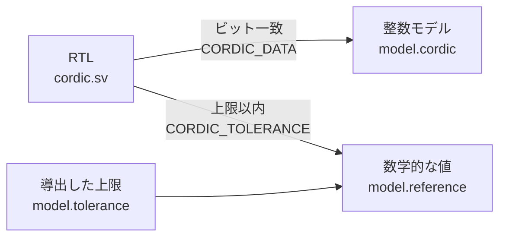

# CORDICを、ビット一致と、根拠のある許容誤差の2段で確かめる

CORDICは、シフトと加減算だけで回転・三角関数・大きさと角度を求める反復法です。結果は数学的な値の近似なので、「正しい」の意味が2つあります。

1. 回路は、決めたとおりの整数演算をしているか（**ビット一致**）。
2. その整数演算の結果は、数学的な値にどこまで近いか（**許容誤差**）。

この教材は、1クロックに1演算を受け付けるパイプラインのCORDIC（回転とベクタリング）を、この2段で確かめます。回路を数学的な値と許容誤差だけで比べると、丸めの1ビットの誤りや、反復を1回省いた誤りが許容の中に隠れます。逆にビット一致だけでは、整数演算そのものが目的の精度に届いているかが分かりません。判定の使い分けは[演算データパスの検証手順](../../docs/method/arithmetic-datapath-verification.md)にあります。



## 仕様

[`rtl/cordic.sv`](rtl/cordic.sv)は、`in_valid`が1のクロックの入力を受け付け、`ITER + 2`クロック後に`out_valid`を1クロックだけ1にして結果を出します。待たせる信号（ready）はなく、毎クロック受け付けられます。リセットは、パイプラインの途中にある演算を捨てます。

| 信号 | 幅 | 意味 |
| --- | --- | --- |
| `mode` | 1 | 0：回転、1：ベクタリング |
| `x_in`、`y_in` | 符号つき`WIDTH` | 入力のベクトル |
| `z_in` | 16 | 回転の角度。1周を65,536とする（`16'h4000`が90度）。ベクタリングでは無視する |
| `x_out`、`y_out` | 符号つき`WIDTH + 1` | 回転：回した後のベクトル。ベクタリング：`x_out`が大きさ、`y_out`は反復が残した成分（0に近い） |
| `z_out` | 16 | 回転：反復が回しきれなかった角度（0に近い）。ベクタリング：x軸からの角度 |

- **回転**：`(x_out, y_out)`は、`(x_in, y_in)`を`z_in`だけ反時計回りに回したものです。
- **ベクタリング**：`x_out`は`sqrt(x_in² + y_in²)`、`z_out`は`atan2(y_in, x_in)`です。大きさが0のベクトルの角度は規定しません。
- **出力の幅**：回したベクトルの成分は、入力の成分の最大値の√2倍まで伸びます。出力を1ビット広くしているので、飽和はありません。

### 回路の構成

| 段 | 内容 |
| --- | --- |
| 段0（折返し） | 反復が収束するのは、おおよそ±99.9度までです。回転では、角度が[−90度, 90度)の外なら、ベクトルを先に180度回し（xとyの符号を反転）、角度から180度を引きます。ベクタリングでは、`x_in`が負ならベクトルを180度回し、角度の初期値を180度にします |
| 段1〜`ITER`（反復） | 反復iは、ベクトルを`atan(2^-i)`だけ、角度（回転）または`y`（ベクタリング）を0へ近づける向きに回します。`x`・`y`・角度には、下位に`GUARD`ビットの余裕を持たせます。シフトは算術シフトで、切捨てです |
| 最終段（ゲイン補正） | 反復はベクトルを約1.6468倍に伸ばすので、`K = round(2^17 / ゲイン)`を掛け、四捨五入（中間は正の方向）して余裕のビットを落とします。角度も16ビットへ四捨五入します |

角度の表（`atan(2^-i)`を1周に対する比で表し、2³²倍して丸めた値）と`K`は、RTLに定数で書いてあります。セルフテストが、RTLの定数を、Pythonが`math.atan`と`math.sqrt`から計算した値と照合します。

## 期待値は3つに分ける

[`model.py`](model.py)は、役割の違う3つを別々に持ちます。

| 関数 | 何か | 何と比べるか |
| --- | --- | --- |
| `cordic` | RTLと同じ手順の整数演算（折返し、切捨てのシフト、表の値、ゲイン補正の丸め） | RTLの出力とビット一致 |
| `reference` | `math.sin`・`math.cos`・`math.hypot`・`math.atan2`で求めた数学的な値を、整数へ丸めたもの | RTLの出力と、上限の範囲で一致 |
| `tolerance` | 反復の回数とビット幅から導いた、`cordic`と`reference`の差の上限 | 測定値ではなく、下の式から計算する |

`cordic`は、RTLと同じ人が同じ手順で書いているので、手順そのものの誤り（表の値、折返しの向き）は共有しえます。それを見つけるのが`reference`との比較です。一方、`reference`との比較だけでは、許容の中に収まる誤りを見逃します。下の「意図的な誤実装」に、両方の例があります。

## 許容誤差の上限とその根拠

記号は次のとおりです。nは反復の回数（`ITER`）、Gは余裕のビット数（`GUARD`）、Rは入力のベクトルの長さ、Aはゲイン（n = 16で1.6467602…）です。角度の内部の単位は、1周の`2^-(16+G)`です。

### 回転

出力の各成分の誤差は、次の4項の和を超えません。

| 項 | 式 | 理由 |
| --- | --- | --- |
| 角度の残差 | `R × (z_left + n/2) × 2π / 2^(16+G)` | 反復が残す角度`z_left`と、表の各値が`atan(2^-i)`から最大0.5単位ずれることの積み重ね（n回で`n/2`単位） |
| シフトの切捨て | `E_shift / (2^G × A)` | 反復j（j ≥ 1）は、各成分から1単位未満を捨てます（ベクトルの長さで√2未満）。後の反復がそれを`√(1 + 4^-k)`倍ずつ伸ばすので、`E_shift = √2 × Σ_{j=1}^{n-1} Π_{k=j+1}^{n-1} √(1 + 4^-k)` |
| `K`の量子化 | `(A × R + E_shift / 2^G) × 2^-18` | `K / 2^17`は`1 / A`から最大`2^-18`ずれます |
| 丸め | `0.5 + 0.5` | 出力の四捨五入と、基準を整数へ丸めること |

`z_left`は、表の整数の値から漸化式で求めます。折返しの後の角度は90度以内です。反復iは角度を表の値`step(i)`だけ0へ近づけるので、反復の後の絶対値は`max(上限 − step(i), step(i))`を超えません。この上限は反復ごとに求まり、テストベンチが、RTLの各段が持つ角度をこの上限と比べます（`CORDIC_RESIDUAL`）。

| 構成 | n | G | 角度の残差 | シフト | `K` | 丸め | 合計 | 上限（切上げ） | 全角度で測った最大 |
| --- | --- | --- | --- | --- | --- | --- | --- | --- | --- |
| `w16-i16-g4`（R = 32767） | 16 | 4 | 2.75 | 0.81 | 0.21 | 1.00 | 4.76 | 5 | 2 |
| `w12-i12-g2`（R = 2047） | 12 | 2 | 1.32 | 2.37 | 0.01 | 1.00 | 4.71 | 5 | 2 |

「全角度で測った最大」は、長さRのベクトル`(R, 0)`を、16ビットの角度の全65,536通りで回したときの、整数モデルと数学的な値の差の最大です。上限は測定値の2.5倍で、この種の上限としては普通の緩さです。どの項も最悪の向きにそろうと仮定しているためです。入力の成分が両方とも最大のとき（R = 46340）は、同じ式で上限が6になります。上限は入力ごとに計算し、ベクトルの長さに比例する項を、その入力の長さで評価します。

回転で`z_out`に残る角度の上限は、`ceil((z_left + 2^(G-1)) / 2^G)`です（`w16-i16-g4`で1、`w12-i12-g2`で6）。

### ベクタリング

ベクタリングは、`y`の符号を見て回す向きを決めます。シフトの切捨てで`y`の符号を見誤ることがあり、それは真の`y`が切捨ての誤差`E_shift / 2^G`より小さいときだけです。このとき、ベクトルの向きの残り`ψ`は、`asin(E_shift / (2^G × R))`以内です。これを収束の条件（`atan(2^-i)`は、それより後の反復の角度の和と最後の角度の和を超えない）と合わせると、最後に残る向きは次の値を超えません。

`ψ_max = atan(2^-(n-1)) + asin(E_shift / (2^G × R))`

| 出力 | 上限 |
| --- | --- |
| 大きさ `x_out` | `R × (1 − cos ψ_max)` ＋ シフト ＋ `K` ＋ 丸め |
| 残り `y_out` | `R × sin ψ_max` ＋ シフト ＋ `K` ＋ 丸め |
| 角度 `z_out` | `(ψ_max の内部単位 + n/2) / 2^G + 1`（16ビットへの丸めと、基準の丸め） |

角度の上限は、ベクトルが短いほど大きくなります。`E_shift / 2^G`以下の長さのベクトル（`w16-i16-g4`で長さ1.33以下、`w12-i12-g2`で3.91以下）は、切捨ての誤差に埋もれて向きが決まらないので、角度の上限を半周（検査なし）とします。大きさが0のベクトルもここに入ります。

| 構成 | R | 大きさ | 残り | 角度 | 円周上の掃引で測った最大（大きさ／残り／角度） |
| --- | --- | --- | --- | --- | --- |
| `w16-i16-g4` | 32767 | 3 | 5 | 3 | 1／1／1 |
| `w12-i12-g2` | 2047 | 4 | 9 | 28 | 1／1／8 |

### 上限が緩すぎないことの確認

導出した上限は安全側なので、それだけでは「テストベンチの許容誤差の検査が実際に効いている」ことを示せません。そこで、次の2つを分けて確かめます。

- **上限は破られない**：セルフテストが、回転の全65,536角度と、両モードのランダムな入力で、整数モデルの誤差が上限以内であることを確かめます。測った最大の3倍が上限以上であること（上限が桁違いに緩くないこと）も確かめます。
- **検査は1単位で効く**：ケース`limit-observed`は、許容誤差を「4,096角度の組で測った最大の誤差」（両構成とも2）まで狭めて実行し、合格します。ケース`limit-one-less`は、それをさらに1だけ狭めて実行し、`CORDIC_TOLERANCE`で不合格になることを要求します。対象は正しい回路です。

つまり、合否に使う上限は式から導いた値で、測った最大はそれより小さく、テストベンチの比較はその1単位を区別できます。測った最大を上限として採用しているわけではありません。

## 検証すること

テストベンチ[`tb/cordic_tb.sv`](tb/cordic_tb.sv)は、ベクトルファイルの1行を1クロックとして読み、出力が有効な行で次の順に検査します。

| ラベル | 検査 |
| --- | --- |
| `CORDIC_VALID` | `out_valid`が、予定したクロックだけ1である（早い・遅い・余分・欠落） |
| `CORDIC_UNKNOWN` | 有効な出力にXやZがない |
| `CORDIC_TOLERANCE` | `x_out`・`y_out`・`z_out`が、数学的な値から上限以内にある（角度は円周上の距離） |
| `CORDIC_DATA` | 3つの出力が、整数モデルとビットごとに一致する |
| `CORDIC_RESIDUAL` | 回転の演算が通る各段の角度が、その段の上限以内にある（RTLの内部を参照） |

待ち合わせのないテストベンチなので、テストベンチ自身のタイムアウトはありません。時間切れは、ランナーのコマンドの上限で判定します。

### ケース

| ケース | 内容 |
| --- | --- |
| `boundaries` | 固定の55演算。回転は、4象限、折返しの境界のちょうど（`4000`・`c000`）と前後1単位、0と半周、成分の最大・最小の組合せ。ベクタリングは、軸上、4象限、大きさ0、向きが決まらない短いベクトル、成分の最大・最小。モードを交互に連続で入れ、パイプラインが詰まった状態でリセットします |
| `sweep-rotation` | `(R, 0)`を回す角度の掃引。smokeは16おき（4,096角度、開始位置はseedで変わる）、nightlyは**16ビットの全65,536角度** |
| `sweep-vectoring` | 半径Rの円周上の点のベクタリング。smokeは16おき、nightlyは4おき（16,384点） |
| `random-seedN` | 両モード、全範囲の入力、15%は短いベクトル、演算の間の空きクロック、途中のリセット。smokeは200演算×1 seed、nightlyは2,000演算×3 seed |
| `limit-observed`・`limit-one-less` | 上の「検査は1単位で効く」の2ケース |
| `detect-mutationN` | 下の誤実装6種類を、`boundaries`の入力で実行 |

`in_valid`が0のクロックでは、入力に無関係な値を与えます。受け付けてはいけない値です。

### 要求と目標

[`requirements.json`](requirements.json)は5要求・27目標です。すべての目標に、`boundaries`と`limit-observed`の固定の入力で届きます（ランダムに頼りません）。

| 要求 | 目標 |
| --- | --- |
| `CORDIC-ROTATE` | 4象限、角度0、半周、成分の最小値、両成分が最大 |
| `CORDIC-VECTOR` | 4象限、x軸の正と負、y軸、大きさ0、短いベクトル |
| `CORDIC-FOLD` | 回転の折返し、境界のちょうどと1単位内側、ベクタリングの折返し |
| `CORDIC-ERROR` | 整数モデルと数学的な値が食い違う出力がある（`error/inexact`）、誤差が許容誤差にちょうど届く（`error/at-limit`） |
| `CORDIC-CONTROL` | 連続する受付、演算の間の空き、モードの交互、演算が残っている状態でのリセット |

`error/at-limit`に届くのは`limit-observed`だけです。導出した上限には、正しい回路は届かないからです。

## 意図的な誤実装

| 変異 | 内容 | `boundaries`で検出する検査 |
| --- | --- | --- |
| 1 | 最後の反復が何もしない | `CORDIC_DATA` |
| 2 | 折返しでxだけ符号を反転する | `CORDIC_TOLERANCE` |
| 3 | 反復3の角度の表の値が、16ビットの角度で1単位大きい | `CORDIC_DATA` |
| 4 | ゲイン補正が、四捨五入ではなく切捨て | `CORDIC_DATA` |
| 5 | ベクタリングが逆向きに回す | `CORDIC_TOLERANCE` |
| 6 | `out_valid`が1クロック早い | `CORDIC_VALID` |

変異1・3・4は、数学的な値からの差が上限の中に収まります。許容誤差の検査は通り、ビット一致の検査だけが見つけます。反復を1回省く（変異1）のは精度を落とす誤りですが、16回の反復のうち最後の1回の寄与は、導出した上限の余裕より小さいためです。許容誤差だけで判定していると、この3つは合格します。

変異2と5は、整数モデルにも同じ誤りを入れれば、ビット一致の検査を通ります。数学的な値との比較は、モデルとRTLが同じ誤りを共有する場合の備えです。

## 実行

Python 3.9以上とIcarus Verilogを使います。

```sh
python3 examples/local-cordic/run.py --out artifacts/local-cordic
python3 examples/local-cordic/run.py --profile nightly --out artifacts/local-cordic-nightly
python3 examples/local-cordic/run.py --configuration w12-i12-g2 --demo-bug 3 --out artifacts/local-cordic-demo
python3 -m unittest discover -s examples/local-cordic/tests
```

`--seed`（既定17）は、ランダムの入力と、smokeの掃引の開始位置を決めます。`--iterations`はランダムの演算数です。`--timeout`は1コマンドの上限で、この例の既定は60秒です（nightlyの掃引は1ケースで65,536演算を実行するため）。`--demo-bug 1`〜`6`は、通常のケースにも変異を入れ、終了コード1になることを確かめるためのものです。

JUnitは、2構成でsmoke 26件、nightly 30件です（構成ごとに、固定1、掃引2、ランダム1／3、上限の確認2、変異6、要求と目標の判定1）。

出力には、ケースごとの`vectors.txt`・`simulation.log`・`result.json`・`wave.vcd`と、全体の`manifest.json`・`coverage.json`・`summary.json`・`junit.xml`があります。波形は、長い掃引では最初の4,096行だけを記録します。共通ランナーは全ケースの入力を`manifest.json`へ写すので、nightlyの`manifest.json`は約55 MBになります。

## 確認範囲と残る制限

- **上限の導出**は、この教材で行ったもので、文献の式と照合していません。回転の上限は、各項を最悪の向きに足した安全側の値です。ベクタリングの`ψ_max`の導出は、「回す向きを誤るのは、真の`y`が切捨ての誤差より小さいときだけ」という議論に依っています。セルフテストは、ランダムな入力と円周上の掃引で破られないことを確かめていますが、全入力の証明ではありません。
- **全数は角度だけ**です。回転は`(R, 0)`を全65,536角度で回します。`x`・`y`・角度のすべての組（2⁴⁸通り）は実行していません。ベクタリングの掃引は、1つの半径の円周上だけです。
- **基準の精度**は、Pythonの`math`（倍精度）です。整数へ丸める境界のごく近くでは、基準が1ずれえます。上限の「丸め」の項は、基準を整数へ丸めることを含みますが、倍精度の誤差そのものは見込んでいません（`w16-i16-g4`の値の範囲では、10⁻¹⁰程度です）。
- **フォーマルは使っていません**。整数モデルとRTLの一致は、シミュレーションで与えた入力の範囲です。
- 双曲線・線形のモード、反復を使い回す逐次型の構成、待ち合わせ（ready）、飽和は扱いません。`GUARD`は1以上が必要です。`ITER`は20までの表を持ちますが、実行したのは12と16だけです。
- `CORDIC_RESIDUAL`の検査は、テストベンチがRTLの内部の配列（`dut.z`・`dut.valid`・`dut.m`）を読みます。
- Linuxとkirimasimでは実行していません。

## 確認記録

2026-11-21に、macOS arm64、Python 3.13、Icarus Verilog 14.0開発版（`ca6b8d3`）で実行しました。

- smoke（seed 17・3・100）とnightly（seed 17）が合格しました。JUnitは26件／30件、両構成で27／27目標、変異は6種類を2構成で12件検出、`limit-one-less`は2件とも`CORDIC_TOLERANCE`で不合格でした。nightlyで最も長いケースは、全角度の掃引で約7〜15秒です（ほかの実行と重なった状態での値）。
- セルフテスト14件が合格しました（約40秒。回転の全角度と反復ごとの残差を、Pythonのモデルで2構成とも確かめる時間を含みます）。
- RTLは、2構成と変異0〜6で、Verilator 5.052の`--lint-only --Wall`の警告が0件です。
- 既存の変異とは別に、作業用の写しのRTLへ小さな誤りを11個入れてsmokeにかけました。10個は通常のケースが不合格になりました（折返しの条件・符号・角度、回す向き、算術シフトを論理シフトにする、`K`を1大きくする、表の値を1単位ずらす、リセットで`valid`を消さない、角度の丸めを外す、モードを段ごとに運ばない）。`K`を1大きくした誤りは、`boundaries`の固定の入力では出力が変わらず、掃引とランダムが見つけました。残る1個は、角度の表の値の下位の桁だけを変えたもので、丸めた後の値が変わらず、動作に差が出ません。
