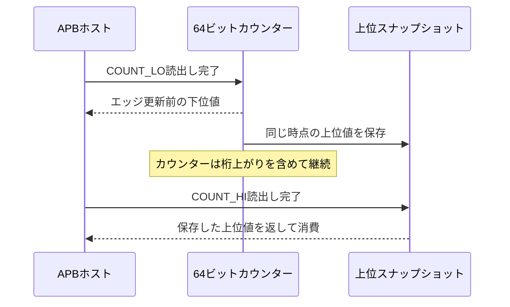
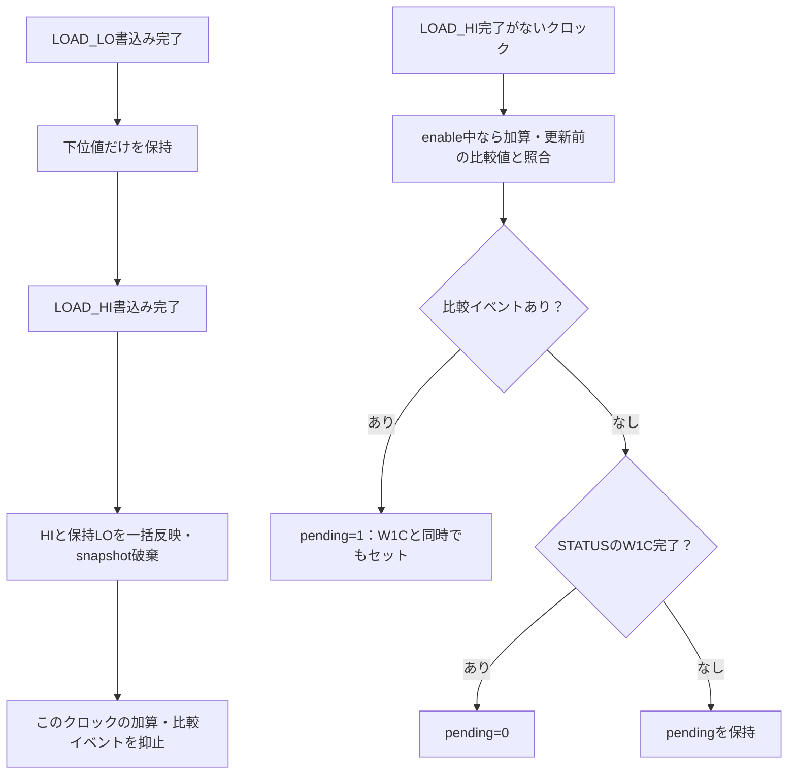

# 64ビットカウンターを32ビットAPBから一貫して読む

カウンターが動き続ける間の下位32ビットの桁上がりと、上下を別々に読むアクセスを組み合わせます。下位読出し時に上位を保存する、教材独自のスナップショット方式です。

## スナップショットの時点



新しいCOUNT_LO読出しはスナップショットを上書きし、COUNT_HIは保存済み値を消費します。保存済み値がなければ現在の上位を返します。ホストはLO→HIの順で1組を読みます。複数ホストが同じスナップショットを競合して使う仕様ではありません。

| 番地 | 操作 | 動作 |
| --- | --- | --- |
| 0x00／0x04 | COUNT_LO／HI・RO | 上記のスナップショット読出し |
| 0x08／0x0C | LOAD_LO／HI・WO | LOを保持し、HI書込みで64ビットを一括反映 |
| 0x10／0x14 | COMPARE_LO／HI | LOを保持し、HI書込みで比較値を一括反映。読出しは確定済み値 |
| 0x18 | CONTROL | bit0=count enable、bit1=IRQ enable |
| 0x1C | STATUS | IRQ pending。bit0へのW1Cでクリア |

カウンターはenable中に1ずつ進み、64ビットで折り返します。次の値が確定済み比較値に等しくなるとpendingをセットします。LOAD_HI完了は加算と比較イベントより優先します。W1Cと比較イベントが同時ならイベント優先です。過去の比較値を設定しただけでは即座にIRQを出す仕様ではありません。

## 桁上がりを挟んだ読出しと書込みの確定

次の表は、LO／HIの間に上位32ビットが変わる例です。APBのSETUP・待ちサイクルは省略し、読出しが完了する時点の値を示します。

| 観測時点 | 実カウンター | 保存した上位 | ホストの読出し値 |
| --- | --- | --- | --- |
| COUNT_LO読出し完了直前 | `0x00000005_FFFFFFFE` | この完了で`0x00000005`を保存 | LO=`0xFFFFFFFE` |
| その後の加算 | `0x00000006_00000002` | `0x00000005`のまま | 読出しなし |
| 続くCOUNT_HI読出し完了直前 | 上位は`0x00000006`へ更新済み | 完了まで`0x00000005`を維持 | HI=`0x00000005`を返して消費 |

組み立てた値は`0x00000005_FFFFFFFE`で、LOを読んだ時点の64ビット値です。間に別のCOUNT_LO読出しやリセット・LOAD_HI書込みを入れると、保存値の上書き・破棄が起きるため、この手順の条件を外れます。



図はリセット解除中の優先関係です。LOAD_LOだけではカウンターをロードせず、enable中の加算は続きます。COMPAREもLOを保持してHIで一括反映し、その完了クロックの比較には更新前の比較値を使います。

## 確認と実行

Pythonの広い整数と64ビットマスクから、APBの応答、カウンター、スナップショット、IRQを毎クロック予測します。下位の桁上がりを挟むLO／HI、64ビット全体の折返し、書込み途中の保持、比較とクリアの競合、リセットを検査します。桁上がりと全体折返しのカバレッジは、有効な加算で実際に境界を越えた場合だけを数え、LOAD_HIやリセットによる値の変化では加算しません。

```sh
python3 examples/local-counter-snapshot/run.py --out artifacts/counter-snapshot
python3 examples/local-counter-snapshot/run.py --profile nightly
python3 -m unittest discover -s examples/local-counter-snapshot/tests -v
```

[共通手順](../local-common/README.md)を使います。APB待ち0／2の各10目標。smoke20操作列、nightly150列×3 seedを固定シナリオへ加えます。上位の生値読出し、下位だけの加算、クリア誤優先、LOAD_LOの早期反映の4変異です。JUnit14／18件、確認6件。実時間精度・クロック誤差・CPU命令の原子性・特定製品のタイマー互換性は対象外です。
