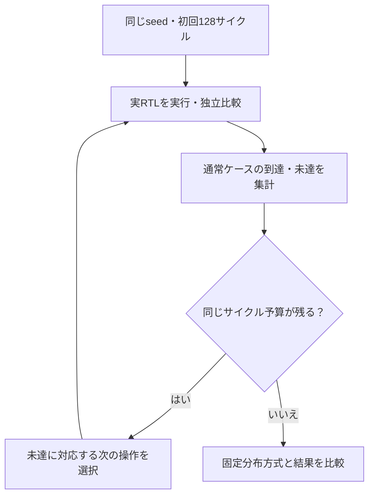

# 観測したカバレッジから次の刺激を選ぶ

既存の[AXI4-Stream FIFO](../local-axis/README.md)を使い、固定分布のランダム刺激と、未達目標に応じて操作列を変える方式を比較します。必要な11目標は既存カタログをそのまま使います。

## 未達目標を次の刺激へ戻す

合格した実RTLの観測から未達を求め、比較基準を固定したまま次バッチの刺激だけを変更します。



固定分布側の未達も比較結果として残します。両方式とも最終到達した実行記録から、一般的な性能優位は主張しません。

| 確認する場面 | 期待する動作 | 主な照合対象 |
| --- | --- | --- |
| 固定分布方式 | 分布を維持して次のランダム列を生成 | 同じサイクル予算 |
| フィードバック方式 | 未達に対応する操作を選ぶ | 選択履歴と実観測 |
| どちらの方式も | データ・順序・保持の比較を継続 | 失敗実行は到達へ加算しない |

## 比較の進め方

1. 両方式で同じseedの最初の128サイクルを実行します。
2. 合格した実RTL実行の`COVER`ログから、各方式の到達と未達を求めます。
3. 固定分布の方式は次のランダム列へ進みます。フィードバック方式は未達のTKEEP、パケット長、停止、途中リセットに対応する操作を選び、残りをランダムデータで埋めます。
4. 同じサイクル予算まで実行し、目標数、未達、経過時間と選択履歴を保存します。

ランダム方式もTKEEPが0のビート、キューにデータがある状態でのリセット、出力済み途中パケットのリセットを生成できます。出現確率は低めに固定してあり、比較結果はこの分布と教材回路についてのものです。フィードバック方式が常に速い、少ないseedで十分、といった一般的な性能保証はしません。初回から全目標に到達すれば追加の誘導は不要です。

両方式の予算は**実際にチェックしたRTLサイクル数**です。経過時間には初回のビルドが含まれるため、その値をそのまま速度比較には使いません。ビルドの実行時間は別の記録にも残します。smokeは各384サイクル、nightlyは各768サイクル×3 seedです。最終バッチの末尾で保留中の通信は次のバッチへ引き継がず、各バッチをリセットから始めます。全送信の排出を要求するスループット試験ではありません。

## 判定と実行

終了コード、予定の比較数・転送数、VCDを確認します。失敗した実行の到達は加算しません。フィードバック方式は11目標すべての到達が必須で、固定分布側の未達は比較結果として保存します。到達数だけでなく、既存のデータ・順序・保持チェッカーも毎回有効です。4種類の変異の検出を別枠で実行し、その到達で不足を埋めません。

```sh
python3 examples/local-coverage-feedback/run.py --out artifacts/coverage-feedback
python3 examples/local-coverage-feedback/run.py --profile nightly --seed 42
python3 -m unittest discover -s examples/local-coverage-feedback/tests -v
```

Python 3.10以上とIcarusを使います。追加パッケージは不要です。`coverage.json`にバッチ前の未達、選択方式、実観測、予算と時間、`executions.json`に全実行を保存します。ログ、ベクトル、VCD、ビルド・ソースの版も残ります。JUnitはsmoke 8件、nightly 16件です。

ここでいうカバレッジは手続き的な機能目標の集計です。SystemVerilogのcovergroup DBや、シミュレータ内部のコードカバレッジを使う誘導探索ではありません。分布を調整しても、独立した期待値の比較と完了条件は変更しません。

2026-10-27のseed 17では初回8／11目標で、次バッチに残る3目標を誘導しました。nightlyのseed 18／19でも未達に応じた選択を確認しました。今回の最終到達は両方式とも11／11で、速度や予算削減の優位は主張しません。
