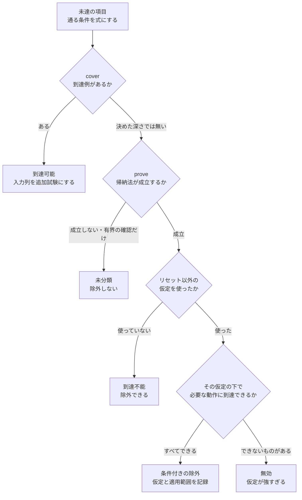

# コードカバレッジの未達を、到達例と到達不能の証明で分類する

コードカバレッジの未達には、試験が足りないだけの項目と、どんな入力でも通らない項目が混ざっています。前者は試験を足し、後者は根拠を付けて必須から外します。この教材では、[コードカバレッジの例](../local-code-coverage/README.md)の基礎試験で残る未達を、フォーマルの`cover`（到達例が得られる）と`prove`（到達しないことの証明）で分類します。除外は[台帳](exclusions.json)に記録し、証明・仮定・ソースのハッシュ・ツールの版が今回の実行と合っているかを検査します。

考え方は[コードカバレッジの手法](../../docs/method/code-coverage.md#3-未達を分析し必要な試験へ戻す)にあります。この教材は、そこで「到達不能の根拠を示せる」とした部分の実行例です。商用の到達不能解析ツールの代わりではありません。

## 分類の規則



| フォーマルの結果 | 分類 | 扱い |
| --- | --- | --- |
| `cover`が到達例を出した | 到達可能 | 入力列を保存し、追加試験の材料にする。除外しない |
| `cover`は決めた深さで未達、`prove`が帰納法で成立、仮定はリセットだけ | 到達不能 | 台帳に記録して必須から外せる |
| 同上で、契約上の仮定（機能モードなど）を使った。その仮定の下で、必要な動作はすべて到達できる | 条件付きの除外 | 仮定と適用範囲を台帳に記録する。仮定が成り立たないモードには使えない |
| `cover`は未達だが、`prove`が成立しない（帰納法が終わらない、有界の`bmc`が通っただけ、証明を実行していない） | 未分類 | 除外しない。深さを増やす、補助の不変条件を証明する、試験を足す、のどれかへ進む |
| `prove`は成立したが、使った仮定の下で必要な動作の一部に到達できない | 無効 | 仮定が強すぎる。その証明を除外の根拠にしない |
| ツールのエラー、時間切れ、ログや証人ファイルの欠落、コンパイルされた仮定の過不足 | エラー | どの分類にも数えない。実行は不合格 |

「決めた深さで到達しなかった」ことと「到達しない」ことは別です。到達不能と言えるのは、帰納法の証明が成立したときだけです。

## 対象

2つの回路を使います。

| 回路 | 役割 | カバレッジの実測 |
| --- | --- | --- |
| [`command_unit.sv`](../local-code-coverage/rtl/command_unit.sv)（コードカバレッジの例のRTL。変更しません） | 実測した未達を1件ずつ分類し、到達例をシミュレーションへ戻す | Verilator 5.052で実測 |
| [`guarded_unit.sv`](rtl/guarded_unit.sv)（この例のRTL） | 証明に補助が要る項目、深い位置にある項目、仮定つきの項目と、2種類の負例 | 実測しません。ソースのコメントのラベル（`GU_*`）で項目を指します |

`guarded_unit`は、`command_unit`と同じ「要求を受け、許可があれば演算し、なければ拒否する」回路に、次の3つを足したものです。

- **`GU_STALL`**：応答を`resp_ready`なしで12サイクル待つと`stalled`を立てます。リセットから15ステップかかります。
- **`GU_GUARD`**：待ちのカウンター`held`が上限以上なら`fault`を立てる、防御用の検査です。カウンターは上限の手前で止まるので、この分岐は通りません。
- **`GU_TEST`**：`test_mode`が1のときだけ、固定のパターンを返します。機能モードでは`test_mode`を0に固定する契約です。

### 項目と式

[`items.json`](items.json)が項目の表です。各項目は、対象の回路、その項目を通る条件の式、探索の深さ、使う仮定と補助、期待する分類を持ちます。実測する回路の項目は、Verilatorのポイント（種類・行・名前）も持ちます。

式は「そのクロックの立ち上がりで、その文が実行される条件」を、エッジの前の値で書いたものです。たとえば25行目の`else`（応答の保持）は`rst_n && state==RESP && !resp_ready`です。

ランナーは、RTLのコピーの最後の`endmodule`の前に、仮定と検査の文を足します。リポジトリのRTLは書き換えません。

```systemverilog
 reg f_past=1'b0;
 always @(posedge clk)begin
  f_past<=1'b1;
  if(!f_past)as_initial_reset:assume(!rst_n);
  if(f_past)begin
   target:cover(rst_n && state==RESP && !resp_ready);   // proveでは assert(!(...))
  end
 end
```

最初のステップでリセットをかける仮定`as_initial_reset`は、すべてのタスクに入ります。これも仮定なので、台帳に記録します。

## 検証すること

### 1. 実測した未達と項目の対応

コードカバレッジの例と同じ方法（同じRTL、同じ[C++ハーネス](../local-code-coverage/sim_main.cpp)、同じ計測オプション、同じ基礎試験）で、8ビットの構成を実測します。機能比較に合格したDBだけを使います。基礎試験の未達は、行2、分岐4、FSM状態1、FSM遷移3の計10件です。この10件と、実測する回路の10項目が1対1に対応することを要求します。対応する項目のない未達や、未達でなくなった項目があれば不合格です。

式（3件）とtoggle（41件）の未達は、この教材では分類しません。件数だけを記録します。

### 2. 分類

| 項目 | 回路の箇所 | 分類 | 根拠 |
| --- | --- | --- | --- |
| `cu-branch-l20-else` | 許可のない要求が`DENY`へ進む分岐 | 到達可能 | 3ステップの到達例 |
| `cu-branch-l25-else`・`cu-fsm-arc-resp-resp` | 応答の保持 | 到達可能 | 5ステップ |
| `cu-branch-l38-if` | XORの演算 | 到達可能 | 4ステップ |
| `cu-branch-l43-if`・`cu-line-l24`・`cu-fsm-state-deny`・`cu-fsm-arc-deny-resp` | 拒否の経路と`DENY`状態 | 到達可能 | 各4ステップ |
| `cu-line-l26-default`・`cu-fsm-arc-default-idle` | `case`の`default`と、ツールが作るその遷移 | 到達不能 | 帰納法の証明。2ビットの状態の4つの値を、`default`の前にすべて列挙している |
| `gu-deny` | `GU_DENY` | 到達可能 | 4ステップ |
| `gu-stall` | `GU_STALL` | 到達可能 | 深さ24で探索し、15ステップの到達例 |
| `gu-guard` | `GU_GUARD` | 到達不能 | 帰納法の証明。補助`ah_held_in_range`（`held<LIMIT`）を同じタスクで証明する |
| `gu-test` | `GU_TEST` | 条件付きの除外 | 仮定`as_functional_mode`（`!test_mode`）の下での証明。機能モードに限る |

`default`の2件は、コードカバレッジの例が[計画](../local-code-coverage/coverage-plan.json)の`not_required`に文章の理由を付けて分けている2件と同じものです。この教材は、その理由に証明を付けます。

### 3. 到達例をシミュレーションへ戻す

実測する回路の到達可能な8項目は、到達例の入力列を証人ファイルから取り出し、シミュレーションのベクトルにして実行します。期待値は、コードカバレッジの例のPythonモデルが入力から独立に求めます。機能比較に合格することと、その項目のVerilatorのポイントが実際にヒットすることを要求します。式の書き間違いで別の箇所へ到達していた場合は、ここで不合格になります。

基礎試験と8件の再実行のカウンターを足した後、行・分岐・FSMの未達に残るのは2件です。この2件が、台帳の除外、コードカバレッジの例の`not_required`の両方と一致することを確かめます（`measured-closure`）。

到達例は、条件を満たす最短に近い入力列です。値の比較は行いますが、境界値や組合せを狙った試験ではありません。追加試験を作るときの出発点として使います。

### 4. 負例：有界の未達を到達不能と読み替えない

`gu-stall-shallow`は、`GU_STALL`を深さ8で調べる診断用の項目です。

| タスク | 結果 | 読み方 |
| --- | --- | --- |
| `cover`（深さ8） | 未達 | 8ステップでは届かないだけ |
| `bmc`（深さ8） | 合格 | 8ステップまでは通らない、という有界の確認 |
| `prove`（深さ8） | 基本ケースは合格、帰納法は不成立（SBYの状態は`UNKNOWN`） | 証明になっていない |
| `cover`（深さ24、項目`gu-stall`） | 15ステップで到達 | 実際には到達可能 |

最初の3つがそろっても、分類は「未分類」です。`bmc`の合格を根拠にした台帳の行は、`LEDGER_BOUNDED_ONLY`で拒否します。

`gu-guard-no-helper`は、`GU_GUARD`を補助なしで証明しようとする項目です。この分岐は実際に到達不能ですが、帰納法は終わりません。リセットから到達できない状態（待機中に`held`が上限以上）から始まる反例が、何ステップでも作れるためです。分類は「未分類」のままで、補助の不変条件`held<LIMIT`を**証明する**（仮定しない）と、初めて到達不能になります。

### 5. 負例：強すぎる仮定で到達不能に見える

`gu-deny-overconstrained`は、「要求は常に許可されている」という仮定`as_always_permitted`を置いて`GU_DENY`を調べます。`prove`は成立します。しかし、同じ仮定の下で必要な動作（演算、拒否、応答の保持、待ちすぎの検出）の到達を調べると、拒否（`g_deny`）に到達できません。仮定が必要な動作を消しているので、分類は「無効」です。仮定を外した`gu-deny`は、4ステップで到達します。

契約上の仮定`as_functional_mode`では、同じ4つの動作にすべて到達できます。この違いで、契約の仮定と強すぎる仮定を分けます。

必要な動作の一覧は、仕様から人が決めて[`items.json`](items.json)の`goals`に書きます。一覧に漏れがあれば、強すぎる仮定を見逃します。

### 6. 除外の台帳の検査

[`exclusions.json`](exclusions.json)は4件の除外を持ちます。1件ごとに、項目、対象ソースのSHA-256、式のSHA-256、証明タスクの名前・方式・エンジン・深さ、仮定、補助、理由、レビュー日、失効条件を記録します。実測した項目はVerilatorのポイントも記録します。ツールの版（Yosys 0.70、Z3 4.15.3）は台帳の先頭にあります。

今回の実行の結果と照合し、次のどれかがあれば不合格にします。

| 検査ラベル | 不合格にするもの |
| --- | --- |
| `LEDGER_NO_PROOF` | 証明の記録がない。今回の実行で証明が成立していない。別のタスクやエンジンを指している |
| `LEDGER_STALE_SOURCE`・`LEDGER_STALE_EXPRESSION` | 対象のRTL、または項目の式が、記録の後で変わった |
| `LEDGER_ASSUMPTIONS`・`LEDGER_HELPERS` | 仮定や補助の記録がない。コンパイルされたモデルの仮定・補助と一致しない |
| `LEDGER_REACHABLE` | 到達例のある項目を除外している |
| `LEDGER_BOUNDED_ONLY` | 有界の確認だけ、または未分類の項目を除外している |
| `LEDGER_OVERCONSTRAINED` | 無効な仮定に頼る証明で除外している |
| `LEDGER_TOOL_VERSION`・`LEDGER_POINT`・`LEDGER_NO_REVIEW`・`LEDGER_UNKNOWN_ITEM` | ツールの版の違い、ポイントの違い、理由・レビュー・失効条件の欠落、項目表にない項目や重複 |

ランナーは、台帳のコピーを6通りに書き換え、それぞれが予定のラベルで拒否されることも確かめます（証明の削除、古いハッシュ、仮定の削除、到達可能な項目の追加、有界の確認だけの項目の追加、強すぎる仮定の項目の追加）。除外できる分類になった項目と、台帳の項目が一致することも要求します。

仮定の一覧は、タスクの定義からではなく、Yosysが実際にコンパイルしたモデルの`assume`の一覧から取ります。仮定が1つ増えても減っても、そのタスクはエラーになります。

## 実行

Verilator 5.052、C++20コンパイラーとmake、[共通フォーマル手順](../local-formal-common/README.md)の固定版のYosys・SBY・Z3が要ります。リポジトリのルートで実行します。

```sh
. artifacts/toolchains/formal-venv/bin/activate
python3 examples/local-coverage-unreachable/run.py --out artifacts/coverage-unreachable
python3 examples/local-coverage-unreachable/run.py --profile nightly --out artifacts/coverage-unreachable-nightly
python3 -m unittest discover -s examples/local-coverage-unreachable/tests -v
```

nightlyは、到達可能な10項目について逆向きのタスク（通らないことの`prove`）も実行し、リセットからの反例で否定されることを確かめます。乱数は使わないので、`--seed`は結果を変えません。

`--timeout`（シミュレーションと版の取得）、`--build-timeout`（Verilatorのビルド）、`--formal-timeout`（SBYの1タスク）、`--jobs`（並列数）、`--verilator`、`--sby`、`--yosys`、`--smtbmc`、`--witness`、`--out`を指定できます。既存の出力先は上書きしません。

`--ledger`で別の台帳を検査できます。到達可能な`gu-deny`を除外に足した台帳を渡すと、`ledger-accepted`が`LEDGER_REACHABLE`で失敗し、終了コードは1になります。

## 合格条件と証跡

予定した検査は、smoke 42件、nightly 52件です。すべてが完了し、合格したときだけ終了コードが0になります。[要求カタログ](requirements.json)は8要求で、各検査はどれか1つの要求に属します（`UR-CROSS`はnightlyだけ）。どの要求にも属さない検査や、対応する検査のない目標があれば、実行の前にエラーにします。

出力先には次を保存します。

- `manifest.json`：項目表、全タスクの定義、検査の一覧、入力のSHA-256（この例の4ファイルとRTL、コードカバレッジの例のRTL・ハーネス・計画・ランナー）。
- `tools.json`と版のログ。
- `measured-baseline/`、`replay-*/`：ベクトル、ログ、波形、`coverage.dat`。
- `tasks/<タスク>/`：検査を足したRTLのコピー、`task.sby`、SBYの作業ディレクトリ（ログ、反例・到達例のVCDと証人ファイル）、`result.json`。到達例には、入力列を取り出した`reach-inputs.json`があります。
- `classification.json`：項目ごとの分類と、`cover`・`prove`の結果、仮定、補助、ポイント。
- `ledger-audit.json`、`coverage.json`、`summary.json`、`junit.xml`。

## 確認範囲

2026-11-20に、macOS arm64のPython 3.14、Verilator 5.052、YoWASP版Yosys 0.70（SBYを含む）、Z3 4.15.3で、smoke 42件とnightly 52件、セルフテスト21件が成功しました。分類は、到達可能10、到達不能3、条件付きの除外1、未分類2、無効1です（未分類と無効の3件は、負例として用意した診断用の項目です）。`--ledger`に書き換えた台帳を渡した実行が、終了コード1になることも確かめました。`guarded_unit.sv`は、Verilatorのlint（`-Wall`）で警告0件、Icarus Verilog 14とYosysでも読めます。Linuxでは実行していません。

この教材で確かめていないことは次のとおりです。

- 式とtoggleの未達は分類していません。コードカバレッジの例のうち、行・分岐・FSMの10件だけが対象です。16ビットの構成も対象外です。
- 項目の式は、人がソースを読んで書いています。Verilatorのポイントから式を自動で作る仕組みではありません。実測する回路では、到達例の再実行が式の誤りを検出しますが、到達不能の項目の式は再実行で確かめられません。式が狭すぎれば、通る箇所を到達不能と証明してしまいます。レビューの対象です。
- `guarded_unit`のカバレッジは実測していません。4つのラベルとVerilatorのポイントの対応は確かめていません。
- 単一クロック・2値のモデルです。XやZ、非同期リセット、複数クロックは扱いません。2値では到達しない`default`も、Xの伝搬や故障注入では通ることがあります。保護用の経路は、除外する前に、故障注入で確かめる必要がないかを判断します。
- 証明は、リセットを最初にかけるという仮定の下のものです。リセットなしで使う回路には当てはまりません。
- エンジンはZ3を使うSMTの有界検査と帰納法の1種類です。大きな回路では、どちらも終わらないことがあります。その場合は「未分類」になり、除外はできません。
- 商用の到達不能解析ツールや、カバレッジのデータベースへ除外を自動で反映する機能の代わりではありません。

## 参考にした一次資料

- [SBYの文書](https://yosyshq.readthedocs.io/projects/sby/en/latest/)：`cover`・`prove`・`bmc`の各モードと、結果の状態。
- [Yosysの文書](https://yosyshq.readthedocs.io/projects/yosys/en/latest/)：モデルの読込みと、証人ファイルの形式。
- [Verilatorのカバレッジの説明](https://verilator.org/guide/latest/simulating.html#coverage-analysis)：行・分岐・FSMのポイントの定義。
- [コードカバレッジの手法](../../docs/method/code-coverage.md)、[フォーマル検証の手法](../../docs/method/formal-verification.md)：除外の記録と、仮定・有界検査の読み方。
