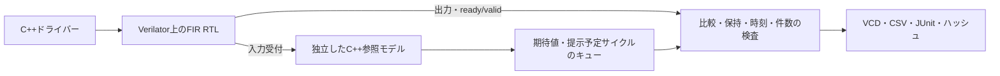

# C++参照モデルとストリーミングFIR RTLの照合

入力を受け付けたときだけ更新するC++参照モデルと、実際のFIR RTLをVerilator上で接続する例です。参照モデルはRTLのクロック・レジスター・待ちカウンターを再現せず、受理したサンプル列から結果を計算します。[検証手順](../../docs/method/cpp-reference-verification.md)、[既存の固定小数点DSP例](../local-dsp/README.md)も参照してください。

## 構成



| 項目 | 仕様 |
| --- | --- |
| 演算 | 3タップFIR、`(3*x[n] - 2*x[n-1] + x[n-2])/4` |
| 数値表現 | 符号付き8／12ビット。最近接丸め、ちょうど中間ならゼロから遠い側へ丸め、同じ幅へ飽和 |
| 履歴 | 入力の受付時だけ進め、リセットで0へ戻す |
| 接続 | 入出力ともready/valid。待ち中は有効信号とデータを保持 |
| 未完了数 | 1件。出力受付と次入力受付は同時に可能 |
| 構成 | `w8-lat1`と`w12-lat3`。LATENCY=3は単一未完了の処理待ちを持つ |
| リセット | 未完了結果を中断し、演算履歴と出力をクリアする |

各立上り直前の観測点にサイクル番号を付けます。サイクルkで入力を受け付けると、出力の最初の有効観測点はk+LATENCYです。出力を提示してから受け付けられるまでの待ちは別に検査します。実装後の遅延や最大動作周波数を測る例ではありません。

## 参照モデルの独立性

[`model/reference.cpp`](model/reference.cpp)は64ビット整数で積和を計算し、除算の商・余りから丸めます。RTLは符号拡張・シフト・加減算で演算します。C++モデルのAPIは`accept(sample)`と`reset()`で、DUT内部のレジスターを読みません。

モデル自身は、Pythonの`Fraction`による有理数計算と各幅1,000件以上の入力列で照合します。データの期待値、出力提示の予定サイクル、待ち中の保持、受付・完了・中断の件数を分けて検査します。

## 実行

Python 3.10以上、Verilator 5.052、C++17コンパイラー、makeを使います。[共通環境](../../tools/ENVIRONMENT.md)のVerilator構築手順を利用できます。

```sh
python3 examples/local-cpp-reference/run.py --profile smoke --out artifacts/cpp-reference-smoke
python3 examples/local-cpp-reference/run.py --profile nightly --out artifacts/cpp-reference-nightly
python3 -m unittest discover -s examples/local-cpp-reference/tests -v
```

`--cxx`・`--verilator`で実行ファイル、`--timeout`で実行、`--build-timeout`でビルドの上限を指定できます。出力先は毎回新しくします。

## 合格条件と証跡

固定試験は基本演算・入力／出力待ち・リセットです。リセットは出力待ち中と、受付直後の2回です。受付直後は`w12-lat3`では処理待ち中に当たり、`w8-lat1`では出力の提示と重なります。固定入力列には、丸め後の値がちょうど最大値+1・最大値・最小値−1・最小値になる3入力も含みます。ランダム試験は固定入力列にsmokeで64入力×1 seed、nightlyで256入力×3 seedを加え、データとready/validの待ちを変えます。既定seedは17、nightlyは17／18／19です。

[3要求・16目標](requirements.json)を構成ごとに全達成し、全出力値・最初の提示時刻・待ち中の保持が一致することを要求します。最後に受付数=出力受付数+リセット中断数を照合し、余分な出力が無いことも確認します。`reset/history-clear`は非0の入力を受け付けた後のリセットだけを数え、起動時のリセットは数えません。

各構成でRTLの係数・負数の丸め・出力保持・リセット履歴の4種類と、C++参照モデルの係数誤りを検出します。参照モデルへの故障注入はRTL変異とは別の分類です。ビルド失敗や別のラベルでの異常終了は、予定した不具合の検出に数えません。

smokeは22、nightlyは26判定です。`checks`は比較を完了した出力数で、クロック数とは別です。`COUNT`の`accepted`・`retired`・`cancelled`・`resets`はそれぞれ受付・出力受付・中断・リセット操作の件数です。

`manifest.json`、`summary.json`、`junit.xml`、`coverage.json`、`builds.json`、`executions.json`に加え、入力列`vectors/構成/試験/vectors.txt`と各試験の`trace.vcd`・`trace.csv`・ログを保存します。機能目標はC++の手続き型到達記録です。SystemVerilogの`covergroup`やRTLコードカバレッジの測定値とは区別します。
