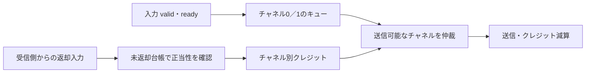

# クレジット方式の2チャネル通信を検証する

各チャネルに送信前のキューと受信側バッファ数に対応するクレジットを持つ教材です。入力はvalid/readyで受け付け、クレジットがあるチャネルだけを送信します。両方が送信可能ならラウンドロビンで選びます。送信側のキューと受信側の空き枠は別々に管理します。

## キューと受信枠を分ける

入力キューへ受理したデータを、受信側の空き枠に対応するクレジットがあるときだけ送信します。



同じエッジの新規送信を即時返却する規則ではありません。クレジット0への返却で送信可能になるのは次サイクルです。

| 確認する場面 | 期待する動作 | 主な照合対象 |
| --- | --- | --- |
| 送信 | 対象チャネルを1減算 | 順序・データ・残クレジット |
| 正当な返却 | エッジ前の未返却分だけを加算 | チャネル別台帳 |
| 過剰な返却 | 無視してbad_returnを通知 | 満杯時と同時送信の境界 |

## 契約と参照モデル

キュー深さと初期クレジットは各2／4の2構成、データ8ビットです。入力が受理されなかった場合はvalid・チャネル・データを保持し、テストベンチもその条件を検査します。Pythonも保留中の入力を保持したまま次の予定列を作ります。

送信ごとに該当チャネルのクレジットを1減らします。返却は、そのエッジ前に実際の未返却分がある場合だけ受け付けます。初期クレジットが満杯なのに返却された場合は無視し、`bad_return`で通知します。同じエッジの送信を、そのエッジで返却してよいという規則にはしていません。0からの返却で新しい送信が可能になるのは次サイクルです。

通常の返却刺激はPythonの未返却台帳から選び、返却の遅延とチャネル差を変えます。初回には不正返却も明示的に注入して通知を確認します。満杯のチャネルが送信する同じエッジに返却する境界も固定シナリオに含めます。リセットはキュー・未返却分を破棄し、両端が協調して初期クレジットへ戻る前提です。片側だけが状態を保持する非同期リンクの回復方式ではありません。

## 検査・実行

Pythonの独立したキュー、未返却台帳、選択順から、受付、送信、データ、残クレジット、キュー件数、不正返却通知を照合します。両チャネル、クレジット枯渇・返却・同時送信、キュー満杯、リセット復帰の各10目標です。チャネル内の順序と、送信可能な場合の選択順も毎サイクル比較します。

4種類の変異は送信時の減算漏れ、返却チャネルの入替え、データ破損、誤った初期クレジットです。

```sh
python3 examples/local-credit-link/run.py
python3 examples/local-credit-link/run.py --profile nightly
python3 -m unittest discover -s examples/local-credit-link/tests -v
```

[共通手順](../local-common/README.md)を使います。smokeは100サイクル、nightlyは1000サイクル×3 seedを固定シナリオへ追加し、最後に排出します。2構成のJUnitは14／18件、セルフテストは5件です。実物の受信メモリ・物理リンク・CDCをモデル化した結果ではなく、受信完了を外部の返却入力として扱います。
