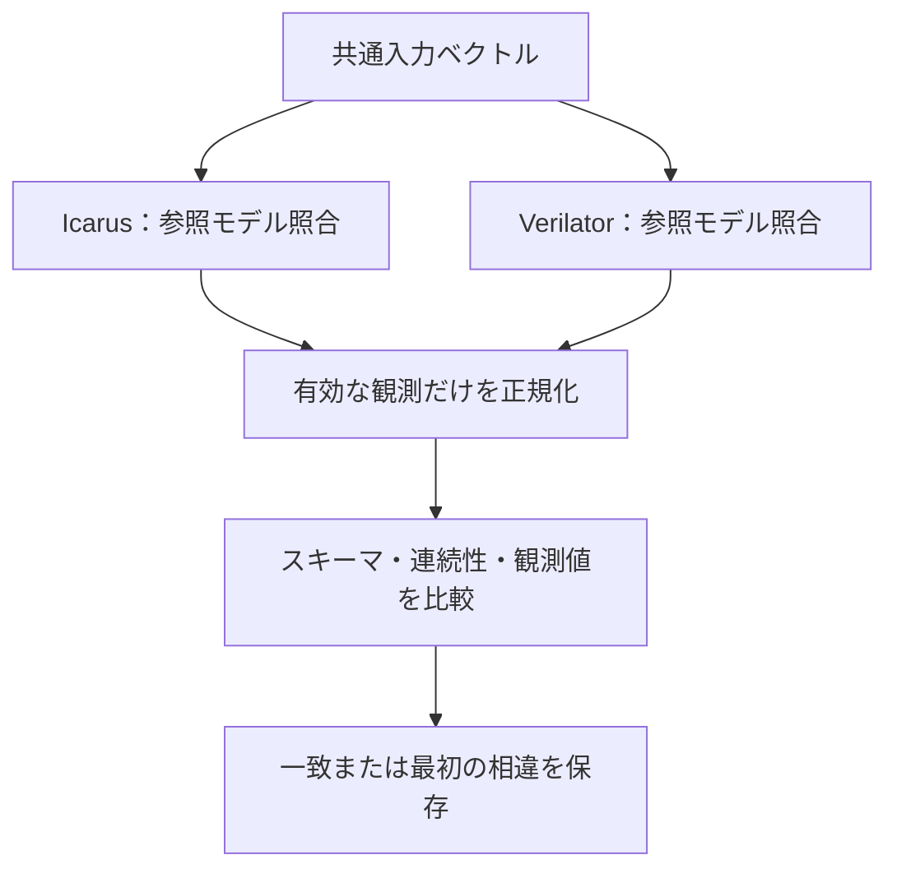

# 同じ入力をIcarusとVerilatorで比較する

[固定小数点DSP](../local-dsp/README.md)と[AXI4-Stream FIFO](../local-axis/README.md)へ同じベクトルを与え、仕様への照合とシミュレータ間の比較を両方行います。2つの結果が一致するだけでは、仕様どおりであることは確認できません。

## 仕様照合とバックエンド比較

同じ入力を2つのシミュレータへ与え、各参照モデルの合格を要求した上で有効観測列を比較します。



2つの実行結果が一致するだけで仕様適合とはしません。通常実行の独立比較を先に要求します。

| 確認する場面 | 期待する動作 | 主な照合対象 |
| --- | --- | --- |
| READY・VALID | 毎クロック比較 | 欠落・重複も拒否 |
| 出力ペイロード | VALID中の対象値だけ比較 | 無効レーンを正規化 |
| X/Zや壊れたログ | 一致として扱わない | 通常比較と診断を分離 |

## 比較する観測

DSPの2構成、Streamの2構成を個別にビルドします。通常実行では両バックエンドで参照モデルを有効にし、終了・完了数・COUNTも照合します。その後、各クロックの`OBS`ログを比較します。

- READY／VALIDは毎クロック比較します。
- DSPの結果とclippedは出力VALIDの間だけ含めます。
- StreamのデータはTKEEPで有効なバイトに正規化し、VALID中のKEEP／LASTとともに含めます。
- 無効な出力ペイロード、波形の内部名、ログの時刻表示・実行時間は比較しません。
- 観測スキーマ、全クロックの連続性、欠落・重複も検査します。X/Zを含む比較対象や壊れたログは一致扱いにしません。

[要求カタログ](requirements.json)は1要求・3目標で、全4構成に、両方の仕様照合・完全な観測列・バックエンド一致を要求します。

## 2つの独立した診断

DSPの最初の構成で、次も別ケースとして実行します。

1. 両バックエンドのデータ期待値比較を無効にし、Verilator側だけ出力LSB反転を入れます。両方の終了・COUNTが正常でも、トレースの差を比較器が検出することを確認します。この設定を通常ケースへ適用しません。
2. 有効入力へXを注入し、Icarus側のデータチェッカーが失敗することを確認します。このケースをVerilatorとの一致比較には使いません。

別に、無効入力のデータ・係数だけをXにする正常ケースも両方で実行します。受け付けない値の違いを誤って不一致にしない確認です。2値／4値の差を検証済みの実装不具合と誤認しないよう、対象を分けます。診断の観測は通常実行のカバレッジへ加えません。

## 実行

POSIX、Python 3.10以上、Icarus、Verilator、C++コンパイラー、makeを使います。

```sh
python3 examples/local-differential/run.py
python3 examples/local-differential/run.py --profile nightly
python3 -m unittest discover -s examples/local-differential/tests -v
```

[共通ホスト手順](../local-host-common/README.md)で実行します。smokeは各例の固定刺激＋32ランダム操作×1 seed、nightlyは300×3 seed。DSPの操作は演算、Streamはパケットで、比較するchecksはクロックごとのベクトル数です。JUnitは通常・診断・4構成の合否判定で16／24件です。

各バックエンドのビルド・入力・実行ログ・VCDと、`comparison.json`の最初の相違位置を保存します。比較器・スキーマ・ツール不在・実バックエンドを確認する5テストがあります。全SystemVerilog構文の差分試験、Xの伝搬規則全体、形式的な等価性証明ではありません。
