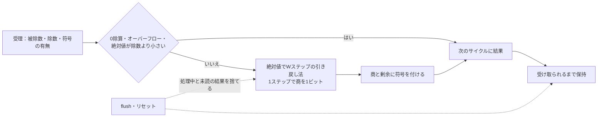

# 多サイクル除算器を、32ビットはシミュレーション、縮めた幅はフォーマルで確かめる

CPUの除算命令で使う、1ビットずつ商を求める多サイクルの除算器の教材です。誤りが出やすいのは、0除算や符号付きオーバーフローの特別な結果、剰余の符号、短い経路で終える条件の境目、処理の取消しと完了が重なるサイクルです。32ビットの乱数でこれらに当たることはほとんどありません。例えば、被除数と除数の絶対値が等しくなる確率は約2^-32です。この例では、32ビットと8ビットを境界値とランダム刺激のシミュレーションで、4ビットと8ビットをフォーマル検証で、すべての入力について確かめます。

## 特別な場合は1サイクル、それ以外はWステップ



## 仕様

結果はRISC-Vの[M拡張の除算命令](https://github.com/riscv/riscv-isa-manual/blob/main/src/unpriv/m-st-ext.adoc)（Division Operations）の定義に合わせます。

| 条件 | 商 | 剰余 | 受理から結果まで |
| --- | --- | --- | --- |
| 除数が0 | 全ビット1 | 被除数 | 1サイクル |
| 符号付きで、最小値÷-1（オーバーフロー） | 被除数 | 0 | 1サイクル |
| 被除数の絶対値が除数の絶対値より小さい | 0 | 被除数 | 1サイクル |
| それ以外 | 0の方向へ切り捨て | 被除数と同じ符号 | W+1サイクル |

商を0の方向へ切り捨て、剰余に被除数の符号を付けるので、例えば次のようになります。

| 被除数 | 除数 | 商 | 剰余 |
| --- | --- | --- | --- |
| 7 | -2 | -3 | 1 |
| -7 | 2 | -3 | -1 |
| -7 | -2 | 3 | -1 |

- **受理**：`in_valid && in_ready`で受理します。`in_ready`は、処理中でなく、未読の結果がなく、`flush`が0のときだけ1です。
- **結果**：`out_valid`の間、`out_ready`が来るまで商と剰余を保持します。
- **取消し**：`flush`は、処理中の除算と未読の結果を捨てます。最後のステップと同じサイクルに来た場合も、取消しを優先します。
- **リセット**：同期リセットで、処理中の除算と結果を捨てます。

## 2つの方法の分担

| 方法 | 幅 | 範囲 | 確かめること |
| --- | --- | --- | --- |
| シミュレーション（[`run.py`](run.py)） | 32・8ビット | 境界値の全組合せと、ランダム刺激 | 実際の幅での結果・遅延・保持・取消し |
| フォーマル（[`formal.py`](formal.py)） | 4・8ビット | すべての被除数・除数・入力の列 | `/`・`%`演算子と特別な場合の結果との一致、遅延、保持、取消し |

RTLは幅`W`をパラメーターに持つ1つのコードです。8ビットの証明は、幅によらない誤り（符号の扱い、短い経路の条件、取消しの優先順位）を、すべての入力について除きます。ただし、32ビットの正しさを証明したことにはなりません。カウンターの幅や最小値の定数のように、幅で変わる部分の誤りは、32ビットのシミュレーションで確かめます。

## シミュレーション

Pythonの期待値は、仕様の文章どおりに、0除算・オーバーフロー・0方向への切り捨て・剰余の符号を書いたものです。RTLの引き戻し法は使いません。サイクル単位のモデルが、受理・遅延・保持・取消しを表します。

テストベンチは毎サイクル、`in_ready`・`out_valid`、保持中の値、有効な結果を照合します。受理時に被除数と除数の種類を記録し、その結果を照合した時点で目標に加算します。取消しは、受理からのサイクル数で、途中か、最後のステップか、未読の結果かを区別します。

固定シナリオは次の順に実行します。

1. 符号付き・符号なしのそれぞれで、10個の境界値（0、1、2、3、7、最大値、最小値、最小値+1、-2、-1）の全組合せ
2. 絶対値が等しい組、剰余の符号が分かれる組、符号なしで最上位ビットが1の組
3. 結果を3サイクル待たせる場合（W+1サイクルの除算と1サイクルの除算）
4. 受理後1〜W+1サイクルのすべての時点での取消し、未読の結果の取消し
5. 処理中のリセット

ランダム刺激は、30%を境界値、10%を絶対値の等しい組にし、待たせるサイクル数、取消し、まれなリセットを混ぜます。[要求カタログ](requirements.json)は4要求・16目標です。両構成とも、固定シナリオだけで16目標に達します。

## フォーマル検証

[`divider.sv`](rtl/divider.sv)の`ifdef FORMAL`の中に、受理した被除数と除数を保持する記録と性質を書いています。期待値は、Verilogの`/`・`%`演算子に、0除算の場合を加えたものです。符号付きのオーバーフローは、`/`の結果が幅で切り詰められて最小値になり、`%`は0になるので、仕様と一致します。

| 性質 | 内容 |
| --- | --- |
| `ap_quotient`・`ap_remainder` | 結果が有効な間、商と剰余が期待値と一致する |
| `ap_latency` | 結果は受理から1サイクル（特別な場合）かW+1サイクル後に出る |
| `ap_completion` | 取消しもリセットもなければ、受理した除算の結果が、上の時点に必ず出る |
| `ap_hold` | 待たされている間、結果を保持する |
| `ap_flush`・`ap_reset` | 取消しとリセットの次のサイクルは、処理中でも未読でもない |
| `ai_partial`ほか5つ | 処理中の部分剰余と部分商、除数、符号、経過サイクル、未完了の除算と処理中の状態の関係（補助不変条件） |

### 補助不変条件と帰納法の深さ

k-inductionの帰納ステップは、任意の状態から始まってkサイクル続けて性質が成り立つ列なら、次のサイクルでも成り立つことを示します。任意の状態には、どの除算からも到達しない途中の部分剰余も含まれます。これを除く方法は2つあります。1つは、処理中の値の関係を補助不変条件として書くことです。この例では、`ai_partial`が「処理済みの上位ビットを除数で割った商と余りが、部分商と部分剰余に一致し、残りの下位ビットが`quo`の上位に残っている」ことを表します。もう1つは、帰納法の深さを1回の除算より長くすることです。そうすると、到達しない途中の状態は、仮定した区間の中で必ず誤った結果を出して矛盾します。

| 幅 | 補助不変条件 | 帰納法が閉じる最小の深さ | 証明の時間 |
| --- | --- | --- | --- |
| 4 | なし | 7 | 1秒未満 |
| 8 | なし | 11 | 約25秒 |
| 8 | あり | 2 | 約10秒 |
| 16 | なし（深さ18） | 10分以内に終わらない | － |
| 16 | あり（深さ2） | 10分以内に終わらない | － |

補助不変条件がない場合、最小の深さはW+3で、幅とともに伸びます。結果が出ることを示すには、結果の時点から受理の時点までさかのぼる必要があるためです。補助不変条件があれば深さは2で済みますが、乗算を含む条件はソルバーに重く、16ビットではどちらの方法も10分以内に終わりませんでした（16ビットは`ap_completion`を加える前の版で測定）。これが、幅を縮めて証明し、32ビットをシミュレーションで確かめる理由です。

回帰の証明は、補助不変条件を入れたうえで深さ12にしています。ベースケースが8ビットの除算1回を丸ごと含むので、`--demo-bug`で誤りを入れた回路は、帰納法のUNKNOWNではなく、具体的な反例を持つFAILになります。

### タスク

各構成6タスク、計12件のJUnitです。

- `divider-proof`：13個のassertを深さ12のk-inductionで証明します。
- `scenario-cover`：0除算、オーバーフロー、絶対値が等しく符号が異なる組、負の被除数と正の除数で剰余が0でない組、符号なしで両方の最上位ビットが1、3サイクル続く保持、最後のステップでの取消しの7目標に到達することを確認します。
- 4種類の変異：深さ16のBMCで、予定したassertの反例を要求します。

## 意図的な誤実装

| 番号 | 誤実装 | シミュレーションの検出ラベル | フォーマルの反例 |
| --- | --- | --- | --- |
| 1 | 0除算の商を0にする | `DIV_DATA` | `ap_quotient` |
| 2 | 剰余に、被除数ではなく商の符号を付ける | `DIV_DATA` | `ap_remainder` |
| 3 | 絶対値が等しい場合も1サイクルで終える | `DIV_CONTROL` | `ap_latency`（商と剰余も同時に破れる） |
| 4 | 最後のステップと同時の取消しより、完了を優先する | `DIV_CONTROL` | `ap_flush` |

seed 17〜19の200除算のランダム刺激だけで実行すると、変異1〜3はどのseedでも検出できます。変異3を検出できるのは、ランダム刺激の10%を絶対値の等しい組にしているからです。変異4は、32ビットではどのseedでも検出できず、8ビットでも1つのseedでしか検出できません。取消しが最後のステップにちょうど重なる必要があるためです。セルフテストで、32ビットのランダム刺激に最後のステップでの取消しが含まれないことを確かめています。フォーマルは、8ビットで11ステップ目の反例として見つけます。

## 実行

```sh
python3 examples/local-divider/run.py --out artifacts/divider
python3 examples/local-divider/run.py --profile nightly --out artifacts/divider-nightly
. /tmp/lsi-bus-formal-venv/bin/activate
python3 examples/local-divider/formal.py
python3 -m unittest discover -s examples/local-divider/tests -v
```

シミュレーションは[共通手順](../local-common/README.md)を使い、構成は`w32`と`w8`です。smokeは200除算×1 seed、nightlyは2000除算×3 seedを固定シナリオとは別に実行します。JUnitは各構成7／9件、全体14／18件です。フォーマルは[共通フォーマル手順](../local-formal-common/README.md)を使い、構成は`w4`と`w8`、12件のJUnitです。セルフテストは8件です。

## 確認範囲

2026-10-31に、Python 3.14.7、Icarus Verilog 14.0開発版で、両構成のsmoke／nightly、16目標、4種類の変異、セルフテスト8件が成功しました。同じ日に、YoWASP版Yosys・SBY・Z3（共通フォーマル手順の固定版）で、フォーマルの12タスクが成功しました。8ビットの証明に約30秒、全体で約1分半かかりました。証明のタスクに4種類の変異を入れると、どれもFAILになりました。結果を出さずに捨てる誤り（両方とも負の除算で`out_valid`を立てない）も、`ap_completion`と`ai_pending`の反例でFAILになることを確かめています。Verilator 5.052の`--lint-only -Wall`では、W=4・8・32、変異0〜4のどれでも警告はありません。

引き戻し法の1ビットずつの除算だけを扱います。SRTなどの高基数の除算、先頭の0の数による早期終了、乗算器との共用、面積・動作周波数は扱いません。フォーマルの証明は4ビットと8ビットについてのもので、16ビット以上は10分以内に完了しませんでした。
