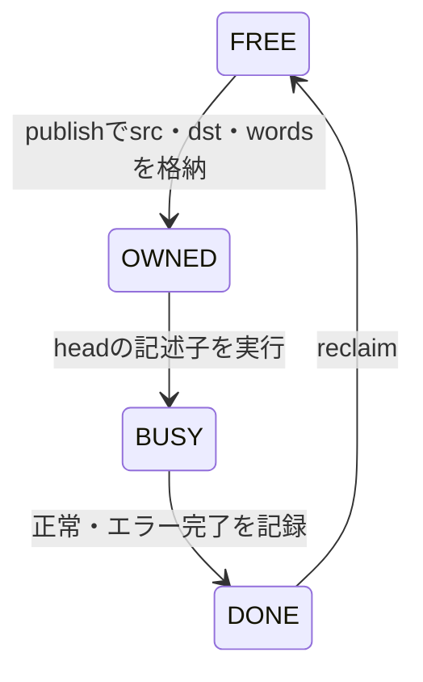
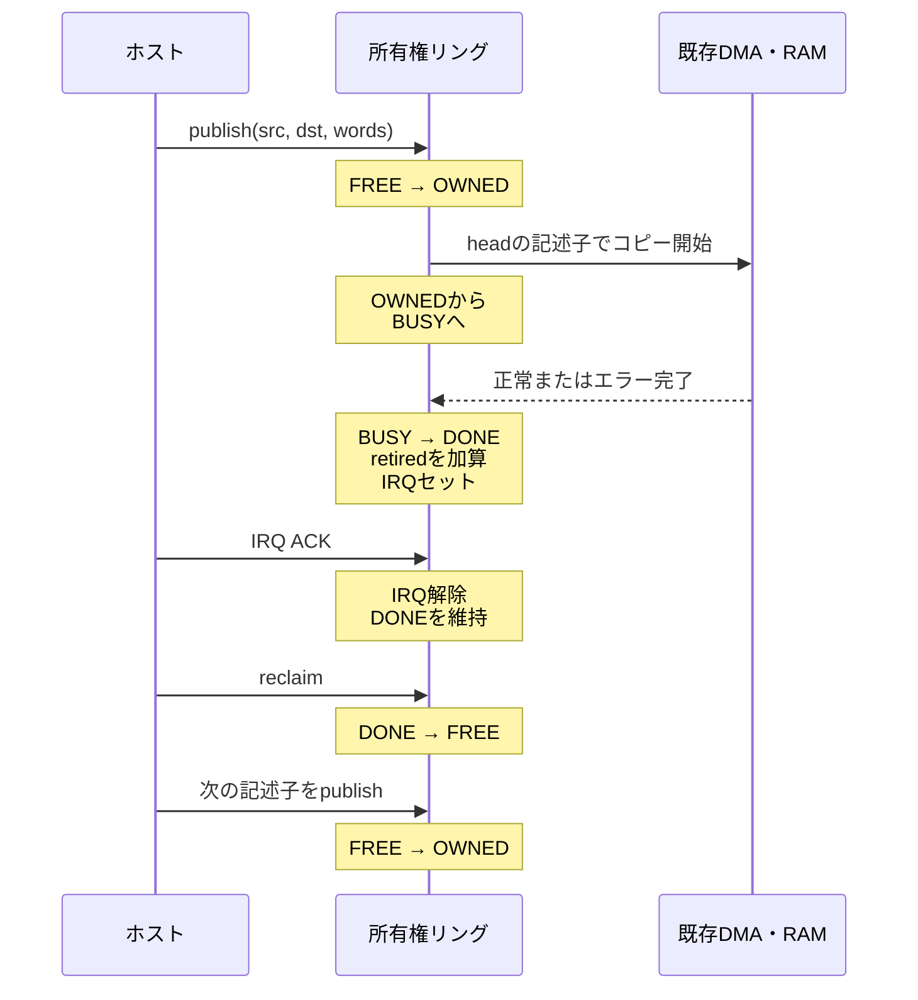

# DMAリングの所有権・完了返却・再利用を結合検証する

ホスト側の公開・回収コマンド、内部の記述子RAM、既存の[リング制御](../local-descriptor-dma/README.md)・[DMAコア](../local-dma/README.md)・[AXI4 RAM](../local-axi4/README.md)を接続します。同じスロットの二重公開・二重実行を防ぎ、処理中の記述子追加と周回後の再利用を確認する教材です。

## 所有権とホスト操作



深さ2／4、headは0から開始します。記述子を内部RAMから実際のAXI読出し応答として既存リング制御へ返し、コピーのAXI要求は外部RAMへ渡します。記述子読出しはID=0、データ読出しはID=1で区別するため、外部データの転送元が内部記述子の番地範囲（6144〜6144＋16×深さ−1）と重なってもコピーできます。CPUが共有DRAM上の記述子を書き換える構成ではありません。キャッシュ保守・メモリバリア・実CPU命令は含みません。

| host_op | 操作 | 拒否条件・副作用 |
| --- | --- | --- |
| 1 | FREEへpublish | FREE以外・範囲外は拒否し、記述子を維持 |
| 2 | DONEをreclaim | DONE以外は拒否。受理するとFREEへ戻す |
| 3 | doorbell | 実行を有効化し、headのOWNEDを継続的に処理 |
| 4 | IRQ ACK | 通知をクリア。所有権・完了数は維持 |

ホストはvalidとreadyが成立するエッジでコマンドを完了し、その時点のerrorを検査します。doorbellで有効化した後は、headが未公開なら待ち、公開されると再開します。headを飛ばして後方のOWNEDを先に処理しません。

`retired`はエラーを含む返却済み記述子数を示す8ビットのカウンターで、256で折り返します。各スロットのerrorを別に持ち、エラー時もDONEへ返します。次の記述子へ進み、回収・再公開で再利用できます。IRQは各返却でpendingになり、ACKまで保持します。

## 完了通知とスロット回収の違い

IRQ ACKは通知の解除、reclaimはスロットの回収です。以下は他の完了・ACKが重ならない単一スロットの例で、doorbellによる実行は有効になっているものとします。



| 確認時点 | スロットの所有権 | IRQ | 再publish |
| --- | --- | --- | --- |
| 初期化後 | FREE | 0 | 受理する |
| 公開後・取得前 | OWNED | 0 | 拒否する |
| コピー中 | BUSY | 0 | 拒否する |
| 完了後 | DONE | 1 | 拒否する |
| IRQ ACK後 | DONE | 0 | 拒否する |
| reclaim後 | FREE | 0 | 受理する |

エラー完了でもDONEへ返します。IRQだけで成否を決めず、スロットのerrorとコピー結果を照合します。実行を有効にした後は、FREEへ戻しただけでは再実行せず、再publishされたOWNEDを取得します。

## 独立した検証

Pythonは公開するsrc・dst・wordsとエラーになる記述子から、最終メモリのチェックサムを計算します。SVは拒否応答、所有権、headと返却数、実AXIの番地・長さ・データ、全8192バイトも比較します。期待値をDUTのメモリから作りません。初期データには上位アドレスも混ぜ、256バイト離れた領域が同一パターンになってコピー漏れを見逃すことを防ぎます。

固定ケースは公開前回収、不正コマンド・slot、二重公開・回収、処理中の追加、2／3周の再利用、不正な転送元、IRQ ACK、動作中の協調リセット、転送元と内部記述子の番地範囲の重なりです。各構成11目標。所有権の迂回、回収の欠落、head更新の誤り、実コピーのデータ破損の4種類の変異を検出します。

```sh
python3 examples/local-dma-ownership/run.py --out artifacts/dma-ownership
python3 examples/local-dma-ownership/run.py --profile nightly
python3 -m unittest discover -s examples/local-dma-ownership/tests -v
```

[共通手順](../local-common/README.md)を使い、smokeは12操作列、nightlyは60列×3 seedに固定4列を加えます。JUnit14／18件、確認6件です。実行するコピーは各1〜4ワード・非重複領域で、任意の共有メモリ所有権プロトコルや動的tailポインターの検証ではありません。
