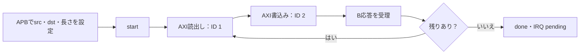

# APB＋AXI4＋割り込みでDMAを結合検証する

APBで設定したメモリ間コピーを、AXI4マスターが実行し、終了を割り込みで通知するローカル教材です。新規DMA RTLと[既存AXI4 RAM](../local-axi4/README.md)を実際に接続します。

## 設定・コピー・通知の流れ

APB設定後に読出しバーストと書込みバーストを順に完了し、最後に状態と割り込みを照合します。



通常コピーの概略です。ゼロ長、要求不正、R/Bエラーは本文の独自方針で終了し、既に反映した書込みは戻しません。

| 確認する場面 | 期待する動作 | 主な照合対象 |
| --- | --- | --- |
| 境界に近いコピー | src／dst両方の4KiB境界で分割 | AR・AW・ビート数 |
| 読出し中のabort | 読出しを排出し、そのデータは書かない | 残存範囲と終了状態 |
| 書込み中のabort | 現在の書込み・B応答まで完了 | 全RAMとIRQ |

## 仕様

32ビット・ワード整列、0〜32ワード、8KiB内の**重ならない**領域を扱います。INCRバーストは最大4ビートで、転送元・転送先それぞれの4KiB境界に合わせて分割します。読出しID=1、書込みID=2です。1バーストを読み終えてから書き、B応答を受けて次へ進みます。複数バーストを並行発行する実装ではありません。

APBは待ちなしで、次の相対アドレスを使います。

- 0x00／0x04／0x08：転送元バイトアドレス、転送先バイトアドレス、ワード数。実行中の変更はエラーです。
- 0x0C COMMAND：bit0=start、bit1=abort、bit2=IRQクリア。実行中のstart、startとabortの同時指定はエラーです。
- 0x10 STATUS（R/O）：bit0=busy、bit1=done、bit2=error、bit3=aborted、bit4=IRQ pending。
- 0x14 IRQ_ENABLE：bit0で出力をマスクします。pendingはマスク中も保持します。

ゼロ長はバス転送なしで正常終了し、非整列・重複・領域外・過大長はバスへ出さず異常終了します。どちらもdoneとIRQ pendingを立てます。完了・エラー・中断の状態は次のstartまで保持し、IRQクリアだけでは消しません。

abortは受付済みAXIトランザクションを取り消しません。AR待ち／読出し中なら読出しバーストを受け切って終了し、そのデータは書きません。AW待ち／書込み中なら現在の書込みとB応答まで完了して終了します。既に書いた内容は戻しません。読出しエラーは残るRビートを受け切って終了し、書込みエラーでも既に反映した書込みは残ります。

## 検査

テストベンチはAPBで実際に設定・start・状態読出し・abort・IRQ操作を行います。独立した要求モデルで転送件数・分割数・書込みが残る範囲を生成し、受付したAR／AWアドレス、ID、長さ、Wデータ・WSTRB・WLAST、待ち中の保持、終了状態を照合します。IRQクリア後も状態が残ること、拒否した書込みが設定値を変えないことも読み戻して確認します。RAM初期値はアドレスごとに異なるパターンをバックドアで設定し、終了後は全8192バイトを照合します。コピー先以外の変化も失敗です。

固定ケースは通常コピー、ゼロ長、転送元／転送先の境界分割、R／Bエラー注入、読出し前／書込み前のabort、実行中の設定拒否、startとabortの同時指定の拒否、AR待ちでのリセットと再実行、IRQマスク・解除・クリアです。エラーはRAM応答へSLVERRを加える方法で注入します。ランダム検証は長さ・番地・初期データ・エラー・abort・リセット・IRQマスクを変更します。

`no-stall`と`request-stalls`の2構成で、後者はAR／AW／Wの受付を周期的に止めます。RAMはRビート間に空きがあります。DMAはR／Bを受理できる状態では止めません。R／B受信側の任意のバックプレッシャーを探索する試験ではありません。

[要求カタログ](requirements.json)は4要求・12目標。start、AR／AWバースト、R／Wビート、完了件数を照合します。4種類の変異は、境界分割の欠落、Wデータ反転、IRQ pendingの欠落、転送先の進め方の誤りです。予定ラベル・非ゼロ終了が必要です。

## 実行

[共通手順](../local-common/README.md)に従い、ルートから実行します。

```sh
python3 examples/local-dma/run.py
python3 examples/local-dma/run.py --profile nightly
python3 -m unittest discover -s examples/local-dma/tests -v
```

smokeは24コマンド×1 seed、nightlyは200×3 seed。固定14ケースは別枠です。1ベクトルが1コマンドで、リセット試験では破棄するstartをもう1回発行します。JUnitは全2構成で14／18件です。

CPU・実ドライバ、キャッシュ整合性、仮想アドレス、重複領域、非整列コピー、クロックドメイン間の転送、合成後タイミング、DMA全体のフォーマル証明は対象外です。APBのレジスタ仕様・中断・エラー時の残存範囲は教材独自の仕様です。AXIの規則は[Arm IHI 0022E](https://documentation-service.arm.com/static/5f915b62f86e16515cdc3b1c)を参照しています。

## 次に試す結合例

[リング式ディスクリプタDMA](../local-descriptor-dma/README.md)は、本DMAコアを変更せずに使い、メモリ上の記述子の取得、リング巡回、エラー・中断・IRQを検査します。[キャッシュとDMA](../local-cache-dma/README.md)は別の小規模モデルで、clean／invalidateによる可視性を扱います。後者は本AXI DMAや実CPUキャッシュを接続した例ではありません。
