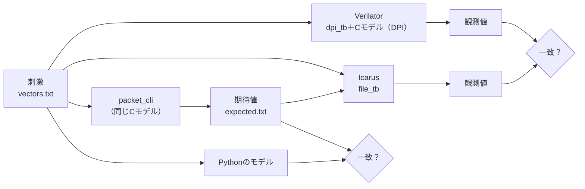

# Cの参照モデルをDPI-Cでテストベンチへつなぎ、ファイル経由の方式と比べる

参照モデルをCで書くと、ソフトウェアやアルゴリズムの検討で使ったコードを、そのままRTLの期待値に使えます。SystemVerilogのテストベンチからCの関数を呼ぶ標準の方法がDPI-C（Direct Programming Interface）です。この教材では、小さなチェックサム回路を題材に、次の3点を実行して確かめます。

- **つなぎ方**：`pure`と`context`のimport、export、オープン配列、ハンドルによる複数インスタンス、2値と4値の型の対応。
- **DPIが使えないシミュレーターでの代替**：同じCモデルを先に実行して期待値をファイルへ書き、Icarus Verilogのテストベンチで照合する方式。2方式が同じ結果になることを確かめます。
- **Cモデル自体の誤り**：シミュレーションだけでは、モデルの誤りと回路の誤りを区別できません。独立に書いたPythonのモデルと、公開されている検査値で、Cモデルを別に確かめます。

HWとソフトウェアの統合の中での位置付けは[HW／SW統合の検証手順](../../docs/method/hw-sw-integration-verification.md)にあります。C++の参照モデルをVerilatorのC++ハーネスから直接呼ぶ方式は、[C++参照モデルの例](../local-cpp-reference/README.md)で扱っています。この教材との違いは、テストベンチがSystemVerilogで、Cとの境界がDPIである点です。

## 題材の回路

[`packet_sum.sv`](rtl/packet_sum.sv)は、バイト列のCRC-16とバイト数を求めます。

| 信号 | 向き | 意味 |
| --- | --- | --- |
| `valid`、`data[7:0]`、`last` | 入力 | `valid`が1のクロックで1バイトを受け取る。`last`が1なら、そのバイトでパケットが終わる |
| `done` | 出力 | パケットの最後のバイトを受け取った次のクロックで、1クロックだけ1になる |
| `crc[15:0]`、`length[7:0]` | 出力 | 直前に終わったパケットのCRCとバイト数。次のパケットが終わるまで保持する |

- CRCの多項式は0x1021で、上位ビットから処理します。ビットの反転と最後のXORはありません。開始値はパラメーター`INIT`で、0xFFFFと0x0000の2構成を実行します。
- バイト数は255で飽和します。
- リセットは同期・Low有効です。途中のパケットを捨て、出力を0に戻します。
- `valid`が0の間の`data`と`last`は、結果に影響しません。

## 3つの実装と、その独立性

| 実装 | ファイル | CRCの計算方法 |
| --- | --- | --- |
| RTL | [`rtl/packet_sum.sv`](rtl/packet_sum.sv) | 1バイトを8回のシフトで処理する組合せ回路 |
| Cの参照モデル | [`model/packet_model.c`](model/packet_model.c) | 256要素の表を引く方式（1バイトにつき1回） |
| Pythonのモデル | [`model.py`](model.py) | 1ビットずつ処理する。パケットのバイト列を貯めてから、まとめて計算する |

Cモデルは、クロックごとに`pm_cycle`を1回呼ぶ形で、出力ポートの値（保持とリセットを含む）まで計算します。状態は`packet_model`構造体に入っていて、インスタンスごとに`pm_new`で作ります。パケット全体を配列で受け取る`pm_block`もあります。

3つとも同じ人が同じ仕様を読んで書いたものです。計算方法と状態の持ち方は変えてありますが、仕様の読み違いは共有し得ます。そこで、多項式については、数字9文字「123456789」に対する公開の検査値（開始値0xFFFFで0x29B1、0x0000で0x31C3）を外部の基準にしています。

## DPIの接続

[`tb/dpi_tb.sv`](tb/dpi_tb.sv)と[`model/packet_dpi.c`](model/packet_dpi.c)が使う機能は次のとおりです。

| 機能 | この教材での使い方 | 確かめ方 |
| --- | --- | --- |
| `pure`のimport | `dpi_crc_step`：引数だけで結果が決まる1バイト分の計算。テストベンチ側で畳み込み、モデルの結果と比べる | `SUM_PURE` |
| ハンドル（`chandle`） | `dpi_new`が返すポインターを、DUTのインスタンスごとに持つ | 2チャネルで長さの違うパケットを重ねる |
| `context`のimportとexport | `dpi_cycle`がパケットの終わりごとに、テストベンチの`dpi_note_packet`を呼び返す | 呼ばれた回数とバイト数の合計（`SUM_EXPORT`） |
| オープン配列 | `dpi_block`が、300要素の配列と9要素の配列を同じ関数で受け取る | パケットごとの再計算（`SUM_BLOCK`）と検査値（`SUM_KNOWN`） |
| 4値の引数 | `data`を`logic [7:0]`で渡し、C側で不定のビット数を数える | 下の「不定値の扱い」 |
| 2値の出力引数 | `done`、`crc`、`length`を`bit`と`byte unsigned`で受け取る | クロックごとの比較 |

exportした関数を呼べるのは、`context`を付けたimportの中だけです。`pure`のimportは、同じ引数なら呼出しを省いたりまとめたりしてよい、という約束なので、状態を読み書きする関数には付けません。

[`tb/dpi_probe_tb.sv`](tb/dpi_probe_tb.sv)は、型がC側でどう見えるかを1つずつ確かめる小さなテストベンチです。期待値は[`run.py`](run.py)の`PROBE`に固定してあります。

| SystemVerilogの型 | C側の型 | 確かめる内容 |
| --- | --- | --- |
| `byte`、`shortint unsigned`、`int`、`longint`、`real` | `signed char`、`unsigned short`、`int`、`long long`、`double` | 符号と桁あふれ（-128から1を引くと127、0xFFFFに1を足すと0） |
| `bit [7:0]`、`bit [39:0]` | `svBitVecVal`の配列（32ビットごとに1語） | 40ビットの値が2語に分かれて届き、戻ること |
| `logic [7:0]` | `svLogicVecVal`（`aval`と`bval`の組） | 不定のビットの数、Cが返す不定値 |
| `string`、`chandle` | `const char *`、`void *` | 長さ、ポインターの往復 |
| `byte unsigned a []`（オープン配列） | `svOpenArrayHandle` | `[4]`と`[7:2]`の2つの宣言で、要素数と添字の範囲 |
| exportした関数とタスク | `extern`の関数 | `context`のimportからの呼び返し、呼出し元のスコープ名 |

### 不定値の扱い

DPIの4値の型は、XやZをC側へ伝える手段です。ただし、伝わるのはシミュレーターがXを持っている場合だけです。Verilatorは2値のシミュレーターなので、次の結果になりました（Verilator 5.052）。

- `8'bxxzz_1010`を`logic [7:0]`の引数で渡すと、C側の`bval`は0で、不定のビットは0個に見えます。
- C側が`bval`を立てて返した値は、SystemVerilog側では`bval`が捨てられ、`aval`の値だけが残ります。

この結果は、型の確認の`logic_in_unknown=0`と`logic_out=00001111`として固定しています。DPIの規格の誤りでもVerilatorのバグでもなく、Xを持たないシミュレーターでは境界の前後でXが消える、という性質です。

そこで、この教材の入力の決まり「`valid`が1のとき`data`に不定値があってはならない」は、次のように確かめます。

| 刺激 | Icarus（ファイル方式） | Verilator（DPI方式） |
| --- | --- | --- |
| `valid`が0の間の`data`がX | 合格。結果に影響しないことを確認できる | 合格。ただしXは0として読まれるので、「Xでも影響しない」ことの確認にはならない |
| `valid`が1のときの`data`にX | `SUM_X_INPUT`で不合格（検出） | 合格してしまう。C側に不定のビットが届かない |

右下の「合格してしまう」ことも、`dpi-x-blind`という検査で毎回確かめています。将来Verilatorの動作が変わってこの検査が不合格になったら、不定値の方針を見直す合図です。不定値に関わる確認は、4値のシミュレーターで行う必要があります。

## ファイル経由の方式

Icarus Verilog 14.0はDPIを実装していません。そこで、同じCモデルを先に単独のプログラムとして実行します。



- [`model/packet_cli.c`](model/packet_cli.c)は、刺激のファイルを読み、クロックごとの期待値と、パケットごとの`pm_block`の結果、件数を書き出します。
- [`tb/file_tb.sv`](tb/file_tb.sv)は、刺激と期待値を1行ずつ読み、DPI方式と同じ時刻に同じラベルで比較します。
- 2つのテストベンチは、クロックごとの観測値（`done`、`crc`、`length`）をファイルへ書きます。ランナーは、2方式の観測値が全行で一致することと、5種類の誤実装を同じラベルで検出することを確かめます。

2方式の違いは次のとおりです。

| 観点 | DPI方式 | ファイル方式 |
| --- | --- | --- |
| モデルを呼ぶ時点 | シミュレーション中。DUTの出力を見てから次の入力を決める刺激にも使える | シミュレーションの前。刺激がDUTの応答に依存しない場合に限る |
| 不定値 | シミュレーターが2値なら見えない | 4値のシミュレーターでそのまま確認できる |
| 必要なもの | DPIを実装したシミュレーターと、Cのコンパイルとリンク | ファイルの入出力だけ。どのシミュレーターでも使える |
| モデルの状態 | シミュレーターのプロセスの中にある。リセットや複数インスタンスの扱いを自分で決める | 実行のたびに新しいプロセス |
| 食い違いの調査 | 波形の時刻でCの関数を止めて調べられる | 期待値のファイルと観測値のファイルを行で比べる |

この回路の刺激はDUTの応答に依存しないので、どちらの方式でも同じ検査ができます。

## Cモデルの誤りを見つける

Cモデルには、試験用の誤りを5種類入れられます（`pm_set_fault`）。Pythonのモデルとの比較が、それぞれを予定した種類の食い違いとして報告することを確かめます。

| 誤り | 内容 | Pythonとの比較の報告 |
| --- | --- | --- |
| 1 | 表を作る多項式が違う（0x8005） | `MODEL_CRC`、`MODEL_BLOCK` |
| 2 | 状態を、インスタンスごとではなく1つの静的な変数に持つ | `MODEL_DONE`、`MODEL_LEN`、`MODEL_CRC`、`MODEL_COUNT` |
| 3 | リセットでバイト数を消さない | `MODEL_LEN` |
| 4 | `pm_block`が最後の1バイトを落とす | `MODEL_BLOCK` |
| 5 | `valid`が0のクロックでもバイト数を進める | `MODEL_LEN` |

シミュレーションだけでは分からないことも、3つ実行して示します。

| 検査 | 内容 | 結果 |
| --- | --- | --- |
| `model-fault-1-dpi-known-answer` | 誤り1のモデルと正しいRTLでシミュレーションする | 開始直後に`SUM_KNOWN`で止まる。公開の検査値をシミュレーションの中でも確かめているため |
| `model-fault-3-dpi-ambiguous` | 誤り3のモデルと正しいRTL | `SUM_LEN`で不合格。RTLの誤実装3と同じラベルで、どちらが誤りかは区別できない |
| `model-fault-2-single-channel-miss` | 誤り2のモデルを、1インスタンスだけ作って比べる | 食い違いなし。2インスタンスにすると報告される |
| `model-fault-5-common-mode-miss` | 誤り5のモデルと、同じ誤りを持つRTL（誤実装3） | シミュレーションは合格する。Pythonとの比較だけが`MODEL_LEN`を報告する |

最後の行が、参照モデルを別の実装で確かめる理由です。モデルと回路が同じ誤りを持つと、両者の比較は何も報告しません。

## 検証すること

要求は[`requirements.json`](requirements.json)の6件、目標は30個です。

| 要求 | 内容 | 目標 |
| --- | --- | --- |
| `DPI-STREAM` | 毎クロック、`done`・`crc`・`length`がDPI経由のCモデルと一致する | 1バイトのパケット、検査値のパケット、連続するパケット、パケットの途中の空き、255バイトを超えるパケット、パケットの途中と合間のリセット |
| `DPI-INSTANCE` | DUTのインスタンスごとに、モデルの状態が独立している | 片方だけが動く区間、長さの違うパケットが重なる区間、ハンドル |
| `DPI-BINDING` | `pure`・`context`のimport、export、オープン配列、型の対応 | 接続の3機能と、型の確認の5項目 |
| `DPI-UNKNOWN` | 不定値の扱い | `valid`が0の間のX、ファイル方式での検出、DPI方式では見えないことの記録 |
| `DPI-ROUTES` | 2方式が同じ観測値と同じ検出結果になる | 観測値の一致、誤実装の検出の一致 |
| `DPI-MODEL` | Cモデル自体を確かめる | Pythonとの比較、検査値（単独とシミュレーションの中）、5種類の誤りの検出、上の表の3つの診断 |

刺激は、固定の列（296クロック）とランダムな列（smokeは1 seed、nightlyは3 seed）です。目標は、刺激の列から[`run.py`](run.py)の`goals`が求め、その列でCとPythonの比較・2方式の実行・観測値の一致がすべて成功したときだけ達成とします。

### 意図した誤実装

RTLの`MUTATION`パラメーターで選びます。DPI方式とファイル方式の両方で、同じラベルで検出することを確かめます。

| 変異 | 内容 | 検出するラベル |
| --- | --- | --- |
| 1 | 多項式の最下位ビットが欠ける（0x1020） | `SUM_CRC` |
| 2 | パケットが終わってもCRCを開始値へ戻さない | `SUM_CRC` |
| 3 | `valid`が0のクロックでもバイト数を数える | `SUM_LEN` |
| 4 | パケットの途中のリセットで、計算中のCRCが残る | `SUM_CRC` |
| 5 | 4バイト目で、`last`がなくても`done`を出す | `SUM_DONE` |

DPI方式のテストベンチは、6種類（正常と変異1〜5）のDUTをすべてインスタンスにして、`+MUTATION`で比較する組を選びます。Verilatorのビルドを構成ごとに1回で済ませるためです。ファイル方式は、変異ごとにIcarusでビルドします。

## 実行

Python 3.10以上、Verilator 5.052、C++コンパイラーとmake、Cコンパイラー（`cc`）、Icarus Verilog 14.0を用意し、リポジトリのルートで実行します。準備は[実行環境](../../tools/ENVIRONMENT.md)にあります。

```sh
python3 examples/local-dpi-model/run.py --out artifacts/dpi-model-demo
python3 examples/local-dpi-model/run.py --profile nightly --out artifacts/dpi-model-nightly
python3 -m unittest discover -s examples/local-dpi-model/tests -v
```

`--configuration init-ffff|init-0000|all`、`--seed`、`--verilator`、`--cc`、`--iverilog`、`--vvp`、`--jobs`、`--timeout`、`--build-timeout`、`--out`を指定できます。既存の出力先は上書きしません。

JUnitは、smokeが58件、nightlyが74件です。内訳は次のとおりです。

| 区分 | 件数 | 内容 |
| --- | --- | --- |
| 共通 | 4 | Cモデルのプログラムのビルド、型の確認のビルドと実行、検査値 |
| 構成ごと（2構成） | 22／30 | 2方式のビルド2、刺激の列ごとに4（CとPythonの比較、DPI方式、ファイル方式、観測値の一致）、誤実装5種類×2方式、不定値の2件 |
| モデルの誤り | 9 | 5種類の検出と、4つの診断 |
| 判定 | 1 | 要求と目標 |

セルフテストは18件です。Pythonのモデル、刺激と目標の求め方、比較のラベル、Cモデルのプログラム（`cc`でビルドして実行）、ファイル方式のテストベンチ（Icarusで実行）、Verilatorがない場合に不合格で終わることを確かめます。セルフテストはVerilatorを使いません。

## 証跡

出力先には、マニフェスト（入力のハッシュ）、ツールの版、ビルドのログ、刺激の列ごとの`vectors.txt`・`expected.txt`・`model-summary.txt`・2方式の観測値・ログ・波形、検査ごとの結果（`executions.json`）、達成した目標（`coverage.json`）、`summary.json`、`junit.xml`を保存します。

## Verilator 5.052で動かなかった機能

接続を決める前に小さく試し、次の3つは使わない形にしました。どれもビルドの段階で分かります。

| 試した記述 | 結果 | この教材での代替 |
| --- | --- | --- |
| 動的配列（`byte unsigned d []`を`new`で確保）をオープン配列の引数に渡す | 「Passing dynamic array or queue as actual argument to DPI open array is not yet supported」という内部エラー | 固定長の配列と、使う要素数の引数 |
| exportしたタスクの中の時間待ち（`#`） | 「Unsupported: Timing controls inside DPI-exported tasks」 | exportするのは時間を消費しない関数とタスクだけにする。時間を進める処理はSystemVerilog側に置く |
| `$fscanf`の読込み先に、ベクターのビット選択（`v[0]`）を書く | 生成されたC++がコンパイルできない | スカラーの変数へ読んでから組み立てる |

このほか、Verilatorが生成するヘッダーでは、exportしたタスクの戻り値の型が`void`でした。規格ではimport・exportしたタスクは`int`を返す形なので、ほかのシミュレーターへ持っていくときはC側の宣言を確かめます。Verilatorは`.c`のファイルもC++としてコンパイルするので、この教材のCは、C++としても通る書き方（`malloc`の戻り値のキャスト、`extern "C"`）にしています。

## 適用範囲と対象外

- DPIを実行したのはVerilator 5.052だけです。4値のシミュレーターでのDPI（`svLogicVecVal`で実際にXが届く動作）は実行していません。上の「不定値の扱い」の右列は、2値のシミュレーターでの結果です。
- 型の対応は、表に挙げたものだけです。構造体、パックした配列の配列、多次元のオープン配列、`time`、`shortreal`、出力・入出力の文字列、`svGetArrayPtr`による一括の受渡しは扱っていません。
- exportしたタスクが時間を消費する使い方（Cの中からシミュレーションの時間を進める）は、上のとおり動かず、扱っていません。
- 複数インスタンスは、ハンドルを使う方法だけです。`svGetScope`と`svPutUserData`で、スコープごとにCの状態を持たせる方法は扱っていません。型の確認は、スコープの名前を取得するところまでです。
- スレッドや、複数のシミュレーションのプロセスからCモデルを共有する場合の排他は扱っていません。
- ファイル方式は、刺激がDUTの応答に依存しない場合に限ります。応答に応じて刺激を変える検証（再送や逆圧への反応など）は、この方式では書けません。
- Pythonのモデルは、同じ人が同じ仕様から書いています。外部の基準は、多項式についての検査値2つだけです。バイト数の飽和や、リセットと`done`の関係は、3つの実装が同じ読み方をしています。
- Cのコンパイルは、手元のmacOS（Apple clang）で確かめました。GCCでの警告の有無は、手元では確かめていません。

## 参考にした一次資料

- IEEE Std 1800-2017の35章（Direct programming interface）と、附属書H（DPIのC層）・附属書I（`svdpi.h`）。細かい節番号は、文書と突き合わせていません（未照合）。規格の本文は転載していません。
- [VerilatorのDPIの説明](https://verilator.org/guide/latest/connecting.html)。対応していない機能は、上の表のとおり手元の5.052で確かめた結果です。
- CRCの検査値は、広く公開されているCRCのパラメーター一覧にある「CRC-16/IBM-3740」（開始値0xFFFF、検査値0x29B1）と「CRC-16/XMODEM」（開始値0x0000、検査値0x31C3）の値です。

## 確認記録

2026-11-21に、macOS arm64、Python 3.13、Verilator 5.052、Icarus Verilog 14.0開発版、Apple clangで、smoke（58件）とnightly（74件）、単一構成の実行（36件）、セルフテスト18件が成功しました。RTLは、`INIT`の2値と`MUTATION`の0〜5の全12構成で、Verilatorの`--lint-only -Wall`の警告が0件です。Linuxでは実行していません。
