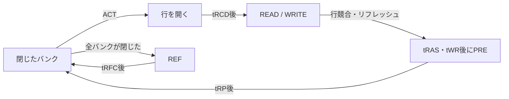

# DRAMのコマンド間隔・行管理・リフレッシュを検証する

2バンク・各4行×4列・32ビットワードの、コマンドレベルのDRAM制御例です。行ヒット／行競合、書込み回復、読出しレイテンシ、リフレッシュと応答保持の関係を扱います。[LiteDRAMの行・列管理](https://github.com/enjoy-digital/litedram/blob/master/litedram/core/bankmachine.py)と[リフレッシュ制御](https://github.com/enjoy-digital/litedram/blob/master/litedram/core/refresher.py)を参照し、本教材の仕様と回路・メモリモデルを新規作成しました。

## 抽象コマンドとタイミング



要求は`req_valid && req_ready`で書込み／読出し、バンク・行・列・データを取り込みます。未完了は1件です。書込み応答はコマンド発行後にデータ0を返し、読出し応答は外部メモリモデルから返るワードを使います。`resp_valid && resp_ready`まで応答を保持し、その間は新しい要求を受けません。

コマンドはクロックごとに最大1個で、NOP=0、ACT=1、READ=2、WRITE=3、PRE=4、REF=5です。コマンド側にバックプレッシャーはありません。バンクが閉じていればACT、別の行が開いていればPREしてからACT、目的の行が開いていればREAD／WRITEを発行します。

| パラメーター | この教材での最小間隔・意味 | fast | slow |
| --- | --- | --- | --- |
| TRCD | ACT→READ／WRITE | 2 | 3 |
| TRP | PRE→ACT、および全PRE→REF | 2 | 3 |
| TRAS | ACT→PRE | 3 | 5 |
| TWR | WRITE→PRE | 6 | 8 |
| TRFC | REF→次の非NOPコマンド | 5 | 7 |
| CL | READからメモリの読出し応答まで | 2 | 3 |
| TREFI | REF翌サイクルから、新規要求を止めるまでの周期 | 24 | 36 |

CLは外部メモリモデルの応答遅延で、コントローラーは`read_valid`を待ちます。

間隔Nは、コマンドを受け取るクロックエッジ間の差がN以上であることを表します。RTLは減算カウンターで待ち、Pythonモデルとテストベンチのモニターは絶対サイクル番号で判定します。

TREFIに達すると新規要求を止め、既に受理した1件を終えてから全バンクを閉じ、TRPも満たしてREFを発行します。**アプリケーションが応答を受理しなくてもリフレッシュを進めます。** REFの翌サイクルを起点に、次のREFまでの経過が`TREFI + TRAS + TWR + 3*TRP + CL + 8`を超えないことも監視します。この余裕は本回路の処理を待つための教材独自の上限で、JEDECの延期回数・保持時間の規定ではありません。

リセットは同期・Low有効で、保留要求・応答を取り消します。テスト用メモリも同時に全ワードを0へ初期化します。実DRAMの内容がコントローラーのリセットで消えるという仕様ではなく、本テスト環境の初期化条件です。

## 実行と判定

Python 3.10以上とIcarus Verilogを用い、リポジトリのルートで実行します。

```sh
python3 examples/local-dram/run.py
python3 examples/local-dram/run.py --profile nightly
python3 -m unittest discover -s examples/local-dram/tests -v
```

テストベンチは、実際のコマンド端子からバンクの開閉と発行時刻を記録し、タイミングと状態の違反を検査します。要求に対応するコマンドのバンク・行・列・書込みデータも検査します。別のメモリ配列も実コマンドで読み書きし、READのCLサイクル後にデータを返します。Python側の期待データは受理要求のメモリ操作から求めるため、誤った列の読出しを見逃しません。

固定シナリオでは全32ワードへ異なる値を書いて読み戻し、行ヒット・行競合、両バンク、tRCD／書込み回復の待ち、リフレッシュ中の停止、応答を保持したままのREF、途中リセットを含む18目標へ到達します。ランダムケースはアドレス・読書き・データ・応答待ちを変えます。終了時の未完了も検査します。

| 変異 | 誤り | 検出ラベル |
| --- | --- | --- |
| 1 | tRCDを待たずREAD／WRITEを発行する | `DRAM_TIMING` |
| 2 | 行が開いているのにREFを発行する | `DRAM_STATE` |
| 3 | PRE前のtRAS／tWRの待ちを無視する | `DRAM_TIMING` |
| 4 | 読出しの列アドレスだけを反転する | `DRAM_ADDRESS` |

セルフテスト7件には、全ワードの照合、長い応答待ち中の複数回のREF、WRITEから行競合への最小間隔、リセット時の取消しを含みます。通常ケースへの`--demo-bug 1..4`も失敗します。JUnitはsmoke 14件／nightly 18件で、証跡は[共通手順](../local-common/README.md)に従います。

2026-10-31に両構成のsmoke／nightly、7セルフテスト、全構成・変異0〜4のVerilator lint、両構成のYosysによる読込み・`proc; opt; check -assert`を確認しました。

## 確認範囲

タイミング値はサイクル単位の教材用設定で、特定のSDRAM／DDRデバイスへの準拠を表しません。初期化シーケンス、モードレジスタ、バースト、tRTP・tCCD・tRRD・tFAW等の追加制約、読書きの方向転換、DQS・PHY・トレーニング、保持不良、温度、セルフリフレッシュ、実機の信号品質は対象外です。実デバイスへ接続するには、その仕様に沿う追加の回路と検証が必要です。

## ネイティブ機能カバレッジ

[Verilatorによる計測例](../local-functional-coverage/README.md)で、実際のcoverpoint・crossとDBを確認できます。各構成18 binの全ヒットと、独立したイベント集計との件数一致を要求します。既存の`COVER`目標とは別の計測計画です。

```sh
python3 examples/local-functional-coverage/run.py --example dram
```
