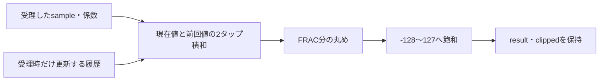

# 固定小数点FIRの符号・丸め・飽和を検証する

2タップの積和演算器を使い、数値演算とハンドシェイクを照合する教材です。入力・係数・出力は符号付き8ビットで、小数部のビット数FRACを3／4に設定します。期待値はPythonの任意精度整数で計算します。

## 広い積和から丸め・飽和まで

受理時の入力と係数で広い整数の積和を作り、丸めてから8ビット範囲へ飽和させます。



図は数値処理の順序です。各箱が独立したパイプライン段を表すものではありません。

| 確認する場面 | 期待する動作 | 主な照合対象 |
| --- | --- | --- |
| 丸めの中間値 | 0から遠い側へ丸める | 正負それぞれの境界 |
| 上下限と飽和 | 広い値を判定してから縮小 | resultとclipped |
| 出力待ち | 結果を保持し、新規受付を制限 | READY・VALID・保持 |

## 数値とサイクルの仕様

整数表現値（raw値）での計算を次のように定義します。

```text
A = signed(sample) × signed(c0) + signed(previous_sample) × signed(c1)
R = A / 2^FRAC を最近傍へ丸める（ちょうど中間は0から遠い方）
result = Rを -128〜127 へ飽和
clipped = 飽和が必要だったか
```

前回サンプルは**入力を受理したときだけ**更新し、現在の入力と係数は受理時に取り込みます。リセットでは履歴を0へ戻します。Pythonは絶対値の商・余りから丸め、RTLは広い整数で積和を作ってから丸め・飽和するため、8ビットへ縮めてから判定しません。

処理は1件ずつです。`LATENCY`クロック後に結果レジスタを有効にし、入力受付から最初の出力ハンドシェイク可能エッジまではLATENCY+1クロックです。出力READY待ちは値とclippedを保持します。1クロックごとに新規入力を受けるFIRパイプラインではありません。

構成は`q3-latency1`と`q4-latency3`です。全パラメーターの直積ではありません。

## 検査と実行

固定刺激はゼロ、正負、上下限ちょうどの値、中間値の丸め、丸めの境界、正負の飽和、履歴項、出力待ち、処理中リセットです。ランダム検証は8ビット全域の入力・係数と出力待ちを変更します。処理中・出力待ち中も別の入力VALIDを出し続け、受け付けないことを確認します。毎クロックのREADY／VALID、有効結果、clipped、出力保持、受付・完了・飽和件数を照合します。

[要求カタログ](requirements.json)は2要求・10目標。符号の誤り、丸め省略、飽和省略、出力LSB反転の4種類の変異を検出します。`OBS`は有効な観測だけを出す差分検証用ログで、[複数シミュレータ例](../local-differential/README.md)でも利用します。

```sh
python3 examples/local-dsp/run.py
python3 examples/local-dsp/run.py --profile nightly
python3 -m unittest discover -s examples/local-dsp/tests -v
```

[共通手順](../local-common/README.md)を利用します。smokeは64演算×1 seed、nightlyは500×3 seed。固定演算と処理中断の試験は別です。checksはクロック数、JUnitは14／18件です。

係数量子化による周波数特性、浮動小数点、FFT、信号品質、演算器の合成効率・タイミングは対象外です。整数演算・丸め方・飽和範囲を先に仕様化し、比較する値の表現をそろえる教材です。
