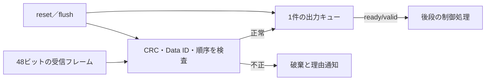

# 車載向けE2E通信保護の単体検証

CRC・Data ID・シーケンス番号を検査し、正常な要求だけをready/valid出力へ渡すRTLです。[オートモーティブの検証手順](../../docs/method/automotive-verification.md)と、これを実際に接続する[小規模ECU](../local-automotive-ecu/README.md)へつながります。

## 保護する境界



CAN等の受信処理より後のペイロード保護を学ぶ、**教材独自のフォーマット**です。CANコントローラー、CANのCRC・仲裁・ビットスタッフィング、AUTOSAR E2Eの特定プロファイルは実装していません。

| 項目 | 教材の仕様 |
| --- | --- |
| 入力 | 48ビット、上位からData ID 16ビット、カウンター8ビット、ペイロード16ビット、CRC 8ビット |
| CRC | CRC-8/SAE-J1850、poly=0x1D、init=0xFF、xorout=0xFF、反転なし。先頭5バイトを上位バイトから計算 |
| 順序 | リセット・flush後は0を期待し、正常受付でのみ1加算。255の次は0 |
| 受付 | `in_valid && in_ready`で1フレームを検査。待ち中は送信側がフレームを保持 |
| 出力 | 正常なペイロードを次のサイクルから提示。出力待ち中は値とvalidを保持 |
| 同時処理 | 出力受付と次入力受付が同時に可能。未完了の正常出力は最大1件 |
| 不正入力 | CRC→Data ID→順序の優先順で理由1／2／3を通知し、期待カウンターを進めない |
| 初期化 | 非同期Lowリセット、または同期flushで出力と順序履歴をクリア。flushは転送より優先 |
| 構成 | Data IDが0xA12F／0x35C9の2構成 |

`accepted`は検査を通過してキューへ入った通知で、後段が出力を受け付けた件数とは別です。`rejected`・`reject_code`は入力を受け付けたエッジ直後の1サイクルだけ通知します。

## 期待値と試験

RTLはビットごとのLFSR演算、Pythonは多項式の剰余計算でCRCを求めます。既知の`123456789`→0x4Bも単独テストします。出力キューはトランザクションとしてモデル化し、DUT内部のカウンターを期待値へ読み戻しません。

- 正常連続転送、255→0の折返し、0／最大ペイロード。
- フレーム内の全48ビット位置への単一ビット反転、CRCが正しい異なるData ID、複数の誤りの優先順位。
- 重複・欠落・順序飛び、不正入力後の正常な番号の再受付、初期化直後の非0番号の拒否。
- 入出力の待ち、同時入替え、未完了出力のreset／flushによる取消、0番からの再開。
- smokeは200サイクル×1 seed、nightlyは1,500サイクル×3 seedのランダム刺激を固定試験へ追加。

[4要求・16目標](requirements.json)を構成ごとに全達成し、全観測値と完了件数を照合します。CRC、ID、順序の検査漏れ、待ち中の誤受付、flushで順序を戻さない誤りの5種類を構成ごとに検出します。指定チェッカー以外の異常やビルド失敗は、予定した検出に数えません。

## 実行と記録

```sh
python3 examples/local-e2e-guard/run.py --out artifacts/e2e-smoke
python3 examples/local-e2e-guard/run.py --profile nightly --out artifacts/e2e-nightly
python3 -m unittest discover -s examples/local-e2e-guard/tests -v
```

Python 3.10以上と[固定版Icarus](../../tools/ENVIRONMENT.md)を使います。smokeは24、nightlyは28判定です。seedの既定値は17、nightlyは17／18／19です。出力先は毎回新しくします。

`manifest.json`・`summary.json`・JUnit・到達目標に加え、生成入力・期待値・ソースのハッシュ、コンパイルと実行の記録、各試験のVCD・`trace.csv`を保存します。件数は`inputs=validated+rejected`、`validated=retired+cancelled`を要求し、最後に出力キューが空であることも確認します。`checks`は比較を完了したサイクル数です。

欠落後は自動で再同期せず、送受信側が合意した初期化で0番へ戻す仕様です。8ビットの折返しや初期化をまたぐ古いフレームを、番号だけで識別できるとは限りません。CRCとカウンターは暗号的な送信者認証ではなく、SecOC等の代用にはなりません。AUTOSAR Profile 1とはカウンター範囲・配置・CRCの扱いが異なります。

車載の信頼性を評価する際は、この通信検査に、使用環境・期間、実部品の故障・劣化、製造品質などの根拠を組み合わせます。本例で破損や順序の異常を検出できても、実部品の故障率や寿命を測定したことにはなりません。[信頼性と機能安全の役割](../../docs/method/automotive-verification.md#車載で信頼性が重視される理由)を参照してください。
