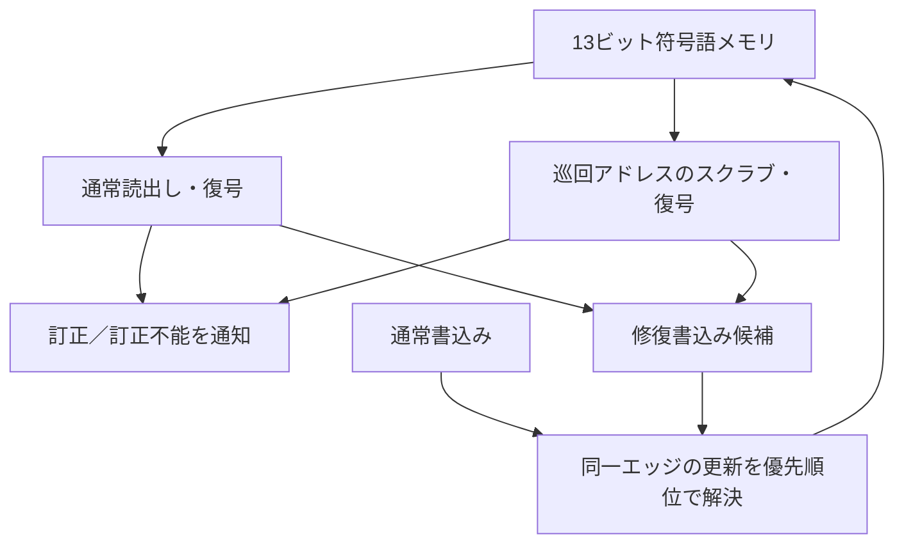

# ECC付きメモリの読出し訂正とスクラビング

既存の[8ビットSECDED](../local-ecc/README.md)を新規の小容量メモリへ組み込みます。読出し時の訂正、訂正値の書戻し、巡回訂正（スクラビング）、通常書込みとの競合、訂正不能の通知を検査します。Pythonは既存の独立した符号語集合・距離判定から期待値を作り、RTLのシンドローム値は参照しません。

## 通常アクセスと巡回訂正の優先関係

通常読出しとスクラブが同じ符号化メモリを検査し、訂正可能な誤りだけを書き戻します。



更新の優先順位は低い順にスクラブ修復、読出し修復、通常書込み、試験用故障注入です。図は特定の単一ポートSRAM構成を表しません。

| 確認する場面 | 期待する動作 | 主な照合対象 |
| --- | --- | --- |
| 1ビット誤り | 訂正し、読出しまたはスクラブで書戻し | 修復後の再読出し |
| 2ビット誤り | 通知し、符号語を変更しない | 訂正不能と保持 |
| 通常書込みとの競合 | 通常書込みが修復より優先 | 更新後の符号語 |

## 機能と優先順位

幅はデータ8ビット・符号語13ビット、深さ4／8の2構成です。リセットはメモリ全体を0へ初期化します。読出しデータは現在のアドレスに対する組合せ出力で、`rd_en`時に訂正・訂正不能フラグを有効にします。

単一誤りの読出しでは、そのエッジで訂正値を書き戻します。スクラブを有効にした各エッジでは巡回アドレスを1つ進め、単一誤りを修復し、結果を次のサイクルの通知へ出します。2ビット誤りは通知し、保存した符号語を変更しません。

同じエッジの優先順位は、低い順に「スクラブ修復 → 読出し修復 → 通常書込み → 試験用の故障注入」です。通常書込みが古いスクラブ値で上書きされないことを確認します。注入はエッジ前の符号語へのXORで、製品のソフトウェアインターフェースではありません。通常読出しと同時書込みは更新前の値を返します。

## 試験と実行

13個すべてのビット位置の単一誤り、代表的な2ビット誤り、修復後の再読出し、訂正不能の保持、スクラブの周回、書込み／読出しとの競合、リセットを含め、各11目標を要求します。元のECC単体例の全数検査と、このメモリ結合例のシナリオ検査を区別します。

4変異はスクラブ書戻しの欠落、スクラブが通常書込みを上書き、訂正不能通知の隠蔽、読出し書戻しの欠落です。

```sh
python3 examples/local-ecc-memory/run.py --out artifacts/ecc-memory
python3 examples/local-ecc-memory/run.py --profile nightly
python3 -m unittest discover -s examples/local-ecc-memory/tests -v
```

[共通手順](../local-common/README.md)を使います。smokeは50操作、nightlyは400操作×3 seedに固定シナリオを加えます。ランダム操作は書込み・0〜2ビット注入・読出しの組で、履歴を変えながら保証範囲内の故障を検査します。2構成合計JUnitは14／18件です。

3ビット以上の任意故障、実SRAMマクロの特性、故障率、スクラブ周期の製品設計、機能安全規格への適合、MBIST・製造テストは対象外です。スクラブと読出しの2つのデコード経路を持つ動作モデルであり、特定の単一ポートSRAMへ実装可能であることの検証でもありません。
