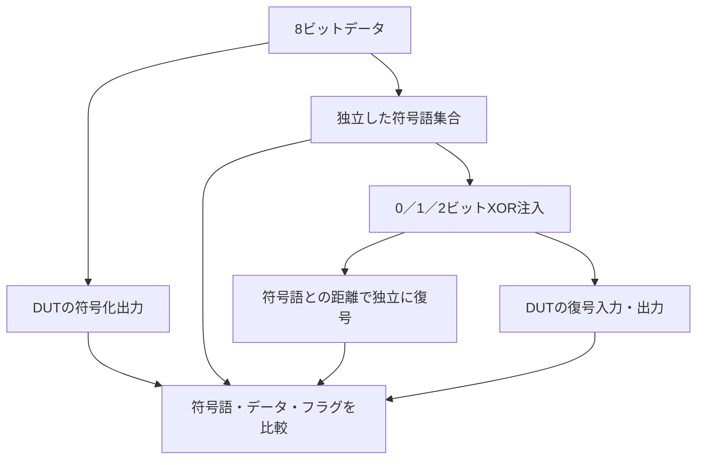

# ECCの故障注入・訂正・検出をローカルで確認する

8ビットデータを13ビットの符号語にする、短縮拡張ハミング符号のSECDED教材です。全データ値について誤りなし、全1ビット誤り、全2ビット誤りを検査し、3ビット以上で保証できないことも診断で示します。実メモリや商用IPの評価ではありません。

## 符号化・故障注入・独立した判定

独立した符号語集合から復号入力と期待値を作り、DUTの符号化出力と復号出力を別々に比較します。



保証範囲の全数検査と、3ビット以上で保証できないことを示す診断を分けます。記憶回路を持たない組合せ回路の例です。

## 1. この回路の仕様

組合せ回路`secded`は、`data_in`の符号化結果`encoded`と、別入力`received`の復号結果を同時に出力します。記憶回路は含みません。偶数パリティを使い、符号語の位置は次のように定めます。

| 位置（1始まり） | 内容 | SVの添字 |
| --- | --- | --- |
| 1、2、4、8 | ハミング検査ビット4個 | 0、1、3、7 |
| 3、5、6、7、9、10、11、12 | データのLSBからMSB | 2、4、5、6、8、9、10、11 |
| 13 | 符号語全体の偶数パリティ | 12 |

`corrected_code`は訂正後の符号語、`data_out`はそこから取り出したデータです。

| 入力の誤り | 期待する結果 | corrected | uncorrectable |
| --- | --- | --- | --- |
| なし | 符号語・データをそのまま返す | 0 | 0 |
| 1ビット | データ／検査／全体パリティのどの位置も訂正 | 1 | 0 |
| 2ビット | 訂正せず検出する | 0 | 1 |

`uncorrectable=1`のとき、`corrected_code`は入力をそのまま返し、`data_out`はその生のデータ部分です。**有効なデータとして使用してはいけません。** 受信ワードの全体パリティが奇数でも、シンドロームが未使用位置13〜15を指す場合は訂正不能とする仕様です。通常の0／1／2ビット誤りでは、この未使用位置への単一誤り訂正は発生しません。

## 2. 刺激と独立した期待値

RTLは検査式でシンドロームを求め、指示された1ビットを反転します。Python側は、パリティ制約を満たす全256個の符号語を列挙し、受信ワードとの**最小ハミング距離**で期待値を決めます。RTLの訂正手順をコピーせず、異なるアルゴリズムで照合します。コードブックの最小距離4もセルフテストで点検します。

固定の全数検査は、256データ×（誤りなし1＋単一誤り13＋二重誤り78）＝**23,552パターン**です。訂正後の符号語、データ、2つのフラグ、符号化結果を毎回比較します。追加のランダム検証は、データ、誤り数0／1／2、重複しない反転位置を変更します。

[要求カタログ](requirements.json)は4要求・97目標です。誤りなし1、単一誤り位置13、二重誤り位置の組78、代表データ5を必須にします。97目標の達成とは別に、23,552件の検査完了と誤り種別別の件数も照合します。

## 3. 保証範囲外の診断と変異

診断は、正常回路でも期待されるSECDEDの限界を示すものです。

- `triple-limit`：元データ0の符号語の位置1・2・3を反転すると、別の符号語への誤訂正が起きます。この例ではデータ1、`corrected=1`、`uncorrectable=0`になります。
- `four-limit`：元データ0に、データ1の有効符号語`0x1007`と同じ4ビットの反転を加えると、データ1として無通知で通ります。

これら2例が再現できても、3ビット誤りや4ビット誤りをすべて分類・検出できたことにはなりません。診断の観測は97目標の達成に算入しません。

RTLの意図的な変異は次の4種類です。ランナーは指定したチェッカーで失敗したことまで照合します。

| 番号 | 誤実装 | 期待する検出ラベル |
| --- | --- | --- |
| 1 | 訂正反転を行わない | ECC_CORRECTION |
| 2 | 訂正不能フラグを出さない | ECC_FLAGS |
| 3 | 符号化結果のビット0を反転 | ECC_ENCODE |
| 4 | 訂正通知を出さない | ECC_FLAGS |

## 4. 実行

[共通の準備・証跡の説明](../local-common/README.md)に従い、リポジトリのルートから実行します。

```sh
python3 examples/local-ecc/run.py --out artifacts/ecc-smoke
python3 examples/local-ecc/run.py --profile nightly --out artifacts/ecc-nightly
python3 -m unittest discover -s examples/local-ecc/tests -v
```

構成は`hamming13-8`の1つです。smokeは64ランダムパターン×1 seed、nightlyは1000×3 seedを全数検査に追加します。正常時のJUnitはsmoke **9件**、nightly **11件**です（全数1＋ランダム1／3＋診断2＋変異4＋合否判定1）。

```sh
python3 examples/local-ecc/run.py --demo-bug 1 --out artifacts/ecc-intentional-failure
```

上のコマンドは通常検証にも不具合を入れるため、終了コード1と`ECC_CORRECTION`による失敗が期待結果です。

## 5. 適用範囲と参考資料

2026-10-27にIcarus Verilog 14.0開発版とPython 3.14.7でsmoke／nightly、全数検査、4種類の変異、診断2件、セルフテスト6件をローカルで確認しました。GitLabでの実行やCI追加は行っていません。

1符号語への論理的なビット反転を扱います。バースト誤り、インターリーブ、スクラビング、故障の継続性、実SRAMへのアクセス、割り込み・リセットとの結合は対象外です。製品では、符号・ビット配置・通知仕様を製品の仕様へ置き換えてください。

SECDEDが単一誤り訂正・二重誤り検出を意味することは、[MicrochipのEDAC概要](https://onlinedocs.microchip.com/oxy/GUID-199548F4-607C-436B-80C7-E4F280C1CAD2-en-US-1/GUID-9565AA8F-AC23-457D-B9F3-C0A80C7AF292.html)でも説明されています。本教材の符号長、ビット配置、フラグ・出力の扱いは独自の仕様で、同製品のEDACを再現したものではありません。
