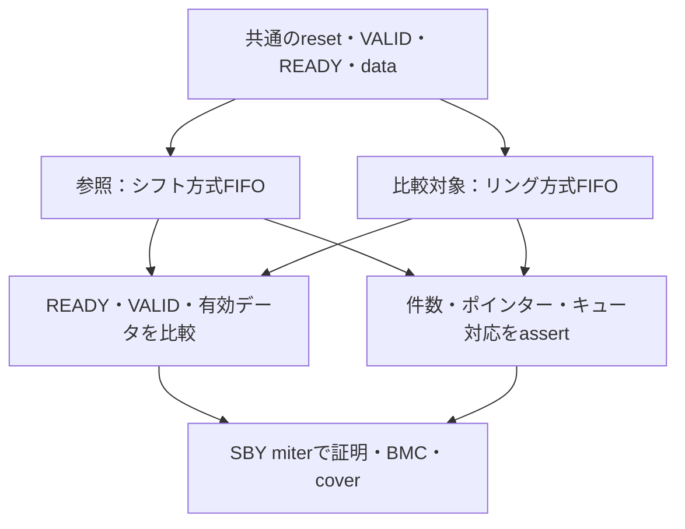

# FIFOの最適化前後を等価性検証する

シフトレジスタ方式とリングバッファ方式のFIFOを同じ入力で動かし、サイクルごとのインターフェースが一致することを証明します。専用の小さなRTLを用意した教材で、既存FIFOを置き換える変更ではありません。

## 同じ入力で2実装を比較する

シフト方式とリング方式へ同じ入力を与え、外部出力と補助不変条件を別々のassertで検査します。



参照実装も誤る可能性は残ります。2実装の一致を、独立した仕様適合性の確認へ置き換えません。

| 確認する場面 | 期待する動作 | 主な照合対象 |
| --- | --- | --- |
| 通常prove | 外部一致と補助条件を非有界に証明 | 指定幅・深さ・同期リセット |
| 変異BMC | 外部インターフェースの予定違反を要求 | 補助条件を外して感度確認 |
| 通常cover | 満杯・同時操作・リセット等へ到達 | 仕様適合性の証明とは別 |

## 比較する契約

データ幅4ビット、深さ2／4の2構成です。空でなければ出力VALID、満杯でなければ入力READYを出します。pushは入力VALIDかつ入力READY、popは出力VALIDかつ出力READYで成立します。

満杯のサイクルでは、そのサイクルにpopしてもpushを受け付けません。空のサイクルのpushを、そのまま同サイクルの出力へ渡すバイパスもありません。出力データは出力VALIDの間だけ比較します。双方でこのサイクル契約を固定するため、レイテンシを変える最適化の比較ではありません。

参照RTLは先頭を取り出して残りをシフトし、比較対象RTLはhead／tailで記憶位置を進めます。どちらにも同期リセットを入れ、空から開始します。

## 証明方法

本実行例は**SBYのmiter方式**です。2実装へ同じ入力を与え、READY／VALIDと有効データの不一致をassertで検出します。既に使うツール群で再現できるようにしており、EQYを起動する例ではありません。大きな回路の分割・照合には[EQY](https://yosyshq.readthedocs.io/projects/eqy/en/latest/quickstart.html)という別の選択肢があります。

通常proveでは、件数の一致と範囲、head／tailと件数の関係、使用中の論理キューと物理メモリの対応もassertします。これら3条件を帰納法の補助条件とし、インターフェースの2条件と合わせた5条件を証明します。内部の対応をassumeしているわけではありません。内部状態の観測ポートは教材の証明用です。

初回リセット以外は、入力データ・VALID・READY・後続リセットを任意とします。空でのpopや満杯でのpushの試行も除外しません。全ての可能な時間までの証明ですが、対象の幅・深さ・リセット・サイクル契約の下での結果です。

## タスク

各構成8タスク、2構成で16件のJUnitです。

- 正常な等価性の非有界証明。
- 満杯、最後のpop、pushとpopの同時成立、データ保持中のリセット、復帰の5目標のcover。
- 同時push／popの件数更新ミス、読出しポインターの誤り、満杯でもREADY、出力データ反転の4変異。補助条件を外したBMCで、外部インターフェースの予定assertの反例を要求します。
- 常時リセットの証明PASSと、正常cover全未達の診断2件。

単に「両方同じ誤りなら一致する」可能性は等価性だけでは解消できません。参照実装が仕様に合うことのレビュー・機能検証も必要です。既存のFIFO機能検証とは役割を分けます。

## 実行

[共通フォーマル手順](../local-formal-common/README.md)でツールを準備します。

```sh
python3 examples/local-equivalence/run.py
python3 examples/local-equivalence/run.py --configuration depth4 --task equivalence-proof
python3 -m unittest discover -s examples/local-equivalence/tests -v
```

2026-10-27に固定版ツールとPython 3.14.7で全16タスク、通常cover 10目標、変異8反例が成功しました。計画の確認テストは2件です。合成後ネットリスト、セルライブラリ、Xの扱い、CDC、物理タイミングの等価性を確認した結果ではありません。
