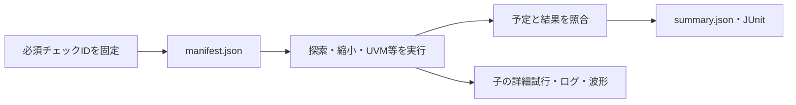

# ローカルの探索・縮小・UVMに共通する証跡

[失敗の縮小](../local-failure-reduction/README.md)、[カバレッジによる刺激調整](../local-coverage-feedback/README.md)、[UVM](../local-uvm/README.md)、[7例の集約](../local-workflow-regression/README.md)で使う補助コードです。既存のプロセス実行・終了判定とAXI4-Stream例を再利用します。

実行前に必須チェックIDを固定し、未実行・重複・計画外のチェック、既存出力先の上書きを拒否します。マニフェスト、予定と結果、JUnitを保存します。各例の詳細試行は子ディレクトリへ保存し、親のゲート数と混ぜません。ビルド失敗やタイムアウトは不具合の再現成功として扱いません。

```sh
python3 -m unittest discover -s examples/local-exploration-common/tests -v
```

Icarusを使う4つの新規回路例は、従来の[共通シミュレーションランナー](../local-common/README.md)をそのまま使います。

## 固定計画と実行記録を照合する

実行前にチェックIDを固定し、全チェックの完了・一意性・合否を保存します。



| 確認する場面 | 期待する動作 | 主な照合対象 |
| --- | --- | --- |
| 計画 | 空・重複・計画外を拒否 | 必須IDの集合 |
| 実行エラー | タイムアウトやビルド失敗を成功にしない | 実行記録 |
| 保存 | 既存出力先を上書きしない | 親ゲートと子試行を区別 |
