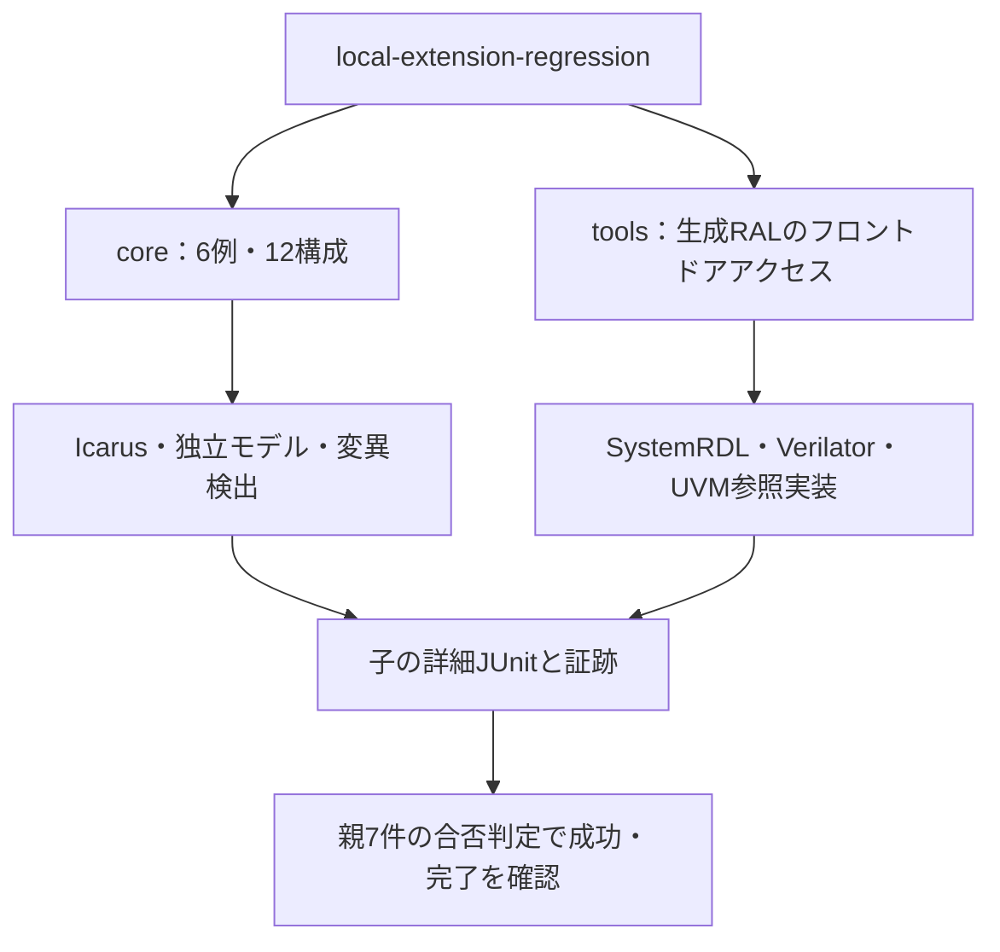
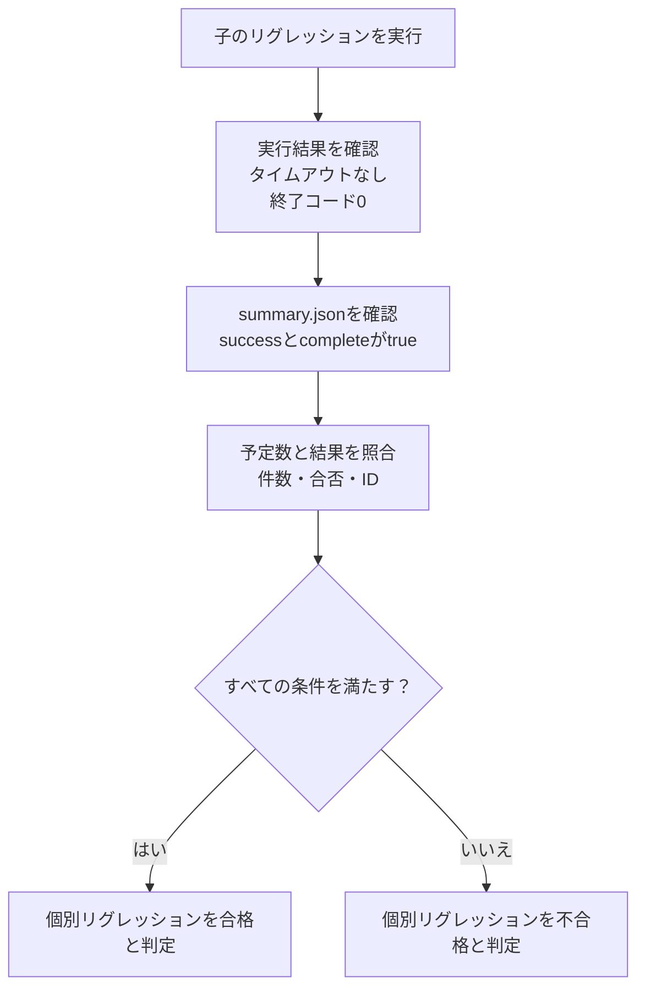

# RAL接続・順序制御・DMA・CRC・カウンター・MBISTの7例

既存例で未対応だった部分を広げるローカル教材をまとめて実行します。GitLabの登録・CI設定・利用枠は使いません。

1. [生成RTL＋UVM RAL frontdoor](../local-generated-ral/README.md)
2. [AXI4の応答順序入れ替え](../local-axi-reorder/README.md)
3. [DMAリングの所有権](../local-dma-ownership/README.md)
4. [メモリ⇄Stream DMA](../local-stream-dma/README.md)
5. [パケットCRC](../local-packet-crc/README.md)
6. [64ビットカウンターのスナップショット](../local-counter-snapshot/README.md)
7. [MBIST・March C−](../local-mbist/README.md)

## 実行範囲と件数



| 区分 | smoke JUnit | nightly JUnit |
| --- | --- | --- |
| 共通シミュレーション6例 | 84 | 108 |
| 生成RALとRTLのバス接続 | 15 | 19 |
| 直下の子の合計 | 99 | 127 |
| 集約ランナーの合否判定 | 7 | 7 |

親と子を重複加算しません。通常実行のカバレッジは正常終了し、予定した比較・件数を満たした通常ケースだけを使います。各例4種類のネガティブテストを持ちますが、生成RALの1件はモデル側の診断で、全件をRTL変異検出率へまとめません。

## 子の成功を親で確認する手順

集約ランナーでは、1項目につき個別リグレッションの完了と成功を確認します。子の個別テストケースを親の件数へ取り込み直す方式ではありません。



`planned`は正の整数を要求します。`results`が整数なら予定数との一致、一覧なら件数の一致・全件pass・空でない一意のIDを要求し、その他の形式や読めないJSONは失敗にします。

| 調べたいこと | 主に確認する保存物 | 見る内容 |
| --- | --- | --- |
| どの子が失敗したか | 親の`summary.json`・`junit.xml` | 選択した子ごとの合否と予定数 |
| 子の起動・タイムアウト | 親の子名付きログ・`子名-execution.json` | コマンド・終了コード・実行エラー |
| どの検査が失敗したか | 子の`junit.xml`とケースごとのログ | 正常・変異・診断・カバレッジの判定 |
| 何を実行したか | 子の`manifest.json`とツール版の記録 | seed・構成・ソースハッシュ・使用環境 |
| 通常実行のカバレッジ目標が未達か | coreの`coverage.json`、生成RALの通常ログとカバレッジの合否判定 | 正常実行からの到達と不足 |
| 信号の時間関係 | 子のシミュレーションケースのVCD | ハンドシェイク・保持・リセット前後 |

`--stage core`では6子、`tools`では1子、`all`では7子だけを親の予定に入れます。未選択の子を検査済みと扱わず、別stageの結果も同じ出力先へ混ぜません。

## 準備と実行

coreはPython 3.10以上・Icarusを使います。toolsにはVerilator 5.052・C++20、[外部UVMライブラリ](../local-uvm/README.md)と[SystemRDL用Python](../local-register-spec/README.md)を準備します。

```sh
python3 examples/local-extension-regression/run.py --stage core --out artifacts/extension-core
python3 examples/local-extension-regression/run.py \
  --uvm-home /tmp/lsi-uvm-library/1800.2-2020.3.2 \
  --rdl-python /tmp/lsi-rdl-venv/bin/python --out artifacts/extension-all
```

同じ引数へ`--profile nightly`と新しい`--out`を指定するとnightlyです。`--stage tools`は生成RALだけです。`--child-timeout`は子1リグレッションの上限で、既定1800秒です。選択しなかった例は合格にしません。ツールの自動インストールは行わず、既存出力先は上書きしません。

各子の入力・ソースハッシュ・ツール版、通常実行とネガティブテストの結果、ログ、VCDを保存します。親では予定数・完了・成功と、一意で空でない結果IDを照合します。

セルフテストは6回路計35件（AXI応答順序6・DMA所有権6・Stream DMA7・CRC5・カウンター6・MBIST5）・生成RAL判定2件・親4件の計41件です。

```sh
python3 -m unittest discover -s examples/local-extension-regression/tests -v
python3 -m unittest discover -s examples/local-generated-ral/tests -v
```

回路ごとの確認コマンドと、教材で採用した仕様・対象外は各READMEを参照してください。任意のAXI実装・CPU・実メモリ・製品の正しさを一括で保証する計画ではありません。

## 実行確認

2026-10-27に全7例のsmoke／nightlyが成功しました。親JUnitは各7件、子は99／127件です。追加時の36件とレビュー追加5件の計41件もすべて成功し、各マニフェストのソースハッシュと使用UVMライブラリsrcのハッシュを現行ファイルと照合しました。レビューでは既存の確認も含む全448件（ローカル316＋GitLab向け132）が成功しました。
