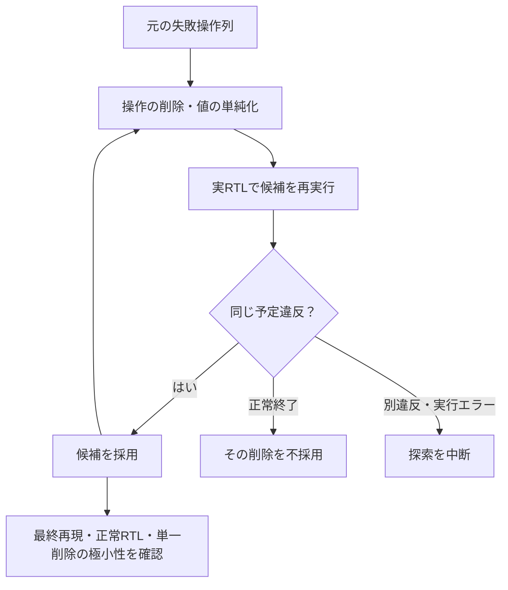

# 失敗したランダム操作列を自動で縮小する

既存の[AXI4-Stream FIFO](../local-axis/README.md)へ、seedで再現するbeat・idle・resetの操作列を与えます。データ反転のRTL変異で`AXIS_DATA`違反を発生させ、操作を削っても同じ違反になるか、毎回Icarusで実行して判断します。GitLabの利用枠は使いません。

## 同じ違反を保って操作を削る

候補ごとに合法な通信と期待値を作り直し、同じAXIS_DATA違反を再現する候補だけを採用します。



最終確認へ進むのは縮小探索の完了後です。図の矢印は候補の採否を示し、エラー時に探索を継続する意味ではありません。

| 確認する場面 | 期待する動作 | 主な照合対象 |
| --- | --- | --- |
| 採用する失敗 | 唯一の予定ラベルと非ゼロ終了 | 正常完了記録なし |
| 最終列の確認 | キャッシュなしで再現し、正常RTLでは合格 | 同じ版・構成・チェッカー |
| 極小性 | 各操作を1個削ると同じ違反は出ない | 全候補中の最短性ではない |

## 縮小の条件

`ddmin`で操作のまとまりを削除し、データ値も単純化した後、再び操作を削除します。候補ごとに高水準の操作からハンドシェイクと独立した参照キューの期待値を作り直します。元のサイクル列を途中で切り貼りして、無効な通信を作る方式ではありません。

- 縮小候補は、非ゼロ終了、唯一の`CHECK_FAIL AXIS_DATA`、正常完了記録なし、を満たす場合だけ再現成功とします。
- 正常終了した候補には、予定の検査数、受付・排出・バイト数等の件数、VCDも要求します。
- タイムアウト、コンパイル失敗、違うチェッカーの失敗は縮小を中断するエラーです。
- 最後にキャッシュを使わず再実行し、元の正常RTLなら合格することも確認します。
- 各操作を1個ずつ削った全候補が同じ違反を起こさないことを確認します。これは単一操作の削除についての極小性であり、全候補中の最短列を保証しません。初期リセットと最終排出は操作列の外にある固定条件です。

[Hypothesisのstateful testing](https://hypothesis.readthedocs.io/en/latest/stateful.html)にも、操作列を生成し短い再現列へ縮小する考え方があります。本例は追加パッケージなしの独自実装で、Hypothesisを呼び出した結果ではありません。

## 実行と証跡

Python 3.10以上、Icarusの`iverilog`・`vvp`を使います。ルートから実行します。

```sh
python3 examples/local-failure-reduction/run.py --out artifacts/failure-reduction
python3 examples/local-failure-reduction/run.py --profile nightly --seed 42
python3 -m unittest discover -s examples/local-failure-reduction/tests -v
```

smokeは25操作、nightlyは101操作を縮小します。縮小対象には不具合を確実に再現する1操作を含め、seedで周辺の履歴を変えます。自然発生した未知の不具合を発見する能力の評価ではありません。

`original.json`・`reproducer.json`・`search.json`に元の操作列、再現列、試行と採否を保存します。全試行のベクトル、実行ログ、VCD、ビルド結果、ソースSHA-256も残ります。6個の合格条件をJUnitへ出力し、探索中の実行数は`executions.json`で別に数えます。

`reproducer.json`は固定回帰へ移すための高水準操作列です。`run.py`の`rows()`で再びベクトルへ変換できます。元の版・構成・チェッカーと合わせて保管してください。別の不具合への汎用適用では、対象操作、生成制約、失敗の識別条件を追加する必要があります。

保存済みの最小列を元の正常RTLで再実行する例です。上の`--out artifacts/failure-reduction`を実行した同じ環境で使います。

```sh
vvp artifacts/failure-reduction/axis-m0.vvp \
  +VECTORS=artifacts/failure-reduction/original-rtl-replay/vectors.txt \
  +WAVE=/tmp/failure-reduction-replay.vcd
```

バイナリを再利用する場合も、元のソース・ツール版のマニフェストを合わせて保管します。新しい版への恒久回帰は`reproducer.json`からベクトルを生成し直し、その版でビルドして確認します。
