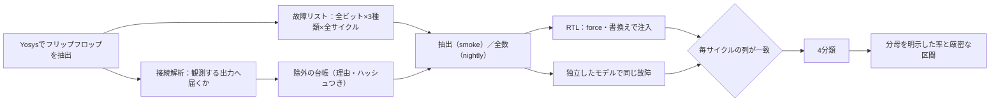

# 故障注入キャンペーンで、分母を明示した検出率を求める

[ロックステップ監視](../local-lockstep-monitor/README.md)のRTLを題材に、故障注入のキャンペーンを最初から最後まで行う教材です。故障リストの生成、注入、結果の4分類、検出率と区間、根拠つきの事前除外を、それぞれ確かめられる形で実行します。

**これは教材のキャンペーンです。ISO 26262の診断網羅率（DC）やASILの主張ではありません。** 分類の名前・分母・除外の考え方はこの教材で決めたもので、ISO 26262-5（2018年版）の該当の節とは照合していません（未照合）。

題材のRTL（`examples/local-lockstep-monitor/rtl/lockstep_monitor.sv`）は編集せず、そのまま参照します。この例のファイルは、ランナー・モデル・テストベンチ・除外の台帳だけです。

## 流れ



## 題材と観測する出力

ロックステップ監視は、同じ演算を2つのコア（`acc0`、`acc1`）で行い、次の値を比べて、食い違えば警報（`error`）を上げて安全状態へ入ります。比べるのはコアの次の値だけで、出力のレジスタ（`result`、`done`）は比べません。

| 区分 | 信号 | 分類での扱い |
| --- | --- | --- |
| 機能の出力 | `result`、`done` | ゴールデン実行と毎サイクル比べる |
| 安全機構の警報 | `error` | ゴールデン実行にない立上りを「検出」とみなす |
| 状態の通知 | `safe`、`error_code` | 分類には使わない（`safe` の影響は、受け付けない操作として機能の出力に現れる） |

## 故障リスト

- **対象のビット**：Yosysで `proc`・`opt_clean` した後のネットリストから、フリップフロップのセルとその出力の名前を取り出します。7レジスタ・29ビットです（`acc0`・`acc1`・`result` 各8、`error_code` 2、`error`・`safe`・`done` 各1）。
- **手書きにしない理由**：RTLの `reg` の宣言を拾うと、`always @*` の中の組合せの変数 `next0`・`next1`（16ビット）も入ります。フリップフロップではないので、注入しても次の評価で上書きされ、分母を水増しします。ランナーは、抽出の結果を、仕様から書いたモデルの状態（`model.py` の `STATE`）と照合します。
- **故障の種類**：1サイクルの反転（そのサイクルの立上りの直後に値を反転し、次の更新で消える）と、持続する0固着・1固着（そのサイクルから最後まで値を固定）の3種類です。
- **注入の時刻**：ゴールデン実行の全21サイクルです。
- **母集団**：29ビット×3種類×21サイクル＝1,827故障です。

## 注入の方法：シミュレーターでの書換えと `force`

RTLの写しに注入用のポートを足す方法と比べ、シミュレーターでの注入を選びました。

- **選んだ理由**：検証する回路が、配布しているRTLそのもの（ハッシュが一致）になります。注入用の回路が、正常の動作や合成の結果に入り込みません。故障リストも、同じRTLから抽出したものです。
- **やり方**：1サイクルの反転は、テストベンチから階層参照でビットを書き換えます。固着は、そのビットへ `force` し、次の故障の前に `release` します。どちらの記述も、抽出したレジスタの一覧から `campaign.py` が生成します（`injector.svh`、出力先に保存）。
- **読み返し**：注入の直後にビットを読み返し、反転なら元の値の逆、固着なら固定した値になっていることを毎回確かめます。
- **弱点**：階層名とシミュレーターの `force` に頼ります。合成した後のネットリストでは名前が変わるので、そのままでは使えません。Icarus Verilog 14.0開発版で、変数のビット選択への書換えと定数のビット選択への `force` が動くことを確かめました。kirimasimでは実行していません。

## ワークロード

12個の操作（LOAD・ADD・XOR・不正な命令、間に空きサイクル）を、テストベンチが握手しながら与えます。テストベンチは次のように反応します。同じ動作を `model.py` の `Workload` が1行ずつ写していて、ゴールデン実行の列で一致を確かめます。

- 操作を出したら `done` を待ちます。4サイクル待っても来なければ「止まった（stall）」として終わります。
- `error` を見たら、次のサイクルで `recover` を出します。不正な命令の警報なら次の操作へ進み、それ以外は同じ操作をやり直します。やり直しが2回を超えたら「諦めた（abandon）」として終わります。
- 96サイクルを超えたら「上限（cap）」として終わります。

ゴールデン実行は21サイクルで、不正な命令による警報が1回あります。

## 分類の規則

ゴールデン実行と故障を入れた実行の列を、サイクルごとに比べます。上から順に当てはめます。

| 順 | 分類 | 条件 |
| --- | --- | --- |
| 1 | 時間切れ | 実行が止まった（stall）か、上限に達した（cap）。警報が出ていても、終わらない実行を安全とはみなさない |
| 2 | 安全機構が検出 | ゴールデンにない警報の立上りが、機能の出力が最初に食い違ったサイクルと同じかそれより前にある |
| 3 | 検出されず出力が相違 | 機能の出力が食い違った、ゴールデンにある警報が出なかった、または実行の長さが違う |
| 4 | 影響なし | 上のどれでもない（機能の出力と警報が全サイクル一致し、最後まで終わった） |

警報と同じサイクルに `result` が0になるのは安全状態への移行なので、2に数えます。

## 事前の除外と台帳

各フリップフロップのビットから、ネットリストを前向きにたどって届く出力を求めます。セルの入力はすべての出力に影響するとみなすので、たどった範囲は実際より広く、届かないと判定したものは本当に届きません。観測する3つの出力（`result`・`done`・`error`）のどれにも届かないビットを除外します。

- **結果**：除外は `error_code` の2ビットだけで、このレジスタは自分の出力へしか届きません。故障の数では126個です。
- **台帳**：`exclusions.json` に、除外するビット、届く出力、理由、題材のRTLのハッシュを書いています。ランナーは毎回解析し直し、台帳と一致すること、RTLのハッシュが変わっていないことを確かめます。題材のRTLを変えると、台帳を見直すまでこの例は不合格になります。
- **シミュレーションでの裏付け**：除外した126故障も毎回シミュレーションし、すべて「影響なし」であることを確かめます。
- **対象**：1,827−126＝1,701故障です。

## 率の定義と区間

| 率 | 分子 | 分母 |
| --- | --- | --- |
| 検出率 | 安全機構が検出 | 影響のあった故障＝検出＋検出されず相違＋時間切れ（対象の故障だけ） |
| 影響なしの割合 | 影響なし | 対象の故障 |

時間切れは、検出していない側に数えます。

### 母集団の値

モデルで対象の1,701故障を全数で分類した値です（nightlyでは、RTLでも全数を実行してモデルと一致することを確かめます）。

| 分類 | 故障の数 |
| --- | --- |
| 影響なし | 355 |
| 安全機構が検出 | 714 |
| 検出されず出力が相違 | 546 |
| 時間切れ | 86 |

検出率は714／1,346＝53.0%、影響なしの割合は355／1,701＝20.9%です。

レジスタごとの内訳（反転／固着の順）は次のとおりで、どこが弱いかが分かります。

| レジスタ | 検出 | 影響なし | 相違 | 時間切れ |
| --- | --- | --- | --- | --- |
| `acc0` | 104／228 | 48／78 | 16／30 | 0／0 |
| `acc1` | 104／258 | 64／78 | 0／0 | 0／0 |
| `result` | 0／0 | 0／46 | 168／290 | 0／0 |
| `done` | 0／0 | 0／2 | 21／21 | 0／19 |
| `error` | 20／0 | 0／11 | 0／0 | 1／31 |
| `safe` | 0／0 | 4／24 | 0／0 | 17／18 |

- 相違の8割以上は `result` です。比較器はコアの次の値を比べ、出力のレジスタは比べないからです。
- `acc0` の一部が検出されずに相違します。復帰の再同期（`acc1 <= acc0`）は `acc0` を確かめずに写すので、安全状態の間に `acc0` が反転すると、誤った値がコア1と `result` へ広がります。
- `error` の1固着は時間切れになります。ワークロードが復帰を繰り返し、操作へ進めないからです。

### 抽出したときの区間（smoke）

smokeは、対象の1,701故障から300個を、seedで決めて重複なしに選びます。分類した数から、二項分布の厳密な区間（Clopper-Pearson、両側、各裾にα/2、α＝0.001）を付けます。

- **seed 17の結果**：検出率は126／230＝54.8%、区間は43.8〜65.5%。影響なしの割合は70／300＝23.3%、区間は15.9〜32.1%。どちらも母集団の値を含みます。
- **区間の幅**：検出率の半幅は、およそ3.29×√(p(1−p)／230)＝0.108です。幅を半分にするには、4倍の故障が要ります。
- **誤って不合格にする確率**：1回の判定で2つの区間を使うので、合わせて0.002以下を狙っています。重複なしの抽出は二項分布より散らばりが小さく、区間は保守的になります。
- **確率の実測**：モデルの分類だけを使い、固定した2,000個のseedで同じ判定を行います。外れたのは1回でした。上限は12回です。設計どおり0.002なら平均4回で、12回を超える確率は1%未満です。この確認は、seedを固定しているので毎回同じ結果になります。

nightlyは、RTLで全1,827故障を実行してモデルと照合し、3つのseedの抽出も行います。

### 比較器を弱めたとき（nightly）

題材の既存の変異1（比較がビット0を見ない）で全数のキャンペーンを行うと、検出率は53.0%から50.4%へ下がります（検出は714から670）。どのビットの検出が減ったかは `faults.json` で追えます。

## 固定の故障（17個）

ゴールデン実行のサイクル（0 LOAD、1 ADD、2〜3 空き、4 XOR、5 ADD、6 空き、7 LOAD、8 ADD、9 不正な命令、10 復帰、11 XOR、12〜13 空き、14 ADD、15 LOAD、16 ADD、17 空き、18 XOR、19〜20 後の空き）から、分類と終わり方を手で決めた故障です。RTLとモデルの両方の分類が、手で決めた分類と一致することを求めます。

| 故障 | 分類 | 終わり方 | 場面 |
| --- | --- | --- | --- |
| `acc1[3]` 反転、6 | 影響なし | 完了 | 次のLOADで上書きされて消える |
| `acc1[2]` 反転、2 | 検出 | 完了 | 次のXORで検出し、復帰・再実行で最後の値は正しい |
| `done` 反転、1 | 相違 | 完了 | 完了を見落とし、同じADDを2回実行する |
| `safe` 反転、2 | 時間切れ | 停止 | 警報なしで操作を受け付けなくなる |
| `acc1[0]` 1固着、0 | 検出 | 諦め | やり直すたびに食い違う |
| `error` 反転、2 | 検出 | 完了 | 偽の警報 |
| `acc0[4]` 反転、9 | 相違 | 完了 | 安全状態の間の誤りを、復帰の再同期が広げる |
| `result[5]` 反転、12 | 相違 | 完了 | 出力のレジスタは比較されない |
| `error_code[1]` 反転、9 | 影響なし | 完了 | 除外したビット |
| `error` 1固着、3 | 時間切れ | 上限 | 復帰を繰り返して進めない |
| `acc0[0]` 反転、0 | 検出 | 完了 | ビット0（変異1で比較から外れる） |
| `acc1[0]` 反転、2 | 検出 | 完了 | 同上 |
| `done` 0固着、0 | 時間切れ | 停止 | 完了が来ない |
| `result[7]` 1固着、0 | 相違 | 完了 | 最初のサイクルから出力が違う |
| `acc0[6]` 反転、19 | 影響なし | 完了 | 最後の操作の後で使われない |
| `acc1[5]` 反転、1 | 検出 | 完了 | 上位のビットの比較 |
| `acc0[3]` 1固着、0 | 検出 | 完了 | 警報は先に出るが、復帰の後に誤った値のまま最後まで進む（最終の `result` は142、ゴールデンは126） |

最後の場面は、分類が「検出」でも結果が正しいとは限らないことを示します。分類は最初の警報の時刻で決まり、警報の後のシステムの反応（ここでは再同期とやり直し）の正しさは別の問題です。

## 構成

| ファイル | 内容 |
| --- | --- |
| `run.py` | ランナー。計画の固定、抽出、台帳の照合、注入、照合、分類、集計、証跡 |
| `campaign.py` | ネットリストの読取り、接続解析、注入記述の生成、分類器、厳密な区間、集計 |
| `model.py` | 題材の仕様から書いたモデル、テストベンチの反応を写したワークロード、故障の適用、母集団 |
| `tb/fault_campaign_tb.sv` | 1回の起動で全故障を順に実行し、毎サイクルの列を書くテストベンチ |
| `exclusions.json` | 除外の台帳 |
| `requirements.json` | 6要求・25目標 |
| `tests/test_campaign.py` | セルフテスト17件 |

## 実行方法

Icarus Verilogと、固定版のYoWASP版Yosysが必要です。

```sh
python3 examples/local-fault-campaign/run.py --out artifacts/fault-campaign-smoke
python3 examples/local-fault-campaign/run.py --profile nightly --out artifacts/fault-campaign-nightly
python3 -m unittest discover -s examples/local-fault-campaign/tests -v
```

`--yosys` でYosysを、`--iverilog`・`--vvp` でシミュレーターを指定できます。`--demo-bug N`（1〜4）は、正常の計画を題材の変異Nで実行し、不合格になることを見せます。

出力先には、`manifest.json`、`summary.json`、`junit.xml` のほか、`yosys/netlist.json`、`cones.json`、生成した `injector.svh`、各実行の `faults.txt`・`trace.txt`、故障ごとの記録 `faults.json`、集計 `campaign.json`、`coverage.json` が残ります。smokeで全体約1 MB、nightlyで約3 MBです。

## JUnitと変異

smokeは26件、nightlyは32件です。

| 種類 | 件数 | 内容 |
| --- | --- | --- |
| 正常の確認 | 13（nightly 19） | ツール、抽出、台帳、除外の裏付け、ゴールデン、分類器と集計の既知の答え、固定の故障、抽出と区間、区間の較正、集計、目標。nightlyは全数と変異1の検出率、seedの追加 |
| 題材の変異 | 4 | 1・2（比較・封じ込めの誤り）は `FC_MODEL`、3・4（復帰の値・不正な命令の誤り）は `FC_GOLDEN` |
| 注入の誤り | 3 | 1：レジスタの取り違え（`FC_MODEL`）、2：反転しない（`FC_INJECT`）、3：`reg` の宣言から一覧を作る（`FC_INVENTORY`） |
| 分類器・集計の誤り | 5 | 1：時間切れを影響なしに、2：警報の順序を見ない、3：最後の行だけ比べる、5：出なかった警報を検出に数える（以上 `FC_CLASSIFY`）、4：除外した故障を分母に入れる（`FC_ACCOUNT`） |
| 台帳の誤り | 1 | `done[0]` を誤って除外した台帳を拒否し、その63故障のうち61が影響なしでないことを示す |

分類器の誤りは、手で答えを決めた9組の合成の列（`run.py` の `KNOWN`）で見つけます。分類器はRTLの列にもモデルの列にも同じものを使うので、RTLとモデルの比較では分類器の誤りは見えないからです。

## 追加で入れた誤り

作業用の写しで、題材のRTL・テストベンチ・この例のコードへ1つずつ誤りを入れ、smokeを実行しました。題材のRTLを変えた写しでは、台帳のハッシュを更新し（見直したことにして）、動作の検査だけで見つかるかを確かめています。

| 誤り | 不合格になった主な確認 |
| --- | --- |
| RTL：復帰でコア1を再同期しない | 固定の故障、抽出 |
| RTL：比較が下位4ビットだけ | 固定の故障、抽出 |
| RTL：コア1のXORがOR | ゴールデン、除外の裏付け、固定の故障 |
| RTL：XORで `done` を出さない | ゴールデン、除外の裏付け、固定の故障 |
| RTL：不正な命令の通知を1にする | ゴールデン、除外の裏付け、固定の故障 |
| RTL：安全状態で `result` を0にしない | 固定の故障、抽出 |
| テストベンチ：待ちの上限が1長い | 固定の故障、抽出 |
| テストベンチ：注入が1サイクル遅い | 除外の裏付け、固定の故障、抽出 |
| テストベンチ：完了の後にやり直しの回数を戻さない | 固定の故障、抽出 |
| 接続解析：フリップフロップの入力をたどらない | 台帳 |
| 分類器：警報が厳密に先のときだけ検出 | 分類器の既知の答え、固定の故障 |
| 区間：αを0.5にする | 抽出の区間 |

12個すべてを、smokeが不合格にしました。最初の版では、比較を下位4ビットにする誤りと、やり直しの回数を戻さない誤りを、固定の故障が見つけられず、抽出した故障だけが見つけていました。上位のビットの比較（`acc1[5]` の反転）と、警報が何度も出る固着（`acc0[3]` の1固着）を固定の故障に足して、固定の故障でも見つかるようにしました。

## 確認範囲と残る制限

- **故障モデル**：フリップフロップの1ビットの反転と固着だけです。組合せの論理・配線・クロック・リセットの故障、複数のビットの同時の故障、持続時間の違う過渡故障は扱いません。
- **母集団**：1つのワークロードの21サイクルについてのものです。率は、このワークロードでの値で、回路の性質そのものではありません。ワークロードを変えれば率も変わります。
- **除外**：構造的な到達だけを根拠にしています。値の範囲から届かない故障（例：使われない値の範囲）は、除外せずにシミュレーションしています。
- **モデルの独立性**：モデルは題材のREADMEの仕様表から書きましたが、題材のRTLを読んだ同じ人が書いています。テストベンチの反応は、モデルがそのまま写しています。両方が同じ誤解を持てば、比較では見つかりません。固定の故障の分類を手で決めたことが、その対策の1つです。
- **分類**：分類は最初の警報と最初の食い違いの時刻で決まり、警報の後の反応の正しさは判定しません（`acc0[3]` の1固着の場面）。
- **区間**：区間は抽出の誤差だけを表し、ワークロードの選び方の偏りは表しません。
- **規格**：ISO 26262の安全な故障・残余故障・潜在故障などの用語や、診断網羅率の計算方法とは照合していません。この例の分類と率を、規格の指標として使わないでください。
- **未実行**：Linux、kirimasim、統合ランナー経由では実行していません。

## 確認記録

2026-11-21に、macOS arm64、Python 3.13、Icarus Verilog 14.0開発版、YoWASP版Yosys 0.70で次を確かめました。

- smoke（seed 17）：26件合格、約8秒。nightly（`--timeout 60`、seed 17〜19）：32件合格、約9秒。
- 全1,827故障で、RTLの毎サイクルの列と終わり方がモデルと一致しました。
- セルフテスト17件が合格しました（約23秒）。セルフテストは一時ディレクトリを `/tmp` の下に作り、YoWASP版のYosysへ相対パスで渡す扱いも確かめます。
- 上の「追加で入れた誤り」12個は、すべてsmokeで不合格になりました。
