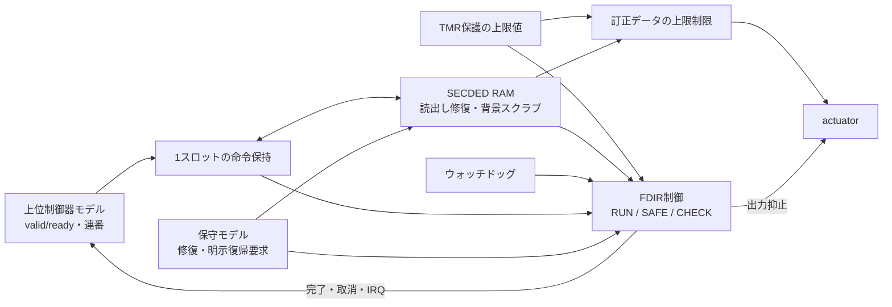
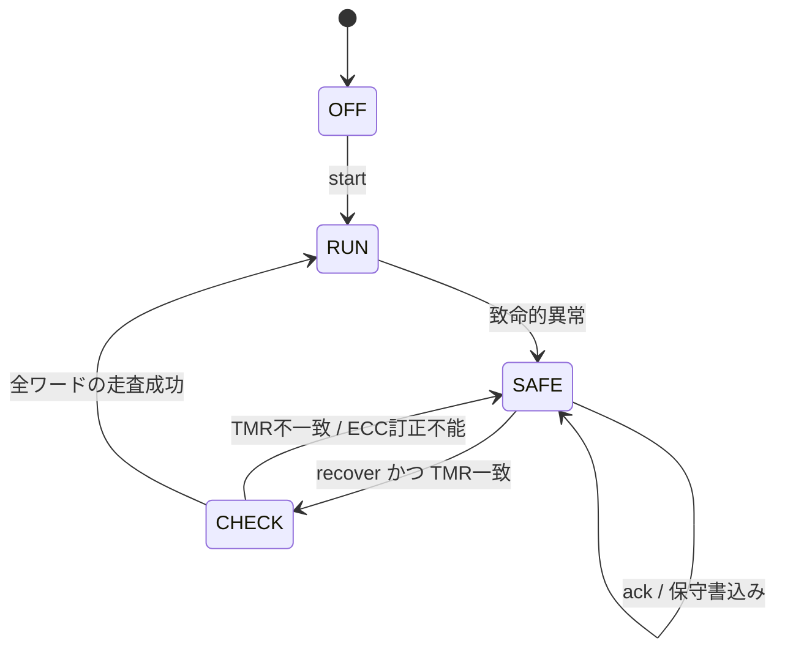

# TMR・ECC・ウォッチドッグを接続したFDIRサブシステム

上位制御器から計測値の書込み・読出し命令を受ける、小規模な機器制御の教材です。TMRで保護した上限値、SECDED RAM、ウォッチドッグを接続し、故障検出・封じ込め・復旧（FDIR: Fault Detection, Isolation and Recovery）を確認します。上位制御器と保守操作はテストベンチから駆動します。

[航空宇宙・高信頼システムの検証手順](../../docs/method/aerospace-verification.md)と[単体TMRレジスタ](../local-tmr/README.md)を土台に、複数の保護機構とコマンドの副作用を同じ時系列で照合します。

## 接続と機能



[既存SECDED回路](../local-ecc/README.md)と[タイマー／ウォッチドッグ](../local-timer-watchdog/README.md)、新しいTMRレジスタを実際に接続します。メモリの調停は、この例の`protected_store`で定めます。単体例をまとめて起動する集約ランナーとは別の、接続したRTLです。

| 構成 | RAM | ウォッチドッグ再設定値 | TMR不一致の継続しきい値 |
| --- | --- | --- | --- |
| depth4-wd5 | 4ワード×8データビット、各13ビットの符号語 | 5 | 3サイクル |
| depth8-wd9 | 8ワード×8データビット、各13ビットの符号語 | 9 | 2サイクル |

## 命令の受理・完了・取消

`cmd_valid && cmd_ready`の立上りエッジで1命令を受理し、次のエッジで完了を判定します。スロット使用中、SAFE、CHECK、開始前、既に観測できる致命的異常がある場合はreadyを下げます。完了出力は`commit`の1サイクルパルスで、受信側にreadyを持たない通知です。

| 項目 | 契約 |
| --- | --- |
| opcode 0 | `cmd_data`を指定RAMワードへ書き、同じ値を`result`へ返す。actuatorは保持 |
| opcode 1 | ECC訂正後のデータとTMR上限値の小さい方を`result`と`actuator`へ反映 |
| opcode 2／3 | 不正命令として受理後にSAFEへ移行。RAMやactuatorへ反映しない |
| 連番 | 8ビット。`expected_seq`に一致する命令だけ実行し、commit時に1加算。255の次は0 |
| 不正な連番 | 重複・飛越しを拒否してSAFEへ移行。期待連番は進めない |
| 設定値更新 | `cfg_write`は開始前とSAFEだけ有効。RUN／CHECK中は無視 |
| 副作用 | RAMへの命令書込みとactuator更新はcommit時だけ。受理時には行わない |
| 致命的異常と完了の競合 | 異常を優先し、pending命令は`cancelled`で取消。commitと連番更新を行わない |

`actuator`はRUN以外で0です。ここでは、故障後に要求される出力を0とする仕様を教材用に固定しています。実機の安全出力はシステム要求から定めます。命令の返答やactuatorを一般のAXI／ネットワークインターフェースとは扱いません。

各キャンペーンで、**受理数＝commit数＋異常取消数＋reset取消数＋不正命令数**も照合します。resetによる取消を通常完了へ加えず、終了時にはpendingとCHECKの処理が残っていないことを確認します。

## 故障検出とIRQ

| causeビット | 検出条件 | 反応 |
| --- | --- | --- |
| bit 0 | TMR不一致がTRIP回の観測エッジにわたって継続 | SAFE、出力0、pending取消 |
| bit 1 | 命令読出しでECC訂正不能、または背景スクラブが訂正不能を通知 | 同上 |
| bit 2 | ウォッチドッグ残数1でkickなし | 同上。完了と競合しても異常を優先 |
| bit 3 | 受理した命令のopcode／連番が不正 | SAFE、不正命令の副作用を禁止 |

同じエッジの原因はORして保持します。`ack`はIRQだけを解除し、cause・SAFE・出力抑止を解除しません。新しい異常とackが競合した場合はIRQセットが優先です。

単一系統のTMR反転は多数決でマスクし、修復します。ECCの1ビット反転は読出し／スクラブで訂正し、SAFEの原因にはしません。繰り返す同一系統への反転は、多数決が正しい場合でも、不一致の継続としてSAFEへ移します。2系統以上の同時故障や共通原因故障に対する正しい上限値の維持は保証しません。

開始時と復帰成功時にウォッチドッグをWD_LIMITへ設定し、RUN中はkickで再設定、kickなしで1減算します。残数1のエッジでkickがあれば再設定を優先し、なければSAFEへ移行します。SAFE／CHECKでは監視を止めます。同じクロックを使うため、そのクロック自体の停止を検出する独立監視器ではありません。

## ECCメモリの調停と故障注入

短縮拡張Hamming（13,8）の符号語を使います。機能更新は、**通常書込み＞前景の読出し修復＞背景スクラブ＞保持**の順です。保守書込みはSAFEだけで有効です。CHECKでは背景スクラブを止め、再走査の読出し修復を行います。

注入は、そのエッジの機能更新後の符号語へXORします。書込みと同時の1ビット反転でも「新しい値の符号語を反転」し、古い値へ戻すモデルにはしません。アドレスは4／8ワードの範囲で、マスクは13ビットです。3ビット以上の故障の誤訂正や未検出を、SECDEDが保護できた結果として扱いません。

## 復帰手順



1. 上位がIRQを確認してackする。SAFEと原因は保持する。
2. 保守側が必要ならTMR設定を書き直し、訂正不能ワードを正しいデータで書き換える。
3. `recover`を要求する。TMR不一致があれば開始しない。
4. CHECKで全アドレスを1ワードずつ読み、1ビット誤りは修復する。途中の不一致や訂正不能ではSAFEへ戻り、IRQと`recovery_failed`を通知する。
5. 最終ワードまで成功した場合だけRUNへ戻り、cause／IRQを解除し、ウォッチドッグを再設定して`recovered`を通知する。

復帰は各アドレスの走査時点での健全性を確認する処理です。走査済みの場所への新たな故障を永久に防ぐ保証ではありません。復帰後も読出し検査・スクラブ・TMR監視を続けます。期待連番は最後のcommitの次を保持し、取り消した命令は同じ連番で再送できます。

## 検証計画と実行

固定ケースは、通常の全ワードアクセス、13ビット全位置の単一反転、スクラブ、繰返しTMR故障、期限とkick、誤連番・不正命令、再走査の失敗・保守修復、設定不一致による復帰拒否、pending／CHECK中のreset、書込みと注入、書込みとスクラブ、同時原因、連番折返しです。さらにseed付きのデータ・アドレス・故障位置を加えます。

PythonモデルはECCの符号語集合からHamming距離を調べて訂正・検出を決め、RTLのsyndrome補正を複写しません。全サイクルで外部出力、TMRの3系統、RAMの全符号語、ウォッチドッグ、連番、IRQ、状態を比較します。メモリモデルのセルに故障を入れるテストと、テストの検出力を確かめる変異は分けます。

[要求カタログ](requirements.json)は5要求・22観測目標です。各構成の通常成功ケースから全目標を集計し、変異の到達では未達を埋めません。4変異は、異常時の誤commitを`FDIR_CONTAIN`、不正な復帰・IRQ優先順位・ackによる復帰を`FDIR_STATE`で検出します。

```sh
python3 examples/local-fdir/run.py --profile smoke --out artifacts/fdir-smoke
python3 examples/local-fdir/run.py --profile nightly --out artifacts/fdir-nightly
```

Python 3・Icarus Verilog・vvpを使います。2構成でJUnitはsmoke 44件／nightly 48件です。nightlyはseedを1→3、各seedのランダムな書込み・故障・読出しの組を16→48へ増やします。

ソース・構成・seed・生成入力のハッシュ、`vectors.txt`、全状態の`expected.hex`、VCD、ログ、受理・commit・取消・復帰・注入・reset件数を保存します。[全体ランナー](../../tools/REGRESSION.md)と[実行記録](../../PROVENANCE.md#aerospace-20261101)で予定と証跡を照合できます。

## 適用範囲

単一クロック・同期resetのRTL教材です。SEU等の論理的なビット反転と、定めた故障条件下の反応を確認します。実際の放射線感度・発生率、SETパルス、SEL、SEFI、TID、配置配線・電気特性、独立クロック監視、CPUソフトウェアや通信規格全体は対象外です。FDIR制御器・多数決回路・連番や状態レジスタの全てを三重化した設計でもありません。

機能カバレッジは手続き的な観測ログです。ネイティブcovergroup DB・コードカバレッジ、サブシステム全体のフォーマル証明、航空機認証・宇宙機の保証要求への適合を確認した結果にはしません。
