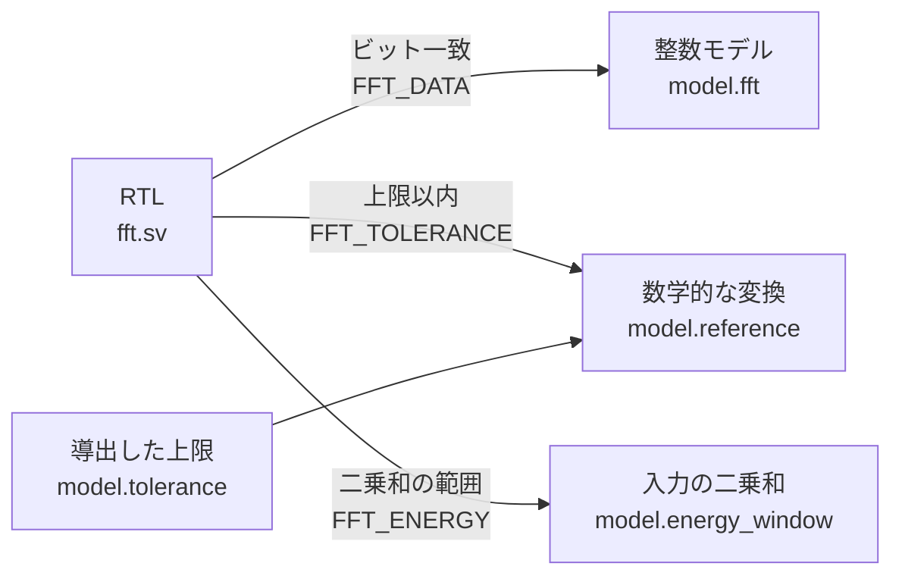

# 固定小数点のFFTを、ビット一致と、根拠のある許容誤差の2段で確かめる

FFTの回路は、丸めと語長の制限のために、数学的な離散フーリエ変換とは少し違う値を出します。そのため、「正しい」の意味が2つあります。

1. 回路は、決めたとおりの整数演算をしているか（**ビット一致**）。
2. その整数演算の結果は、数学的な変換にどこまで近いか（**許容誤差**）。

この教材は、バタフライを1クロックに1つ計算する逐次型の基数2のFFT（16点と64点）を、この2段で確かめます。数学的な値と許容誤差だけで比べると、丸めの向きの誤りや、回転因子の表の1単位の誤りが許容の中に隠れます。逆にビット一致だけでは、モデルと回路が同じ誤りを共有していても気付けません。判定の使い分けは[演算データパスの検証手順](../../docs/method/arithmetic-datapath-verification.md)にあり、同じ分け方の例に[CORDIC](../local-cordic/README.md)と[IIRフィルター](../local-iir-biquad/README.md)があります。



## 仕様

[`rtl/fft.sv`](rtl/fft.sv)は、N＝2^`LOGN`個の複素数のサンプルを1フレームとして受け取り、N個のビンを出します。以下はこの教材が決めた仕様です。

| 信号 | 幅 | 意味 |
| --- | --- | --- |
| `in_valid`、`in_ready` | 1 | 両方が1のクロックに、サンプルを1つ受け付ける。`in_ready`が0のときに出されたサンプルは無視する |
| `in_re`、`in_im` | 符号つき`WIDTH` | サンプルの実部と虚部 |
| `out_valid` | 1 | ビンを出しているクロックで1 |
| `out_last` | 1 | 最後のビン（N−1番）で1 |
| `out_re`、`out_im` | 符号つき`WIDTH` | ビンの実部と虚部。0番から順に出す |
| `overflow` | 1 | このフレームの計算のどこかで、結果が範囲に収まらなかった。`out_valid`が1の間だけ意味を持つ |

- 1フレームは、読込みNクロック、変換`LOGN`×N／2クロック、出力Nクロックです。出力には待たせる信号がなく、毎クロック1つ出ます。最後のビンの次のクロックから、次のフレームを受け付けます。
- `SCALE`が0でなければ、各段で結果を2で割ります。出力は変換をNで割った値です。`SCALE`が0なら割らず、出力は変換そのもので、最大でN倍に大きくなります。
- 範囲（符号つき`WIDTH`ビット）に収まらない結果は、上限か下限に張り付き、`overflow`が立ちます。`overflow`は最後のビンを出すまで保たれ、次のフレームには残りません。
- リセット（同期、Lowで有効）は、読込み・変換・出力のどの途中でもフレームを捨てます。

### 回路の構成

サンプルは、番号のビットを逆順にした番地へ書き込みます。変換は、その場所で段ごとに行います。段s（0から数える）は、2^sだけ離れた2つの値aとbから、次の2つを作ります。

```text
t  = b × (cos θ − j sin θ)   積を2^14で割り、0.5以上を切り上げて整数にする
a' = a + t
b' = a − t                   SCALEが0でなければ、a'とb'を2で割り、0.5以上を切り上げる
```

回転因子は、半周を32等分した角度の余弦と正弦を、2^14倍して丸めた表です。16点の変換は、この表を4つおきに使います。

## 期待値は4つに分ける

[`model.py`](model.py)は、次の4つを別々の関数として持ちます。ランナーとテストベンチも、これらを別の検査として扱います。

| 関数 | 中身 | 使う検査 |
| --- | --- | --- |
| `fft` | RTLと同じ整数演算。ただし構成は別で、偶数番と奇数番のサンプルへ再帰的に分ける。ビットの逆順の並べ替えと、番地の計算を持たない | `FFT_DATA`（ビット一致） |
| `reference` | `cmath`で計算した離散フーリエ変換を、整数へ丸めた値 | `FFT_TOLERANCE` |
| `tolerance` | 段の数・サンプルの大きさ・丸めの回数から導いた、差の上限。測定した値ではない | `FFT_TOLERANCE` |
| `energy_window` | 出力の二乗和が入るべき範囲。入力の二乗和と上限だけから決まり、整数モデルを使わない | `FFT_ENERGY` |

整数モデルが再帰の構成なのは、RTLと同じ誤りを共有しにくくするためです。ビットの逆順の並べ替えや、番地・角度の計算を誤っても、再帰の構成にはその計算がないので、ビット一致の比較で差が出ます。セルフテストは、RTLと同じ「その場所で段ごとに計算する」構成の第3の実装を持ち、整数モデルと一致することを確かめます。NumPyは使っていません。

## 許容誤差の上限とその根拠

誤差は、最後の段の後の値と、正確な値との複素数の距離で数えます。単位は出力の1（LSB）です。誤差の元は3つあります。

| 元 | 大きさ | 理由 |
| --- | --- | --- |
| 回転因子の量子化 δ | 2^−14／√2 ≈ 4.32×10⁻⁵ | 余弦と正弦をそれぞれ丸めるので、各成分の誤差は0.5×2^−14以下 |
| 積の丸め ρ | 1／√2 ≈ 0.707 | 実部と虚部をそれぞれ丸めるので、各成分の誤差は0.5以下 |
| 2で割るときの丸め ρ | 1／√2 ≈ 0.707 | 同上。`SCALE`が0なら、この丸めはない |

段sの後の誤差の上限をE_sとすると、1段の計算から次の漸化式が出ます。Bは、サンプルの絶対値の最大です。

```text
SCALE≠0：  E_s = ( E_{s-1} + (1+δ)·E_{s-1} + (B + E_{s-1})·δ + ρ ) / 2 + ρ
SCALE＝0：  E_s =   E_{s-1} + (1+δ)·E_{s-1} + (2^(s-1)·B + E_{s-1})·δ + ρ
E_0 = 0
```

- 第1項と第2項は、aとbが持ってきた誤差です。量子化した回転因子の長さは1+δ以下です。
- 第3項は、回転因子の誤差に、bの大きさを掛けたものです。2で割る構成では、値の大きさは平均を取るたびにB以下に保たれます。割らない構成では、段ごとに最大で2倍になります。
- 最初の2段は、回転因子として1と−jだけを使います。表はこの2つを誤差なしで持ち、積にも丸めが要りません。この2段では、δと積のρを0にします。

1つの成分の差は複素数の距離以下で、基準を整数へ丸めるときに0.5ずれます。許容誤差は、`ceil(E_LOGN + 0.5)`です。振幅が約4分の3（割らない構成では、あふれない大きさ）の正弦波のフレームでの値は、次のとおりです。

| 構成 | B | 段ごとのE_s | 許容誤差 | 測った最大 |
| --- | --- | --- | --- | --- |
| `n16-scaled` | 24575 | 0.71、1.41、3.01、4.60 | 6 | 2 |
| `n64-scaled` | 24575 | 0.71、1.41、3.01、4.60、6.19、7.78 | 9 | 3 |
| `n16-unscaled` | 1535 | 0、0、0.97、3.18 | 4 | 2 |

「測った最大」は、同じ振幅の範囲のランダムなフレーム2,000個で、整数モデルと基準を比べた値です。上限は、すべての丸めが同じ向きに最大の誤差を出すと仮定した値なので、測った値の2〜3倍あります。

### 上限が緩すぎないことの確認

導出した上限に、正しい回路は届きません。そこで、許容誤差の検査そのものが働いていることを、別の2ケースで確かめます。

- `limit-observed`：決めた6フレームについて、許容誤差を「整数モデルで測った最大の差」まで狭めます。正しい回路は合格します。
- `limit-one-less`：そこからさらに1狭めます。正しい回路が`FFT_TOLERANCE`で不合格になります。

合否に使うのは、導出した上限です。測った値を合否の基準にすると、回路の今の動作をそのまま正解にすることになるからです。

### 二乗和の検算

パーセバルの関係から、出力の二乗和は、入力の二乗和のN倍（割らない構成）か、N分の1（割る構成）です。各ビンが正確な値からE以内にあれば、二乗和のずれは`2·E·√(N·S) + N·E²`以下です（Sは正確な二乗和）。テストベンチは、最後のビンで、出力の二乗和がこの範囲に入ることを確かめます（`FFT_ENERGY`）。

この検査は、整数モデルにも、ビンごとの基準にも依りません。振幅が2倍になる誤りや、最大のビンが消える誤りは範囲を外れます（セルフテストで確かめています）。範囲は広いので、小さな誤りは見つけません。

あふれたフレームには、数学的な変換が当てはまりません。許容誤差と二乗和の検査は行わず、ビット一致だけで判定します。

## 検証すること

テストベンチは、1クロックごとに、`in_ready`・`out_valid`・`out_last`・`overflow`と出力のデータを期待値と比べます。入力の列は、ランナーが作ります。同じ内容のクロックが続くところは、繰返しの数をつけた1行にまとめています（共通ランナーが入力を`manifest.json`へ写すので、その大きさを抑えるためです）。

| 検査 | 内容 |
| --- | --- |
| `FFT_READY`、`FFT_VALID` | 受け付けるクロックと、出すクロックが予定どおりか |
| `FFT_UNKNOWN` | 出しているビンにXがないか |
| `FFT_TOLERANCE` | 数学的な変換との差が、導出した上限以内か |
| `FFT_DATA` | 整数モデルとビットごとに一致するか |
| `FFT_LAST`、`FFT_OVERFLOW` | 最後のビンの印と、あふれの印が予定どおりか |
| `FFT_ENERGY` | 出力の二乗和が、入力から決まる範囲に入るか |

### ケース

| ケース | 内容 |
| --- | --- |
| `boundaries` | 固定のフレーム（下の表）。すべての目標に、このケースだけで届く |
| `random-seed*` | ランダムなフレーム。振幅（最大、中、ごく小さい）、読込みの途中の待ち、変換中に出すサンプル、途中のリセットを混ぜる |
| `limit-observed`、`limit-one-less` | 許容誤差の検査が働いていることの確認（上の節） |
| `detect-mutation*` | 変異を入れた回路に、固定のフレームの短い版を与える |

固定のフレームは、次のものです。

| 種類 | フレーム |
| --- | --- |
| インパルス | 0番、1番、最後の番号のサンプルだけが0でない。すべて0 |
| 一定の値 | 最大の値、最も負の値、小さい値 |
| 単一の周波数 | すべてのビンに、1つずつ。最も速い交番、実数の余弦（2つのビン） |
| あふれの境界 | あふれない最大の振幅と、それより1大きい振幅。符号を反転した版。割らない構成では、一定の値と交番でも同じ境界を取る |
| 丸めの中間点 | 積がちょうど2つの整数の中間になるインパルス |
| 握手 | 読込みの途中の待ち、変換中と出力中に出し続けるサンプル、最後のビンの直後の受付 |
| リセット | 読込み・変換・出力のそれぞれの途中。あふれの印が立った後 |

あふれの境界の振幅は、整数モデルで探します。実部と虚部が、あるビンの正弦波の符号どおりに最大の振幅を取るフレームは、そのビンの実部が振幅の約1.27倍になり、2で割る構成でもあふれます。`n16-scaled`では、振幅26,071があふれない最大で、26,072であふれます。割らない構成の一定の値は、2,047が収まる最大で（16倍して32,752）、2,048であふれます。

### 要求と目標

要求は5件、目標は19個です（[`requirements.json`](requirements.json)）。目標は、テストベンチがDUTの入出力から観測したときにだけ数えます。

| 要求 | 目標 |
| --- | --- |
| 変換 | すべて0、インパルス、一定の値のフレーム。すべてのビンが、1回ずつ最大のビンになる |
| 誤差 | 基準と一致するフレーム、一致しないビンのあるフレーム |
| あふれ | 最大の値・最も負の値の入力。上限・下限への張付き。印が立つ、次のフレームに残らない |
| 握手 | 読込みの途中の待ち、変換中のサンプル、出力中のサンプル、最後のビンの直後の受付 |
| リセット | 読込み・変換・出力のそれぞれの途中 |

## 意図的な誤実装

| 変異 | 内容 | 固定のフレームで検出する検査 |
| --- | --- | --- |
| 1 | サンプルを、ビットの逆順にせずに書き込む | `FFT_TOLERANCE` |
| 2 | 回転因子の角度が、どの段でも2倍になる | `FFT_TOLERANCE` |
| 3 | 積を、丸めずに切り捨てる | `FFT_DATA` |
| 4 | 回転因子の表の1つの値が、1単位大きい | `FFT_DATA` |
| 5 | 収まらない結果を、張り付けずに折り返す | `FFT_DATA` |
| 6 | `overflow`が、最後のバタフライの結果だけを示す | `FFT_OVERFLOW` |
| 7 | 変換中・出力中に出されたサンプルを、メモリへ書き込む | `FFT_TOLERANCE` |
| 8 | `out_last`が、1つ前のビンで立つ | `FFT_LAST` |
| 9 | リセットが、サンプルの番号を0へ戻さない | `FFT_READY` |
| 10 | バタフライの下側の出力が、引き算ではなく足し算になる | `FFT_TOLERANCE` |

変異3と4は、数学的な変換からの差が上限の中に収まります。許容誤差の検査は通り、ビット一致の検査だけが見つけます。変異5は、あふれたフレームでしか現れません。そのフレームは許容誤差の検査をしないので、やはりビット一致の検査が見つけます。

変異1・2・10は、整数モデルにも同じ誤りを入れれば、ビット一致の検査を通ります。数学的な変換との比較は、モデルとRTLが同じ誤りを共有する場合の備えです。

## 実行

Python 3.9以上とIcarus Verilogを使います。

```sh
python3 examples/local-fft/run.py --out artifacts/local-fft
python3 examples/local-fft/run.py --profile nightly --out artifacts/local-fft-nightly
python3 examples/local-fft/run.py --configuration n16-scaled --demo-bug 3 --out artifacts/local-fft-demo
python3 -m unittest discover -s examples/local-fft/tests
```

構成は3つです。`n16-scaled`（16点、各段で2で割る）、`n64-scaled`（64点、同じ）、`n16-unscaled`（16点、割らない）で、どれも16ビットです。`--seed`（既定17）は、ランダムなフレームを決めます。`--iterations`は、ランダムのケース1つあたりのフレーム数です（smoke 6、nightly 24）。`--demo-bug 1`〜`10`は、通常のケースにも変異を入れ、終了コード1になることを確かめるためのものです。

JUnitは、3構成でsmoke 45件、nightly 51件です（構成ごとに、固定1、ランダム1／3、上限の確認2、変異10、要求と目標の判定1）。

出力には、ケースごとの`vectors.txt`・`simulation.log`・`result.json`・`wave.vcd`と、全体の`manifest.json`・`coverage.json`・`summary.json`・`junit.xml`があります。波形は、長いケースでは最初の8,192クロックだけを記録します。`manifest.json`は、smokeで約5 MB、nightlyで約8 MBです。

## 確認範囲と残る制限

- **上限の導出**は、この教材で行ったもので、文献の式と照合していません。各項を最悪の向きに足した安全側の値です。セルフテストは、ランダムなフレームとすべてのビンの正弦波で破られないことを確かめていますが、全入力の証明ではありません。
- **基準の精度**は、Pythonの`cmath`（倍精度）です。整数へ丸める境界のごく近くでは、基準が1ずれえます。許容誤差の0.5は、基準を整数へ丸めることを含みますが、倍精度の誤差そのものは見込んでいません（この範囲の値では10⁻⁹程度です）。
- **フォーマルは使っていません**。整数モデルとRTLの一致は、シミュレーションで与えたフレームの範囲です。入力の全数（16点・16ビットでも2^512通り）は実行できません。
- **二乗和の検査は粗い**検査です。範囲の幅は、正弦波のフレームで二乗和の約0.2〜1%あり、1つのビンの小さな誤りは見つけません。
- 実行した構成は、16点と64点、16ビットだけです。`LOGN`は2〜6を受け付けますが、ほかの値は実行していません。窓関数、逆変換、実数入力に特化した構成、パイプライン型の構成、出力側の待ち合わせは扱いません。
- 割らない構成は、入力が小さいときにしか使えません（16点・16ビットなら、振幅が約2,000まで）。段ごとに語長を増やす構成は扱いません。
- `out_valid`が0のクロックの`out_re`・`out_im`・`out_last`・`overflow`の値は、仕様で決めておらず、検査もしていません。
- Linuxとkirimasimでは実行していません。

## 確認記録

2026-11-21に、macOS arm64、Python 3.13、Icarus Verilog 14.0開発版（`ca6b8d3`）で実行しました。

- smoke（seed 17・3・100）とnightly（seed 17、`--timeout 60`）が合格しました。JUnitは45件／51件、3構成で19／19目標、変異は10種類を3構成で30件検出、`limit-one-less`は3件とも`FFT_TOLERANCE`で不合格でした。最も長いケースは`n64-scaled`の固定のフレーム（26,957クロック）で、1秒未満です。nightly全体は約7秒でした。
- 目標は、3構成とも、固定のフレームのケースだけで19個すべてに届きます（セルフテストで確かめています）。
- セルフテスト18件が合格しました（約17秒）。Icarusがない環境では、RTLを使う5件は失敗します（skipにはしません）。
- RTLは、`LOGN`が4と6、`SCALE`が0と1、変異0〜10のすべての組で、Verilator 5.052の`--lint-only --Wall`の警告が0件です。`tools/check_tb_races.py`の候補は0件です。
- 既存の変異とは別に、作業用の写しのRTLへ小さな誤りを20個入れてsmokeにかけました。
  - 16個は、3構成の固定のフレームが不合格になりました（フレームが1サンプル短い、2で割るときに丸めない、あふれの判定が1ビット足りない、負のあふれを上限へ張り付ける、虚部の積の符号、番地のシフト、印を消さない2通り、ビンを逆順で出す、出力中に受け付ける、正弦の表の1単位、差の符号、あふれの判定から結果を抜く2通り、積の0.5を切り捨てる、最後の段を1つ早く終える）。2で割るときに丸めない誤りは、割らない構成では回路が変わりません。
  - このうち2個は、最初は一部の構成で合格しました。試験の抜けだったので、フレームを足しています。割らない構成で、バタフライの下側の出力の虚部だけがあふれる場面がなかったこと（交番のフレームを追加）と、16点の構成で、積がちょうど中間になる入力がなかったこと（丸めの中間点のインパルスを追加）です。
  - 残る4個は、動作に差が出ません。角度をバタフライの番号から作る誤りは、上位のビットが捨てられて同じ角度になります。リセットで段の番号、またはバタフライの番号を消さない誤りは、変換の開始のときにも消すので同じです。`out_valid`が0のときに`out_im`を0にしない誤りは、仕様で決めていない値だけが変わります。
