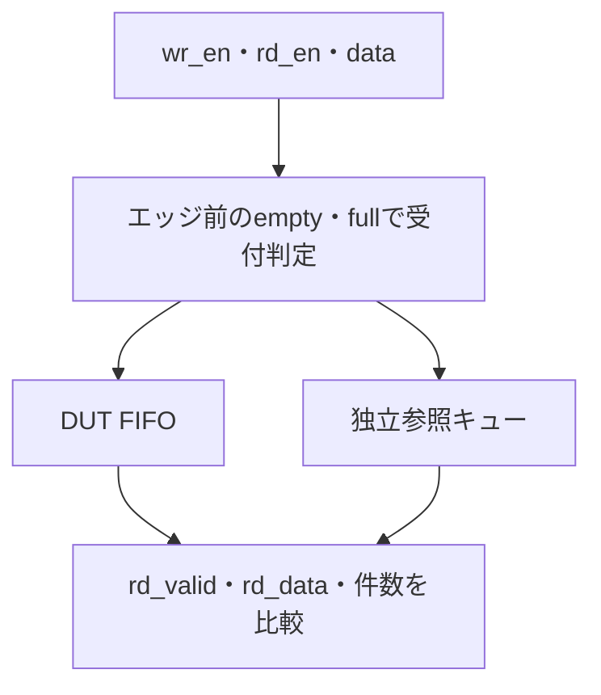

# FIFOのランダム検証を実行する

PythonとIcarus Verilogで、同期FIFOを検証する例です。スコアボードでデータの値・順序と占有数を比較し、境界条件のディレクテッドテストとランダムテストを組み合わせます。深さとデータ幅を変えた6構成を実行します。

[IRQ・CDCの実行例](../local-irq-cdc/README.md)に続く題材です。プロセスの実行・停止、ログの終了判定は、同例の[`run.py`](../local-irq-cdc/run.py)を再利用しています。このリポジトリ全体を取得して実行してください。

## 要求と受理した操作を区別する

書込み・読出しの受理をエッジ前の空・満杯から判定し、参照キューで値・順序・占有数を比較します。



本FIFOは満杯なら同時読出しがあっても書込みを受理しません。ready/valid FIFOの別例と受付規則が異なります。

## 1. FIFOの仕様

[`sync_fifo.sv`](rtl/sync_fifo.sv)は説明用の単一クロックFIFOです。深さ1・3・8、データ幅8・16で確認します。深さ3は、ポインターの折り返しを2のべき乗に依存させないための構成です。

- active lowの同期リセットで、占有数・出力データ・読出し有効信号を0にする。保持中のデータは破棄する。
- 書込みは、エッジ直前に満杯でなく、`wr_en=1`のとき受け付ける。
- 読出しは、エッジ直前に空でなく、`rd_en=1`のとき受け付ける。受け付けたデータをエッジ後の`rd_data`へ出し、`rd_valid=1`にする。
- 空でも満杯でもない状態の同時読出し・書込みは両方受け付け、占有数を維持する。読出しデータは、先に保持していた先頭データとする。
- 空での同時要求は書込みだけを受け付ける。入力を直接読出し出力へ通すバイパスは行わない。
- 満杯での同時要求は読出しだけを受け付ける。そのエッジで空きができても書込みは受け付けない。
- 読出しがないサイクルは、`rd_valid=0`、`rd_data`は直前の値を保持する。

同時要求の扱いはこの例の仕様です。すべてのFIFOに共通の規則ではないため、実際のIPへ適用するときは受付条件と出力タイミングを合わせます。非同期FIFO・CDC、実バス、UVM、SVA、フォーマル検証はこの例の対象に含みません。

同じRTLを使う[フォーマル検証例](../local-fifo-formal/README.md)は別の例として用意しています。シミュレーションの結果と、制御の証明・データの有界検査の範囲を分けて記録します。

## 2. スコアボードとカバレッジ

[`fifo_tb.sv`](tb/fifo_tb.sv)は、RTLの循環ポインターを写さず、先頭を取り出して残りを詰める参照キューを使います。入力はクロックの立下りで与え、立上りのNBA更新後に占有数、full／empty、`rd_valid`、出力データを比較します。未受理の書込み・読出しが状態を変えていないことも比較に含めます。

必要な比較がすべて合格したサイクルだけ、`COVER`記録を出します。[`requirements.json`](requirements.json)の必須目標と照合し、ケースがすべて成功しても未達があればリグレッションを失敗させます。

| 観点 | 必須目標 |
| --- | --- |
| 状態×操作 | 空・満杯・中間状態それぞれで、保持／書込み要求／読出し要求／同時要求 |
| データ | 0、全ビット1、交互ビットの値を実際に読み出して比較 |
| リセット | 空・データ保持中のリセット、保持中リセットの解除後の転送 |
| 反復転送 | 深さ分の書込み・読出しを繰り返し、ポインターの折り返しを含む転送を比較 |
| 受付抑止 | 満杯時の書込み要求、空での読出し要求 |

深さ1には中間状態がないため、該当する1要求・4目標を対象外とし、理由を`coverage.json`へ記録します。深さ1は7要求・18目標、深さ3・8は8要求・22目標です。構成ごとに判定し、6構成の和集合で未達を補いません。この目標数は説明用の計画で、全データ値や全操作列の網羅を表すものではありません。covergroup DBの計測ではなく、手続き的なチェッカーの観測記録を集計しています。

## 3. ローカルで実行する

POSIX環境のPython 3.10以上、`iverilog`、`vvp`を使います。Pythonの追加パッケージは不要です。リポジトリのルートで実行します。

```sh
python3 -m unittest discover -s examples/local-fifo/tests -v
python3 examples/local-fifo/run.py --depth 3 --width 8
python3 examples/local-fifo/run.py --depth 8 --width 16 --profile nightly --seed 73
```

| プロファイル | 通常回路のケース | 変異検出 | 要求・カバレッジ判定 | 構成ごとのJUnit件数 |
| --- | --- | --- | --- | --- |
| smoke | 境界テスト1件＋ランダム1 seed・200サイクル | 3件 | 1件 | 6件 |
| nightly | 境界テスト1件＋ランダム3 seed・各2000サイクル | 3件 | 1件 | 8件 |

各ランダムケースには、初期リセットと、最後に保持データを読み出す処理も付けます。表のサイクル数はランダム生成部分の長さです。`nightly`のseedは指定値と、その次の2値を使います。`--cycles 500`などでランダム部分の長さも指定できます。

正常な出力の例は次のとおりです。

```text
PASS     d3-w8-boundaries: 85 checked cycles
PASS     d3-w8-random-seed17: 205 checked cycles
DETECTED d3-w8-detect-mutation1: expected mutation detected by FIFO_DATA_ORDER
DETECTED d3-w8-detect-mutation2: expected mutation detected by FIFO_COUNT
DETECTED d3-w8-detect-mutation3: expected mutation detected by FIFO_RESET
Coverage: 22/22 required goals
Regression: PASS
```

出力先は既定で`artifacts/fifo-local-日時/`です。`--out`で指定する場合も、新しいディレクトリを選びます。既存の結果は上書きしません。

## 4. ランダム検証で確認すること

ランダム部分では書込み・読出し要求、データ、動作中リセットを生成します。データは境界パターンと乱数値を混ぜ、書込み要求を出しても満杯なら受け付けないこと、読出し要求を出しても空なら出力を有効にしないことを含めて比較します。リセットで破棄されるデータは、参照キューも同じ仕様で破棄します。

seedと生成した全入力列をマニフェストと`vectors.txt`へ保存します。ツールや生成器の版が変わった場合は、seedだけで同じ入力列を再現できるとは扱いません。固定の境界テストで必須条件を確実に確認し、ランダムテストでその間の値・順序・リセットの組み合わせを広げます。

## 5. 意図的な不具合の検出

通常回路とは別に、次の3種類の変異を同じ境界テストへかけます。

| 変異 | 意図した不具合 | 必須の失敗ラベル |
| --- | --- | --- |
| 1 | 読出しデータの最下位ビットを反転 | `FIFO_DATA_ORDER` |
| 2 | 満杯でも書込みを受け付ける | `FIFO_COUNT` |
| 3 | データ保持中のリセットを無視 | `FIFO_RESET` |

意図したチェッカーによる検出を確認した場合に、変異検出の項目を成功にします。コンパイル失敗、タイムアウト、別の失敗ラベル、完了記録の欠落は検出成功にしません。変異から得たカバレッジを通常機能の達成には加算しません。

通常回路側へ不具合を入れ、リグレッションが失敗することを試すには次を使います。

```sh
python3 examples/local-fifo/run.py --demo-bug 1
```

このコマンドは非0で終了します。`--demo-bug 2`、`--demo-bug 3`でも同様に確認できます。通常回路の失敗と、予定した変異検出の成功は別に記録します。

## 6. 6構成を実行する

深さ1／3／8×幅8／16の6構成を、`--depth`と`--width`で1構成ずつ実行します。構成を含むケース名・クラス名を使い、結果を混同しないようにします。nightlyは`--profile nightly`、seedは`--seed`、失敗デモは`--demo-bug 1`などで選びます。JUnitは結果表示用で、リグレッションの合否は終了コードへ反映します。

## 7. 保存する証跡と確認範囲

出力先（既定は`artifacts/fifo-local-日時/`）に、入力のハッシュ・構成・seed・全入力列を持つ`manifest.json`、ツール版、ビルド結果、ケース別ログ・VCD波形・判定、要求スナップショット、`coverage.json`、`summary.json`、`junit.xml`を保存します。

タイムアウトやSIGTERM／SIGINTでは実行中のプロセスグループを停止します。中断時には途中の証跡を残しますが、最終JUnit・summaryの完成は保証しません。コンテナ・パッケージはタグだけでは厳密な版固定にならないため、実際のツール版も記録します。

2026-10-26にmacOS・Python 3.14.7・Icarus Verilog 14.0の開発版で、全6構成のsmokeとnightlyを実行しました。各構成で必須18／22目標と3種類の変異の検出を確認し、ランナーの10テストも合格しました。製品FIFOへの適用、性能・タイミング・物理検証、すべてのパラメータへの一般化を示す結果ではありません。

同日に、Debian・Python 3.11.2・Icarus Verilog 11.0の環境でも、FIFOの全6構成のsmokeとランナー10テストが成功しました。各構成の`summary.json`から、深さ1の18／18目標、深さ3・8の22／22目標、3種類の変異の検出を照合しました。nightlyの全2000サイクル×3 seedの確認は、上記のmacOSでの実行です。

11例全体の構成は[初期の11例の構成](../../README.md#初期の11例の構成)を参照してください。

## ready/valid通信への展開

[ready/valid通信のランダム検証例](../local-stream/README.md)では、validとreadyが同時に成立したときの受理、受信待ち中のデータ保持、満杯での同時送受信による入替えを検証します。本FIFO例の、満杯時は同時読出しがあっても書込みを受け付けない仕様とは異なります。ポートの意味と受理条件を対象回路の仕様に合わせて判定します。
