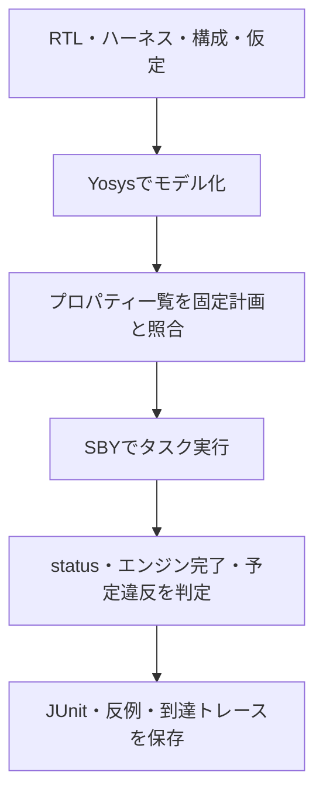

# システム教材のフォーマルリグレッションを実行する

[AXI4のフォーマル例](../local-axi4-formal/README.md)、[FIFOの等価性例](../local-equivalence/README.md)、[完了期限の例](../local-progress/README.md)、[Top-K選択の例](../local-topk/README.md)、[接続性の例](../local-connectivity/README.md)、[除算器の例](../local-divider/README.md)、[命令デコーダの例](../local-riscv-decoder/README.md)が使うSBYランナーです。各例の`run.py`（除算器は`formal.py`）から起動し、このファイルを直接実行するものではありません。

## モデル・タスク・証跡の対応

構成と仮定を固定したモデルへ各タスクを実行し、期待した種類の結果と証跡を照合します。



| 確認する場面 | 期待する動作 | 主な照合対象 |
| --- | --- | --- |
| prove | PASSと帰納法完了 | 仮定下の非有界証明 |
| BMC・cover | 指定深さの完了／全目標到達 | 有限深さと到達性を区別 |
| 変異・環境反例 | 予定assertのFAILと反例 | UNKNOWN・TIMEOUTは失敗 |

## ツールの準備

POSIXとPython 3.10以上を使います。初回は一時仮想環境へ既存の固定版ツールを入れます。既に用意した環境は上書きせず、そのままactivateできます。

```sh
python3 -m venv /tmp/lsi-bus-formal-venv
. /tmp/lsi-bus-formal-venv/bin/activate
python3 -m pip install -r examples/local-bus-formal/tools-requirements.txt
```

ツールはYoWASP版Yosys・SBYとZ3です。商用ライセンスやシステム全体へのインストールは使いません。実際のパッケージ・ツール版を証跡へ残します。配布物とコマンドの位置は[既存の準備手順](../local-bus-formal/README.md)も参照してください。

## 実行オプション

```sh
python3 examples/local-axi4-formal/run.py
python3 examples/local-equivalence/run.py
python3 examples/local-axi4-formal/run.py --configuration bytes16 --task data-bmc --bound 12
```

`--configuration`は既定all、`--task`は既定allで、一部のタスクだけも実行できます。一部だけの成功はリグレッション全体の完了ではなく、マニフェストの選択ケースを確認してください。`--bound`はBMC／coverの深さで8〜64です。既定は、AXI4・等価性が12、完了期限が24、Top-K・接続性が8、除算器が16です。AXI4のproveは別に帰納法探索深さ8を使います。

`--timeout`は版取得・各SBYタスクへの上限です。既定は、AXI4が300秒、等価性・完了期限・接続性が120秒、Top-K・除算器が600秒です。SBY内部にも少し短い上限を設定します。`--sby`、`--yosys`、`--smtbmc`、`--witness`で実行ファイル、`--out`で新規保存先を指定します。

`--demo-bug 1..4`は通常の証明／データ検査にも指定変異を入れ、リグレッションの失敗を確認するオプションです。専用の変異検出ケースは別に残ります。AXI4のデータだけの不具合は制御証明がPASSしても、データBMCがFAILすることがあります。

## 判定と保存

全ソース、ランナー、ツールrequirementsのSHA-256、選択ケース・構成・仮定・プロパティ・パッケージ版を保存します。タスクごとにRTL・ハーネスをコピーし、SBY設定、ログ、status、コンパイル済み`inventory.json`、VCD・witness、`result.json`を残します。全体には`coverage.json`、`summary.json`、`junit.xml`があります。

- proveはPASSと帰納法完了を要求します。UNKNOWNやTIMEOUTは成功にしません。
- BMCはPASSとエンジンの完了を要求し、保証を指定の深さまでに限定します。
- coverは固定した全目標の到達とVCD・witnessを要求します。
- 変異や予定した環境反例は、予定したassertのFAIL、非ゼロ終了、反例を要求します。別のassertだけのFAILやクラッシュは検出成功ではありません。
- k-inductionの帰納ステップの反例（`trace_induct`）は、到達できない状態から始まることがあり、実際の反例ではありません。保存はしますが、witnessを要求せず、反例にも数えません。
- コンパイルされたパラメーターとassert／assume／coverの名前・個数を固定計画と照合します。
- 常時リセットの診断では、証明PASSと全正常cover未達を別に確認します。診断の到達を通常実行のカバレッジへ足しません。

小規模メモリを`memory_map`で論理回路へ展開してから検査します。既存のAHB／AXI-Liteフォーマルランナーを置き換えるものではなく、そちらの45タスクは別計画です。

通常は、全ソースを読み込んでから構成と変異のパラメーターを`TOP`へ設定します。プラグインが`prepare(parameters, case)`を定義していれば、その戻り値をこの読込み手順の代わりに使います。[接続性の例](../local-connectivity/README.md)は、SoCを平坦化して内部の端子を取り出してから検査回路を読むために使います。パラメーターを設定したモジュールが`TOP`と異なる場合は、`PARAMETER_MODULE`でその名前を指定し、コンパイル後のパラメーターをそこで照合します。

```sh
python3 -m unittest discover -s examples/local-formal-common/tests -v
```

判定・欠落・タイムアウト・意図しない違反・環境条件を外した予定反例・プロパティ数・ツール不在・出力先保護、`PARAMETER_MODULE`での照合、`prepare`の手順がSBYの設定へ入ること、帰納ステップの反例の扱いを確認する12テストです。実際の証明を実行するコマンドとは別です。[SBYの一次資料](https://yosyshq.readthedocs.io/projects/sby/en/stable/verilog.html)を参照し、運用・判定方式は本教材用に作成しました。
