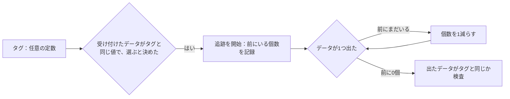

# 任意の1データを追跡して、データの整合性を非有界に証明する

FIFOやストリームの回路では、「入れたデータが、欠けず、重ならず、順序と内容を変えずに出てくる」ことを確かめます。入れたデータを全部覚えておく参照キューと比べる方法は分かりやすい反面、状態が大きくなり、フォーマルでは有限の深さまでの検査（有界検査）に留まりがちです。[FIFOのフォーマル例](../local-fifo-formal/README.md)は、制御は非有界に証明していますが、データは深さ10の有界検査です。

この教材では、データを1つだけ追う方式で、同じ性質をすべての入力列について証明します。対象は、既存の[同期FIFO](../local-fifo/README.md)と[AXI4-StreamのFIFO](../local-axis/README.md)、この教材に置いた小さな幅変換の3つです。あわせて、この方式で見つかる誤りと見つからない誤りを、誤りを入れた回路で確かめます。

フォーマル検証全体の進め方は[フォーマル検証の手順](../../docs/method/formal-verification.md)にあります。

## 1データを追う方式



証明用のラッパーは、次の3つだけを持ちます。

- **タグ**：追うデータの値です。`anyconst`で宣言した任意の定数で、ツールがすべての値を調べます。
- **選択**：タグと同じ値のデータが受け付けられたとき、それを追うかどうかです。`anyseq`で宣言した任意の入力で、同じ値のデータが続けて入る場合に、何番目を追うかも任意になります。
- **位置カウンター**：追っているデータより前に受け付けられ、まだ出ていないデータの個数です。追跡の開始時に、インターフェースで数えた滞留数から決めます。

データが出るたびに位置カウンターを1つ減らし、0のときに出るデータがタグと同じであることを検査します。タグの値も、追う相手も、その前にいる個数も任意なので、1回の証明が「すべての値・すべての位置のデータ」を対象にします。参照キューのように全データを覚える必要はなく、ラッパーの状態は滞留数とカウンターだけです。

この1つの検査で、次の誤りが見つかります。

| 誤り | 見つかる理由 |
| --- | --- |
| 内容が変わる | 位置0で出たデータがタグと違う |
| 前のデータが欠ける | 追っているデータが1つ早く出てしまい、位置0のときには別のデータが出る |
| 前のデータが重複する | 位置0のときに、重複したデータが出る |
| 順序が入れ替わる | 位置0のときに、別のデータが出る |

追っているデータ自身が欠ける、または重複する誤りは、その次のデータを追う場合として見つかります。どのデータを追うかが任意だからです。

位置カウンターを持つので、インターフェースで数えた滞留数についての検査も一緒に置きます。

| 性質 | 内容 |
| --- | --- |
| `ap_content` | 追っているデータが出るとき、値がタグと同じ |
| `ap_no_spurious` | 滞留数が0のときに、データは出ない |
| `ap_no_overflow` | 容量を超えて、データを受け付けない |
| `ap_available` | 滞留数が0でなければ、データを出力に見せている |

`ap_available`は追跡とは別の性質です。なぜ必要かは、[見つからない誤り](#見つかる誤りと見つからない誤り)で確かめます。

## 対象の回路

| 対象 | RTL | 追うデータ | 位置 |
| --- | --- | --- | --- |
| 同期FIFO | 既存の[`sync_fifo.sv`](../local-fifo/rtl/sync_fifo.sv)。3段と12段、8ビット | 1ワード | 前にいるワードの数 |
| AXI4-StreamのFIFO | 既存の[`axis_packet_fifo.sv`](../local-axis/rtl/axis_packet_fifo.sv)。2ビートと4ビート | TLAST・TKEEP・TDATAを合わせた37ビットの1ビート | 前にいるビートの数 |
| 幅変換 | この教材の[`width_downsizer.sv`](rtl/width_downsizer.sv)。16ビットを8ビット2つへ | 16ビットの1ワード | 前にいるビートの数と、ワードの中の何番目の半分か |

既存の2つのRTLは、編集せずにそのまま読み込みます。既存の[幅変換の例](../local-width-converter/README.md)はAXI4-Liteの1トランザクションを2つに分ける回路で、ストリームではないので、この教材ではストリームの幅変換を新しく置きました。

幅変換の仕様は次のとおりです。

- 入力は16ビット、出力は8ビットで、どちらもvalidとreadyのハンドシェイクです。
- 1ワードを、下位の半分、上位の半分の順に出します。
- 保持できるのは1ワードです。上位の半分が出ていくサイクルに、次のワードを受け付けます。
- 保持しているワードは、必ず出力に見せます（`m_valid`）。

同期FIFOは、読出しを受け付けた次のサイクルにデータが出ます。AXI4-StreamのFIFOは、満杯でも、同じサイクルに1つ出ていくなら1つ受け付けます。どちらも、ラッパーの検査を回路の仕様に合わせています。

## 内部の状態へ届く方法

帰納法の証明には、ラッパーの状態と回路の内部の状態の関係（補助の不変条件）が要ります。たとえば「追っているデータは、読出しポインターから位置カウンターの分だけ進んだ番地に入っている」です。これがないと、帰納法は、到達できない状態（メモリの中身がタグと違うのに追跡中、など）から始めて失敗します。

SystemVerilogでは`bind`や階層参照で内部の信号を見ますが、固定版のオープンソースのYosysはどちらも読めません。そこで、ランナーがYosysのスクリプトで次の順に処理します。

1. 設計を読み、パラメーターを設定する。
2. 階層を平坦化し、メモリをレジスタへ展開する。
3. ラッパーの`x_`で始まる配線を、回路の内部レジスタへ`connect`でつなぐ。

既存のRTLに観測用のポートを足さずに済みます。つなぐ信号の名前は[`run.py`](run.py)の`REGISTERS`にあり、ラッパーの宣言と一致することをセルフテストで確かめます。

つなぎ忘れた配線は、どこからも駆動されない任意の入力になります。その場合は補助の不変条件が成り立たず、証明は失敗します。接続を外して実行し、3つの対象とも基本ケースで失敗することを確かめました（下の[確認記録](#確認記録)）。

補助の不変条件は、仮定（`assume`）ではなく、すべて`assert`として証明します。仮定は「最初のサイクルはリセット」の1つだけです。

| 対象 | 補助の不変条件 |
| --- | --- |
| 同期FIFO | `ai_count`（占有数が滞留数と同じ）、`ai_pointer`（2つのポインターと占有数の関係）、`ai_slot`（追っているデータの番地と中身） |
| AXI4-StreamのFIFO | 同じ3つ |
| 幅変換 | `ai_state`（保持と位相から決まる残りビート数）、`ai_slot`（追っているワードが保持されていて、位相が合っている） |

## タスク

構成は1つで、対象・深さ・有効にする検査をタスクごとのパラメーターで切り替えます。全部で26タスクです。

| 種類 | タスク | 数 | 内容 |
| --- | --- | --- | --- |
| 証明 | `fifo3`・`fifo12`・`axis2`・`axis4`・`width`の`-integrity-proof` | 5 | k帰納法（深さ4）で、4つの性質と補助の不変条件を非有界に証明 |
| 到達 | `fifo3`・`axis4`・`width`の`-tracking-cover` | 3 | 追跡の開始、前のデータを待つ、追っているデータが出る、などの状況へ到達 |
| 変異の検出 | `-detect-mutationN` | 14 | 誤りを入れた回路で、予定した性質の反例が出る |
| 見つからないことの記録 | `fifo12-bound10-misses-mutation2`ほか | 4 | 誤りを入れた回路が合格してしまう条件を、合格として記録 |

到達の目標は、同期FIFOとAXI4-StreamのFIFOが5つずつ、幅変換が4つです。AXI4-Streamでは、TLASTが1でTKEEPが一部だけのビートを追って出すところまで到達させます。幅変換では、前のワードの最後の半分が出るサイクルに追跡を始める場合と、上位の半分が待たされる場合を含みます。

## 見つかる誤りと見つからない誤り

変異の検出では、補助の不変条件を外し、4つの性質だけで有界検査（深さ24）を行います。表の「ステップ」は、反例の長さです。

| 対象 | 変異 | 誤り | 違反する性質 | ステップ |
| --- | --- | --- | --- | --- |
| FIFO | 1 | 読出しデータの最下位ビットが反転する | `ap_content` | 4 |
| FIFO | 2 | 満杯でも書き込み、古いデータを上書きする | `ap_no_overflow` | 6 |
| FIFO | 3 | 占有数が0でないと、リセットが効かない | `ap_no_spurious` | 2 |
| AXI4-Stream | 1 | TLASTが常に0になる | `ap_content` | 3 |
| AXI4-Stream | 2 | TKEEPが常に全ビット1になる | `ap_content` | 3 |
| AXI4-Stream | 3 | TDATAの最下位ビットが反転する | `ap_content` | 3 |
| AXI4-Stream | 4 | 満杯でも受け付ける | `ap_no_overflow` | 6 |
| 幅変換 | 1 | 半分を逆の順に出す | `ap_content` | 3 |
| 幅変換 | 2 | 上位の半分が出る前に、次のワードを受け付ける | `ap_no_overflow` | 4 |
| 幅変換 | 3 | 次のワードが待たされていると位相を進めず、下位の半分を2回出す | `ap_content` | 4 |
| 幅変換 | 4 | 下位の半分が全ビット1のワードだけ、上位の半分が1ビット違う | `ap_content` | 4 |
| 幅変換 | 5 | 下位の半分が0のワードを、出力に見せない | `ap_available` | 3 |
| 幅変換 | 6 | 送ったばかりのワードと同じ値のワードを捨てる | `ap_available` | 5 |

変異4と6は、特定の値のときだけ起きる誤りです。ランダムなデータではほとんど当たりませんが、タグが任意の定数なので、短い反例がすぐに見つかります。

`ap_available`を外して実行しても、幅変換の変異1〜4と6、FIFOとAXI4-Streamの全変異は、残る3つの性質のどれかで見つかります（幅変換の変異6は`ap_no_overflow`、ステップ5）。見つからないのは幅変換の変異5だけです。

合格してしまう条件は、次の4タスクで記録しています。どれも、誤りを入れた回路が合格する実行です。

| タスク | 誤り | 合格してしまう理由 | 見つける方法 |
| --- | --- | --- | --- |
| `fifo12-bound10-misses-mutation2` | 12段のFIFOの上書き | 深さ10の有界検査では、12段を満杯にできない | 深さを十分に取る（`fifo12-detect-mutation2`、ステップ15）。誤りのない回路は、深さに依らない証明（`fifo12-integrity-proof`）で確かめる |
| `axis4-data-only-misses-mutation1` | TLASTが常に0 | TDATAだけを比べると、非有界の証明が成立する | 追うデータにTLASTとTKEEPを含める（`axis4-detect-mutation1`） |
| `axis4-data-only-misses-mutation2` | TKEEPが常に全ビット1 | 同上 | 同上（`axis4-detect-mutation2`） |
| `width-tracking-only-misses-mutation5` | あるワードを出力に見せない | データが出てこなければ、「出るときは正しい」は破られない。追跡の3つの性質は非有界に証明できてしまう | 保持しているデータを見せる性質`ap_available`を足す（`width-detect-mutation5`） |

まとめると、1データの追跡で分かることと分からないことは次のとおりです。

- **分かること**：出てくるデータの内容・順序・重複・欠落。値や位置に依る誤りも含みます。
- **追う範囲に入れないと分からないこと**：比べていない欄（TLAST、TKEEPなど）の誤り。
- **追跡だけでは分からないこと**：データが出てこない誤り。この教材では、保持しているデータを同じサイクルに見せる回路なので、安全性の性質`ap_available`で確かめました。待ち時間のある回路では、期限つきの性質（[完了期限の例](../local-progress/README.md)）や活性の証明（[公平性の例](../local-liveness/README.md)）が要ります。
- **この教材の性質の対象外**：占有数やfull・emptyの出力の値、読出しのないサイクルの出力の保持、リセット直後の出力。同期FIFOについては、FIFOのフォーマル例の制御の証明が扱います。

### FIFOのフォーマル例との比較

| | [FIFOのフォーマル例](../local-fifo-formal/README.md)のデータ検査 | この教材 |
| --- | --- | --- |
| 比べる相手 | 全データを覚える参照キュー | 任意の1データのタグと位置カウンター |
| 検査の範囲 | 深さ10までの有界検査（`data-bmc`） | すべての入力列（k帰納法） |
| 回路の深さ | 1段と3段 | 3段と12段 |
| 内部の状態 | 見ない | メモリとポインターを、補助の不変条件で結ぶ |
| 合格の意味 | リセットから10サイクル以内に反例がない | リセットの後のどの時点でも反例がない |

有界検査は、内部の状態を見ずに書けて、反例がすぐ出る利点があります。一方、深さより長い手順が要る誤りは見つけません。12段のFIFOの上書きは、有界検査の深さ10では合格し、ステップ15で初めて反例が出ます。回路が深くなるほど必要な深さも実行時間も増えます（この反例の探索に約33秒）。1データの追跡と帰納法の証明は、12段でも数秒で終わり、深さに依りません。代わりに、内部の状態についての不変条件を書く手間がかかります。

## 独立した期待値

[`model.py`](model.py)は、幅変換と追跡の検査を、SystemVerilogを見ずに仕様の説明から書いたPythonのモデルです。半分を1ビットに縮めると、到達できる状態をすべて数え上げられます。セルフテストで、次の点が上の表と一致することを確かめます。

- 誤りのない回路は、到達できるどの状態でも、どの性質も破らない。
- 変異1〜6は、表に書いた性質を最短の手順で破る。
- 変異5は、`ap_available`を除いた3つの性質をどの状態でも破らない。

同期FIFOとAXI4-StreamのFIFOには、このような独立のモデルを置いていません。この2つの期待値は、表に書いた性質の名前と、各回路の既存の例の検証結果です。

## 実行

[共通フォーマル手順](../local-formal-common/README.md)の固定版のYosys・SBY・Z3を使います。

```sh
. artifacts/toolchains/formal-venv/bin/activate
python3 examples/local-formal-data-integrity/run.py --out artifacts/formal-data-integrity
python3 examples/local-formal-data-integrity/run.py --task width-integrity-proof --out artifacts/formal-data-integrity-width
python3 examples/local-formal-data-integrity/model.py
python3 -m unittest discover -s examples/local-formal-data-integrity/tests -v
```

`--bound`（既定24、8〜64）は、変異の検出と到達の深さです。証明の深さ（4）と、深さ10の記録用のタスクは変わりません。`--timeout`（既定300秒）は、タスクごとの上限です。`--demo-bug 1..4`は、AXI4-Streamの4ビートの証明へ変異を入れ、失敗することを確かめます。セルフテストはツールを起動せず、計画・ラッパー・接続のスクリプト・モデル・この文書の表の整合を確かめます。

## 証跡

タスクごとに、SBYの作業ディレクトリ、実際にコンパイルされた性質の一覧（`inventory`）、反例と到達例の波形とその証人ファイルを残します。全体では`manifest.json`（入力のハッシュ）、`summary.json`、`junit.xml`を残します。性質の一覧や設定されたパラメーターが計画と違えば、証明が成立しても不合格です。

## 要求

[`requirements.json`](requirements.json)は4要求で、26タスクのそれぞれを1つの要求に対応させています。

| 要求 | 内容 | タスク |
| --- | --- | --- |
| `DI-INTEGRITY` | 任意の1データが、値を変えず、1回だけ、先に受け付けたデータの後に出る。保持しているデータを見せる | 5 |
| `DI-REACH` | 証明が対象にする状況へ到達できる | 3 |
| `DI-DETECT` | 誤りを入れた回路で、予定した性質の反例が出る | 14 |
| `DI-LIMITS` | 見つからない条件を、誤りを入れた回路の合格として記録する | 4 |

## 確認範囲と残る制限

- 単一クロック・2値の検証です。X、非同期のクロック、メタスタビリティは扱いません。
- 証明した大きさは、同期FIFOの3段と12段（8ビット）、AXI4-StreamのFIFOの2ビートと4ビート、16ビットから8ビットへの幅変換です。ほかの大きさは実行していません。
- 活性（いつか必ず出る）は証明していません。確かめたのは、保持しているデータを同じサイクルに見せることまでです。出力側のreadyが上がり続けない場合の進行は対象外です。
- 同期FIFOの受付は、回路自身のfullとemptyの出力で判定しています。fullを出し続けて受け付けない誤りは、この教材の性質では見つかりません。
- AXI4-Streamは、パケットの境界をTLASTの値として追うだけです。パケット単位の性質（途中で切れない、など）は扱いません。AXI4-Streamの仕様書とは照合していません。
- 内部の状態へつなぐ方法は、平坦化した後の信号名に依ります。RTLのレジスタ名を変えると接続が外れ、証明は失敗します（合格にはなりません）。メモリをレジスタへ展開するので、大きなメモリには向きません。
- 幅変換は教材用の小さな回路で、シミュレーションのテストベンチは置いていません。確認は、フォーマルと、1ビットに縮めたモデルの全状態探索です。
- 変異の検出で違反する性質は、最短の反例でソルバーが示したものです。同じ長さで複数の性質が破れる変異もあります（幅変換の変異6は、`ap_available`と`ap_no_overflow`）。

## 確認記録

2026-11-21に、macOS arm64、Python 3.14、YoWASP版Yosys 0.70とSBY、Z3 4.15.3で実行しました。

- 全26タスクが予定どおりの結果になりました（証明5、到達3、変異の検出14、見つからないことの記録4）。実行時間は合計で約85秒で、そのうち約33秒が`fifo12-detect-mutation2`です。
- 補助の不変条件を外した証明は、3つの対象（`fifo3`、`axis4`、`width`）とも、帰納法の段階で失敗し、結論が出ませんでした。
- 内部の状態への接続を外した証明は、3つの対象とも、基本ケースで補助の不変条件が破れて失敗しました。
- `ap_available`を外した変異の検出は、上の節に書いたとおりです。
- セルフテスト14件が成功しました。`rtl/width_downsizer.sv`は、Verilator 5.052の`-Wall`で、変異0〜6とも警告がありません。

後の3項目は、計画には入れていない追加の実行です。Linuxとkirimasimでは実行していません（フォーマルだけの例で、シミュレーターは使いません）。

## 参考にした一次資料

- [SBYの文書（Verilogのフォーマル拡張）](https://yosyshq.readthedocs.io/projects/sby/en/latest/verilog.html)：`anyconst`と`anyseq`の意味。
- [Yosysのコマンドの文書](https://yosyshq.readthedocs.io/projects/yosys/en/latest/cmd_ref.html)：`flatten`、`memory_map`、`connect`。
- [フォーマル検証の手順](../../docs/method/formal-verification.md)：補助の不変条件を仮定にせず証明すること、有界検査と証明の読み分け。

任意の1データを追う方式は、フォーマル検証で広く使われている書き方で、特定の文献の本文や図は引用していません。
