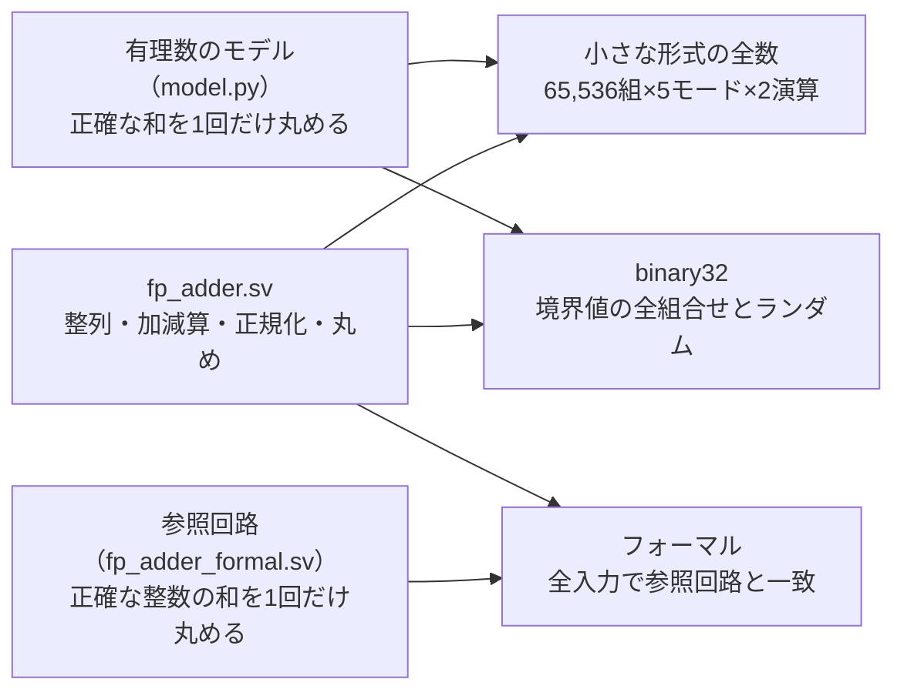

# 浮動小数点の加算器を、有理数のモデル・全数・フォーマルで確かめる

浮動小数点の加算は、ほとんどの入力で正しく動く回路でも、丸めの中間点、桁上げ、subnormal、ゼロの符号といった境界でだけ誤ります。一様な乱数は、この境界にほとんど当たりません。この教材では、IEEE 754の2進形式の加算器（加算と減算）を1つのRTLで書き、次の3つの方法で確かめます。

1. 8ビットの小さな形式で、全入力の組・全丸めモード・加算と減算を**全数**でシミュレーションする。
2. 同じ小さな形式を、別の考え方で書いた参照回路との一致として**フォーマル**に証明する。
3. binary32は、境界値どうしの全組合せと、境界を厚くしたランダムで確かめる。

期待値は、Pythonの`fractions`で書いた有理数のモデルです。判定の使い分けは[演算データパスの検証手順](../../docs/method/arithmetic-datapath-verification.md)、プロセッサの中での位置付けは[プロセッサの検証手順](../../docs/method/processor-verification.md)にあります。

## 3つの確認と期待値の関係



## 仕様（契約）

[`fp_adder.sv`](rtl/fp_adder.sv)は組合せ回路です。指数部`EXP`ビット、仮数部`FRAC`ビットをパラメーターで決めます。`EXP=8`・`FRAC=23`がbinary32です。

| 信号 | 向き | 内容 |
| --- | --- | --- |
| `sub` | 入力 | 0で`a + b`、1で`a - b` |
| `rm` | 入力 | 丸めモード（下の表） |
| `a`・`b` | 入力 | オペランド。上位から符号1ビット、指数部、仮数部 |
| `result` | 出力 | 結果。同じ形式 |
| `flags` | 出力 | 例外フラグ。上位から`NV`（invalid）・`DZ`・`OF`（overflow）・`UF`（underflow）・`NX`（inexact） |

丸めモードの符号と`flags`の並びは、RISC-VのF拡張の`frm`と`fflags`に合わせています。

| `rm` | 名前 | 丸め方 |
| --- | --- | --- |
| 0 | RNE | 最も近い値へ。中間なら仮数の最下位が偶数の側 |
| 1 | RTZ | 0の方向 |
| 2 | RDN | 負の無限大の方向 |
| 3 | RUP | 正の無限大の方向 |
| 4 | RMM | 最も近い値へ。中間なら絶対値の大きい側 |
| 5〜7 | － | 契約外です。テストベンチは与えず、フォーマルは仮定で除きます |

規格が実装に選択を任せている点と、この教材での選択は次のとおりです。

| 項目 | この教材の選択 |
| --- | --- |
| NaNの結果 | 入力のNaNの符号やペイロードは伝えず、必ず正準のquiet NaN（符号0、指数部がすべて1、仮数部は最上位だけ1）を返します |
| quiet NaNとsignaling NaNの区別 | 仮数部の最上位が1ならquiet、0ならsignalingです |
| invalid | どちらかの入力がsignaling NaNのとき、または符号の違う無限大どうしの加算のとき。quiet NaNだけでは立ちません |
| ゼロの符号 | 正確な和が0で、2つの項の符号が違うときは+0、RDNのときだけ−0。符号が同じとき（ゼロどうし）はその符号 |
| overflow | 丸めた結果が最大の有限値を超えたとき。`OF`と`NX`を立て、結果はモードと符号で決まります。RNE・RMMは無限大、RTZは最大の有限値、RDNは正なら最大の有限値・負なら−∞、RUPは正なら+∞・負なら絶対値が最大の負の有限値です |
| underflow | 丸めた後の値が小さく、かつ不正確なとき（tininessを丸めの後で判定）。ただし、加算では起きません（下記） |
| 例外のトラップ | ありません。フラグを出すだけで、積算もしません |

**加算ではunderflowは起きません。** 同じ形式の2つの数は、どちらも最小のsubnormalの整数倍です。和もその整数倍なので、subnormalの範囲に入る和は必ず正確に表せます。このためRTLは`UF`を常に0にしています。有理数のモデルは、丸めを任意の有理数に対して定義どおりに書いてあり、`UF`も計算します。小さな形式の全数で、モデルの`UF`が一度も立たないことをセルフテストで確かめています。`DZ`も加算では立ちません。

## 回路

1. 2つのオペランドを、絶対値の大きい側`x`と小さい側`y`に分けます。subnormalは、指数を最小の正規化数と同じにし、隠れビットを0にします。
2. `y`の仮数を指数の差だけ右へ寄せます。仮数の下にguard・round・stickyの3ビットを付け、押し出されたビットはすべてstickyにまとめます。
3. 符号が同じなら足し、違えば引きます。
4. 桁上げが出たら1ビット右へ、上位に0が並んだら左へ正規化します。左への正規化は、指数が最小になるところで止めます（結果がsubnormalになる場合です）。
5. guardと、それより下のビットから、モードに従って1を足すかを決めます。足した結果が仮数からあふれたら、指数を1つ上げます。
6. 指数が上限に達したらoverflowです。NaN・無限大・正確な0は、別に扱います。

## 独立した期待値：有理数のモデル

[`model.py`](model.py)は、RTLの手順（整列、guardビット、正規化）を使いません。

1. 有限のオペランドを`Fraction`に直します。
2. 和を`Fraction`のまま正確に求めます。
3. 和を挟む2つの表現可能な値を、指数から直接求め、余りと1/2の大小でモードごとに丸めます。

無限大・NaN・正確な0の符号は、仕様の表から分岐で決めます。モデル自身は、次の方法で確かめています。

- binary32のRNEを、Pythonの`struct`によるホストの単精度への変換と突き合わせます（倍精度の和が正確になる組だけを使い、二重の丸めを避けます）。
- 小さな形式で、加算の可換性、`a - b`と`a + (-b)`の一致、`x - x`の符号、`b`を大きくしたときに結果が減らないことを確かめます。
- 手で求めた結果とフラグ（中間点、桁上げ、overflowのモード別の結果、NaN、ゼロの符号）を固定の試験にしています。

## 検証すること

### 小さな形式の全数

構成`small`は、符号1・指数4・仮数3の8ビットです。オペランドの組は65,536通りで、5つの丸めモードと2つの演算を掛けた**655,360通りをすべて**、smokeでもnightlyでも実行します。モードと演算ごとに1ケース（`exhaustive-rne-add`など10ケース）に分けています。結果の全ビットと全フラグを照合します。

### binary32

構成`binary32`では全数はできないので、次の2つを実行します。

- **境界値の全組合せ**（`boundaries`）：62個の境界値どうしのすべての組を、5モード・2演算で実行します（38,440通り）。境界値は、±0、最小と最大のsubnormal、最小の正規化数、1.0の前後、1.5、1.0の最下位の半分（中間点を作る値）とその前後、指数の差が仮数の幅の前後になる値、最大の有限値とその前後、±∞、quiet NaN（ペイロードの違う2つ）、signaling NaN（符号の違う2つ）です。
- **ランダム**（`random-seed<n>`）：1行が32演算です。相手のオペランドは、符号を反転した値の近く（大きな相殺）、指数が仮数の幅の前後だけ離れた値、境界値、一様な乱数から選びます。smokeは100行×1 seed、nightlyは1000行×3 seedです。

小さな形式でも、同じ作り方の境界値（60個）とランダムを実行します。

### 目標

[要求カタログ](requirements.json)は6要求・25目標です。目標は刺激の種類で、有理数のモデルが演算ごとに判定します（中間点だったか、丸めで桁上げが起きたか、など）。テストベンチは、その行の比較がすべて合格したときに目標を数えます。両方の構成で、境界値の全組合せだけで25目標すべてに達します。

| 要求 | 目標 |
| --- | --- |
| オペランドの種類 | ゼロ、subnormal、無限大、quiet NaN、signaling NaN |
| 結果の種類 | +0、−0、subnormal、overflowで無限大、overflowで最大の有限値、無限大どうしのinvalid |
| 丸め | 正確、中間点、絶対値の大きい側へ、小さい側へ、丸めによる指数への桁上げ |
| 整列 | 大きな相殺、指数が離れていて小さい側がすべてstickyになる |
| 演算とモード | 加算、減算、5つのモード |

### フォーマル

[`fp_adder_formal.sv`](fp_adder_formal.sv)の参照回路は、RTLと別の構造です。有限のオペランドを「最小のsubnormalを1とする整数」に直し、正確に足すか引き、広い整数のまま先頭の1の位置で切って、1回だけ丸めます。整列のシフトも、guard・round・stickyも、正規化もありません。

[`formal.py`](formal.py)は、全オペランド・2演算・5モードについて、結果とフラグが参照回路と一致することを証明します。組合せ回路なので、1ステップの検査がそのまま全入力の証明になります。

| 構成 | 形式 | 証明の時間（手元） |
| --- | --- | --- |
| `e4f3` | 8ビット（指数4、仮数3）。シミュレーションの`small`と同じ | 約37秒 |
| `e5f4` | 10ビット（指数5、仮数4） | 約150〜180秒（他の処理と並行したときの値を含む） |

これより広い形式の証明は試していません。binary16やbinary32の証明は、この方式（1つのSMTの問い合わせ）では行っていません。

### 意図的な誤り

| 番号 | 誤り | シミュレーションの検出 | フォーマルで反例が出るアサーション |
| --- | --- | --- | --- |
| 1 | 整列で押し出したビットをstickyに入れない | `FP_FLAGS` | `ap_flags` |
| 2 | RNEの中間点を、いつも絶対値の大きい側へ丸める | `FP_VALUE` | `ap_result` |
| 3 | subnormalの結果の指数部を0にしない | `FP_VALUE` | `ap_result` |
| 4 | 丸めの桁上げで指数を上げない | `FP_VALUE` | `ap_result` |
| 5 | 正確な0の符号を、RDNでも+0にする | `FP_VALUE` | `ap_result` |
| 6 | overflowの結果を、どのモードでも無限大にする | `FP_VALUE` | `ap_result` |
| 7 | inexactをguardビットだけで決める | `FP_FLAGS` | `ap_flags` |

変異1は、値も誤らせます。境界値の最初の食い違いがフラグなので、ラベルは`FP_FLAGS`です。フラグの検査を外すと`FP_VALUE`で検出されることを、セルフテストで確かめています。フォーマルの変異タスクは、予定したアサーションだけを残して実行するので、別のアサーションの反例を検出に数えません。

テストベンチには、出力のXを見る`FP_X`もあります。期待値やRTLを書き換えて、`FP_VALUE`・`FP_FLAGS`・`FP_X`がそれぞれ働くことをセルフテストで確かめています。

## 実行

シミュレーションはIcarus Verilogだけで動きます。フォーマルには、[共通フォーマル手順](../local-formal-common/README.md)の固定版のYosys・SBY・Z3が要ります。

```sh
python3 examples/local-fp-adder/run.py --out artifacts/fp-adder
python3 examples/local-fp-adder/run.py --profile nightly --out artifacts/fp-adder-nightly
python3 examples/local-fp-adder/run.py --configuration binary32 --seed 42 --iterations 500 --out artifacts/fp-adder-seed42

. artifacts/toolchains/formal-venv/bin/activate
python3 examples/local-fp-adder/formal.py --out artifacts/fp-adder-formal
python3 -m unittest discover -s examples/local-fp-adder/tests -v
```

`run.py`は[共通手順](../local-common/README.md)を使います。`--iterations`はseedごとのランダムの行数（1行32演算）で、全数と境界値は減りません。`--demo-bug 1..7`は、通常の検証にも変異を入れて、終了コード1になることを確かめるためのものです。

## 証跡

`run.py`は、共通手順の証跡（`manifest.json`、`builds.json`、ケースごとの`vectors.txt`・`simulation.log`・`wave.vcd`・`result.json`、`coverage.json`、`summary.json`、`junit.xml`）を残します。

- ベクトルの1行は、演算、モード、`a`、個数、`b`の列、期待する結果とフラグの列、目標の語です。1行に最大256個の`b`をまとめています。
- テストベンチは、DUTの出力から数えた加算の数、減算の数、`NV`の数、`NX`の数を`COUNT`で出し、ランナーがモデルの件数と照合します。
- 波形にはポートだけを記録します。内部の信号まで記録すると、全数のケースでファイルが大きくなるためです。

`formal.py`は、共通フォーマル手順の証跡（タスクごとのSBYのログ、読み込んだアサーションの一覧、反例と到達例の波形、`summary.json`、`junit.xml`）を残します。

| | smoke | nightly |
| --- | --- | --- |
| `run.py`のJUnit | 30件 | 34件 |
| 比較した演算の数（通常ケース） | 736,200 | 921,800 |
| `formal.py`のJUnit | 18件（区別なし） | 同じ |

## 適用範囲と対象外

2026-11-21に、macOS arm64のPython 3.14、Icarus Verilog 14.0開発版、Verilator 5.052（lint）、YoWASP版Yosys 0.70とSBY、Z3 4.15.3で、2構成のsmoke 30件とnightly 34件、小さな形式の全655,360通り、7変異の検出、フォーマルの2構成18件、セルフテスト15件が成功しました。Linuxとkirimasimでは実行していません。

この教材で確かめていないことは次のとおりです。

- 乗算、除算、平方根、積和（FMA）、整数や他の形式との変換、比較は扱いません。
- binary64、binary16、十進の形式は実行していません。RTLはパラメーターで幅を変えられますが、確かめたのは8ビット、10ビット（フォーマルだけ）、binary32です。
- binary32は、境界値の全組合せとランダムの範囲です。全入力の確認ではなく、フォーマルの証明もありません。
- 公開の試験ベクトル（Berkeley TestFloatなど）との照合はしていません。TestFloatは取得しておらず、ライセンスの条件もこの作業では確認していません。使う場合は、固定する版と配布元のライセンスの表示を確かめてください。
- 例外のトラップ、フラグの積算、丸めモードのレジスタ、NaNのペイロードの伝搬は扱いません。
- 組合せ回路です。パイプライン化、逆圧、動作周波数、面積は扱いません。
- IEEE 754やRISC-Vへの適合の認定ではありません。

## 参考にした一次資料

- IEEE Std 754-2019：2進の交換形式の符号化（3.4節）、丸め方向の属性（4.3節）、加算と減算（5.4.1節）、無限大の演算（6.1節）、NaNの扱い（6.2節）、符号ビット（6.3節）、invalid・overflow・underflow・inexact（7.2節、7.4〜7.6節）。本文は写していません。
- [The RISC-V Instruction Set Manual, Volume I](https://docs.riscv.org/reference/isa/)のF拡張の章：丸めモードとフラグの符号、正準のNaN、tininessを丸めの後で判定すること。
- [Berkeley TestFloat](http://www.jhauser.us/arithmetic/TestFloat.html)：浮動小数点の実装を試験する公開のプログラム。名前を挙げるだけで、この教材では使っていません。
- [Pythonの`fractions`](https://docs.python.org/3/library/fractions.html)：有理数のモデルに使った標準ライブラリ。
