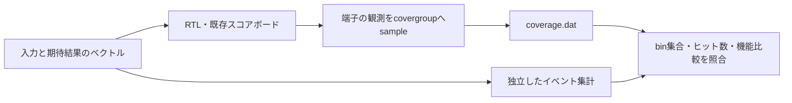

# Verilatorで機能カバレッジを実測する

[DRAM](../local-dram/README.md)・[SHA-256](../local-sha256/README.md)・[パケットスイッチ](../local-packet-switch/README.md)を、SystemVerilogの`covergroup`・`coverpoint`・`cross`で計測する例です。既存の`COVER`ログによる目標集計に加え、Verilatorのネイティブ`coverage.dat`を取得します。

機能カバレッジは、仕様から選んだ条件・組合せへ到達したかを確認するために使います。既存の期待値比較も同時に実行し、結果の正しさと到達状況の両方を合格条件にします。コードの行・分岐・関数を実行した割合とは異なります。

## 観測と独立した照合



ラッパーから実際の端子をサンプリングします。既存テストベンチは立下り後1nsで入力の安定と期待値の比較を終えるため、その後の2ns時点で観測し、次の立上りでの受理前の値を数えます。リセット中は数えません。

| 対象 | coverpoint・cross | bin数／構成 |
| --- | --- | --- |
| DRAM | バンク2、ACT／READ／WRITE／PREの4種、バンク×コマンド8、REF時の応答保持2、応答readyの2状態 | 18 |
| SHA-256 | 要求受理時の長さ9区分、結果2種、readyの2状態、結果×readyの4組合せ | 17 |
| スイッチ | 出力2、末尾の有無2、readyの2状態、出力×末尾×readyの8組合せ | 14 |

SHA-256の長さ区分は0、1〜54、55、56、57〜63、64、65〜118、119、120〜127です。受理した要求を数えるため、その後リセットで取り消す要求も入力の長さの計測に含みます。結果のカバレッジは、実際に`digest_valid`が立った期間にだけ数えます。

応答とスイッチ出力は、提示中の各サイクルを数えます。待ちサイクルの重複ヒットを含むため、binカウンターの合計は完了トランザクション数ではありません。DRAMのREFはバンクと関係がないため、バンク×コマンドのcrossから分けています。

スイッチには、両出力の本体・末尾をそれぞれ待たせる固定刺激を追加してから既存のシナリオを実行します。全3例とも固定シナリオだけで必須binへ到達します。ランダム刺激だけで収束したことを示す結果ではありません。

## 実行

Python 3.10以上、Verilator 5.052、C++20コンパイラーとmakeを使います。この例にはUVM・商用シミュレーター・ソルバーは不要です。[Verilatorの公式説明](https://verilator.org/guide/latest/simulating.html#covergroup-coverage)と[対応範囲](https://verilator.org/guide/latest/languages.html#coverage)に従い、`--coverage-user`で計測します。

```sh
python3 examples/local-functional-coverage/run.py
python3 examples/local-functional-coverage/run.py --profile nightly
python3 examples/local-functional-coverage/run.py --example sha256
python3 -m unittest discover -s examples/local-functional-coverage/tests -v
```

`--example`は`all`（既定）・`dram`・`sha256`・`packet-switch`、ほかに`--seed`・`--verilator`・`--jobs`・`--timeout`・`--build-timeout`・`--out`を指定できます。出力先が既にある場合は拒否します。各例の2構成を別々にビルドし、smokeは固定＋ランダム1 seed、nightlyは固定＋ランダム3 seedで実行します。通常実行の**一つひとつ**で全binのヒットを要求し、構成やseedの和集合で不足を埋めません。

コンパイル警告も失敗として扱います。既存3テストベンチのファイルハンドルの比較とSHA-256の長さ比較を明示的な幅に修正し、警告の一括抑止は加えていません。

## 合格条件と計測の検出力

ネイティブDBのbin名・個数・ソース・cross種別を固定計画と照合します。全binの存在とヒットに加え、ベクトルから独立して数えた**binごとの期待ヒット数との完全一致**を要求します。100%の表示だけでは合格にしません。

各構成で、刺激を減らしたケースと、`sample()`を無効にしたケースも実行します。どちらもRTLの機能比較と完了検査は成功し、DBは期待する未達binを持ち、カバレッジ判定で拒否される必要があります。これらはカバレッジ環境の診断であり、RTLの変異検出率には加えません。診断ケースのヒットで通常ケースの未達を補いません。

クラッシュ・ビルド失敗・DB欠落・不正なbin集合・予定外のヒット数を、未達の検出成功に数えません。binの未生成、重複、別ソースのカウンター、cross属性の欠落、全binが正の値でも件数が違う場合の拒否をセルフテストに含めます。

`manifest.json`、ツール版、ビルド・実行ログ、ベクトル、波形、各ケースの`coverage.dat`、期待値と実測値を含む`result.json`、`executions.json`、`summary.json`、`junit.xml`を保存します。JUnitは全3例でsmoke 36件／nightly 48件です。既存Icarus共通ランナー58例のJUnitとは別集計です。

2026-10-31にVerilator 5.052で全6構成のsmoke／nightly、計測不足と無効化の診断、セルフテスト8件が成功しました。既存の[UVMの24 binを使う例](../local-uvm-random/README.md)も、両構成のsmoke（JUnit 17件）を再実行して成功しました。

## 確認範囲

明示したbin集合を計測する教材です。既存の`COVER`目標すべてをcovergroupへ置き換えた例でも、全58例にネイティブ計測を追加した結果でもありません。4値・X伝搬の確認はIcarusの既存実行で継続します。全SystemVerilog構文や商用DBとの互換性、UCISの相互運用、コードカバレッジや仕様全体の網羅を確認した結果とは区別します。計画の作り方は[機能カバレッジの手法](../../docs/method/functional-coverage.md)を参照してください。
