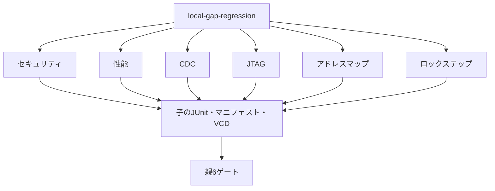

# セキュリティ・ライフサイクルとデバッグ認証の6例

既存のローカル例で薄かった検証領域を補う6例をまとめて実行します。GitLabの登録・CI設定・利用枠は使いません。

| 例 | 主に補う領域 |
| --- | --- |
| [セキュリティ・ライフサイクル](../local-secure-lifecycle/README.md) | 権限、ライフサイクル、デバッグ認証、鍵の消去 |
| [性能モニター](../local-performance-monitor/README.md) | 未完了数、レイテンシ、最大値、測定窓、帯域 |
| [CDCハンドシェイク](../local-cdc-handshake/README.md) | 複数ビットreq/ack、パルス同期、リセット同期 |
| [JTAG TAP](../local-jtag-tap/README.md) | DFTアクセス、IR/DR、IDCODE、BYPASS、境界走査 |
| [アドレスマップ](../local-address-map/README.md) | デコード、別名、未割当、バイトストローブ、IRQ集約 |
| [ロックステップ監視](../local-lockstep-monitor/README.md) | 比較、故障注入、安全状態、復帰、不正命令 |

## 実行範囲と集約



| 区分 | smoke JUnit | nightly JUnit |
| --- | --- | --- |
| 6例・12構成の子 | 84 | 108 |
| 親の集約ゲート | 6 | 6 |

各例は2構成を持ち、構成ごとに固定シナリオ1件、ランダム1件（nightlyは3件）、4変異、必須目標ゲートを実行します。子のJUnitは1構成7件（nightly 9件）です。親と子を二重加算しません。

## 子の成功を親で確認する

親は子の終了コード、`summary.json`の`success`と`complete`、予定数と結果数、各結果の`pass`と一意なIDを確認します。子の個別テストを親の件数へ取り込み直す方式ではありません。欠落・重複・形式不正は失敗にします。

```sh
python3 examples/local-gap-regression/run.py --stage core --out artifacts/gap-smoke
python3 examples/local-gap-regression/run.py --stage core --profile nightly --out artifacts/gap-nightly
python3 -m unittest discover -s examples/local-gap-regression/tests -v
```

`--child-timeout`は子1回帰の上限で、既定1800秒です。ツールの自動インストールは行わず、既存出力先は上書きしません。

## 確認範囲

6例の確認テストは33件（セキュリティ5、性能5、CDC6、JTAG6、アドレスマップ6、ロックステップ5）で、親の4件を加えると37件です。通常カバレッジと負の試験を分け、負の試験の観測を通常目標へ加算しません。

各例は教材であり、製品のセキュリティ認証、CPUのロックステップ、実JTAG/DFT、実CDCのタイミング収束、実測性能を保証するものではありません。対象範囲と一次資料は各READMEに記載しています。
