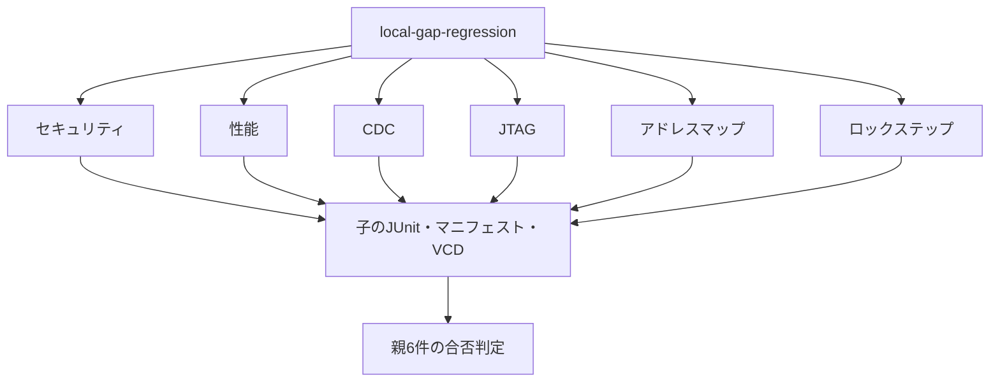
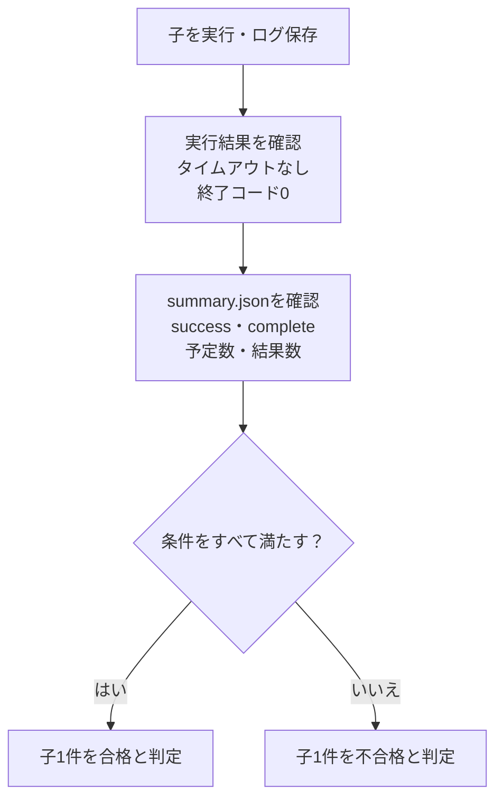

# セキュリティ・性能・CDC・JTAG・マップ・監視の6例

既存のローカル実行例では十分に扱っていなかった検証領域を補う6例をまとめて実行します。

| 例 | 主に補う領域 |
| --- | --- |
| [セキュリティ・ライフサイクル](../local-secure-lifecycle/README.md) | 権限、ライフサイクル、デバッグ認証、鍵の消去 |
| [性能モニター](../local-performance-monitor/README.md) | アウトスタンディング数、レイテンシ、最大値、測定区間、帯域 |
| [CDCハンドシェイク](../local-cdc-handshake/README.md) | 複数ビットreq/ack、パルス同期、リセット同期 |
| [JTAG TAP](../local-jtag-tap/README.md) | DFTアクセス、IR/DR、IDCODE、BYPASS、境界走査 |
| [アドレスマップ](../local-address-map/README.md) | デコード、別名、未割当、バイトストローブ、IRQ集約 |
| [ロックステップ監視](../local-lockstep-monitor/README.md) | 比較、故障注入、安全状態、復帰、不正命令 |

## 実行範囲と集約



| 区分 | smoke JUnit | nightly JUnit |
| --- | --- | --- |
| 6例・12構成の子 | 84 | 108 |
| 集約ランナーの合否判定 | 6 | 6 |

各例は2構成を持ち、構成ごとに固定シナリオ1件、ランダム1件（nightlyは3件）、4種類の変異、必須カバレッジ目標の合否判定を実行します。子のJUnitは1構成7件（nightly 9件）です。親と子を二重加算しません。

## 子の成功を親で確認する

親は子の終了コード、`summary.json`の`success`と`complete`、予定数と結果数、各結果の`pass`と一意なIDを確認します。子の個別テストを親の件数へ取り込み直す方式ではありません。欠落・重複・形式不正は失敗にします。

```sh
python3 examples/local-gap-regression/run.py --stage core --out artifacts/gap-smoke
python3 examples/local-gap-regression/run.py --stage core --profile nightly --out artifacts/gap-nightly
python3 -m unittest discover -s examples/local-gap-regression/tests -v
```

`--child-timeout`は子1リグレッションの上限で、既定1800秒です。ツールの自動インストールは行わず、既存出力先は上書きしません。

## 目標とセルフテストの対応

通常実行のカバレッジ目標は各構成で満たし、4種類の変異の検出結果は別に記録します。セルフテストは、生成計画の再現性、通常リグレッション、ネガティブテストの判定、レビューで見つけた不具合の再発防止を含みます。



| 例 | 構成ごとの通常実行のカバレッジ目標 | セルフテスト | レビュー後の主な確認 |
| --- | --- | --- | --- |
| セキュリティ | 15 | 6 | タンパーと鍵書込みの競合、消去後の状態 |
| 性能 | 13 | 7 | タグ範囲、255での飽和、測定区間境界 |
| CDC | 15 | 8 | 実クロックエッジ、独立データ照合、最終排出 |
| JTAG | 14 | 9 | PRELOAD、立下り更新、未実装IR、TMSリセット |
| アドレスマップ | 13 | 8 | GPIOピン、全RAM、イベントとW1Cの競合 |
| ロックステップ | 12 | 7 | 全error_code、復帰後の観測、最終操作 |

6例の45件に親の形式検査4件を加えて49件です。子の`manifest.json`・ケースログ・VCDから実行内容を確認でき、親には子ごとのログと実行結果、集約JUnitを残します。

## 確認範囲

6例のセルフテストは45件（セキュリティ6、性能7、CDC8、JTAG9、アドレスマップ8、ロックステップ7）で、親の4件を加えると49件です。通常実行のカバレッジとネガティブテストを分け、ネガティブテストの観測を通常実行のカバレッジ目標へ加算しません。

各例は教材であり、製品のセキュリティ認証、CPUのロックステップ、実JTAG/DFT、実CDCのタイミング収束、実測性能を保証するものではありません。対象範囲と一次資料は各READMEに記載しています。
