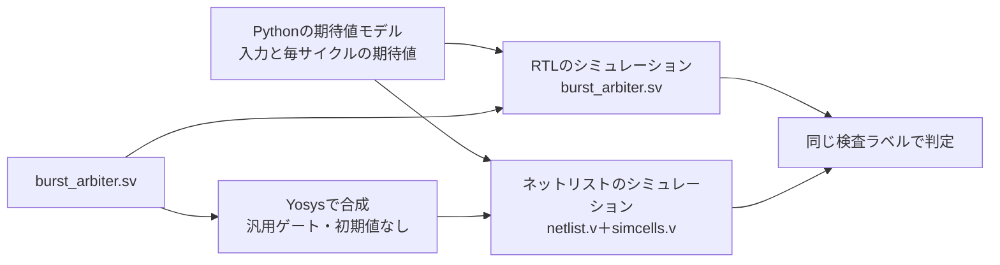

# 合成後のネットリストでしか見えない食い違いを、同じテストベンチで見つける

RTLのシミュレーションで合格しても、合成した回路が同じように動くとは限りません。合成ツールだけが解釈する指示、シミュレーターだけが実行するコード、フリップフロップの初期値、シミュレーターの実行順に依存する書き方があると、RTLと合成結果が食い違います。この教材では、同じテストベンチと期待値を、RTLと、Yosysで合成したゲートレベルのネットリストの両方で実行します。RTLでは合格し、ネットリストでだけ失敗する4種類の誤りを確かめます。

## 同じ期待値を2つの見方で照合する



テストベンチ[`arbiter_tb.sv`](tb/arbiter_tb.sv)は1つで、`GATE`パラメーターでRTLとネットリストを切り替えます。ネットリストにはパラメーターがないので、変異の番号は合成の時点で固定します。毎サイクル、出力にXやZがないこと、制御信号、番号とカウンターを照合します。

## 対象回路

[`burst_arbiter.sv`](rtl/burst_arbiter.sv)は、4つの要求から番号の最も小さいものを選び、4ビートのバーストを出す固定優先度のアービタです。バーストの後に1サイクル休み、次のサイクルで次の要求を選びます。完了したバーストの数を8ビットのカウンターで数えます。

| サイクル | 0 | 1 | 2 | 3 | 4 | 5 | 6 | 7 |
| --- | --- | --- | --- | --- | --- | --- | --- | --- |
| `req` | `1010` | `0000` | `0000` | `0000` | `0000` | `0000` | `0110` | `0000` |
| `out_valid` | 0 | 1 | 1 | 1 | 1 | 0 | 0 | 1 |
| `out_last` | 0 | 0 | 0 | 0 | 1 | 0 | 0 | 0 |
| `out_id` | － | 1 | 1 | 1 | 1 | － | － | 1 |
| `bursts` | 0 | 0 | 0 | 0 | 0 | 1 | 1 | 1 |

サイクル0とサイクル6で要求を選び、次のサイクルからバーストが始まります。サイクル5は休みのサイクルです。出力はすべてフリップフロップから出し、同期リセットで0に戻します。

## 合成の手順

[`run.py`](run.py)は、変異ごとに次のYosysのスクリプトで合成します。

```text
read_verilog -sv burst_arbiter.sv
chparam -set MUTATION <番号> burst_arbiter
synth -top burst_arbiter -flatten
setattr -unset init w:*
dfflegalize -cell $_DFF_P_ x
opt_clean
stat
write_verilog -noattr -noexpr netlist.v
```

| 手順 | 理由 |
| --- | --- |
| `synth` | 汎用ゲート（AND・OR・MUXなど）とフリップフロップへ変換します |
| `setattr -unset init` | フリップフロップの初期値を取り除きます。ASICのフリップフロップには初期値がないためです |
| `dfflegalize -cell $_DFF_P_ x` | リセット付きのフリップフロップを使わず、同期リセットを前段の論理で作ります。リセット付きのセルを持たないライブラリと同じ形です |
| `write_verilog -noexpr` | 論理式ではなくセルの接続として書きます。セルの動作はYosysの`simcells.v`で与えます |

変異0のネットリストは92セル（フリップフロップ17個、MUX 28個）です。実際のセルライブラリ、配置配線、遅延情報（SDF）は使いません。遅延なしのシミュレーションです。

## RTLとネットリストが食い違う4つの書き方

| 番号 | 書き方 | RTLのシミュレーション | 合成結果 | ネットリストでの検出 | 事前の手がかり |
| --- | --- | --- | --- | --- | --- |
| 1 | カウンターのリセットを`translate_off`の範囲に置く | 範囲内のコードも実行し、0に戻る | 範囲を読み飛ばし、リセットがない | `ARB_X`（サイクル0でカウンターがX） | Yosysの警告 |
| 2 | 優先度付きの`casez`に`// synopsys parallel_case`を付ける | コメントを無視し、上の項目を優先 | 一致した項目の値のORになる | `ARB_DATA`（要求`0011`で番号1） | Yosysの警告 |
| 3 | 初期値から数える起動時リセットを使う | 初期値0から数え、3サイクルで解除 | 初期値がなく、カウンターが決まらない | `ARB_X`（サイクル8で`out_valid`がX） | Verilatorの`PROCASSINIT` |
| 4 | 別の順序回路ブロックでブロッキング代入した値を読む | 先に代入するブロックを実行し、新しい値を読む | レジスタになり、1サイクル前の値を読む | `ARB_DATA`（番号がずれる） | Verilatorの`BLKSEQ` |

変異1と2は、合成ツールだけが解釈するコメントによるものです。Yosysは、`translate_off`と`parallel_case`のコメントを見つけると警告を出し、`ifdef`や`parallel_case`属性、SystemVerilogの`unique`・`priority`への置き換えを勧めます。合成ログの警告を読めば、ネットリストのシミュレーションの前に気付けます。

変異3は、FPGAでは動く書き方です。FPGAのフリップフロップは設定時に初期値を持つためです。ASICでは電源投入時の値が決まらず、実機ではカウンターが3から始まって起動時のリセットが出ないこともあります。

変異4は、どちらのブロックを先に実行するかが規格で決まっていない書き方です。この例のIcarus Verilog 14.0では、ファイル内で先に書いたブロックが先に実行され、RTLは正しい値を読みます。セルフテストでは、2つのブロックの順序を入れ替えるとRTLでも失敗することを確かめています。RTLの合格が、たまたまの実行順に依存していたことになります。

Verilatorの`--lint-only -Wall`は、変異3と4の書き方を警告します。この例は変異を同じファイルに置き、パラメーターで切り替えています。そのため、YosysとVerilatorの警告は変異0でも出ます。

## Xの現れ方

RTLの`if (X)`はelse側を実行するので、不定値が隠れます（X楽観）。ネットリストのMUXは、選択信号がXでも入力の値が等しければその値を、異なればXを出します。変異3では、リセット解除の直後は要求がなく、次の値とリセット値がどちらも0なので、出力はXになりません。サイクル7に最初の要求が来て次の値が1になると、サイクル8で初めて`out_valid`がXになります。Xを見つけるには、リセット値と異なる値へ進む刺激が必要です。

ゲートレベルのX表示も実機とは一致しません。実機の値は0か1のどちらかです。同じXの信号が合流する論理では、実機なら決まる値もXと表示されることがあります（X悲観）。この例では、変異0のネットリストでXが出ないことを、全ケースで確かめています。

## 独立した期待値

Pythonの期待値モデルは、仕様をサイクル単位で書いたものです。出力はそのサイクルの状態から決まり、エッジで次の状態へ進みます。同じ入力と期待値の列を、RTLとネットリストの両方に与えます。RTLとネットリストを直接比べるのではなく、両方を同じ仕様に照らします。

テストベンチは、バーストの開始時に直前のサイクルの要求を見て、要求が1つか、複数か、4つすべてか、0番と3番を含むかを記録します。目標への加算は、そのケースが合格したときだけ行います。

## 固定シナリオとランダム刺激

固定シナリオは次の順に実行します。

1. 電源投入後の3サイクルのリセット
2. 要求がない状態
3. 各番号の単独の要求
4. `0011`・`0110`・`1001`・`1100`・`1111`の競合
5. 保持した要求による連続したバースト
6. 休みのサイクルと選択のサイクルの間での要求の変化
7. カウンターの255から0への折り返し
8. バーストの途中のリセット

ランダム刺激は、要求なし、単独の要求、複数の要求を混ぜ、1〜3サイクルずつ保持し、まれにリセットを入れます。

[要求カタログ](requirements.json)は4要求・9目標です。RTLとネットリストのどちらでも、固定シナリオだけで9目標に達します。

## 実行

Yosysは[共通フォーマル手順](../local-formal-common/README.md)の固定版を使います。`simcells.v`はYoWASP版Yosysのパッケージから自動で探します。別のYosysを使う場合は`--yosys`と`--cell-library`を指定します。

```sh
. /tmp/lsi-bus-formal-venv/bin/activate
python3 examples/local-gate-sim/run.py --out artifacts/gate-sim
python3 examples/local-gate-sim/run.py --profile nightly --out artifacts/gate-sim-nightly
python3 -m unittest discover -s examples/local-gate-sim/tests -v
```

[共通手順](../local-common/README.md)を使い、構成は`rtl`と`gate`です。共通手順の`build_sources`で、構成と変異ごとにネットリストを作ってコンパイルします。各`gate-m<番号>`には、合成ログ`synthesis.log`と`netlist.v`を残します。smokeは400サイクル×1 seed、nightlyは4000サイクル×3 seedです。JUnitは各構成7／9件、全体14／18件で、セルフテストは6件です。

## 確認範囲

2026-10-31に、Python 3.14.7、Icarus Verilog 14.0開発版、YoWASP版Yosys 0.70で、両構成のsmoke／nightly、9目標、RTLでの4変異の合格とネットリストでの4変異の検出、セルフテスト6件が成功しました。全体の実行は約4秒です。

対象は論理の食い違いです。遅延を含むタイミングのシミュレーション、実際のセルライブラリ、スキャンなどの試験回路、消費電力の見積りは扱いません。RTLとネットリストの一致を証明するには、等価性検証を使います（[FIFOの等価性例](../local-equivalence/README.md)）。シミュレーションは与えた刺激の範囲でしか食い違いを見つけません。
