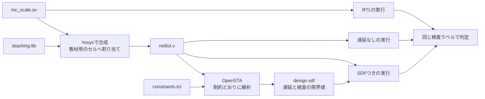

# 遅延つきのゲートレベルシミュレーションで、STAが見逃す誤りを見つける

静的タイミング解析（STA）は、与えた制約が正しいことを前提にします。マルチサイクルパスやフォルスパスの指定が回路の実際の動きと合っていなければ、STAは違反を報告しません。クロックを理想として扱えば、クロックの遅れも見ません。この教材では、同じテストベンチを、RTL、遅延なしのネットリスト、SDFの遅延を付けたネットリストの3つで実行します。STAは合格し、遅延なしの2つも合格し、SDFを付けたときだけ失敗する誤りを3種類確かめます。

論理の食い違いを遅延なしで見つける例は、[合成後ネットリストのシミュレーション](../local-gate-sim/README.md)です。STAそのものの読み方は、[OpenSTAの実行例](../local-sta/README.md)で扱います。

## 3つの見方と、その間をつなぐファイル



| 見方 | 構成名 | 見えるもの |
| --- | --- | --- |
| RTL | `rtl` | 仕様どおりの論理 |
| 遅延なしのネットリスト | `gate` | 合成後の論理。遅延とタイミング検査はなし |
| SDFつきのネットリスト | `sdf` | セルの遅延、セットアップとホールドの検査 |

テストベンチ[`mc_tb.sv`](tb/mc_tb.sv)は1つで、`GATE`パラメーターで切り替えます。サイクル数は数えません。演算を始め、`done`が来たときに結果を照合します。このため、結果が出るまでのサイクル数が変わる誤りは、遅延なしでは見えません。

## 対象回路

[`mc_scale.sv`](rtl/mc_scale.sv)は、6ビットの2つの値を掛け、`cfg`が1なら積を2倍にします。掛け算の論理は1周期に収まらないので、結果のレジスタは、入力のレジスタの2つ後のエッジで取り込みます。これがマルチサイクルパスです。

| エッジ | 0 | 1 | 2 | 3 |
| --- | --- | --- | --- | --- |
| 動作 | `start`を受け付け、`a`・`b`・`cfg`を取り込む | 待つ | 結果を取り込む | `done`を1サイクル出す |

制御のレジスタは同期リセットで0に戻します。データのレジスタはリセットせず、最初の取り込みまでXです。

## 合成とセルライブラリ

[`teaching.lib`](cells/teaching.lib)は教材用の架空のライブラリです。遅延はセルごとに1つの定数で、入力の傾きにも負荷にも依存しません。実際の製造プロセスの値ではありません。

| セル | 遅延など（ns） |
| --- | --- |
| `INV`・`NAND2`・`NOR2`・`XOR2`・`BUF` | 0.08・0.10・0.12・0.18・0.10 |
| `DFF`・`DFFE`（イネーブル付き） | クロックから出力0.30、セットアップ0.20、ホールド0.10 |
| `CKDLY` | 0.25。合成では使わず、変異3がクロックに入れます |

[`run.py`](run.py)は、変異ごとに次のYosysのスクリプトで合成します。

```text
read_liberty -lib cells.lib
read_verilog -sv mc_scale.sv
chparam -set MUTATION <番号> mc_scale
synth -top mc_scale -flatten
dfflegalize -cell $_DFF_P_ x -cell $_DFFE_PP_ x
dfflibmap -liberty cells.lib
abc -liberty cells.lib
opt_clean
stat
write_verilog -noattr -noexpr mapped.v
```

変異0のネットリストは325セルで、フリップフロップは30個（うちイネーブル付き26個）です。ランナーは、各フリップフロップを出力のネット名で呼び直します（`a_q[3]`を出すものは`a_q_3_reg`）。制約とSDFでレジスタを名前で指せるようにするためです。

結果のレジスタにイネーブル付きのフリップフロップを使うのは、掛け算の出力がエッジ1の前後でも動いているからです。イネーブルが0の間、データ入力の変化は取り込まれません。

## STAと周期の決め方

合成結果の遅延は、Yosysの版で変わりえます。そこで周期を固定せず、OpenSTAの測定から決めます。[`probe.tcl`](sta/probe.tcl)が、経路の種類ごとに「遅延＋セットアップ時間」を測ります。

| 種類 | 手元の値（ns） | 周期への条件 |
| --- | --- | --- |
| 入力レジスタから結果レジスタ（マルチサイクル） | 3.28 | 2周期に収まる |
| そのほかのレジスタ間・出力 | 0.90 | 1周期に収まる |
| 入力ポートから | 0.52 | 半周期に収まる（入力は立ち下がりで変える） |

ランナーは、3つの条件を0.1 nsの余裕つきで満たす最短の周期を、0.05 ns刻みで選びます。手元では1.75 nsです。掛け算が1周期に収まるようになった場合は、この教材の前提が崩れるので、エラーにします。

[`constraints.tcl`](sta/constraints.tcl)が制約です。入力レジスタから結果レジスタへ、セットアップ2・ホールド1のマルチサイクルパスを指定します。クロックは理想として扱います。[`check.tcl`](sta/check.tcl)は、最悪のセットアップとホールドのスラックを出し、SDFファイルを書きます。

## Icarus Verilogでのタイミング検査

Icarus Verilog 14は、SDFの経路遅延（`IOPATH`）を`specify`の経路へ反映します。コンパイルには`-gspecify -ginterconnect -Tmax`が要ります。`-Tmax`がないと、最小値と最大値の組だけを持つSDFからは、何も反映されません。

一方、`$setup`や`$hold`などのタイミング検査には対応していません。SDFの`TIMINGCHECK`も読み飛ばし、警告を出します。そこで、[セルモデル](cells/cells.v)のフリップフロップが、自分のデータ入力を検査します。

- データの変化がクロックのエッジの`TSETUP`より近い手前、または`THOLD`より近い後ろなら、出力をXにし、`TIMING`の行を表示します。ライブラリのモデルのノーティファイアと同じ考え方です。
- `TSETUP`と`THOLD`の値は、ランナーがSDFの`TIMINGCHECK`から読み取り、生成するモジュール`mc_timing`の`defparam`で各フリップフロップへ設定します。SDFがすべてのフリップフロップを網羅していなければ、エラーにします。
- イネーブル付きのフリップフロップは、イネーブルが1のときだけデータ入力を検査します。実際のライブラリの条件付き検査に当たります。

`mc_timing`は、周期と、`cfg`を変える時刻も持ちます。`rtl`と`gate`では周期10 nsで、遅延と限界値はありません。

## STAは合格し、SDFつきでだけ失敗する3つの誤り

| 番号 | 誤り | STAが合格する理由 | SDFつきでの検出 | 正しい制約でのSTA | 事前の手がかり |
| --- | --- | --- | --- | --- | --- |
| 1 | 結果をエッジ1で取り込むようにRTLを変えたが、マルチサイクルパスの指定を残した | 指定どおり2周期で解析する | `MC_DATA`（結果レジスタの違反、誤った積） | セットアップ違反（スラック−1.55 ns） | 例外の指定とRTLのイネーブルの突き合わせ |
| 2 | `cfg`の到着が遅いのに、「固定の設定入力」としてフォルスパスにした | `cfg`からの経路を解析しない | `MC_DATA`（`cfg_q_reg`のセットアップ違反、結果がX） | セットアップ違反（−0.10 ns） | `check_setup`の「制約のない終点が1つ」 |
| 3 | `done`のフリップフロップのクロックに遅延セルが入ったのに、クロックを理想のまま解析した | クロックの経路の遅延を見ない | `MC_X`（`done_reg`のホールド違反） | ホールド違反（−0.05 ns） | `set_propagated_clock`での解析 |

- **変異1**は、RTLの変更です。サイクル数を数えないテストベンチでは、結果が1サイクル早く出ても合格します。SDFつきでは、掛け算が終わる前に取り込むので、ほとんどの演算で結果が誤るかXになります。
- **変異2**は、RTLを変えません。変えるのは、`cfg`の到着時刻と制約です。テストベンチは`cfg`を、開始サイクルのエッジの0.1 ns前にフリップフロップへ届く時刻に変えます。遅延なしではエッジの前なので正しく取り込めます。
- **変異3**は、クロックの遅延セルです。前段の`fire`の変化が、遅れたクロックのエッジの0.05 ns後に届きます。経路の遅延だけでは結果は変わらず、ホールドの検査があって初めて見つかります。セルフテストで、限界値を設定しないと変異3が合格してしまうことを確かめています。

ランナーは、変異ごとに2回STAを実行します。与えた制約では合格すること、変異を正しく表す制約では表の違反が出ることの両方を要求します。

## 固定シナリオと目標

固定シナリオは、リセットの後に13回の演算を始めます（1回はリセットで中断します）。0や1を含む値、最大値どうし、開始サイクルでの`cfg`の変更、待機中の`cfg`の変更、連続した開始、演算の途中のリセットを含みます。ランダム刺激は、値・`cfg`・間隔を変え、まれにリセットを入れます。

[要求カタログ](requirements.json)は4要求・10目標です。3つの構成のどれでも、固定シナリオだけで10目標に達します。SDFつきの通常実行では、タイミング違反が0件であることも数えます（`COUNT timing_violations=0`）。

## 実行

YosysとOpenSTAが要ります。Yosysは[共通フォーマル手順](../local-formal-common/README.md)の固定版、OpenSTAは[STAの例](../local-sta/README.md)と同じものです。`--yosys`と`--sta`で場所を指定できます。

```sh
. artifacts/toolchains/formal-venv/bin/activate
python3 examples/local-gate-timing/run.py --out artifacts/gate-timing
python3 examples/local-gate-timing/run.py --profile nightly --out artifacts/gate-timing-nightly
python3 -m unittest discover -s examples/local-gate-timing/tests -v
```

[共通手順](../local-common/README.md)を使い、構成は`rtl`・`gate`・`sdf`です。`build_sources`フックでネットリスト・SDF・`mc_timing`を作り、`iverilog_options`フックで`sdf`だけに遅延のオプションを渡します。各`sdf-m<番号>`には、合成ログ、ネットリスト、STAのスクリプトとログ、`design.sdf`、測定と周期を記録した`timing.json`を残します。`builds.json`にも同じ測定を記録します。JUnitはsmoke 18件／nightly 24件、セルフテストは18件です。

## 確認範囲

2026-11-20に、macOS arm64のPython 3.14、Icarus Verilog 14.0開発版、YoWASP版Yosys 0.70、OpenSTA 3.1.0で、3構成のsmoke／nightly、10目標、遅延なしでの3変異の合格とSDFつきでの3変異の検出、セルフテスト18件が成功しました。Linuxでは実行していません。

この教材で確かめていないことは次のとおりです。

- 遅延は架空のライブラリの定数です。配線の遅延は0で、配置配線の結果も、実際のセルライブラリも使いません。
- コーナーは1つです。最小と最大の遅延を分けたホールドの確認はしていません。
- タイミング検査は、この例のセルモデルが行います。シミュレーターの`$setup`・`$hold`やノーティファイアを使う実際のライブラリのモデルとは、作りが違います。違反の後の値は、実機では0か1のどちらかで、Xは「分からない」ことの表示です。
- 遅延つきのシミュレーションは、与えた刺激が通った経路しか見ません。STAの代わりにはなりません。例外の指定を網羅的に確かめるには、指定の前提（イネーブルの間隔など）をアサーションや形式検証で確かめる方法があります。
- スキャン挿入後のネットリスト、電源制御、複数クロックは扱いません。
