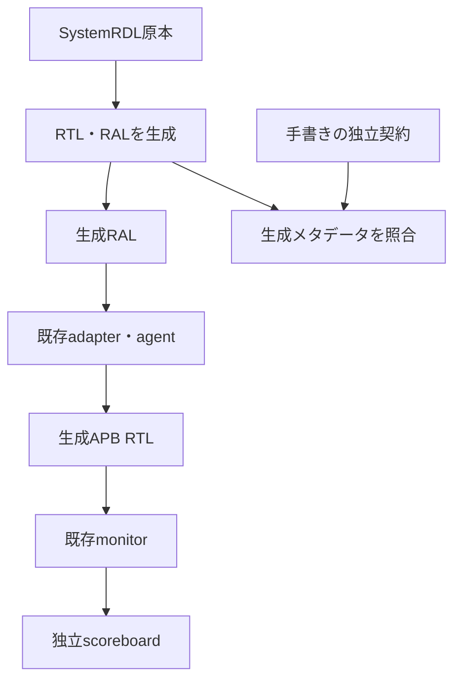
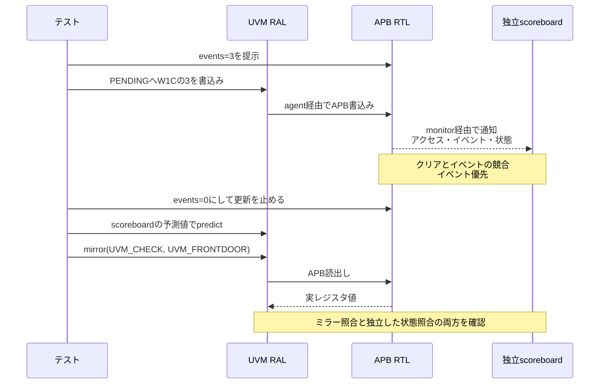

# 生成RTLとUVM RALをfrontdoorで結合する

[SystemRDL例](../local-register-spec/README.md)の生成器・原本・独立契約を再利用し、生成したAPB RTLと生成RALを実バスで接続します。既存例の属性照合に加え、frontdoor操作、ミラー比較、独立scoreboardを動かすローカル教材です。

## 構成と判定



RALの一致だけで合格にせず、手書きのCONFIG=8ビット・reset 0x12、ID=0x52444c31、4ビットPENDINGのモデルで実応答とエッジ後の状態を比較します。SETUP・待ち中の更新も毎クロック検査します。

| 操作 | RAL側 | 独立した確認 |
| --- | --- | --- |
| CONFIG読書き | frontdoor＋auto prediction＋mirror UVM_CHECK | アドレス・応答・8ビット保持・状態 |
| イベントとW1C | 操作終了後に仕様モデルから明示的predictし、実読出し | イベント優先と保持・クリア |
| リセット | DUT駆動とRAL resetを別々に実行 | 初期値と復帰後の実読出し |
| RO書込み・未定義番地 | raw sequenceで実バスへ投入 | エラー応答・無副作用 |

APB待ち0／2の各通常実行で9目標を要求します。smokeは固定12取引＋12回のCONFIG書込み・ミラー照合、nightlyは80回×3 seedです。データ列はseed付きの固定アルゴリズムで、SVの制約付きrandomizeではありません。

## イベントで変わるPENDINGを確認する順序

PENDINGはバス操作以外でも変わるため、イベントを止めて状態が落ち着いてから、独立scoreboardの予測値をRALへ渡します。図はW1Cとイベントを重ねる固定ケースの流れです。APBの待ちサイクルは省略しています。



| 判定層 | 期待値・入力の出所 | 主に見つける誤り |
| --- | --- | --- |
| 生成メタデータと独立契約 | 手書きの`contract.json` | フィールド幅・初期値・アクセス属性の生成誤り |
| RALのfrontdoor・ミラー照合 | RALの予測値と実APB読出し | adapterの接続やミラー値の不一致 |
| 独立scoreboard | 観測した操作・イベントと手書きの状態更新規則 | 応答・保持値・W1C優先順位の誤り |
| ランナーの最終判定 | 転送件数・目標・UVMのseverityと警告ID | 検査の未実行・件数不足・予期しない警告 |

## 負の試験とUVMの警告

生成RTLのreset・マスク・W1C優先順位の3変異を、予定したSTATE／PENDINGチェッカーで検出します。正常RTLへ誤ったミラー値を与える診断では、UVM_CHECKの不一致と最終reportの失敗を要求します。これはRTL変異率へ含めません。

PENDINGはハードウェア更新可能なのでvolatileのまま使います。UVM 2020-3.2のmirrorから出る`UVM/FLD/GET_MIRRORED_VAL/VOL`の警告3件と、既存DPIなし構成の`NO_DPI_USED`・`NO_VISIT_CHECK`各1件、計5件だけを許可します。ERROR／FATALは通常実行で0件を要求し、未知の警告や件数差は失敗です。volatileの警告を避けるために属性を非volatileへ変えません。

## 実行

Python 3.10以上、Verilator 5.052、C++20環境、[外部UVM 2020-3.2](../local-uvm/README.md)、[SystemRDL用Python環境](../local-register-spec/README.md)を用意します。

```sh
python3 examples/local-generated-ral/run.py \
  --uvm-home /tmp/lsi-uvm-library/1800.2-2020.3.2 \
  --rdl-python /tmp/lsi-rdl-venv/bin/python --out artifacts/generated-ral
python3 examples/local-generated-ral/run.py --profile nightly \
  --uvm-home /tmp/lsi-uvm-library/1800.2-2020.3.2 --rdl-python /tmp/lsi-rdl-venv/bin/python
python3 -m unittest discover -s examples/local-generated-ral/tests -v
```

JUnitは15／19件、確認テストは2件です。生成物・独立契約・ライブラリsrcのハッシュ、ツール版、ビルド、ログ、転送件数、VCDを保存します。各通常実行の全目標到達を要求し、負の試験の観測を加算しません。外部UVMソースはリポジトリへ転載しません。多フィールド・RC・汎用RAL生成・全APB適合性は対象外です。
