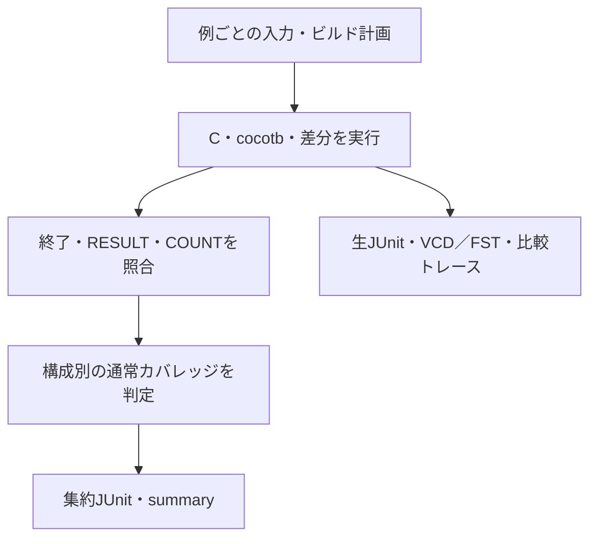

# C・cocotb・差分検証の結果を判定する

[Cドライバ](../local-c-driver/README.md)、[cocotb](../local-cocotb/README.md)、[シミュレーター差分](../local-differential/README.md)が使う共通ランナーです。必要なツールは各例のREADMEを参照してください。

## 生の実行結果と集約判定

C・cocotb・差分検証の実行結果を、終了・件数・要求・波形などの条件と照合して集約します。



| 確認する場面 | 期待する動作 | 主な照合対象 |
| --- | --- | --- |
| 通常 | 終了0・唯一の完了記録・COUNT一致 | 構成別の全必須目標 |
| 負の試験 | 予定ラベルと非ゼロ終了 | 注入先ごとに分類 |
| JUnit | 親ゲートと生の結果を区別 | 同じ試験を二重計上しない |

## 共通オプション

各例の`run.py`をリポジトリのルートから実行します。`--profile smoke|nightly`、`--seed`（既定17）、`--iterations`で探索量を指定します。nightlyはseed、seed+1、seed+2を使います。固定試験と予定の負の試験は省略しません。

`--timeout`は版取得・各実行コマンドの制限で既定120秒（差分例ではバックエンドごと）、`--build-timeout`はネイティブビルドの制限で180秒。`--iverilog`、`--vvp`、`--verilator`、`--cc`で実行ファイルを選択します。cocotbのIcarusは同じディレクトリの`iverilog`／`vvp`という名前の組を指定してください。指定ファイルが無い場合にPATH上の別ツールへ切り替えません。

`--out`は新規ディレクトリに限ります。ツール・パッケージを自動インストールせず、不在・ビルド失敗・タイムアウトは失敗にします。

## 合格と証跡

通常ケースは終了0、唯一の`RESULT PASS checks=N`、予定数、重複のない全COUNTの一致が必要です。期待する負の試験は、予定した唯一のCHECK_FAILラベルと非ゼロ終了が必要です。別のクラッシュや期待しないassertは成功にしません。

通常カバレッジは合格した通常ケースだけから集計し、構成ごとに全必須目標を要求します。診断・変異の観測で不足を補いません。負の試験の注入先はRTL・Cコード・期待値・バックエンド構成など各例で異なるため、件数を一律のRTL変異検出率として合算しないでください。

ソース・要求・ランナーのSHA-256、全ケースと期待値、構成・seedの`manifest.json`、版取得ログと`tools.json`、ビルド／実行ログ、ケース別`result.json`、`coverage.json`、`summary.json`、`junit.xml`を保存します。各例固有のVCD／FST、Cのコンパイル記録、cocotbの生JUnit、比較トレースも子ディレクトリに残します。

親JUnitはケースと構成別カバレッジゲートを数えます。cocotbの生JUnitや2バックエンドの実行を、同じテストの追加件数として再合算しません。

```sh
python3 -m unittest discover -s examples/local-host-common/tests -v
```

判定、件数欠落、無関係なクラッシュ、予定違反、タイムアウト、コンパイラー不在、出力先保護を確認する8テストです。各例の実RTL検証とは分けて扱います。
