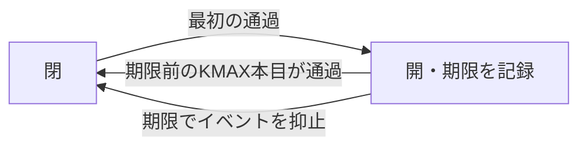

# セマフォの獲得、カウントフェンス、IRQ受付窓の境界を検証する

同一クロック上の共有資源を題材に、獲得と解放の競合、8ビットの飽和、2系統の割り込みが同時に到着する境界を検査します。Pythonの参照モデルはスロットの所有集合、整数カウンタ、窓が期限を迎える絶対サイクルを保持します。

## 入出力の規約

- **セマフォ4スロット**。選択スロットが空いているときだけclaimを許可し、1サイクルのgrantを返します。所有中の再要求は保留し、releaseで解放します。同時にclaimとreleaseを与えると解放を優先します。
- **カウントフェンス2本**。各入力の増分パルスを255まで独立に数え、255に到達したときdoneを立てます。doneは再armまで保持するレベル出力です。再armと増分が重なると再armを優先し、対象のカウンタとdoneをクリアします。
- **IRQ受付窓**。最初の通過イベントで窓を開き、その時刻からWINサイクル後が期限です。期限のサイクルは両入力を抑止して窓を閉じます。期限前にKMAX本目が通過した場合も、そのイベントで窓を閉じます。同じエッジに2入力が立つ場合はlane 0、lane 1の順に処理するため、lane 0が窓を閉じ、lane 1が次の窓を開くことがあります。



`w8k2` はWIN=8、KMAX=2、`w16k3` はWIN=16、KMAX=3です。各サイクルで所有状態、grant、両カウンタとdone、両IRQの通過・抑止と窓の開閉を照合します。固定試験で255到達後の追加パルス、片側だけの再arm、期限上の同時要求、同一エッジでの窓の開き直しを通ります。[13目標の要求カタログ](requirements.json)

## 変異と観測点

1. 必要なreleaseが来る前に所有権を解放する変異は `SEM_STATE`。
2. カウンタが255を越えて0へ巻き戻り、doneが落ちる変異は `FENCE`。
3. 窓を1サイクル長く開く変異は、期限サイクルの通過・抑止の違いで `IRQ_LIMIT`。
4. 通過するたびに通過数を1へ戻す変異は、KMAX本目の窓の開閉で `IRQ_LIMIT`。

## 実行と確認範囲

```sh
python3 examples/local-hw-semaphore/run.py --out artifacts/hw-semaphore-smoke
python3 examples/local-hw-semaphore/run.py --profile nightly --out artifacts/hw-semaphore-nightly
python3 -m unittest discover -s examples/local-hw-semaphore/tests -v
```

2026-11-23にIcarus Verilogで両構成を実行しました。各構成のsmokeは固定列＋ランダム200サイクル×1 seed＋変異4件、nightlyは1000サイクル×3 seedです。全体12／16実行、JUnitは14／18件、各構成13／13目標、各4／4変異を検出しました。セルフテストは6件です。所有者ID、ソフトウェア間の公平性、異なるクロック間のイベント同期は本例の対象外です。
