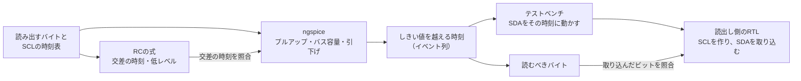

# I2Cのオープンドレインの立上りと、取込みの時刻の整合を確かめる

I2CのSDAは、プルアップ抵抗で引き上げ、つないだ素子がオープンドレインで引き下げる線です。0から1へ戻るときは、抵抗とバス容量のRCでゆっくり上がります。この例では、SDAの電圧を[固定版のngspice](../../tools/ENVIRONMENT.md#ngspiceとspice協調例)で解き、入力のしきい値を越える時刻をRTLのシミュレーションへ渡して、I2Cの読出し側のRTLがどのビットを読むかを確かめます。立上りが取込みの時刻に間に合う／間に合わない境界を、RCの式とngspiceの両方で求め、間に合わない組では読み違えることと、取込みの時刻を遅らせれば正しく読めることを示します。

抵抗・容量・オン抵抗・しきい値・時間は、この教材のために決めた架空の値です。引下げは理想のスイッチと固定のオン抵抗で表した動作モデルで、実際のプロセスのトランジスタやPDKは使っていません。実際のI2C素子やバスの特性を示すものではありません。I2Cの規格への適合も確かめていません。

## 全体の流れ



デジタル側からアナログ側へ戻る信号はありません。SCLの時刻は読出し側の分周の設定だけで決まるので、SCLとSDAの時刻表をPythonで先に作り、ngspiceを先に解いてからRTLを動かします。テストベンチは、RTLが出したSCLの変化を、その時刻表と1つずつ照合します。食い違えば、先に解いた波形は使えないので不合格です。

## アナログ側：SDAの線

[ネットリスト](sda.cir.in)は次のとおりです。

| 要素 | 値 | 意味 |
| --- | --- | --- |
| 電源 | 3.3 V | プルアップの先 |
| プルアップ抵抗 `Rp` | 負荷ごと（100 Ω〜10 kΩ） | 線を引き上げる |
| バス容量 `Cb` | 負荷ごと（50〜425 pF） | 配線と入力の容量 |
| 引下げ | 理想スイッチ、オン抵抗50 Ω | 読み出される側（ターゲット）の出力 |
| 入力のしきい値 | VIH＝0.7×3.3 V＝2.31 V、VIL＝0.3×3.3 V＝0.99 V | 上がるときはVIHを越えたら1、下がるときはVILを下回ったら0。間では前の値を保つ |

ターゲットは、SCLが下がってから100 ns後にSDAを変えます。0を出すときは引き下げ、1を出すときは放します。スイッチは1 nsの制御の傾きで切り替わり、0.6 nsの時点で導通・遮断します（モデルの`vt=0.5`、`vh=0.1`）。解析の式もこの時刻を使います。

### 解析で分かる値

スイッチが開いている間は時定数 τr＝Rp×Cb で3.3 Vへ、閉じている間は τf＝Cb×(Rp∥Ron) で低レベル VOL＝3.3 V×Ron／(Ron＋Rp) へ、どちらも指数関数で近づきます。区間ごとに式で電圧をつなぐと、しきい値を越える時刻が閉じた形で求まります。

- 十分に下がった線を放してからVIHを越えるまでの時間：t＝τr×ln((3.3−VOL)／(3.3−VIH))。VOLが小さければ約1.204×τrです。
- 線が下がり切る前に次の引下げが来れば、その立上りは途中で切れます（VIHを越えません）。
- VOLがVILより高ければ、引き下げても0と読まれません（プルアップが強すぎる場合）。

読出し側がSDAを取り込むのは、SCLを放してからSAMPLEクロック後です。0の次の1を正しく読むには、ターゲットが放してから取込みまでの時間（窓）の中で、VIHを越える必要があります。

窓＝SCLの低い期間（DIV×10 ns）−100 ns＋SAMPLE×10 ns

| 構成 | 分周DIV | SCL | 取込みSAMPLE | 窓 |
| --- | --- | --- | --- | --- |
| `fm400-mid` | 125 | 400 kHz | 62（高い期間の中央） | 1,770 ns |
| `fm400-late` | 125 | 400 kHz | 112（高い期間の終わり近く） | 2,270 ns |
| `fm1m` | 50 | 1 MHz | 25（高い期間の中央） | 650 ns |

同じ式から、取込みを高い期間の割合 s の位置で行うときの、0の次の1を読める最高のSCLの周波数が求まります：f＝(1＋s)／(2×(t＋100 ns))。

### 負荷と、境界の組

負荷は10組です。汎用の4組と、各構成の窓の0.95倍と1.05倍でVIHを越える境界の組を、3構成×2組で作りました。境界の組は、構成ごとのプルアップ（400 kHzは4.7 kΩ、1 MHzは2.2 kΩ）に対して、バス容量を式から逆算し、0.1 pF単位に丸めています。10組とも、3構成すべてで実行します。

| 負荷 | Rp（Ω） | Cb（pF） | τr（ns） | VIHまで（ns） | VOL（V） | 最高周波数 s≈0.5（kHz） | 最高周波数 s≈0.9（kHz） |
| --- | --- | --- | --- | --- | --- | --- | --- |
| `light` | 1000 | 50.0 | 50.0 | 57.8 | 0.157 | 4741 | 6009 |
| `heavy` | 10000 | 400.0 | 4000.0 | 4795.9 | 0.016 | 153 | 194 |
| `strong-ok` | 150 | 100.0 | 15.0 | 13.7 | 0.825 | 6576 | 8334 |
| `strong-fail` | 100 | 100.0 | 10.0 | 8.0 | 1.100（VIL超え） | — | — |
| `fm400-mid-inside` | 4700 | 299.8 | 1409.1 | 1681.6 | 0.035 | 420 | 532 |
| `fm400-mid-outside` | 4700 | 331.3 | 1557.1 | 1858.2 | 0.035 | 382 | 484 |
| `fm400-late-inside` | 4700 | 384.5 | 1807.2 | 2156.6 | 0.035 | 331 | 420 |
| `fm400-late-outside` | 4700 | 424.9 | 1997.0 | 2383.2 | 0.035 | 301 | 382 |
| `fm1m-inside` | 2200 | 237.6 | 522.7 | 617.6 | 0.073 | 1042 | 1321 |
| `fm1m-outside` | 2200 | 262.6 | 577.7 | 682.6 | 0.073 | 956 | 1211 |

最高周波数の列は、s＝62／125と112／125で計算しています。`fm400-mid-inside`は400 kHzで読め（最高420 kHz）、`fm400-mid-outside`は読めない（最高382 kHz）、という境界の両側になっています。

### 判定と許容誤差

ngspiceの波形（最大の刻み2 ns、Gear法、`reltol`＝1e-4）から、VIHとVILを越える時刻を線形補間で求め、上のヒステリシスを当てて、デジタルのイベント列にします。そのうえで次の順に判定し、最初に外れた検査のラベルで不合格にします。

| ラベル | 検査 | 許容 |
| --- | --- | --- |
| `ANALOG_MEASURE` | 測定値の欠落、有限でない値 | — |
| `ANALOG_INITIAL` | 始めの電圧が3.3 V（放された線） | 5 mV |
| `ANALOG_LOW` | 引き下げて十分に落ち着いた区間（スイッチが閉じてから30τf＋20 ns後）の電圧がVOL | 5 mV |
| `ANALOG_COUNT` | イベントの数と向きが、式と同じ | 一致 |
| `ANALOG_TIME` | 各イベントの時刻が、式と同じ | 1 ns＋その遷移のτの0.1% |
| `ANALOG_SETTINGS` | 最大の刻み1 nsと`reltol`＝1e-5、または台形法で解き直したときの時刻の動き | 0.5 ns＋τの0.05% |

許容の根拠：手元で測った式とのずれは、強いプルアップ（τ＝15 ns）で最大0.34 ns、ほかは0.11 ns以下でした。設定を変えたときの動きは最大0.26 nsでした。許容はその約3倍です。一方、境界の組の余裕は窓の5%（400 kHzで88 ns、1 MHzで32 ns）で、許容（数ns）よりずっと大きいので、式とngspiceで読むビットが分かれることはありません。それも毎回確かめ、分かれたら`ANALOG_BOUNDARY`で不合格にします。バス容量を5%増やしただけのネットリストは、`ANALOG_TIME`で不合格になります（許容2.4 nsに対してずれ約84 ns）。

取込みの時刻から2 ns以内にイベントがある場合は、どちらに読むかが決まらないので、計画の作成の時点でエラーにします。乱数の負荷は、式のイベントが許容＋5 ns以内に来ないものだけを選びます。

## デジタル側：読出し側のRTL

[`i2c_rx_master.sv`](rtl/i2c_rx_master.sv)は、I2Cの読出しのデータの段階だけを取り出した教材です。STARTやアドレス、ACK、クロックの引延ばしは持ちません。

- 開始の要求を受けた立上りエッジ（25 ns）でSCLを下げ、DIVクロックごとに放し・下げを繰り返します。
- SCLを放してからSAMPLEクロック後にSDAを取り込み、最上位ビットから並べます。取り込んだエッジの次に`smp`を1クロック出します。
- 8ビット目の後でもう一度SCLを下げ（ターゲットはここでSDAを放します）、DIVクロック後に放して`done`を出し、`busy`を下げます。

[テストベンチ](tb/i2c_od_tb.sv)は、ngspiceから作ったイベント列でSDAを動かし、次を確かめます。

| ラベル | 検査 | 期待値 |
| --- | --- | --- |
| `I2C_SCL` | SCLの各変化の時刻と値、最後にすべての変化が済んでいること | 時刻表 |
| `I2C_SAMPLE` | 取込みの時刻 | 時刻表 |
| `I2C_BIT` | 取り込んだ各ビット | イベント列と取込みの時刻から求めたビット |
| `I2C_COUNT` | `done`までに取り込んだビットの数 | 8 |
| `I2C_DONE`、`I2C_DATA` | `done`の時刻と、受け取ったバイト | 時刻表、読むべきバイト |
| `I2C_PHASE` | SCLが高い間にだけ取り込む | モデルを使わない |
| `I2C_BUSY` | 取り込む間は`busy`、`done`の後は下がっている | モデルを使わない |
| `I2C_UNKNOWN` | 出力にXがない | モデルを使わない |
| `I2C_TIMEOUT` | 決めた時刻までに`done`が来る | 検査とは別のラベル |

読むべきバイトは、ngspiceのイベント列から取込みの時刻ごとの値を数えたものです。正しいRTLは、読み違える負荷では「読み違えたバイト」を正確に出さなければ合格しません。

## 場面と結果

読み出すバイトは0x5A（0 1 0 1 1 0 1 0）です。0の次の1が3回、1の次の1が1回あります。各構成で10組の負荷と、乱数の負荷・バイト（smokeは1組、nightlyは3組）を実行します。固定の負荷の結果は次のとおりです。

| 負荷 | `fm400-mid` | `fm400-late` | `fm1m` |
| --- | --- | --- | --- |
| `light` | 5a（正しい） | 5a | 5a |
| `heavy` | 00（立上りが途中で切れる） | 00 | 00 |
| `strong-ok` | 5a | 5a | 5a |
| `strong-fail` | ff（0が1と読まれる） | ff | ff |
| `fm400-mid-inside` | 5a（窓の0.95倍） | 5a | 00 |
| `fm400-mid-outside` | 08（窓の1.05倍、0の次の1を読み違える） | **5a（取込みを遅らせると読める）** | 00 |
| `fm400-late-inside` | 08 | 5a（窓の0.95倍） | 00 |
| `fm400-late-outside` | 08 | 08（窓の1.05倍） | 00 |
| `fm1m-inside` | 5a | 5a | 5a（窓の0.95倍） |
| `fm1m-outside` | 5a | 5a | 08（窓の1.05倍） |

0x08は、0の次の1（3つ）が0と読まれ、1の次の1だけが残った値です。

### 目標

| 要求 | 目標 |
| --- | --- |
| `I2C-LINE` | `analog/rise-crossing`、`analog/fall-crossing`、`analog/low-level`、`analog/interrupted-rise`、`analog/low-above-vil`、`analog/solver-settings` |
| `I2C-WINDOW` | `boundary/just-inside`（窓の0.9〜1倍で正しく読む）、`boundary/just-outside`（1〜1.1倍で読み違える）、`sample/later-rescues`（`fm400-mid`で読み違えた負荷を`fm400-late`が正しく読む） |
| `I2C-READ` | `outcome/correct`、`outcome/slow-rise`、`outcome/low-too-high`、`rtl/misread-predicted` |
| `I2C-NEGATIVE` | `negative/analog-faults`、`negative/rtl-mutants` |

15目標すべてに、固定の負荷だけで届きます。

## 誤りと、見つける検査

### RTLの変異（6種類）

`fm400-mid`の`light`の負荷で実行します。

| 変異 | 内容 | ラベル |
| --- | --- | --- |
| 1 | 1クロック早く取り込む | `I2C_SAMPLE` |
| 2 | 最下位ビットから並べる | `I2C_BIT` |
| 3 | SCLの高い期間が1クロック短い | `I2C_SCL` |
| 4 | SCLが低い間に取り込む | `I2C_PHASE` |
| 5 | 7ビットで終わる | `I2C_COUNT` |
| 6 | 最後にSCLを放さない | `I2C_SCL` |

### アナログ側の負例（4種類）

`fm400-mid-inside`の負荷で、ネットリストの値だけを変えます。式は正しい値のままです。

| 負例 | 内容 | ラベル |
| --- | --- | --- |
| `no-initial` | 容量の初期電圧が0 V | `ANALOG_INITIAL` |
| `ron-high` | オン抵抗が20倍 | `ANALOG_LOW` |
| `release-missing` | 最後の放しがない | `ANALOG_COUNT` |
| `cb-plus5` | バス容量が5%大きい | `ANALOG_TIME` |

### 解けなかったときの扱い

ngspiceは別のプロセスで動かします。終了コードが0でない、`SPICE_PASS`の行がない、時間切れ、ベクトルの欠落、有限でない値、時刻が増えていない、要求した終わりの時刻まで進んでいない、のどれも不合格で、負例の検出にも数えません。ngspiceのメッセージに`error`・`aborted`・`timestep too small`があれば、終了コードが0でも不合格にします。壊れたネットリスト（知らない素子・モデル）、`v(sda)`を保存しないネットリスト、時間切れは、セルフテストで確かめています。

## 実行

```sh
python3 examples/local-i2c-open-drain/run.py --profile smoke --out artifacts/i2c-open-drain-smoke
python3 examples/local-i2c-open-drain/run.py --profile nightly --timeout 60 --out artifacts/i2c-open-drain-nightly
```

`lsi-ngspice-config`（[固定版のngspice](../../tools/ENVIRONMENT.md#ngspiceとspice協調例)の導入先の`bin`）、`iverilog`、`vvp`がPATHに要ります。別の場所なら`--ngspice-config`、`--iverilog`、`--vvp`で渡します。

### 証跡

出力先には、`manifest.json`、`summary.json`、`junit.xml`、`coverage.json`、`builds.json`、`ngspice-source.json`と、ケースごとのディレクトリを残します。ngspiceのケースは、ネットリスト、要求、測定値、間引いた波形（CSV）、ログです。RTLのケースは、イベント列、期待値のファイル、波形（VCD）、ログ、結果です。

## 確認範囲と残る制限

- SDAだけを解いています。SCLは読出し側が直接動かす理想の信号で、SCLの立上りの遅れは扱いません。実際のI2CではSCLもオープンドレインです。
- 引下げは理想のスイッチです。出力の立下りの傾きの制御、入力のノイズ、グリッチの除去、クロックの引延ばしは扱いません。
- 入力は2つのしきい値とヒステリシスで表した理想の入力です。しきい値の間にある時間の扱い（入力が不定になる時間）は、この教材の決め方です。
- 読出し側はデータの段階だけです。START・STOP・アドレス・ACK・複数バイトは扱いません。リセットの後に1バイトだけを読むので、転送の間に残る状態は確かめていません。
- 時刻表（SCLとターゲットの時刻）はRTLの外で作り、RTLがそれに従うことをテストベンチで確かめます。RTLとアナログを同時に動かしてはいません。
- 境界は、窓の0.95倍と1.05倍の組で確かめています。ちょうど1倍の負荷は、取込みの時刻とイベントの時刻が重なって読み方が決まらないので、作っていません。
- 規格（NXPのI2Cバス仕様）とは照合していません。しきい値の比、ターゲットの保持時間、周波数の名前は教材として決めたもので、規格の値や節番号とは未照合です。
- Linux、kirimasim、統合ランナー経由では実行していません。

## 確認記録

2026-11-21に、macOS arm64、Python 3.13、Icarus Verilog 14.0開発版、Verilator 5.052（lintだけ）、固定版のngspiceで確認しました。

- smoke（seed 17・3・100）とnightly（`--timeout 60`）が合格しました。JUnitはsmoke 72件／nightly 84件で、15目標すべてに届きました。全体の時間はsmokeが約4秒、nightlyが約5秒です。
- 変異6種類とアナログ側の負例4種類は、すべて予定のラベルで不合格になりました。
- セルフテスト19件が合格しました。
- RTLは、3構成と変異0〜6で、Verilator 5.052の`--lint-only --Wall`の警告が0件です。
- 既存の変異とは別に、作業用の写しへ誤りを入れて確かめました。
  - RTLへ10個入れ、smokeの全33ケースのイベント列と期待値で動かしました。9個は全ケースまたは大半のケースで不合格になりました（相の長さ、取込みの時刻、取り込む値、ビット数、`done`、`busy`、リセットのSCLの値、SDAの反転、低い間の取込み）。最初の版のテストベンチは`busy`を見ておらず、終わっても`busy`が下がらない誤りを見逃したので、`I2C_BUSY`の検査を足しました。残る1個（開始の要求で受信ビット数を消さない）は、リセットの後に1バイトしか読まないこの例の範囲では、動作に差が出ません。
  - 判定の式へ4個入れ、全体の実行がすべて不合格になりました（許容を100倍にすると`cb-plus5`が見えなくなる、τを10%誤る、低レベルを0 Vとする、ヒステリシスの向きを誤る）。
- ngspiceの結果と式のずれは最大0.34 ns、ソルバーの設定による動きは最大0.26 nsでした（上の許容の根拠）。
