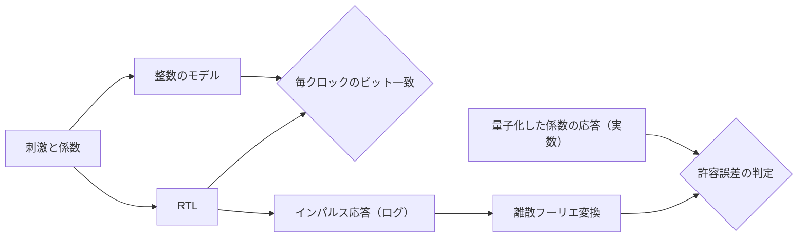

# 2次のIIRフィルターの量子化・飽和・リミットサイクルを検証する

2次のIIRフィルター（biquad）を題材に、固定小数点の再帰フィルターで起きる4つのことを確かめる教材です。係数の量子化、飽和と折返し、リミットサイクル、状態のリセットです。判定は2種類に分けます。

- **ビット一致**：出力の値とフラグは、Pythonの整数だけで書いたモデルと1ビットも違わないことを毎クロック確かめます。
- **許容誤差**：周波数応答は実数の計算なので、上限を式で導いた許容誤差で確かめます。

位置付けは[演算回路の検証手順](../../docs/method/arithmetic-datapath-verification.md)にあります。再帰のないフィルターは[固定小数点FIRの例](../local-dsp/README.md)が扱います。

## 判定を2つに分ける



ビット一致で判定できるものは、必ずビット一致で判定します。許容誤差の判定は、整数のモデルでは答えられない問い（量子化した係数が、設計した周波数応答を保っているか）にだけ使います。

| 確認する場面 | 期待する動作 | 判定 |
| --- | --- | --- |
| 丸めの中間値と負の端数 | 3つの丸め方がそれぞれの規則どおりに丸める | ビット一致 |
| 上下限のちょうどと1つ超え | ちょうどは通し、1つ超えたらフラグを立てる | ビット一致 |
| 大振幅の後の零入力 | 折返しでは大きな発振が続き、飽和では収まる | ビット一致と、末尾の区間の件数 |
| 小振幅の後の零入力 | 丸め方によって、振動が残るか0へ収まるかが変わる | ビット一致と、末尾の区間の件数 |
| 状態の消去とリセット | 消去の後の応答が最初の応答と同じになる | ビット一致 |
| 周波数応答 | 量子化した係数の応答と、導いた上限の中で一致する | 許容誤差 |

## 数値とサイクルの仕様

入力と出力は符号付き24ビット、係数は符号付き16ビットで、小数部が`FRAC`ビットです。構造は直接形Iです。

```text
A = b0·x[n] + b1·x[n-1] + b2·x[n-2] − a1·y[n-1] − a2·y[n-2]   （48ビットの整数。丸めない）
Q = A / 2^FRAC を丸める
      ROUND=0：負の無限大の向き（切捨て）
      ROUND=1：最近傍。ちょうど中間は正の無限大の向き
      ROUND=2：0の向き（絶対値の切捨て）
y[n] = SAT=1 なら Q を −2^23〜2^23−1 へ飽和、SAT=0 なら下位24ビット（折返し）
ovf_pos = Q > 2^23−1、ovf_neg = Q < −2^23   （飽和でも折返しでも立てる）
```

履歴に入るのは、飽和または折返しの後の`y[n]`です。再帰するので、ここでの1ビットの違いは後のすべての出力に残ります。

制御は次のとおりです。

- **受付**：`in_ready = !clear && (!out_valid || out_ready)`です。結果を受け取ってもらえる限り、毎クロック1サンプルを受け付けます。受け付けた次のクロックに`out_valid`と結果が出ます。
- **保持**：`out_ready`が0の間、結果と2つのフラグを保持し、次のサンプルを受け付けません。待たされたサンプルは履歴に入りません。
- **係数**：`cfg_we`で`cfg_addr`の0〜4（b0・b1・b2・a1・a2）へ書きます。5〜7への書込みは無視します。書いた値は、次に受け付けるサンプルから使います。同じクロックに受け付けたサンプルには、書く前の値を使います。係数を書いても履歴は消えません。
- **消去**：`clear`は同期で、4つの履歴を0にし、待っている結果を捨てます。係数は残します。`clear`のクロックに出されたサンプルは受け付けません。
- **リセット**：`rst_n`は非同期で、履歴・係数・結果・フラグをすべて0にします。

## 構成

| 構成 | `SAT` | `ROUND` | `FRAC` | ねらい |
| --- | --- | --- | --- | --- |
| `sat-nearest` | 1 | 1 | 14 | 基準 |
| `wrap-nearest` | 0 | 1 | 14 | 折返しによる発振 |
| `sat-floor` | 1 | 0 | 14 | 切捨てによるリミットサイクル |
| `sat-zero` | 1 | 2 | 14 | 絶対値の切捨てでリミットサイクルが消える |
| `coarse` | 1 | 1 | 6 | 係数の量子化が粗く、設計の許容誤差を外れる |

係数は2組使います。どちらも双一次変換で設計した低域通過フィルターです。

| 名前 | 設計 | 14ビットへ量子化した係数（b0・b1・b2・a1・a2） | 極の半径 |
| --- | --- | --- | --- |
| 低域通過 | 遮断0.1（サンプリング周波数比）、Q 0.7071 | 1105・2210・1105・−18727・6763 | 0.6425 |
| 共振 | 遮断0.2、Q 12 | 5445・10890・5445・−9740・15135 | 0.9611 |

周波数応答は低域通過の係数で測ります。飽和・折返し・リミットサイクルは、減衰の小さい共振の係数で起こします。

## 折返しと飽和

共振の係数で、大きな入力を4サンプル（4194303、−8388608、−4194304、0）与え、その後は入力を0にします。零入力は520サンプルで、最後の64サンプルを数えます。

| 構成 | 最後の64サンプルのうち、絶対値が2^20以上の数 | 最大の絶対値 |
| --- | --- | --- |
| `wrap-nearest` | 64 | 6662255（フルスケールの約0.79） |
| `sat-nearest` | 0 | 5 |

折返しでは、入力が0になった後もフルスケールに近い振動が続きます。再帰の中で桁あふれが起き、折り返した値がまた次の桁あふれを起こすためです。飽和では、同じ入力でも振幅が減衰し、後で述べる小さなリミットサイクルだけが残ります。この対比は、整数のモデルが示す結果を件数として固定し（`PHENOMENA`）、RTLが同じ件数を数えることで確かめます。2次の直接形で飽和が桁あふれによる発振を防ぐことは、文献で知られた結果ですが、出典の節番号は未照合です。この例が示すのは、この係数とこの入力での観測です。

## リミットサイクル

同じ共振の係数で、小さな入力を3サンプル（1000、−700、300）与え、その後300サンプルは入力を0にします。線形のフィルターなら出力は0へ収まります。最後の64サンプルは次のとおりです。

| 構成 | 丸め方 | 0でないサンプルの数 | 値の範囲 | 繰返しの形 |
| --- | --- | --- | --- | --- |
| `sat-nearest` | 最近傍 | 51 | −4〜4 | −4・−2・3・4・0 の5サンプル周期 |
| `sat-floor` | 切捨て | 64 | −7〜6 | −7・−4・4・6・−1 の5サンプル周期 |
| `sat-zero` | 0の向き | 0 | 0 | 0へ収まる |
| `coarse` | 最近傍（係数6ビット） | 51 | −5〜5 | −5・−3・3・5・0 の5サンプル周期 |

最近傍と切捨てでは、丸めの誤差が再帰で保たれ、入力がなくても数LSBの振動が続きます。切捨ては0に止まるサンプルが1つもありません。0の向きへ丸めると、丸めのたびに絶対値が小さくなるので、この条件では0へ収まります。0の向きの丸めが常にリミットサイクルを消すわけではなく、ここに書いたのはこの係数と入力での結果です。

## 周波数応答と許容誤差の根拠

低域通過の係数を書き、振幅`A = 2^20`のインパルスを1つ入れて、出力を`N = 128`サンプル取ります。ランナーは、シミュレーションのログからこの128サンプルを読み、Pythonの標準ライブラリだけで離散時間フーリエ変換して`A`で割ります。周波数は0からナイキスト周波数の手前まで64点です。NumPyは使いません（固定版の環境に入っていません）。

比べる相手は2つあり、許容誤差の根拠も別です。

### 測った応答と、量子化した係数の応答

量子化した係数の実数の伝達関数を`H_q = B_q/A_q`とします。RTLの出力は、`A·h_q[n]`に丸めの誤差が加わったものです。1回の丸めの誤差`e`は、最近傍で0.5 LSB以下、切捨てと0の向きで1 LSB未満です。この誤差は再帰を通って後の出力にも残るので、出力の誤差は`e`を`1/A_q(z)`に通したものになります。`1/A_q(z)`のインパルス応答を`g[k]`、`G = Σ|g[k]|`（128サンプル分）とすると、次の上限が成り立ちます。

```text
出力1サンプルの誤差  ≤  e_max · G
128サンプルを足した変換の誤差  ≤  N · e_max · G
A で割った周波数応答の誤差  ≤  N · e_max · G / A  +  打切りの誤差
```

打切りの誤差は、129サンプル目以降の応答の絶対値の和で、実数の漸化式を1024サンプルまで回して求めます（0とは仮定しません）。この係数では`G = 4.147`で、上限と実測は次のとおりです。

| 構成 | 上限 | 実測の最大 | 打切りの誤差 |
| --- | --- | --- | --- |
| `sat-nearest`・`wrap-nearest` | 2.53e-4 | 5.72e-6 | 5.2e-25 |
| `sat-floor` | 5.06e-4 | 5.91e-5 | 同上 |
| `sat-zero` | 5.06e-4 | 2.98e-5 | 同上 |
| `coarse` | 2.53e-4 | 5.93e-6 | 1.1e-25 |

上限は、すべての丸めが同じ向きに最大の誤差を出すと仮定した最悪値なので、実測の約9〜44倍あります。この判定の分解能は粗く、**係数を1 LSB間違えても合格します**（セルフテストで確かめています）。係数の1 LSBの誤りを見つけるのは、ビット一致の比較の役目です。この判定が見つけるのは、利得の0.1%の誤り、1サンプルのずれ、サンプルの欠落のような、応答の形が変わる誤りです。

インパルスの振幅を2^20にしたのは、上限を小さくするためです。上限は振幅に反比例します。応答の最大値は約0.28倍なので、24ビットの範囲には十分に収まり、桁あふれは起きません（フラグが立たないことをセルフテストで確かめています）。

### 量子化した係数の応答と、設計した応答

設計した実数の伝達関数を`H = B/A`とします。係数を最近傍へ丸めると、1つの係数の誤差は`δ = 2^-(FRAC+1)`以下です。次の式は、近似を含まない恒等式と三角不等式だけから出ます。

```text
H_q − H = (ΔB − H·ΔA) / A_q
|H_q − H| ≤ δ · (3 + 2·|H|) / |A_q|      （ΔBは3項、ΔAは2項。a0は正確に1）
```

この教材の設計仕様は、64点の格子で`|H_q − H| ≤ 0.01`です。上限の最大値が0.01以下なら、その小数部のビット数で仕様を満たすことが保証されます。

| 構成 | `FRAC` | 上限の最大 | 実測の最大 | 仕様0.01 |
| --- | --- | --- | --- | --- |
| `coarse`以外 | 14 | 5.68e-4 | 1.74e-4 | 上限から保証される |
| `coarse` | 6 | 0.147 | 0.0198 | 保証されず、実際に外れる |

`coarse`の構成は、RTLとしては正しく動きます。整数のモデルとビット一致し、自分の量子化した係数の応答とも上限の中で一致します。外れるのは、設計した応答との差です。ランナーはこれを「6ビットでは仕様を外れる」という予定どおりの結果として固定し（`DESIGN_MET`）、仕様を満たす結果に変わったら不合格にします。

## 要求と目標

要求は5件、目標は20個です（`requirements.json`）。すべての構成で全目標に届くことを求めます。

| 要求 | 目標 |
| --- | --- |
| `IIR-ARITH` | 丸めの中間値、負の端数、再帰が働いている受付、インパルス応答の採取 |
| `IIR-OVERFLOW` | 正と負の桁あふれ、上限と下限のちょうど、大振幅の後の零入力の区間 |
| `IIR-LIMIT` | 小振幅の後の零入力の区間 |
| `IIR-STATE` | 履歴がある状態での消去、消去と同時のサンプル、結果が待っている間のリセット、履歴がある状態での係数の書換え、受付と同時の係数の書込み、無視する番地への書込み |
| `IIR-HANDSHAKE` | 受付可能なのにサンプルがないクロック、待たされるサンプル、結果の保持、連続の受付 |

零入力の区間とインパルス応答の3つを除く17個は、固定シナリオ（`boundaries`）だけで届きます。ランダム試験に頼りません。

## 実行方法

```sh
python3 examples/local-iir-biquad/run.py --out artifacts/local-iir-biquad-smoke
python3 examples/local-iir-biquad/run.py --profile nightly --seed 17 --out artifacts/local-iir-biquad-nightly
python3 -m unittest discover -s examples/local-iir-biquad/tests
```

[共通シミュレーションランナー](../local-common/README.md)を使い、Icarus Verilogだけで動きます。`--configuration`で1構成に絞れます。`--demo-bug 1`〜`9`は、通常の試験へ誤実装を入れて不合格になることを見るためのものです。

1構成の計画は、固定の4ケース（`boundaries`、`impulse`、`limit-cycle`、`overflow`）、ランダム1 seed（nightlyは3 seed）、誤実装9件です。ランダムの1 seedは、smokeで80サンプル、nightlyで600サンプルです。係数の半分は設計した安定な低域通過、残りの半分は任意の整数で、後者は桁あふれを多く起こします。

共通ランナーが終わった後、この例のランナーがインパルス応答のログを読み、構成ごとに周波数応答の判定を1件ずつ加えます。結果は`frequency-response.json`に残り、`summary.json`の`frequency_response`と、JUnitの`<構成>-frequency-response`にも入ります。判定が不合格なら、`summary.json`の`success`を偽にして終了コード1で終わります。

JUnitは、smokeが80件、nightlyが90件です。内訳は、5構成×（固定4＋ランダム1または3＋誤実装9）、要求と目標の判定5件、周波数応答5件です。

## 誤実装

誤実装は9種類で、固定シナリオが予定のラベルで検出します。

| 番号 | 誤り | ラベル | 働かない構成 |
| --- | --- | --- | --- |
| 1 | a2の項が2つ前でなく1つ前の出力を使う | `IIR_DATA` | なし |
| 2 | 2つ前の入力の履歴に、今の入力が入る | `IIR_DATA` | なし |
| 3 | 負の桁あふれのフラグが立たない | `IIR_FLAG` | なし |
| 4 | 消去が出力の履歴を消さない | `IIR_DATA` | なし |
| 5 | 待たされたサンプルが履歴に入る | `IIR_DATA` | なし |
| 6 | 結果が待っていてもサンプルを受け付ける | `IIR_CONTROL` | なし |
| 7 | 飽和せずに折り返す | `IIR_DATA` | `wrap-nearest`（もともと折返し） |
| 8 | 丸め方を無視して切り捨てる | `IIR_DATA` | `sat-floor`（もともと切捨て） |
| 9 | 番地5〜7への書込みが、下位2ビットの番地の係数を書き換える | `IIR_DATA` | なし |

7と8は、それぞれ1つの構成では回路を変えません。そこでは「検出」を求めず、`equivalent-mutation7`・`equivalent-mutation8`という診断ケースとして実行し、合格のまま終わることを確かめます。5構成の合計は、検出43件、診断2件です。

誤実装の実行は、要求と目標の集計に入れません。

## セルフテスト

27件で、Icarus Verilogが必要です（skipしません）。

- **モデル**：3つの丸め方の表、上下限のちょうどと1つ超え、丸めが起きない係数での有理数計算との一致、係数の丸めの上限と測定の上限が、乱数で作った多数の設計で成り立つこと。
- **計画**：ケースの並び、働かない誤実装の扱い、seedの再現、固定した現象がモデルと食い違うとシミュレーションの前に止まること。
- **現象**：折返しと飽和の対比、丸め方ごとのリミットサイクル、消去の後の応答、受付と同時に書いた係数が次のサンプルから効くこと。
- **周波数応答の判定**：利得の0.1%の誤り・1サンプルのずれ・欠落を拒否すること、係数1 LSBの誤りは合格してしまうこと、`coarse`の予定を逆にすると不合格になること。
- **テストベンチ**：期待値を1ビット変えると、値・フラグ・制御のそれぞれのラベルで不合格になること。出力やフラグがXなら不合格になること。保持の違反（`IIR_HOLD`）と時間切れ（`IIR_TIMEOUT`）が、ほかの検査とは別のラベルで出ること。
- **ランナー**：実際のRTLで全計画が合格し証跡がそろうこと、インパルス応答のログを書き換えると判定と証跡が不合格になること、9種類の誤実装が通常の試験を不合格にすること。

## 確認範囲と残る制限

- 構造は直接形Iだけです。直接形II、転置形、縦続接続、係数のスケーリングは扱いません。
- リミットサイクルと折返しの発振は、1組の係数と1つの入力列での観測です。「この丸め方なら起きない」「飽和なら起きない」という一般の主張はしていません。起きない条件を示すには、状態を全数で調べるか証明する必要があり、この例にはありません。
- 周波数応答の判定は、係数1 LSBの誤りを見分けられません。上限が最悪値だからです。ビット一致の比較と置き換えることはできません。
- 測定の上限は、インパルスの間に桁あふれが起きないことを前提にしています。低域通過の係数では、整数のモデルでフラグが立たないことを確かめています。
- 設計の許容誤差0.01は、この教材が決めた値です。実際のフィルターの仕様（通過域のリップル、阻止域の減衰）とは対応付けていません。
- 整数のモデル、実数の参照、RTLは、同じ人が同じ仕様から書いています。整数のモデルは、丸めが起きない係数で、別の書き方の有理数計算と突き合わせています。外部のフィルター設計ツールとは照合していません。
- テストベンチは、目標の条件と件数のために、DUTの内部（積和の値、係数、出力の履歴）を階層参照で読みます。合否の比較には、端子の値だけを使います。
- テストベンチはベクトルを順に与えるだけで、応答を待つループを持ちません。時間切れの検査は、ベクトルの読込みが進まない場合の備えです。
- 単一クロックです。係数の書込みと別クロックのデータ、係数を切り替えたときの過渡の扱い（履歴の引継ぎ方）は、仕様として「履歴は消さない」と決めているだけです。
- 合成、タイミング、48ビットの積和の実装コストは対象外です。

## 確認記録

2026-11-21に、macOS arm64、Python 3.13、Icarus Verilog 14.0開発版で確かめました。Linuxとkirimasim、統合ランナー経由では実行していません。

- smoke（seed 17）とnightly（seed 17・3・99）が合格しました。nightlyは、1コマンドの上限を60秒にしても合格します。シミュレーションの合計は、smokeで約2.4秒、nightlyで約3.4秒です。
- 5構成すべてで20／20目標に届き、誤実装は43件を予定のラベルで検出、働かない2件は診断として合格しました。
- セルフテスト27件が合格しました。
- RTLは、5構成のパラメーターと誤実装0〜9のすべてで、Verilator 5.052の`--lint-only --Wall`の警告が0件です。`tools/check_tb_races.py`の候補も0件です。
- 既存の誤実装とは別に、作業用の写しのRTLへ小さな誤りを16個入れて、smokeにかけました。15個は通常の試験が不合格になりました。内訳は、積和の項の取り違えと符号（4個）、丸め（3個）、上下限の比較（2個）、消去とリセット（3個）、ハンドシェイク（2個）、フラグ（1個）です。合格のまま残った1個は、係数の番地の上限を5から6にする誤りです。係数は5語しかなく、番地5への書込みはもともとどこにも入らないので、動作に差が出ません。
