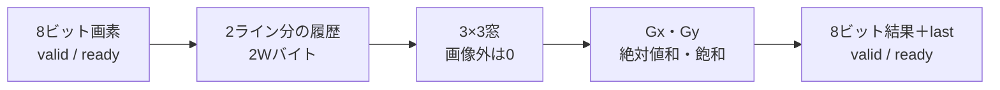
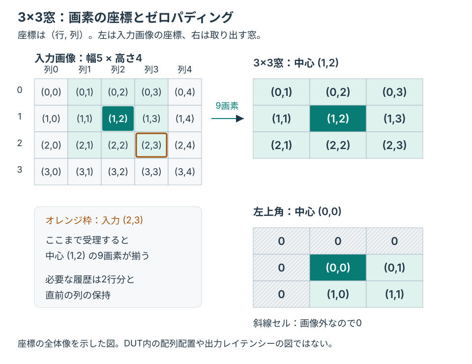

# ラインメモリ付きSobel画像処理IP

8ビットのグレースケール画像をラスター順に受け取り、2ライン分の履歴から3×3窓を作り、Sobel演算の結果を1画素ずつ出力する例です。「画像処理」分野の単体IP教材として、画像の端、演算の符号と飽和、待ち、フレーム境界、リセットを扱います。

学習の進め方は[画像処理の検証手順](../../docs/method/image-processing-verification.md)、CPUから設定・実行する結合例は[小規模画像処理SoC](../local-image-soc/README.md)を参照してください。

## 構成とラインメモリ



窓生成には既存の[`conv_window`](../local-conv-window/README.md)を再利用します。ラインメモリは2Wバイトのシフト配列で、直前2列の保持と合わせて窓を作ります。IP内部に画像全体のフレームバッファは置きません。SRAMマクロやFPGAのブロックRAMの推論、読書きポート、read-during-write特性を検証する例ではありません。



座標は（行, 列）です。幅5の例では、中心(1,2)の窓は入力(2,3)まで受理すると揃います。図は窓の座標対応を示し、登録したSobel結果の出力時点は、後述の受理・出力の順序で照合します。

## 演算とストリームの仕様

水平・垂直のカーネルは次の値です。左上から右下へ対応させます。

```text
Gx = [-1  0  1]       Gy = [-1 -2 -1]
     [-2  0  2]            [ 0  0  0]
     [-1  0  1]            [ 1  2  1]

出力 = min(255, abs(Gx) + abs(Gy))
```

ここでは平方根や正規化は使いません。成分は符号付きで計算し、絶対値和を求めてから飽和します。中心の係数は両方とも0です。未知値を0へ読み替える仕様ではありません。

| 項目 | 契約 |
| --- | --- |
| 入力 | 8ビット画素、左上から行ごとの順序。`in_valid && in_ready`で受理 |
| 画像端 | 画像の外は0。入力と同じW×H画素を出力 |
| 出力 | 入力と同じラスター順。最終画素だけ`out_last=1` |
| 出力待ち | `out_valid && !out_ready`の間はvalid・画素・lastを保持 |
| フレーム境界 | 窓生成は最終入力後にW+1ステップ排出する。次フレームの入力は受理できるまで待つ |
| リセット | 処理中の画素と履歴を破棄し、次の入力を新しい画像の左上として扱う |

窓を作る時点と、登録したSobel結果が出力される時点には段差があります。スコアボードは受理・出力の順序で照合し、待ちを含む一定のクロック遅延を仮定しません。

## 独立した期待値と観測目標

[`model.py`](model.py)は画像全体を配列として持ち、各座標の3×3近傍へカーネルを直接適用します。RTLのラインメモリ・列保持・排出の実装は再現しません。画像全体を保持するのは期待値モデルで、DUTではありません。

テストベンチは有効な全出力画素とlastを比較し、待ち中の保持、受理数、出力数、フレーム数を検査します。Pythonも完了件数を照合します。[要求カタログ](requirements.json)は3要求・14目標です。

- 端・角・内部、ゼロ出力・非飽和出力・飽和出力。絶対値和は常に偶数なので、飽和の境界は254（そのまま出力）と256（255へ飽和）です。
- 入力の空き、入力側へのバックプレッシャ、出力保持、連続フレーム、最終画素。
- 処理中リセット後の再開。

`COVER`はテストベンチが記録する観測目標です。ログから通常実行のヒットを集計し、変異の実行は目標達成へ加えません。ネイティブcovergroup DBやコードカバレッジを計測した結果ではありません。

## 構成と試験

| 構成 | 幅×高さ | 主な狙い |
| --- | --- | --- |
| `w5h4` | 5×4 | 小さい画像で端・角・内部、行末の排出を確認 |
| `w7h5` | 7×5 | 異なる行長・奇数画素数で履歴とフレーム境界を確認 |

固定試験は一様画像、明暗の段差、傾斜、インパルス、位置依存の画像に加え、周囲の絶対値和がちょうど254と256になる2つのインパルスを使います。ランダム試験は低コントラストと全8ビット範囲を交互に使い、飽和した値だけで誤りが隠れないようにします。入力の空きと出力待ちは独立に発生させます。

smokeは1 seed・各4フレーム、nightlyは3 seed・各12フレームのランダム試験です。固定7フレーム、リセット、4変異、構成ごとの目標判定は両方に含みます。JUnitはsmoke 18件／nightly 22件で、ツール確認・入力の版の照合も含む親の判定数です。画素数や要求数へ読み替えません。

| 変異 | 誤実装 | 検出ラベル |
| --- | --- | --- |
| 1 | Sobelの係数2を1にする | `IMAGE_DATA` |
| 2 | 左端のゼロパディングを外す | `IMAGE_DATA` |
| 3 | 最終画素フラグを反転する | `IMAGE_LAST` |
| 4 | 出力待ち中に画素を変える | `IMAGE_HOLD` |

## 実行と証跡

Python 3.10以上、Icarus Verilog、vvpを使います。追加PythonパッケージやRISC-Vコンパイラーは不要です。

```sh
python3 examples/local-image-sobel/run.py --out artifacts/image-sobel-smoke
python3 examples/local-image-sobel/run.py --profile nightly --out artifacts/image-sobel-nightly
python3 -m unittest discover -s examples/local-image-sobel/tests -v
```

入力・期待画像、ログ、VCD、目標、JUnit、ソースと生成入力のハッシュを保存します。ビルド不能・時間切れ・記録欠落を、変異の検出成功に変換しません。セルフテスト7件は、手計算した画像、符号付き演算と飽和、入力条件、完了件数を確認します。RTLのリグレッションとは別集計です。

このIPをSoCで使う場合も同じRTLをコンパイルします。単体の画素の正しさと、メモリ転送・CPU・割り込みまで含む結合の正しさは、[SoC例](../local-image-soc/README.md)で別々に確認します。RGB、任意の画素幅、可変画像サイズのレジスタ設定、異なるパディング、複数クロック、実カメラ入力は対象に含めません。
