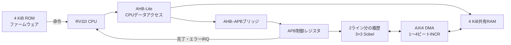

# CPU・ROM・RAM・3種類のバスを接続した画像処理SoC

RV32I CPUがROMから起動し、RAMへ画像を作り、APB経由でラインメモリ付きSobel IPを設定します。IPはAXI4 DMAで画像を読み書きし、最終書込み応答の後に割り込みを出します。CPUはハンドラーから復帰して全出力画素を確認します。

単体IPは[画像処理分野のSobel例](../local-image-sobel/README.md)、学習と検証計画は[画像処理の検証手順](../../docs/method/image-processing-verification.md)へつながります。[既存のSoC関連7例の集約](../local-soc-regression/README.md)とは異なり、この例は実際にRTLを接続した1つのSoCです。

## 接続とバスの役割



CPUは[既存の5段RV32Iコア](../local-riscv-iss/README.md)と[命令デコーダ](../local-riscv-decoder/README.md)を再利用し、`TRAPS=1`で外部割り込みとMRETを使います。命令フェッチはROMへ直接接続するハーバード構成です。CPUのデータポートは、新しいアダプターからAHB-Liteへ接続します。

| 接続 | この例で実行する範囲 |
| --- | --- |
| AHB-Lite | 32ビット整列LW／SW、1件ずつのNONSEQ/SINGLE。アドレス相とデータ相、待ち、2サイクルERROR |
| APB | setup/access、待ち、エラー応答、制御レジスタとW1C |
| AXI4 | 32ビット整列INCR、1〜4ビート、ID 0、読出し・書込み各1件まで。AW/W/BとAR/Rの独立したハンドシェイク |
| 共有RAM | CPUとDMAが同じRAMを使用。AXI書込み受理時はCPU側を待たせる |

AXI4-Liteではなく、LEN・SIZE・BURST・ID・LASTを持つAXI4の限定した構成です。全バースト種別、多数の未完了転送、ID間の順序入替え、AMBA規格全体への適合を確認する例ではありません。規格の広い条件は[個別のバス例](../README.md#バスレジスタアドレス)と組み合わせてください。

## アドレスマップと画素の配置

| CPUアドレス | 内容 |
| --- | --- |
| `0x0000–0x0fff` | ROM。命令フェッチとAHBデータ読出しが可能。書込みはERROR |
| `0x1000–0x1fff` | 共有RAM。リセットで0へ初期化 |
| `0x40000000–0x400000ff` | APB画像処理レジスタ。未定義オフセットはERROR |
| その他 | AHBの2サイクルERROR |

入力画像は`0x1000`、出力は`0x1400`、CPUの並行アクセスは`0x1800`、終了署名は`0x1ffc`を使います。1画素を32ビット整列した1スロットの下位8ビットへ置きます。実際の8ビット密詰め転送を最適化する例ではありません。

CPUは出力スロットを`0xa5a50000`で初期化します。DMAは`WSTRB=0001`で画素だけを書き換えるため、上位3バイトを保ったことも、RAM読戻しとCPUのLWで確認できます。

## APBレジスタと開始条件

| オフセット | 名前 | 動作 |
| --- | --- | --- |
| `0x00` | CTRL | bit 0へ1を書いて開始。busy中の書込みはエラー |
| `0x04` | STATUS | bit 0 busy、bit 1 done、bit 2 error。done/errorはW1C |
| `0x08` | SRC | 入力画像の先頭。busy中の変更はエラー |
| `0x0c` | DST | 出力画像の先頭。busy中の変更はエラー |
| `0x10` | IRQ_MASK | bit 0でdone/error通知を許可。busy中の変更はエラー |
| `0x14` | SHAPE | 読出し専用。上位16ビットがH、下位16ビットがW |

開始時に、SRC/DSTの4バイト整列、フレーム全体がRAM内に収まること、入力と出力の非重複を確認します。不正ならDMAを開始せず、errorを保持します。IRQが許可されていればエラー割り込みを出します。APBの不正アクセスはレジスタを書き換えません。

CPUコアのデータインターフェースにはアクセスフォルト入力がないため、AHB ERRORをCPUのアクセスフォルト例外へ変換していません。アダプターの`bus_fault`に保持し、テストベンチで照合します。割り込みとバスエラーの扱いを区別してください。

## ファームウェアと完了の順序

[`firmware.py`](firmware.py)は既存のRV32IアセンブラーでROM命令語を作ります。RISC-VのCコンパイラーは不要です。テストベンチが初期化するのはROMイメージで、RAM画像の準備・レジスタ設定・開始・解除・結果確認は実際のCPU命令で行います。

1. ROMから起動し、AHBでもROM先頭を読み、内容を確認する。
2. RAMへ入力画像と出力の番兵値を書く。
3. SRC/DSTとIRQ許可を設定し、処理を開始する。
4. CPUは別のRAM領域へ読書きを続ける。DMAとの競合で待たされても、重複・欠落させない。
5. DMAは画像を読み、Sobel結果を書き戻す。
6. **最終Wビートだけで完了にせず、最後のB応答を受理した後にdone/errorとIRQを出す。**
7. ハンドラーがSTATUSを保存し、W1Cで解除し、MRETで復帰する。
8. 正常終了ならCPUが全画素をLWで読み期待値と比較し、成功署名を書いてEBREAKで停止する。

署名は正常時`0x600d600d`、ファームウェアの比較失敗時`0xbad0bad0`です。署名だけで合格にはせず、全AXI画素、フレームごとのRAM読戻し、CPU比較数、割り込み数、ROMの退出記録も照合します。

RAMはキャッシュなしで、CPUのデータアクセスは1件ずつ完了します。実CPUのキャッシュ保守や一般的なメモリ一貫性を検証した結果ではありません。

## シナリオ・観測目標・意図的な誤実装

| シナリオ | 確認する動作 |
| --- | --- |
| boot／random | ROM起動から2フレームを連続して処理。別画像へ再設定して全画素を比較 |
| read-error／write-error | RRESP／BRESPへSLVERRを注入し、doneでなくerrorを通知 |
| invalid-config | 非整列、範囲超過、重複の3設定を拒否し、DMAが0件であることを確認。その後の正常実行も確認 |
| bus-errors | ROM書込み、busy中のSRC変更と再startを拒否。正常処理と元の設定を維持 |
| reset-read／reset-write | 読出し中／書込み中に全体をリセットし、未完了転送を取消してROMから再起動 |

応答エラー注入はRAMモデルがデータを維持したまま応答コードを変えるモデルです。DMAは受理済みの処理を排出し、最終応答まで受けてerrorを通知します。一般のエラー時に出力が正しいという保証にはしません。書込みのロールバックも行いません。エラー用ファームウェアは出力を成功結果として採用しません。

全体リセットはCPU・ブリッジ・DMA・RAMを同時にリセットします。CPUへの解除は2段で同期させます。RAMのデータも破棄し、未完了取引を正常完了へ加えません。片側だけのリセット、RDC、複数クロックの検証は対象外です。

[要求カタログ](requirements.json)は5要求・27観測目標です。TBの自動チェッカーでバス保持・LAST・受理数・アドレス・画素・完了順序を確認し、通常実行の`COVER`だけを目標達成へ加算します。ネイティブcovergroup DBやコードカバレッジ、SoC全体のフォーマル証明を計測・実行した例ではありません。

| 変異 | 誤実装 | 検出ラベル |
| --- | --- | --- |
| 1 | CPUのAHBアドレスを1ワードずらす | `SOC_AHB` |
| 2 | APBレジスタのオフセットをずらす | `SOC_APB` |
| 3 | Sobelの係数を誤らせる | `SOC_PIXEL` |
| 4 | 最後のB応答より前に完了IRQを出す | `SOC_COMPLETION` |

## 実行・構成・証跡

Python 3.10以上、Icarus Verilog、vvpを使います。追加パッケージは不要です。

```sh
python3 examples/local-image-soc/run.py --out artifacts/image-soc-smoke
python3 examples/local-image-soc/run.py --profile nightly --out artifacts/image-soc-nightly
python3 -m unittest discover -s examples/local-image-soc/tests -v
```

| 構成 | 画像 | AHBメモリ待ち | APB待ち | 最後のAXIバースト |
| --- | --- | --- | --- | --- |
| `w5h5-wait0` | 5×5 | 0 | 1 | 1ビート |
| `w7h5-wait2` | 7×5 | 2 | 3 | 3ビート |

これにRAMモデルのチャネル別の待ちを加えます。B応答は最後のW受理後、少なくとも5サイクル遅らせ、通知の順序を確認します。完全なフレーム転送には4ビートの通常バーストと短い末尾の両方が含まれます。

smokeは1 seed、nightlyは3 seedのランダム画像を使います。JUnitはsmoke 28件／nightly 32件、セルフテストは8件です。画素数や要求数へ合算しません。

各ケースに入力画像・期待画像・ROMイメージとそのハッシュ、退出命令ログ、VCD、全フレームのRAM読戻し、合否を保存します。PythonもRAMの全ワードとCPU比較・IRQ・resetの件数を再照合します。実行例の固定条件と確認実績は[由来と確認記録](../../PROVENANCE.md#image-soc-20261101)を参照してください。

CPU命令全体のISS比較は[既存のCPU例](../local-riscv-iss/README.md)で行います。このSoC例の退出ログはROMとの対応・外部割り込み・MRETを確認するもので、SoC用ISSとの逐次比較ではありません。OS、MMU、キャッシュ、密詰め画像、実カメラやディスプレイ、FPGA・実シリコンは対象外です。
