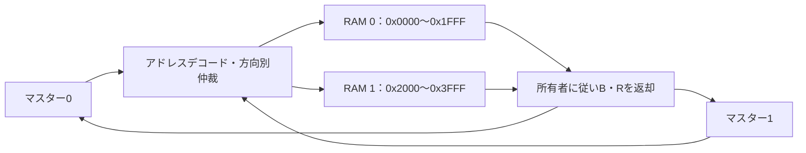

# 2マスター×2ターゲットのAXI4結合検証

新規インターコネクトに[既存AXI4 RAM](../local-axi4/README.md)を2個つなぎ、転送先と応答先、ID、競合、仲裁、バックプレッシャーを確認するローカル教材です。

## 2要求元と2ターゲットの接続

ターゲットと読書き方向ごとに所有者を保持し、最終応答を元の要求元へ戻します。



同一領域の書込み同士・読書きは、この計画では生成時に拒否します。別のmemory-order例で扱います。

| 確認する場面 | 期待する動作 | 主な照合対象 |
| --- | --- | --- |
| 同じIDの2要求元 | 所有者で区別して返却 | BID・RID・応答先 |
| 同一ターゲット競合 | 完了後に相手を次の優先先へ | 方向別仲裁順 |
| 未割当領域 | DECERRで規定の応答を返す | ビート数と完了 |

## 接続と制限

マスター側の相対バイトアドレスは15ビットです。0x0000〜0x1FFFをRAM 0、0x2000〜0x3FFFをRAM 1へ割り当て、下位13ビットを各RAMへ渡します。0x4000〜0x7FFFは未割当でDECERRです。書込みは指定ビート数のWを受けてからBを返し、読出しは指定ビート数のRを返します。

32ビット・整列INCR・1〜4ビート・2ビットIDのサブセットです。各マスターは書込み・読出しをそれぞれ1件まで未完了にできます。各ターゲットにも方向ごとに所有者を保持し、そのトランザクションが最終応答まで終わってから次へ移ります。WはAWで決めた所有者から受け付けます。WVALIDがAWより先でも、受付まで保持できます。

IDはターゲットへそのまま渡します。同じIDを使う2マスターも、ターゲットごとの所有者に従って応答を返すため区別できます。複数マスターのIDを拡張して、同じターゲットへ多数の要求を並行投入する構造ではありません。異なるターゲットや読書きの方向は並行して動けます。

仲裁はターゲット・方向別のラウンドロビンです。応答が完了したマスターの相手を次の優先先にします。仲裁方式は本実装の仕様であり、AXIがこの方式を要求するという意味ではありません。

## 期待値と確認項目

Pythonは2個分のバイト参照メモリへ書込みストローブを適用し、読出し値・応答と完了件数を生成します。1ベクトルで最大2マスターを同時に動かし、AW／Wの開始時刻と応答待ちを変えます。

SV側は、上流で受け付けた要求を独立した台帳に記録し、ターゲット側の実ポートで番地を照合します。公開したgrantトレースと台帳から仲裁順も確認し、BID／RID、RESP、各Rデータ・RLAST、B／R待ち中の保持を検査します。待ちループには600クロックの上限があります。

同時に同じメモリ範囲へ書く、または同じ範囲を読みながら書く組合せは、マスター間の実行順に応じた期待値が別途必要です。この計画では生成時に拒否します。異なるマスター間のメモリ順序全体を検証した結果ではありません。

固定ケースは両ターゲットの読書き、同一ターゲットでの競合、読書きの並行、同じID、部分／ゼロストローブ、先行するW、応答待ち、未割当DECERR、RAMの4KiB境界違反によるSLVERRです。境界違反は不正要求を加えるネガティブテストです。

公平性は、両方が待つ場合の次の選択と、有限の待ちを入れた刺激が完了することで確認します。無期限に応答を受けないマスターがいても他方の同一ターゲット転送が進む、という保証ではありません。

[要求カタログ](requirements.json)は4要求・12目標。4種類の変異は、応答先の誤り、デコード先の入替え、固定優先への誤変更、Wデータの反転です。

## 実行

```sh
python3 examples/local-interconnect/run.py
python3 examples/local-interconnect/run.py --profile nightly
python3 -m unittest discover -s examples/local-interconnect/tests -v
```

[共通手順](../local-common/README.md)を利用します。構成は`two-by-two`、smokeは48ペア×1 seed、nightlyは500×3 seed、固定11ペアは別枠です。JUnitは7／9件。リセットは初期化に使い、動作中リセットのリグレッションケースは含みません。

全AXI4属性、Rのインターリーブ、アウトオブオーダー、排他アクセス、キャッシュ整合性、任意個数のマスター、フォーマル証明は対象外です。[Arm AXI仕様](https://documentation-service.arm.com/static/5f915b62f86e16515cdc3b1c)と[AMDの仲裁に関する説明](https://docs.amd.com/r/en-US/pg059-axi-interconnect/Transaction-Arbitration)を参照し、デコード・所有者管理・仲裁方針は教材用に作成しました。

## 同一領域の競合も検証する

[別の読書き順序の例](../local-memory-order/README.md)は、このRTLをそのまま使い、同一領域の書込み同士・読書きも扱います。RAMの取込みエッジに従う独立スコアボードで、ターゲットと要求元のデータを照合します。このページの12目標・入力制約とは別の計画です。
