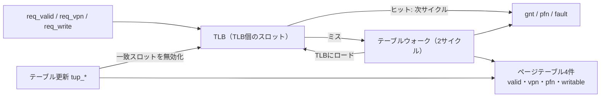
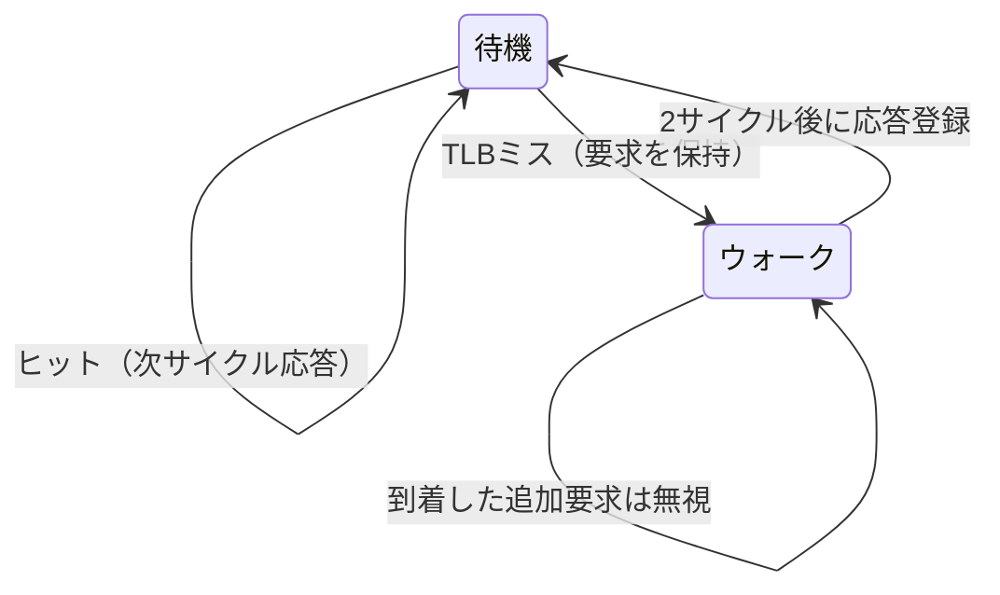

# DMAメモリのアドレス変換とTLB無効化を検証する

4つのマスター向けにVPN→PFN変換を行うIOMMU風の小型変換ユニットの教材です。TLBヒットの1サイクル応答、テーブルミスの2サイクルウォーク、書込み権限フォールト、テーブル更新時のTLB無効化、ウォーク中のリクエスト保持（バックプレッシャ）を別々のラベルで判定します。

## 回路の契約



| 条件 | 要求する動作 |
| --- | --- |
| TLBヒット | 次のサイクルに`gnt`。書き込みでスロットが書込み不可なら`fault=10` |
| TLBミス | 2サイクルのテーブルウォーク後に応答。ヒットした表エントリはTLBへロード |
| 表に有効なエントリなし | `fault=01`（ミス）。TLBは埋めない |
| 権限拒否 | `fault=10`。`pfn`は読み出せる。読み書きの区別は`req_write`だけ |
| ウォーク中のリクエスト | `gnt`は立たない。受け付けた要求は失わず、完了後に自前のTLBヒット経路で応答 |
| テーブル更新 | 旧VPNと新VPNに一致するTLBスロットを無効化する。**更新と同じエッジで埋まったスロットも無効化する**（古いヒットは起こり得ない） |
| 既に登録済みの応答 | 後から来た更新で書き換わらない（`fault=00`の応答が`10`へ変わることもない） |
| 範囲外の更新 | `tup_sel`が4以上ならテーブルもTLBも無変化 |

リセットはテーブル・TLB・ウォーク状態をすべてクリアします。

## ウォークとTLBの状態



応答は`gnt`1サイクルのパルスです。ヒット応答の権限判定はヒットした行のTLBエントリで行い、応答が登録されたあとは同じサイクルのテーブル更新でも変わりません。テーブル更新とスロットのロードが同じエッジで起きたときは無効化が勝ちます。

## 独立した期待値と構成

Pythonはテーブル4件・TLBスロット・ウォーク状態・保持要求・応答レジスタをRTLと別に持ち、毎サイクルの`busy`・`gnt`・`pfn`・`fault`・TLBピン（スロットの有効ビットとVPNを8ビットにパック）をRTLと独立に計算します。固定シナリオはヒット、ミスウォーク、権限拒否、無効テーブルエントリのミス、更新による無効化と再取得、ウォーク中の更新、バックプレッシャ中の要求、応答と同じサイクルの更新、範囲外の更新、リセット復帰と再設定を含みます。

| 構成 | TLBスロット数 |
| --- | --- |
| `tlb1` | 1（常に同じスロットへロード） |
| `tlb3` | 3（ラウンドロビンで置換） |

[要求カタログ](requirements.json)は5要求・14目標です。TLBスロットの有効ビットとVPNはピンとして毎サイクル比較するため、応答が同じでも無効化漏れは状態ピンで先に捕まります。

## 意図的な誤実装

| 番号 | 誤実装 | 期待する検出ラベル |
| --- | --- | --- |
| 1 | TLBヒットが書込みビットを見ない（権限拒否が起きない） | IOMMU_FAULT |
| 2 | テーブル更新がTLBを無効化しない（古いヒットが残る） | IOMMU_STATE |
| 3 | ウォークが1サイクルで終わる（応答が1サイクル早い） | IOMMU_XLAT |
| 4 | 無効な表エントリで変換してしまう | IOMMU_XLAT |

判定は`gnt`・`pfn`（IOMMU_XLAT）→`fault`（IOMMU_FAULT）→状態ピン（IOMMU_STATE）の順で行い、検出ラベルを決定的にしています。変異2は更新の翌行のTLBピンで、変異4は応答の`pfn`で落ちるため、どちらも同じ手順で再現します。

## 実行

```sh
python3 examples/local-iommu/run.py --out artifacts/local-iommu-smoke
python3 examples/local-iommu/run.py --profile nightly --out artifacts/local-iommu-nightly
python3 -m unittest discover -s examples/local-iommu/tests -v
```

smokeは200操作×1 seed、nightlyは1000操作×3 seedを固定シナリオへ加えます。各構成6／8件、全体12／16件の回帰に構成別の目標ゲート2件を足したJUnitです。

## 確認範囲

2026-11-23にPython 3.14.7、Icarus Verilog 14.0開発版で両構成のsmoke（回帰12件・JUnit 14・目標14/14・変異は各構成4/4検出）とnightly（回帰16件・JUnit 18）が成功し、セルフテスト10件も成功しました。各実行の `summary.json` に合否と件数、`coverage.json` に構成別の到達目標を記録します。

この教材は実際のSMMUやIOMMUの仕様には対応しません。大ページ・多段テーブル・ATCとリクエストの並列発行・割り込みやイベントレポート・アドレス空間ID・キャッシュ属性・共有テーブルの排他制御・スコアボードによる複数アウトスタンディング取引の照合は対象外です。ウォークは常に見かけ上2サイクルで、テーブル内容による分岐はありません。
