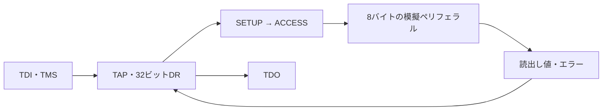

# JTAGのシリアルスキャンからAPB転送を検証する

教材用TAPで2ビットの命令とデータをLSB先頭でシフトし、APBの選択、アクセス、待ち、応答を照合します。TAPと8バイトの模擬ペリフェラルが同じTCKで動く構成です。信号の接続はRTLシミュレーション内で閉じています。



## スキャン形式とAPBの契約

- リセット時はIDCODE命令（1）を選択し、`0xB7071149` を読み出せます。命令2は1ビットのBYPASS、命令3はAPBアクセスです。命令0も1ビットをバイパスします。16状態のTAPを用い、TDOはシフト時の立上り直後に観測する教材用タイミングです。
- APB命令の32ビットDRは、31–24をアドレス、23–16を書込み値、2を書込み選択、1を開始、0を応答エラーとします。予約ビットは0を送ります。Update-DRで開始ビットが立ち、アイドルなら要求を受理します。Capture-DRでは前回の正常な読出しデータと保持中のエラーを返します。
- APBは1サイクルのSETUPに続き、ACCESSでPREADYまで信号を保持します。模擬ペリフェラルは下位3ビットでアドレスを選び、最上位ビットが立った要求にはPSLVERRを返します。エラーは後続の正常な読出し値のbit 7が1のときに解除します。これは本教材の応答レジスタの規約です。
- `w0` は固定待ち0サイクル、`w2` は2サイクルです。TBは追加の待ちを両構成で発生させます。Pythonはスキャンに入れたコマンド全体から期待するAPB転送を作り、独立したメモリ表から次のシリアル応答を予測します。リセット、IR、IDCODE、BYPASS、読書き、応答待ち、エラー保持と解除を含む13項目を観測します。[要求カタログ](requirements.json)

## 意図的な誤実装

1. Capture-DRで応答の代わりに直前のコマンドを返し、TDOの比較で `JAPB_TAP`。
2. 完了後も1サイクルPENABLEを残し、転送フェーズの比較で `JAPB_ERR`。
3. エラーを毎クロック解除し、保持条件で `JAPB_ERR`。
4. 読出しもPWRITEを立て、データ・制御ピンの比較で `JAPB_DATA`。

## 実行と確認範囲

```sh
python3 examples/local-jtag-apb/run.py --out artifacts/jtag-apb-smoke
python3 examples/local-jtag-apb/run.py --profile nightly --out artifacts/jtag-apb-nightly
python3 -m unittest discover -s examples/local-jtag-apb/tests -v
```

2026-11-23にIcarus Verilogで両構成を実行しました。各構成でsmokeは固定列＋20ランダム転送×1 seed＋変異4件、nightlyは80転送×3 seedです。全体は12／16実行、JUnitは14／18件、各構成13／13目標、各4／4変異を検出しました。セルフテスト6件には、待ち中のリセット、スキャンした誤IDCODEの検出も含みます。物理TAP、クロックドメイン交差、外部機器とのタイミング適合は対象外です。
