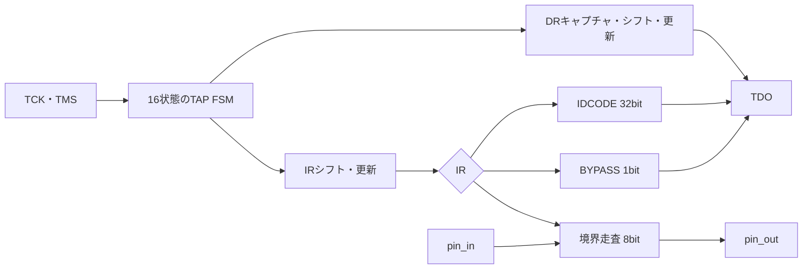
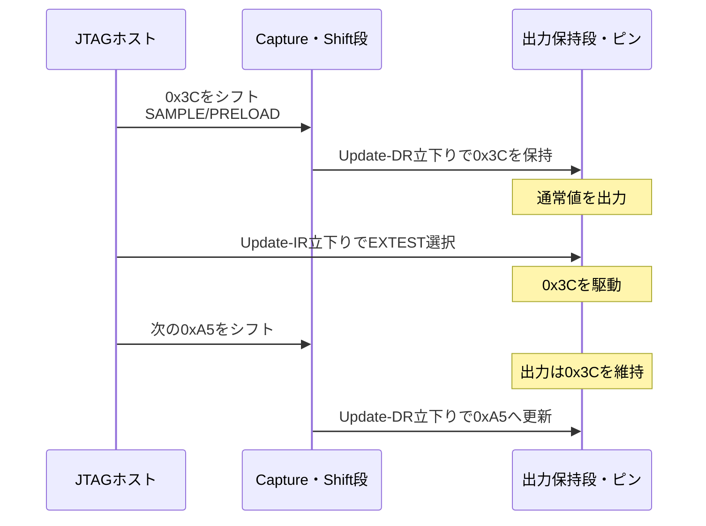

# JTAG TAP・IDCODE・BYPASS・境界走査を検証する

IEEE 1149.1のTAP状態遷移、命令レジスタ（IR）、IDCODE、BYPASS、SAMPLE/PRELOAD、EXTESTを小さな回路で確認する教材です。TCKの立上りで状態・Capture・Shiftを更新し、立下りでIR・出力保持段とTDOを更新します。IR/DRのLSB先行シフト、Updateのタイミング、境界走査レジスタからピンへの駆動を分けて判定します。

## TAPとデータレジスタ



図は教材で実装した命令とデータレジスタの関係です。実デバイスの全命令・全ビット長を再現したものではありません。

## 仕様

| 命令 | IR | DR | 動作 |
| --- | --- | --- | --- |
| IDCODE | 0001 | 32ビット | リセット後の既定命令。IDCODEをLSB先行で読み出す |
| BYPASS | 1111 | 1ビット | 1ビット遅延 |
| SAMPLE/PRELOAD | 0010 | 8ビット | Captureで`pin_in`を取り込み、Updateで出力保持段へPRELOADする |
| EXTEST | 0011 | 8ビット | 出力保持段を`pin_out`へ駆動し、Updateで新しい値へ切り替える |

- TAPは16状態を持ち、TMSで遷移します。Test-Logic-ResetではIRをIDCODEへ戻します。
- Capture-IRは`0001`をロードし、Shift-IRはLSB先行で4ビットをシフトします。Update-IRの立下りでIRを更新します。
- Capture-DRは命令に応じてIDCODE・BYPASS・境界走査レジスタをロードします。Shift-DRはLSB先行です。
- SAMPLE/PRELOADとEXTESTのUpdate-DR立下りで、シフト値を別の出力保持段へ反映します。EXTEST以外では`pin_in`を通常機能のピン値としてそのまま出力します。
- `trst_n`は非同期リセットです。TDOはシフト状態以外の立下りで0にします。
- TDOはTCKの立下りで更新し、テストベンチは立上り前の値を比較します。

## PRELOADした値をEXTESTで出す

Capture/Shift用のBSRと出力保持段を分けることで、EXTEST中に次の値をシフトしても出力が変わりません。命令番号は教材独自です。未実装のIR値は1ビットのBYPASSを選びます。



| クロック・状態 | 更新するもの | ピン出力への影響 |
| --- | --- | --- |
| 立上り・Capture-DR | 選択したDRへ入力値を取り込む | EXTESTの保持値を維持 |
| 立上り・Shift-IR／DR | LSB先行でシフト | 保持値を維持 |
| 立下り・Update-DR | SAMPLE／EXTESTの出力保持段 | EXTEST中なら新しい保持値を駆動 |
| 立下り・Update-IR | IRを確定 | EXTEST選択で保持値へ、それ以外は通常値へ切替 |
| 立下り・Shift-IR／DR | 次に読み出すTDOを提示 | 出力保持段は変更しない |

IDCODEのLSB=1は[AMDのIDCODE説明](https://docs.amd.com/r/en-US/ug570-ultrascale-configuration/Device-Identification-IDCODE-Register)、PRELOADと更新の時点は[Intelの境界走査資料](https://cdrdv2-public.intel.com/820039/ug-ag-jtagbst-820038-820039.pdf)を参照しました。2つのID値は架空の試験値で、JEDEC登録された製品IDを示しません。

## 独立した期待値と構成

Pythonは16状態の遷移表、IR/DRのビット列をLSB先頭のリストで保持し、Capture・Shift・UpdateをRTLと別に計算します。TDOだけでなく、内部の状態番号とIRも比較するため、シフト方向やUpdate位置の誤りを分離できます。

| 構成 | IDCODE |
| --- | --- |
| `id12345679` | 0x12345679 |
| `iddeadbeef` | 0xDEADBEEF |

[要求カタログ](requirements.json)は3要求・14目標です。固定シナリオはIDCODEの32ビット読出し、BYPASS、SAMPLEのCapture、EXTESTの8ビット駆動、Pause/Exit2を通る経路、IRの連続更新、リセット復帰を含みます。

## 意図的な誤実装

| 番号 | 誤実装 | 期待する検出ラベル |
| --- | --- | --- |
| 1 | IDCODEの1ビットを反転 | JTAG_TDO |
| 2 | Update-IRでIRを誤る | JTAG_IR |
| 3 | EXTESTのUpdateでpin_outを駆動しない | JTAG_BOUNDARY |
| 4 | Exit2-DRからShift-DRへ戻る遷移を誤る | JTAG_STATE |

状態番号・IR・TDO・ピン出力を別々に比較するため、変異の影響を該当する判定へ対応付けられます。ネガティブテストの観測は通常の14目標へ加算しません。

## 実行

```sh
python3 examples/local-jtag-tap/run.py --out artifacts/jtag-tap
python3 examples/local-jtag-tap/run.py --profile nightly --out artifacts/jtag-nightly
python3 -m unittest discover -s examples/local-jtag-tap/tests -v
```

smokeは8回のランダム命令・DR操作×1 seed、nightlyは20回×3 seedを固定シナリオへ加えます。各構成7／9件、全体14／18件のJUnitで、セルフテストは9件です。

## 確認範囲

2026-10-28にPython 3.14.7、Icarus Verilog 14.0開発版で両構成のsmoke／nightly、12目標、4種類の変異、確認6件が成功しました。

2026-10-29のレビュー修正後も両構成のsmoke／nightlyが成功し、セルフテストは9件です。再発防止ケースと図表を追加し、実行したソースハッシュを現行ファイルと照合しています。

この教材はTAPのデジタル動作と8ビット境界走査の教材であり、IEEE 1149.1の全命令・全必須動作の適合証明ではありません。実JTAGのTCK周波数、セットアップ・ホールド、TDOの実配線遅延、BSDL、ATPG、スキャンチェーン、故障検出率、実チップのDFTは対象外です。
