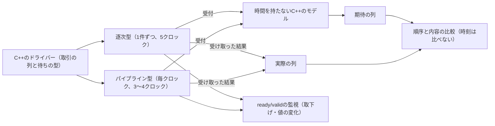

# レイテンシの違う2つのRTLを、時間を持たないモデルとストリームで照合する

時間を持たないC++のモデルを原本とし、同じ演算をレイテンシの違う2つのRTL（逐次型とパイプライン型）で実装して、どちらも「結果の順序と内容」だけで照合する教材です。高位合成や生成器が作るRTLを検証するときの入口として、考え方を小さく写したものです。**実際の高位合成ツールは実行していません。** 写したのは、「時間を持たない原本」「実装ごとに違うレイテンシ」「時刻を比べないストリーム比較」「ready/validの規則の監視」の4点です。

近い例は[C++参照モデルとFIR](../local-cpp-reference/README.md)で、同じ[C++・SPICEの共通処理](../local-native-common/README.md)を使います。C++参照モデルの例は、提示の時刻もモデルの予定と比べます。この例は時刻を比べず、実装の間でレイテンシが違っても同じ判定で合格させます。



## 仕様

| 項目 | 仕様 |
| --- | --- |
| 演算 | 4要素の内積。`a[i]`・`b[i]` は符号付き8ビット、結果は符号付き18ビット（−65,024〜65,536） |
| 入力 | `in_valid`・`in_ready`・`in_data[63:0]`（下位32ビットが `a`、上位32ビットが `b`、各8ビット） |
| 出力 | `out_valid`・`out_ready`・`out_data[17:0]`。提示した結果は、受け取られるまで取り下げず、値も変えない |
| 順序 | 結果は、受け付けた取引の順に1件ずつ出す |
| リセット | 同期リセット。リセットの間は `in_ready` と `out_valid` を0にし、処理中の取引をすべて取り消す |

[`rtl/li_dut.sv`](rtl/li_dut.sv)は、パラメーター`IMPL`で2つの実装を切り替える上位です。

| 構成 | 実装 | 受付の間隔 | 受付から提示まで | 中に持てる取引 |
| --- | --- | --- | --- | --- |
| `seq` | [逐次型](rtl/dot_seq.sv)：1クロックに1回の積和 | 1件ずつ。結果が受け取られるクロックに次を受け付けられる | 5クロック | 1件 |
| `pipe` | [パイプライン型](rtl/dot_pipe.sv)：積の段、和の段、2段のFIFO | 毎クロック | 3クロック | 4件 |
| `pipe-split` | 同じパイプライン型で、和を2段に分ける（`SPLIT=1`） | 毎クロック | 4クロック | 5件 |

パイプライン型の各段は、次の段に空きがあれば進みます。出力が詰まると、FIFOの側から順に埋まり、空いている段には前の段の取引が詰められます。

## 原本のモデルとストリームの比較

[`model/dot_model.cpp`](model/dot_model.cpp)は、取引を1件受け取って結果を1つ返すだけの関数です。クロック、レイテンシ、段、ready/validの状態を持ちません。64ビット整数で積和を計算し、範囲の外の入力は拒否します。RTLは16ビットの積と加算の木で計算するので、書き方が違います。モデル自体は、セルフテストでPythonの内積と2,005件を照合します。

[`harness.cpp`](harness.cpp)は、Verilatorでビルドした実装へ取引の列を与えます。

1. 受け付けた取引（`in_valid`と`in_ready`がそろったクロック）を順にモデルへ渡し、期待の列を作ります。
2. 受け取った結果（`out_valid`と`out_ready`がそろったクロック）を順に並べ、実際の列を作ります。
3. 区切り（`DRAIN`での排出の後、リセットの直前、最後）で、2つの列を[`model/stream_compare.hpp`](model/stream_compare.hpp)で比べます。時刻は比べません。リセットの直前では、実際の列が期待の列の先頭部分であれば合格とし、残りを取消しとして数えます。

列が違うときは、違い方に名前を付けて不合格にします。

| ラベル | 違い方 |
| --- | --- |
| `LI_ORDER` | 同じ結果が、違う順に並ぶ |
| `LI_DROP` | 結果が欠けていて、残りは順のまま |
| `LI_DUP` | 余分な結果があり、どれも直前の結果の繰返し |
| `LI_EXTRA` | ほかの余分な結果がある（リセットの前の取引の結果が残るなど） |
| `LI_DATA` | それ以外の違い（値の誤り） |

ストリームの比較とは別に、ハーネスは毎クロックready/validの規則を監視します。提示した結果を受け取られる前に取り下げると`LI_WITHDRAW`、値を変えると`LI_HOLD`、リセットの間に受付や提示をすると`LI_RESET`です。ストリームの比較は、受け取ったクロックの値しか見ないので、この2つの誤りを見つけられません（下の「診断」）。

最後に、受け付けた件数が「受け取った件数＋取り消した件数」に一致することを確かめます（`LI_COMPLETION`）。テストベンチの時間切れは、検査とは別の`LI_TIMEOUT`です。

## 刺激

取引の列と待ちの型は、`run.py`が`vectors.txt`へ書き、ハーネスが読みます。どの構成にも、同じ列をそのまま与えます。

| 場面 | 内容 |
| --- | --- |
| `flow` | 38件、リセットなし。境界の値（65,536、−65,024、積が打ち消し合って0、レーン3だけが負）、入力の空き、10クロックの出力の停止と4クロックの解除の繰返し、1クロックおきのready、続けて受け付ける区間 |
| `reset` | 3件を排出した後、1件を受け付けた次のクロックにリセット（処理中の取消し）。続けて出力を止めたまま受付が8クロック止まるまで詰め、リセット（詰まった状態の取消し）。その後6件 |
| `random-<seed>` | ランダムな値・空き・待ち。smokeは40件×1 seed、nightlyは120件×3 seed |

各取引は、受け付けられるまで`in_valid`を保ったまま待ちます。したがって、実装が受け付けられない間も要求を出し続けるクロックがあります。readyなのにvalidがないクロックは、入力側と出力側の両方で通ります。

リセットで取り消した取引は、期待の件数に数えません。何件が取り消されるかは実装で違います（`reset`では`seq`が2件、`pipe`が5件、`pipe-split`が6件）。件数の照合は、取り消した取引を除いた件数で行います。

## 実行

Python 3.10以上、Verilator 5.052、C++17コンパイラー、makeを使います。

```sh
python3 examples/local-latency-insensitive-compare/run.py --profile smoke --out artifacts/li-compare-smoke
python3 examples/local-latency-insensitive-compare/run.py --profile nightly --out artifacts/li-compare-nightly
python3 examples/local-latency-insensitive-compare/run.py --configuration pipe-split --out artifacts/li-compare-one
python3 -m unittest discover -s examples/local-latency-insensitive-compare/tests -v
```

`--configuration`は`all`（既定）、`seq`、`pipe`、`pipe-split`です。1構成だけのときは、構成をまたぐ診断を行いません。`--cxx`・`--verilator`で実行ファイル、`--timeout`で1回の実行、`--build-timeout`でビルドの上限を指定できます。出力先は毎回新しくします。

各実行の`transfers.csv`（受け取ったクロックと値）、`accepted.csv`（受け付けたクロックと取引）、`stream-expected.txt`・`stream-actual.txt`（最後の区切りで比べた列）、`trace.vcd`・`trace.csv`を保存します。

## 要求と目標

[5要求](requirements.json)の目標は、`seq`が14個、`pipe`と`pipe-split`が16個です。どの構成も、通常の場面だけで全目標に届きます。

| 要求 | 目標 |
| --- | --- |
| `LI-STREAM` | 区切りでの一致、最大値、最小値、打ち消し合う0、レーン3が負 |
| `LI-FLOW` | 入力の待ち、入力の空き、出力の停止、validのないready、停止の解除 |
| `LI-RESET` | 処理中の取消し、詰まった状態の取消し、リセットの後の最初の結果 |
| `LI-PIPE`（`pipe`・`pipe-split`） | 連続したクロックでの受取り、出力の停止中の受付、4件以上を抱えた状態 |
| `LI-SEQ`（`seq`） | 結果が受け取られるクロックでの受付 |

目標は、モデルと位置ごとに一致した結果と、合格した通常の場面だけで数えます。変異の実行からは数えません。

## 変異

| 変異 | 構成 | 誤り | 予定のラベル | 実測 |
| --- | --- | --- | --- | --- |
| 1 | `pipe` | 停止が解けたクロックに、新しい和が和の段を追い越してFIFOへ入る | `LI_ORDER` | 38件中、9件目から順が入れ替わる |
| 2 | `pipe` | FIFOが1件のときの同時の出し入れで、取出しを無視する | `LI_DUP` | 38件に対し39件 |
| 3 | `pipe` | 和の段が、自分の結果を出せないのに次の和を受け取る | `LI_DROP` | 38件中27件 |
| 4 | `pipe` | 1クロック待った結果を、1件につき1回だけ1クロック取り下げる | `LI_WITHDRAW` | 17クロック目 |
| 5 | `pipe` | リセットが和の段の有効ビットを消さない | `LI_EXTRA` | リセットの後の区切りで6件に対し7件 |
| 6 | `pipe` | レーン3の積を符号なしで計算する | `LI_DATA` | 件数は同じで値が違う |
| 7 | `pipe` | FIFOに2件あって出力が待たされている間、新しい方を見せる | `LI_HOLD` | 17クロック目 |
| 8 | `seq` | 結果が受け取られるクロックに受け付けた取引を捨てる | `LI_DROP` | 38件中19件 |
| 9 | `seq` | 新しい取引で累算器を0に戻さない | `LI_DATA` | 件数は同じで値が違う |

変異1〜3は、結果の値はすべて正しく、並び方だけが違う誤りです。

## 診断

| 判定 | 確かめること |
| --- | --- |
| `diagnose-cycle-compare` | 3構成の`flow`の受け取った値の列が同じで、(クロック, 値)の組で比べると、どの2構成の間でも最初の結果から食い違うこと。最初の結果は、`seq`が7クロック目、`pipe`が5クロック目、`pipe-split`が6クロック目に出る。3構成とも正しいので、時刻で比べる判定は誤った不合格を出す |
| `diagnose-weak-check` | 変異1の結果は、件数（38件）と和（31,573）が期待と同じで、9件目から順が違う。件数と和だけを見る判定は、順の入替えを見逃す |
| `pipe/blind-m4`、`pipe/blind-m7` | 変異4と7を、ready/validの監視を外して実行すると合格する。受け取ったクロックの値は正しいので、ストリームの比較だけでは見つからない |

## 計画外の誤り

既存の変異とは別に、作業用の写しのRTLへ小さな誤りを12個入れ、通常の場面（`flow`、`reset`、`random-17`）だけを流しました。

| 結果 | 個数 | 内容 |
| --- | --- | --- |
| 検査が不合格にした | 7個 | FIFOの満杯の判定を1つずらす（`LI_HOLD`）、書く位置を逆にする、先頭を書込み位置で選ぶ（`LI_HOLD`・`LI_DATA`）、レーン3をレーン2で置き換える（`LI_DATA`）、リセットが積の段の有効ビットを消さない（`LI_EXTRA`）、積和を3回で止める（`LI_DATA`）、結果を受け取っても提示を止めない（`LI_HOLD`） |
| 時間切れで止まった | 2個 | 和の段がFIFOの空きを取出しで作れない、積の段が一度埋まると進まない（どちらも`LI_TIMEOUT`） |
| 目標に届かなかった | 1個 | 逐次型が、結果を受け取られるクロックに次を受け付けない。結果の列は正しく、遅くなるだけなので比較は合格する。`seq/accept-on-delivery`に届かないことで見つかる |
| 合格のまま残った | 2個 | リセット中のFIFOの取出しをリセットで止めない（FIFOもリセットされるので同じ）、符号の拡張を暗黙にする（同じ値） |

合格のまま残った2個は、動作に差が出ない誤りです。性能だけが落ちる誤りは、ストリームの比較では見えず、目標や件数の観点が別に要ることも分かりました。

## 確認範囲と残る制限

- 実際の高位合成ツール、生成器、SystemCの高位合成用の記述は使っていません。原本のC++は手で書いた小さな関数です。
- 比べるのは結果の順序と内容と件数です。レイテンシ、スループット、受付の間隔は、比較の対象外です（性能の誤りは、上のとおり目標で一部を見つけます）。
- 結果は受付の順に出る仕様だけを扱います。IDつきで順不同の応答を許すインターフェースは、[UVMの順不同応答の例](../local-uvm-outstanding/README.md)のような、IDごとの照合が要ります。
- 演算は状態を持たない内積です。取引の間で状態を持つ演算（累算、フィルターの履歴）は、モデルにも状態を持たせる必要があります。
- Verilatorは2値のシミュレーターなので、Xの検査はしていません。
- ready/validの規則は、この例の仕様として決めたものです。特定のバス規格の文書とは照合していません。
- 時刻で比べる判定が誤った不合格を出すことは、正しい3構成の間で示したもので、ほかの比較方法（許容範囲つきの時刻の比較など）は扱っていません。

## 確認記録

2026-11-21に、macOS arm64、Python 3.13、Verilator 5.052、Apple clangで次を実行しました。

- smoke（seed 17・3・100）：27判定がすべて合格。Verilatorのビルドは12回で、初回の実行は約35秒、ビルドの結果を再利用できるときは約7秒。
- nightly（`--timeout 60`）：33判定がすべて合格。
- セルフテスト10件（ホストのC++でのモデルと比較関数の確認、計画の確認、1構成の実際の実行と、ツールがないときの失敗）。
- 3モジュール（`dot_seq`、`dot_pipe`、`li_dut`）の`verilator --lint-only --Wall`：構成と変異のすべての組で警告0件。
- 上の計画外の誤り12個の注入。

Linux、統合ランナー経由、全セルフテストでは実行していません。
