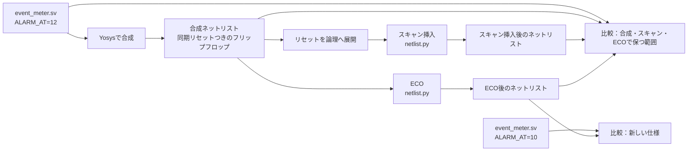

# RTLと合成後・スキャン挿入後・ECO後のネットリストを等価性検証する

合成、スキャン挿入、ECO（配線の小さな修正）は、どれも回路を書き換えます。書き換えの後も論理が同じであることは、シミュレーションではなく等価性検証で確かめます。シミュレーションは与えた刺激の範囲しか見ませんが、等価性検証はすべての入力と状態について比べるからです。

この教材では、8個のフリップフロップを持つ小さなRTLをYosysで合成し、そのネットリストへスキャンチェーンとECOを加えます。正しい書き換えが等価と証明されること、誤った書き換えが、誤りのあるフリップフロップの位置で報告されることを、12個の比較で確かめます。

[合成後ネットリストのシミュレーション](../local-gate-sim/README.md)が「RTLとネットリストの一致を証明するには、等価性検証を使います」と述べている部分の実行例です。RTLどうしの比較は[FIFOの等価性検証](../local-equivalence/README.md)、工程全体での位置付けは[ゲートレベルとタイミングの検証](../../docs/method/gate-level-and-timing-verification.md)で扱います。

## 比べるものと、その作り方



| ネットリスト | 作り方 | 何と比べるか |
| --- | --- | --- |
| `synth` | RTLをYosysで合成 | 元のRTL |
| `scan` | `synth`のリセットを論理へ展開し、各フリップフロップの前にマルチプレクサーを挿入 | 元のRTL（機能モード）、遅延線（シフトモード） |
| `eco` | `synth`の警報の論理を2ゲートで作り直す | 新しい仕様のRTL、元のRTL |
| `reset-polarity`・`reset-value` | `synth`の1個のフリップフロップのリセットを変える（誤り） | 元のRTL |
| `scan-miswire`・`scan-break` | スキャン挿入で1個のマルチプレクサーを誤配線する（誤り） | 元のRTL、遅延線 |
| `eco-wrong` | ECOの1ゲートを取り違える（誤り） | 新しい仕様のRTL |

ネットリストは、実行のたびに[`run.py`](run.py)が生成します。リポジトリには置いていません。生成したネットリストは、JSONとVerilogの両方を`netlists/`に残し、SHA-256を`netlists.json`に記録します。

## 対象回路

[`event_meter.sv`](rtl/event_meter.sv)は、イネーブルされたイベントを15まで数え、データビットのパリティを追い、数がしきい値以上になると警報を出します。

| 信号 | 向き | 意味 |
| --- | --- | --- |
| `rst_n` | 入力 | 同期リセット。0で全フリップフロップを0にする |
| `en`・`clear`・`din` | 入力 | 数える、数とパリティを0に戻す、パリティに加えるビット |
| `busy`・`full` | 出力 | 数えている途中、15に達して止まった |
| `level[3:0]`・`odd` | 出力 | 現在の数、パリティ |
| `warn` | 出力 | 1サイクル前の数が`ALARM_AT`以上だった |

フリップフロップは、`state[1:0]`・`count[3:0]`・`parity`・`alarm`の8個です。`alarm`はどのフリップフロップにも戻らず、出力`warn`だけへ出ます。仕様の変更（ECO）は、`ALARM_AT`を12から10へ下げるものです。

## 合成とスキャン挿入

合成は次のスクリプトです。状態機械の符号を変えると、フリップフロップを名前で対応付けられなくなるので、`-nofsm`で止めています。

```text
read_verilog -sv event_meter.sv
synth -top event_meter -flatten -nofsm
dfflegalize -cell $_SDFF_PN0_ x
abc -g AND,NAND,OR,NOR,XOR,XNOR,ANDNOT,ORNOT,MUX
opt_clean
write_json synth.json
```

手元では37セル（うちフリップフロップ8個）になります。Yosysは`clear`を同期リセットへまとめるので、リセット端子に`rst_n`が直接つながるのは`alarm`だけです。

スキャン挿入の前に、`dfflegalize -cell $_DFF_P_ x`でリセットを論理へ展開します。リセットがデータ入力の論理に入るので、その後ろに置くスキャンのマルチプレクサーは、リセットや`clear`の値に関係なくシフトできます。

[`netlist.py`](netlist.py)の`scan_insert`が、YosysのJSON形式のネットリストを書き換えます。

- 入力`scan_en`・`scan_in`と出力`scan_out`を加えます。
- 各フリップフロップのデータ入力の前に`$_MUX_`を1個置きます。`scan_en=0`で元のデータ、`scan_en=1`でチェーンの前のフリップフロップ（先頭は`scan_in`）を選びます。
- チェーンの順は、フリップフロップが駆動するネットの名前の順です：`alarm`、`count[0]`〜`count[3]`、`parity`、`state[0]`、`state[1]`。`scan_out`は最後のフリップフロップの出力です。

リセットの展開後は45セル、挿入後は53セルで、スキャンのマルチプレクサーが8個増えます。

## 2つの方法で比べる

比較は、1つのYosysの実行の中で、2つの方法を続けて行います。

| 方法 | Yosysのコマンド | 分かること | 分からないこと |
| --- | --- | --- | --- |
| 対応点ごとの帰納的な証明 | `equiv_make`・`equiv_simple`・`equiv_induct`・`equiv_status` | 名前が一致するフリップフロップと出力のそれぞれについて、一致するか。不一致の位置 | 具体的な入力の列 |
| リセットからの有界検査 | `miter -equiv`・`sat -seq 16` | リセットの後16ステップ以内に出力が食い違う入力の列があるか。あれば波形 | 16ステップより先 |

比較の前に、RTLとネットリストを、同じポートを持つラッパー`gold`・`gate`の中へ置きます。スキャンの入力をどう扱うかは、`gate`のラッパーの接続で決まります。

合格の条件は、次のとおりです。

- **一致を期待する比較**：`equiv_status`が全点の証明を報告し、有界検査が反例を見つけず、8個のフリップフロップがすべて比較点に入っていること。比較点が空のまま「証明した」とならないよう、`$equiv`セルにつながるネットを証明後のネットリストから読み取って照合します。
- **不一致を期待する比較**：未証明の点が、予定した集合と**ちょうど**一致し、有界検査がリセットからの反例を波形つきで見つけること。予定にない点が1つでも未証明なら、不合格です。
- どちらでも、Yosysのエラー、非0終了、時間切れ、スクリプトが最後まで進まなかった実行は、エラーです。検出には数えません。

`alarm`と`warn`のように同じネットに2つの名前がある場合は、両方が未証明になります。`state[1]`が食い違うと、そこから組合せ回路で作る`busy`・`full`も未証明になります。予定には、これらも書きます。ほかのフリップフロップは、帰納法の仮定（前のサイクルまで全点が一致）の下で証明されるので、未証明にはなりません。

## 12個の比較

| 比較 | 比べるもの | 期待する結果 |
| --- | --- | --- |
| `rtl-vs-synth` | RTLと`synth` | 30点を証明 |
| `rtl-vs-scan-functional` | RTLと`scan`。`scan_en`を0に固定、`scan_in`は自由 | 30点を証明。`scan_in`の値によらない |
| `diagnose-scan-unconstrained` | 同じ。`scan_en`も自由 | 8個のフリップフロップすべてで不一致 |
| `detect-reset-polarity` | RTLと`reset-polarity`（`alarm`のリセットを1で有効に変えた） | `alarm`で不一致 |
| `detect-reset-value` | RTLと`reset-value`（`count[0]`のリセット値を1に変えた） | `count[0]`で不一致 |
| `detect-scan-miswire` | RTLと`scan-miswire`（`state[1]`のマルチプレクサーの2入力を入れ替えた） | `state[1]`と、`busy`・`full`で不一致 |
| `eco-new-specification` | `ALARM_AT=10`のRTLと`eco` | 30点を証明 |
| `eco-changed-range` | 元のRTLと`eco` | `alarm`だけで不一致 |
| `eco-kept-range` | 元のRTLと`eco`。どちらも出力`warn`を外す | 27点を証明。`alarm`は比較点に入らない |
| `detect-eco-wrong-gate` | `ALARM_AT=10`のRTLと`eco-wrong`（ORをANDにした） | `alarm`で不一致 |
| `scan-shift` | `scan`の`scan_out`と、`scan_in`を8クロック遅らせた遅延線。`scan_en`を1に固定 | 反例なし |
| `detect-scan-chain-break` | 同じ検査を`scan-break`（`count[3]`が`scan_in`を直接取る）で | 反例あり |

### 仮定を外すと反例が出ることを確かめる

`rtl-vs-scan-functional`は、「機能モードでは`scan_en`が0である」という仮定の下の証明です。仮定が強すぎると、何でも証明できてしまいます。`diagnose-scan-unconstrained`は、仮定だけを外した同じ比較で、8個のフリップフロップすべてが不一致になることを要求します。仮定が実際に比較の結果を決めていること、つまり証明が空ではないことが分かります。

機能モードの証明は、`scan_en=0`という仮定を引き継ぎます。実際のチップで機能モードの間`scan_en`が0に保たれることは、この証明の範囲の外で、端子の処理やテスト制御回路の検証で確かめます。

### 仕様を変えるECOは、変える範囲と保つ範囲を分ける

仕様を変えるECOでは、「元のRTLと等価」は成り立ちません。そこで、3つの比較に分けます。

1. **新しい仕様との一致**（`eco-new-specification`）：ECO後のネットリストは、`ALARM_AT=10`のRTLと全点で一致する。
2. **変える範囲**（`eco-changed-range`）：元のRTLと比べると、不一致は`alarm`（と同じネットの`warn`）だけ。変更が実際に入っていること、ほかへ広がっていないことを同時に見ます。
3. **保つ範囲**（`eco-kept-range`）：出力`warn`を両方から外すと、残りは元のRTLと全点で一致する。`warn`を外すと、それだけを駆動する`alarm`のフリップフロップは最適化で消えます。もし`alarm`がほかのフリップフロップへ戻る回路なら、消えずに残って不一致になるので、「保つ範囲」が変更から本当に独立していることも確かめられます。

ECOは、`count >= 10`を`count[3] & (count[2] | count[1])`の2ゲートで作り、`alarm`のフリップフロップのデータ入力をつなぎ替えます。古いゲートは、配線層だけのECOと同じく、負荷のないまま残します（39セル）。`eco-wrong`は、このORをANDに取り違えたもので、`count >= 14`になります。

## 要求と目標

[要求カタログ](requirements.json)は5要求で、目標は12個の比較そのものです。ランナーは、カタログの目標と計画の比較が一致し、すべて合格したことを`requirements`として判定します。

| 要求 | 比較 |
| --- | --- |
| LEC-SYNTH | `rtl-vs-synth` |
| LEC-SCAN-FUNCTIONAL | `rtl-vs-scan-functional`、`diagnose-scan-unconstrained` |
| LEC-SCAN-SHIFT | `scan-shift`、`detect-scan-chain-break` |
| LEC-NEGATIVE | `detect-reset-polarity`、`detect-reset-value`、`detect-scan-miswire` |
| LEC-ECO | `eco-new-specification`、`eco-changed-range`、`eco-kept-range`、`detect-eco-wrong-gate` |

## 実行

Yosysだけを使います。[共通フォーマル手順](../local-formal-common/README.md)の固定版（YoWASP版Yosys）で動きます。`--yosys`で場所を指定できます。SBYとZ3は使いません。

```sh
. artifacts/toolchains/formal-venv/bin/activate
python3 examples/local-lec-netlist/run.py --out artifacts/lec-netlist
python3 -m unittest discover -s examples/local-lec-netlist/tests -v
```

`--timeout`は、Yosysの1回の実行に適用する秒数です（既定120秒）。smokeとnightlyの区別はなく、毎回同じ12個の比較を実行します。手元では全体で15〜35秒です。

## 証跡

| ファイル | 内容 |
| --- | --- |
| `manifest.json` | 計画した検査の一覧、比較の定義、合成のスクリプト、入力のSHA-256 |
| `tools.json`、`yosys-version.log` | Yosysの版 |
| `netlists/` | 合成とリセット展開のスクリプトとログ、各ネットリストのJSONとVerilog、`netlists.json`（チェーンの順、フリップフロップと別名、ハッシュ） |
| `<比較>/compare.ys`、`compare.log` | 実行したYosysのスクリプトとログ |
| `<比較>/gold.v`、`gate.v`、`gate.json` | ラッパーと、比べたネットリスト |
| `<比較>/equiv.json` | 証明後の回路。比較点を読み取る元 |
| `<比較>/counterexample.vcd` | 不一致を期待する比較の、リセットからの反例 |
| `<比較>/result.json` | 予定した未証明点、実際の未証明点、比較点、有界検査の結果、判定 |
| `summary.json`、`junit.xml` | 16件の判定（ツール、ネットリストの生成、12個の比較、要求、入力が変わっていないこと） |

セルフテストは17件です。ネットリストの編集（スキャン挿入、誤配線、リセットの変更）と判定の規則を、ツールなしで確かめます。Yosysを使うテストでは、「不一致があるのに一致と予定する」「一致するのに不一致と予定する」「別のフリップフロップを予定する」「下流の出力を予定に書かない」計画が、すべて不合格になることを確かめます。Yosysが見つからない実行は、検出ではなく失敗になります。

## 確認範囲

2026-11-20に、macOS arm64のPython 3.14、YoWASP版Yosys 0.70で、12個の比較を含む16件の判定と、セルフテスト17件が成功しました。5個の一致の証明、6個の不一致の検出（うち1個は仮定を外す診断）、シフトの検査1個です。生成した`synth`・`scan`・`eco`のVerilogは、Icarus Verilog 14.0開発版でコンパイルでき、Verilator 5.052の既定のlintで警告がないことも手元で確かめました（証跡には含めていません）。RTLの`verilator --lint-only -Wall`も警告0件です。Linuxでは実行していません。

この教材で確かめていないことは次のとおりです。

- **EQYは使っていません。** 固定版の環境にEQYは入っていないので、Yosys本体の`equiv_*`と`miter`・`sat`で比べています。大きな回路の分割と照合には、[EQY](https://yosyshq.readthedocs.io/projects/eqy/en/latest/quickstart.html)という別の選択肢があります。商用の等価性検証ツールも実行していません。
- **対応付けは名前だけです。** 合成で名前が残るように、状態機械の再符号化を止めています。リタイミング、状態の再符号化、フリップフロップの統合や複製など、対応点が1対1にならない最適化は扱いません。
- **スキャン挿入は教材用のスクリプトです。** 実際のスキャン挿入ツール、スキャンセル、複数のチェーン、圧縮、ロックアップラッチ、テストクロックの制御は扱いません。挿入するのは汎用の`$_MUX_`です。
- **セルライブラリを使いません。** Yosysの汎用ゲートのままで、実際のライブラリへの割当て、クロックゲーティングの挿入、低電力要素は対象外です。
- **リセットの前の状態は比べません。** 証明は、対応するフリップフロップが前のサイクルに一致しているという帰納法の仮定から始まります。有界検査は、任意の状態から1サイクルのリセットをかけた後の16ステップです。電源投入時の初期値や、リセット前の出力のXは扱いません。Xを含む比較は[合成後ネットリストのシミュレーション](../local-gate-sim/README.md)の範囲です。
- **シフトの検査は有界です。** 8個のフリップフロップに対し、18ステップで確かめています。キャプチャと組み合わせた試験パターンは、[内部スキャンとATPG](../local-scan-atpg/README.md)で扱います。
- タイミング、物理的な配線、ECOで使う予備セルの配置は対象外です。

## 参考にした一次資料

- [Yosysのコマンドの文書](https://yosyshq.readthedocs.io/projects/yosys/en/latest/cmd_ref.html)：`equiv_make`・`equiv_simple`・`equiv_induct`・`equiv_status`、`miter`、`sat`、`dfflegalize`、`write_json`の各項。JSON形式のネットリストの構造は`write_json`の項にあります。
- [EQYの文書](https://yosyshq.readthedocs.io/projects/eqy/en/latest/quickstart.html)：使っていませんが、同じ考え方を大きな回路へ広げる道具です。
- [検証計画の抜けの点検](../../docs/method/verification-gap-review.md)の等価性（SCOPE-EQUIVALENCE）：比較元・比較先・モード・初期化・除外を固定すること、仕様を変えるECOで範囲を分けること。
