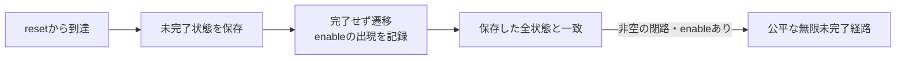

# 公平性を前提とした、期限のない最終完了の証明

2要求者のラウンドロビン仲裁回路で、「受理した要求1は、いつか完了する」を確認します。環境の`enable`には任意の長さの停止を許し、**無限実行中に無限回enableになる**ことだけを前提にします。何サイクル以内という期限は置きません。

[期限付き進行の例](../local-progress/README.md)と対にして読む教材です。期限付き進行は有限の期限違反を調べます。本例は、無限に完了しない経路を有限状態機械の閉路へ変換して検査します。

## 回路と環境の契約

各要求者は最大1件を保留します。`ready`時だけ要求を発行し、完了と同じサイクルの再発行も許します。`enable`時に保留要求を仲裁し、両者が保留中ならラウンドロビンで選びます。初回の1サイクルだけresetを仮定し、以降のresetは許しません。途中resetで取り消せる契約の証明ではありません。

要求1の債務を表す独立した`owed`を持ち、RTLが要求を失っても債務を消しません。証明対象の有限状態は`turn`・`pending[1:0]`・`owed`の計4ビットです。要求0にも対称な契約がありますが、この証明の対象は要求1です。

## 証明方式

macOS arm64用の固定版OSS CAD SuiteにはSBYの`live`用`suprove`がありません。そこで、有限状態機械についての正確なliveness-to-safety変換を記述し、通常のSBY `prove`＋ABC PDRで非有界に証明します。`live`モードを実行したという報告にはしません。



任意に選んだ未完了状態を保存し、要求1が完了しないまま同じ全状態へ戻る閉路を探します。閉路内にenableがあれば、それを反復して公平性を満たす無限の未完了実行になります。有限グラフでは公平な無限経路からそのような閉じた歩道が取れるため、同じ検査で無期限の最終完了を扱えます。snapshotや履歴の補助ビットを除き、遷移に影響する状態を省略してはいけません。

証明器とは別のPythonモデルでも、resetからの到達グラフを全列挙し、未完了の強連結成分に公平な閉路があるか確認します。正常回路は8状態、要求消失の誤実装は12状態です。反例はVCDの入力から全状態・出力・snapshotを再計算し、到達可能な接頭部と実際に反復できる閉路を確認します。

方式の根拠は[Schuppan・Biereによる有限状態モデルのliveness-to-safety変換](https://fmv.jku.at/papers/SchuppanBiere-STTT-5-2-3-2004.pdf)を参照してください。本例はこの単純な仲裁契約専用で、一般のLTL式を変換するツールではありません。

## 実行と5タスク

[full環境と固定版OSS CAD Suite](../../tools/ENVIRONMENT.md)を準備します。

```sh
artifacts/toolchains/full/python/bin/python examples/local-liveness/run.py \
  --oss-home artifacts/toolchains/full/oss/oss-cad-suite \
  --timeout 1800 --out artifacts/liveness
```

| タスク | 条件 | 必須結果 |
| --- | --- | --- |
| `fair-proof` | 正常回路・公平性あり | PDRで非有界証明、Pythonグラフも閉路なし |
| `no-fairness` | 正常回路・公平性なし | enableが止まる無限待機の反例を再生 |
| `starvation` | 要求0を固定優先・公平性あり | enableが繰り返し来ても要求1が飢餓となる反例を再生 |
| `lost-request` | enable停止時に要求1を消失・公平性あり | 債務が残ったまま完了しない反例を再生 |
| `reachable-long-wait` | 正常回路 | 受理・完了・16サイクル停止の3 coverへ到達 |

coverだけは深さ32の有限探索です。16サイクル停止の到達確認は期限を追加する仮定ではありません。3つの反例タスクでは、予定assert・終了コード・反例波形・witness・独立再生がそろって初めて検出成功です。timeout・UNKNOWN・ERRORを無限待機の検出と扱いません。

`--out`に固定計画、コンパイル済みプロパティと仮定、SBYログ、VCD・witness、`state-graph.json`、接頭部と閉路の長さを持つ`lasso.json`を保存します。実行前後でソースと外部ツールの内容も照合します。

## 適用範囲

単一クロック・2値・初期reset・2要求者・固定構成です。公平性は外部のenableだけに課し、仲裁の公平性や最終完了そのものを仮定していません。公平性を満たせない環境では結論を使えません。CDC、途中reset、任意の要求者数、製品のスケジューラ全体は別のモデル・証明が必要です。
