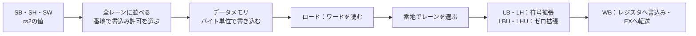

# バイト・ハーフワードのロード・ストアを、ISSとの比較で確かめる

RV32Iのロード・ストアには、ワード（32ビット）のほかに、バイト（LB・LBU・SB）とハーフワード（LH・LHU・SH）があります。誤りやすいのは、番地の下位ビットによるバイトレーンの選択、符号拡張とゼロ拡張の区別、サブワードのストアをワードに書き込む位置、ロードした値を次の命令へ転送する経路です。この例では、[ISSとの逐次比較の例](../local-riscv-iss/README.md)のRV32Iコアにサブワードのアクセスを加え、全サイズ・全レーンを確かめます。

## バイトレーンと拡張



| アクセス | 番地の条件 | 書込み許可（`dmem_be`） | ロードした値 |
| --- | --- | --- | --- |
| バイト | 任意 | 番地のビット1:0のレーン1つ | ビット7を符号拡張（LB）、またはゼロ拡張（LBU） |
| ハーフワード | 2の倍数 | 番地のビット1で選ぶ2レーン | ビット15を符号拡張（LH）、またはゼロ拡張（LHU） |
| ワード | 4の倍数 | 4レーンすべて | そのまま |

境界に合わないアクセスは扱いません。ISSはこれを誤りとして拒否し、命令列の生成器も作りません。境界に合わないアクセスの例外は、[例外・割り込みの例](../local-riscv-traps/README.md)で扱います。

コア[`rv32i_core.sv`](../local-riscv-iss/rtl/rv32i_core.sv)は、メモリ段でストアの値を全レーンに並べて書込み許可を出し、ロードの値をレーンから取り出して拡張します。拡張した値をレジスタに書き、EXへも転送します。テストベンチは、書込み許可のあるバイトだけを書き換えます。

## ISSとの比較

ISSとアセンブラに6命令を加えました。ISSは、データメモリをワードの配列として持ち、サブワードのストアでは該当するバイトだけを書き換え、ロードでは該当するバイトを取り出して拡張します。ストアの退出の記録には、書き込んだサイズ分の値（SBなら下位8ビット）を入れます。追加した6命令の番号は従来の32命令の後なので、ISSとの比較の例の命令列と期待値は変わりません。

退出の記録には、この例で加えた5つの印を付けます。

| 目標 | 内容 |
| --- | --- |
| `lsu/negative-subword-load` | LB・LHで、読んだ値の最上位ビットが1（符号拡張が効く） |
| `lsu/odd-byte` | 奇数番地のバイトのアクセス |
| `lsu/upper-half` | 上位のハーフワード（番地のビット1が1）のアクセス |
| `lsu/subword-store-then-word-load` | 最後にサブワードのストアで書いたワードを、ワードとして読む |
| `lsu/subword-load-use` | サブワードのロードの直後に、その値を使う |

## 固定の命令列とランダムな命令列

固定の命令列は、ISSとの比較の例の固定の命令列（ワード単位の32命令）に続けて、次を実行します。

1. `0x12345678`と`0xfedcba98`をワードで書き、全4レーンからLB・LBU、上下のハーフワードからLH・LHUで読む
2. 4レーンにSBで別々の値を書き、ワードで読む。上下のハーフワードにSHで書き、ワードで読む
3. LB・LHUの直後にその値を使う、LBした値をSBする、x0へのLB

ランダムな命令列は、ISSとの比較の例の生成器で、ロード・ストアのサイズも選ぶようにしたものです（境界に合う番地だけ）。

[要求カタログ](requirements.json)は4要求・11目標で、固定の命令列だけで11目標に達します。全命令の目標は、追加した6命令を含む38命令を求めます。

## 意図的な誤実装

コアの変異9〜12です。`--demo-bug 1..4`は、変異9〜12を通常の実行に入れます。

| 番号 | 誤実装 | 検出ラベル | 最初に食い違う退出 |
| --- | --- | --- | --- |
| 9 | LB・LHをゼロ拡張する | `ISS_DATA` | 負のバイトを読むLB |
| 10 | SB・SHを、番地によらず最下位のレーンに書く | `ISS_DATA` | 後でそのワードを読むLW |
| 11 | ロードのバイトを、番地のビット1だけで選ぶ | `ISS_DATA` | 奇数番地のLB |
| 12 | WBからの転送路だけ、拡張前のワードを渡す | `ISS_DATA` | LBの直後にその値を使うADD |

変異10では、ストア自体の退出の記録（番地と値）は正しいままです。誤りはメモリの中身に残り、そのワードを後で読んだときに初めて現れます。変異12では、レジスタファイルには正しい値が入るので、ロードの直後に使う場合だけ食い違います。

seed 17〜19のランダムな命令列だけで実行すると、変異9〜11は300命令でもすべてのseedで検出できます。変異12は、300命令では3つのseedのうち2つ、2000命令では3つすべてで検出しました。

## 実行

```sh
python3 examples/local-load-store/run.py --out artifacts/load-store
python3 examples/local-load-store/run.py --profile nightly --out artifacts/load-store-nightly
python3 -m unittest discover -s examples/local-load-store/tests -v
```

[共通手順](../local-common/README.md)を使い、構成は`rv32i`の1つです。smokeは300命令×1 seed、nightlyは2000命令×3 seedです。JUnitはsmokeが7件、nightlyが9件です。セルフテストは8件で、ISSのサブワードの意味（手で計算した値との比較）、境界に合わないアクセスの拒否、6命令の符号化とLLVMの`llvm-mc`の出力との一致も確かめます。

## 確認範囲

2026-10-31に、Python 3.14.7、Icarus Verilog 14.0開発版で、smoke／nightly、11目標、4種類の変異、セルフテスト8件が成功しました。Verilator 5.052の`--lint-only -Wall`では、`PREDICT`0〜2と変異0〜12のどの組合せでも警告はありません。ロード・ストアを加えた後も、ISSとの比較の例と分岐予測器の例の回帰とセルフテストは成功しています。

境界に合わないアクセス（例外として[例外・割り込みの例](../local-riscv-traps/README.md)で扱います）、アトミック命令、キャッシュ、メモリの順序付け（FENCE）は扱いません。
