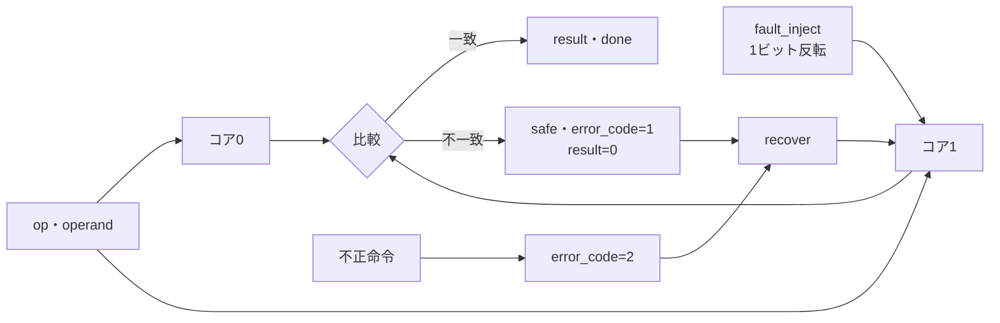

# ロックステップ比較・故障注入・安全状態からの復帰を検証する

同じ操作を受ける2つの小さな演算コアを比較し、不一致を検出して安全状態へ移る教材です。1ビットの故障注入、比較結果の保持、出力の固定、復帰時の再同期、不正命令の検出を分けて確認します。

## 比較と封じ込め



図は教材の監視と復帰の関係です。実CPUのロックステップや安全認証を再現したものではありません。

## 仕様

| 操作 | `op` | 動作 |
| --- | --- | --- |
| ADD | 00 | `acc + operand` |
| XOR | 01 | `acc ^ operand` |
| LOAD | 10 | `operand` |
| ILLEGAL | 11 | 不正命令として安全状態へ |

- 2つのコアは同じ`op`と`operand`を受け、8ビットのアキュムレータを持ちます。
- `fault_inject=1`のとき、コア1の次値の`FAULT_BIT`を反転します。比較で不一致なら`error=1`、`safe=1`、`error_code=1`、`result=0`にします。
- `safe=1`の間は新しい操作を受け付けません。`done`は操作を受理したサイクルだけ1です。
- `recover=1`かつ`error=1`なら、コア1をコア0へ再同期し、`error`・`safe`・`error_code`をクリアします。同じサイクルに操作があっても復帰を優先します。
- 不正命令は比較前の監視で検出し、`error_code=2`にします。コアの状態は更新しません。
- `FAULT_BIT`は構成パラメーターで、0と7を切り替えます。

## 独立した期待値と構成

Pythonは2つのアキュムレータ、故障のビット反転、比較、安全状態、復帰をRTLと別に実装します。各サイクルの`result`・`error`・`safe`・`error_code`・`done`を比較します。

| 構成 | 故障注入ビット |
| --- | --- |
| `bit0` | ビット0 |
| `bit7` | ビット7 |

[要求カタログ](requirements.json)は3要求・12目標です。固定シナリオはADD・XOR・LOAD、故障検出、安全状態での操作無視、復帰後の正常動作、故障が続く場合の再検出、不正命令、リセット復帰を含みます。

## 意図的な誤実装

| 番号 | 誤実装 | 期待する検出ラベル |
| --- | --- | --- |
| 1 | 比較で`FAULT_BIT`を無視する | LOCKSTEP_COMPARE |
| 2 | 不一致でも`safe`を立てず出力を固定しない | LOCKSTEP_CONTAIN |
| 3 | 復帰時の結果を誤る | LOCKSTEP_RESULT |
| 4 | 不正命令を通常命令として扱う | LOCKSTEP_ILLEGAL |

変異1は故障注入した操作の`error`、変異2は`safe`、変異3は復帰サイクルの`result`、変異4は不正命令後の`error_code`で検出します。負の試験の観測は通常の12目標へ加算しません。

## 実行

```sh
python3 examples/local-lockstep-monitor/run.py --out artifacts/lockstep-monitor
python3 examples/local-lockstep-monitor/run.py --profile nightly --out artifacts/lockstep-nightly
python3 -m unittest discover -s examples/local-lockstep-monitor/tests -v
```

smokeは120操作×1 seed、nightlyは600操作×3 seedを固定シナリオへ加えます。各構成7／9件、全体14／18件のJUnitで、確認テストは5件です。

## 確認範囲

2026-10-28にPython 3.14.7、Icarus Verilog 14.0開発版で両構成のsmoke／nightly、12目標、4変異、確認5件が成功しました。

この教材は8ビットの演算コアと1ビットの故障注入によるデジタルな監視動作です。実CPUのロックステップ、遅延・クロック・電源の故障、共通原因故障、故障注入の物理的な実現、安全度水準、診断網羅率、ISO 26262などの認証を保証しません。`recover`は教材の再同期操作で、製品の安全復帰手順そのものではありません。
