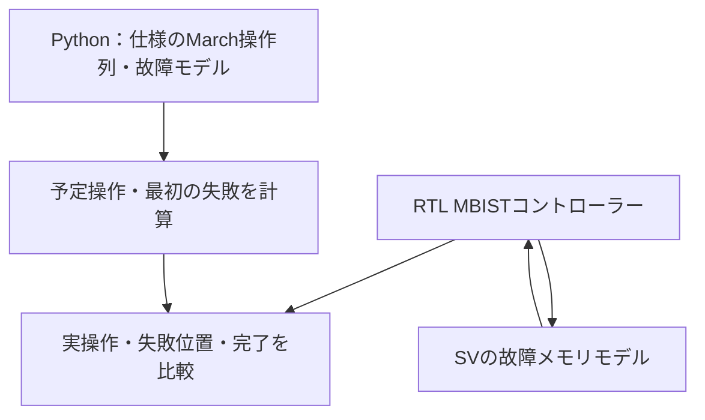
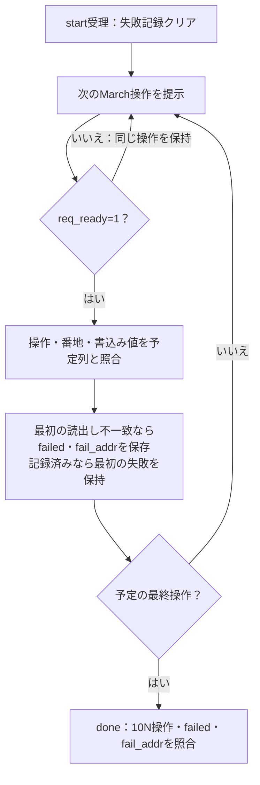

# March C−のMBISTとデジタル故障注入

1ビットのメモリセル8／16個を使い、March C−の各読書き、最初の不一致アドレス、試験完了と操作数を検証します。通常機能のECCとは異なり、記憶セルへの故障とテストアルゴリズムの検出を扱う教材です。

## 試験回路と独立モデル



| 順序 | アドレス方向 | セルごとの操作 |
| --- | --- | --- |
| 1 | 昇順 | w0 |
| 2 | 昇順 | r0、w1 |
| 3 | 昇順 | r1、w0 |
| 4 | 降順 | r0、w1 |
| 5 | 降順 | r1、w0 |
| 6 | 昇順 | r0 |

r0／r1は期待値0／1の読出し、w0／w1は書込みです。Nセルで10N回、メモリreadyによる待ちは操作数に含めません。不一致後も全操作を続け、最初の失敗位置を保持します。startはアイドル時だけ受理し、doneは次startまたはリセットまで保持します。試験はメモリ内容を破壊します。

## 最初の不一致を記録して全操作を続ける

1回の試行で注入する故障の種類は一つです。victimは対象セル、aggressorは別名化の対応先または結合故障を起こすセルを表します。

| fault | 注入モデル | 変える動作 | 照合する内容 |
| --- | --- | --- | --- |
| 0 | 故障なし | 通常の1ビット読書き | 全操作が一致し、failed=0 |
| 1 | 0／1固着 | victimをkindの値へ固定 | 独立モデルが求めた不一致と最初の番地 |
| 2 | 遷移故障 | victimでkindから反対値への遷移を阻止 | 0→1または1→0の書込み後の読出し |
| 3 | 別名化 | victimへの読書きをaggressorへ振り分け | 番地間の干渉と最初の不一致 |
| 4 | 反転結合 | aggressorへの0→1書込みでvictimを反転 | 指定した結合モデルの独立予測との一致 |



故障メモリで不一致が起きることと、検証が失敗することは別です。独立モデルどおりの故障検出なら通常試験は合格です。通知抑止などのRTL変異は、別の負の試験でチェッカーが拒否することを要求します。

## 故障モデルと判定

SVのモデルは、選んだセルの0／1固着、片方向への遷移阻止、2番地の別名化、選んだaggressorの0→1書込みによるvictim反転を注入します。結合故障はこの特定のモデルで、すべての結合故障を表しません。Pythonもセル配列へ故障を適用し、最初に不一致となるアドレスを独立に求めます。

SVではコントローラーの各受理操作を、Pythonの予定列と照合します。エラー通知だけでなく、10N操作、方向・番地・書込み値、first-fail、途中リセットからの再実行も要求します。9目標、失敗通知抑止・失敗番地破損・書込み値破損・早すぎる完了の4変異です。注入故障は通常の検証対象、変異は検証環境の検出力確認として分けます。

```sh
python3 examples/local-mbist/run.py --out artifacts/mbist
python3 examples/local-mbist/run.py --profile nightly
python3 -m unittest discover -s examples/local-mbist/tests -v
```

[共通手順](../local-common/README.md)を使います。smoke20試行、nightly120試行×3 seedに固定8試行を加えます。JUnit14／18件、確認5件。March C−の参考は[Microchip AN1229](https://ww1.microchip.com/downloads/en/AppNotes/01229B.pdf)です。アルゴリズムの一般的な記法を参考に新規作成し、製品ライブラリは転載しません。実SRAM、ワード指向への変換、ATPG、製造故障全体の検出率、機能安全認証の評価は含みません。
