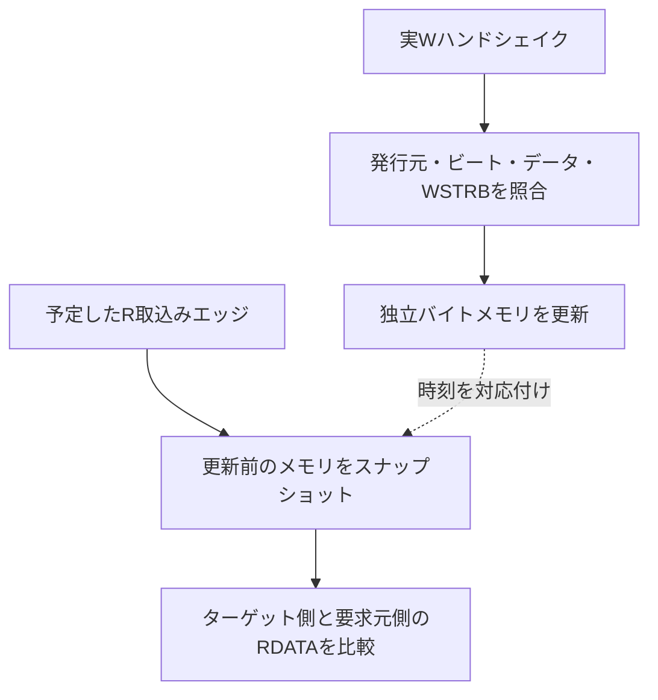

# 同一番地への複数マスターアクセスを検証する

[既存インターコネクト](../local-interconnect/README.md)で除外していた、書込み同士・読書きの同一領域競合を別の検証計画で扱います。RTLは同じ2マスター×2 AXI4 RAMを使い、元の例の除外方針は変更しません。

## 書込みの反映時点と読出し値の確定時点

ターゲットの実ハンドシェイクと読出し取込み時刻で、独立したバイトメモリを更新・参照します。



図の処理順は同一エッジ内のソフトウェア実行順ではありません。同一エッジでは必ず更新前の値を取り込みます。

| 確認する場面 | 期待する動作 | 主な照合対象 |
| --- | --- | --- |
| W受理 | 有効なバイトだけ反映 | データの出所も検査 |
| 同一エッジの読書き | 読出しは書込み前の値 | 本RAMの仕様で固定 |
| R応答の保留中 | スナップショットを保持 | 後続書込みで追従しない |

## このRAM構成の順序を定義する

期待値を「入力した要求の順」で先に決めることはしません。上位で受理した要求を独立台帳へ記録し、ターゲット側のAW／W／ARと応答を実際に観測して、次の仕様モデルを進めます。

- 書込みはターゲットのWハンドシェイクで、WSTRBに従ってバイト参照メモリへ反映します。
- 読出しはターゲットのAR受付後、RAMがRビートをレジスタへ取り込むエッジでスナップショットを作ります。
- 同じエッジの読出し取込みと書込みでは、読出しは**更新前**の値を取り込みます。
- RVALIDで保持している結果は、後続の書込みでメモリが変わっても更新しません。

読出し時刻は独立した予定時刻・ビート番号・VALID状態で管理し、DUTのメモリや読出しポインターを参照しません。既存RAMのRビート間の空きも照合します。ターゲットのタイミング契約を持つスコアボードであり、任意レイテンシのAXIターゲットへそのまま使えるものではありません。

書込みデータも、発行元のパターン・ビート番号・ストローブと照合してから参照メモリを更新します。誤ったDUT出力を期待値として取り込むことを防ぎます。RAM側だけでなく、要求元へ返るRVALID・RDATAも予定のスナップショットと照合します。接続途中のデータ破損も失敗です。ルーティング、ID、RESP、LASTと応答保持は元のポート検査も利用します。元の例と同じく、AW／ARの受付後は上流の番地・長さ・IDを別の値へ変えます。

## 試験

固定ケースは読出し前／後の書込み、同一エッジの競合、保留R応答中の書込み、2マスターの重なる部分書込み、ゼロWSTRB、書込み後の両マスターからの読出しです。両ターゲットで行い、ランダム検証では方向・長さ・ID・データ・マスク・開始遅延・応答待ちを変えます。

[要求カタログ](requirements.json)は2要求・9目標。ネガティブテストは、応答先・デコード先・Wデータの3種類のRTL変異と、同時エッジで書込みを先に反映する**誤った期待値モデル**1種類です。後者は正しいRTLを誤判定する例で、RTL変異の検出率に算入する意味ではありません。ランナーの変異件数は注入先を問わない検出確認件数です。

```sh
python3 examples/local-memory-order/run.py
python3 examples/local-memory-order/run.py --profile nightly
python3 -m unittest discover -s examples/local-memory-order/tests -v
```

[共通手順](../local-common/README.md)を利用します。構成は`two-by-two`、smokeは48ペア×1 seed、nightlyは500×3 seed。固定12ペアは別枠です。JUnitは7／9件です。セルフテスト6件には、ターゲットと要求元の間へ意図的にRDATA破損を入れる検出確認もあります。

これは本RAMの書込みの反映時点、読出し値の確定時点、ストローブ規則の検証です。AXIが全マスター間へ単一のメモリ順序を要求するという説明ではありません。キャッシュ整合性、メモリバリア、排他アクセス、アウトオブオーダー、動作中リセットの計画は含めません。一般規則は[Arm AXI仕様](https://documentation-service.arm.com/static/5f915b62f86e16515cdc3b1c)、対象回路の範囲は[元の接続例](../local-interconnect/README.md)を参照してください。
